import { Callout } from "fumadocs-ui/components/callout";
import { Tabs, Tab } from "fumadocs-ui/components/tabs";
import { Steps, Step } from "fumadocs-ui/components/steps";
import { Cards, Card } from "fumadocs-ui/components/card";

In computational geometry, determining whether a point lies to the left, to the right, or collinear with a directed line segment is the fundamental building block of segment intersection, polygon inclusion, and convex hulls.

Using trigonometric functions (such as `atan2` or division by slopes) introduces numerical precision errors, rounding artifacts, and division-by-zero crashes. Instead, computational geometry relies on the **2D Vector Cross Product**.

---

## 1. Mathematical Definition

Given three points $A(x_1, y_1)$, $B(x_2, y_2)$, and $C(x_3, y_3)$, form vectors:
$$\vec{AB} = (x_2 - x_1, \; y_2 - y_1)$$
$$\vec{AC} = (x_3 - x_1, \; y_3 - y_1)$$

The 2D cross product $\vec{AB} \times \vec{AC}$ corresponds to the determinant of the $2 \times 2$ matrix:

$$\text{Cross}(\vec{AB}, \vec{AC}) = (x_2 - x_1)(y_3 - y_1) - (y_2 - y_1)(x_3 - x_1)$$

```mermaid
flowchart LR
    CrossVal["Cross Product (AB x AC)"] --> Check{"Sign of Result"}
    Check -- "> 0" --> CCW["Counter-Clockwise (Left Turn)"]
    Check -- "< 0" --> CW["Clockwise (Right Turn)"]
    Check -- "== 0" --> Collinear["Collinear (Lies on the same line)"]

    style CrossVal fill:#0f172a,stroke:#38bdf8,stroke-width:2px
    style CCW fill:#064e3b,stroke:#34d399,stroke-width:1px
    style CW fill:#1e1b4b,stroke:#818cf8,stroke-width:1px
    style Collinear fill:#1e293b,stroke:#f59e0b,stroke-width:1px
```



---

## 2. Implementation

<Tabs items={["Python", "TypeScript", "C++"]}>
<Tab value="Python">
```python
class Point:
    def __init__(self, x: int, y: int):
        self.x = x
        self.y = y

def orientation(a: Point, b: Point, c: Point) -> int:
"""
Returns:
1 if counter-clockwise (left turn)
-1 if clockwise (right turn)
0 if collinear
"""
cross = (b.x - a.x) _ (c.y - a.y) - (b.y - a.y) _ (c.x - a.x)
if cross > 0:
return 1
elif cross < 0:
return -1
return 0

````
</Tab>
<Tab value="TypeScript">
```typescript
export interface Point {
  x: number;
  y: number;
}

export function orientation(a: Point, b: Point, c: Point): number {
  const cross = (b.x - a.x) * (c.y - a.y) - (b.y - a.y) * (c.x - a.x);
  if (cross > 0) return 1;   // Counter-clockwise
  if (cross < 0) return -1;  // Clockwise
  return 0;                  // Collinear
}
````

</Tab>
<Tab value="C++">
```cpp
struct Point {
    long long x, y;
};

// Returns 1 (CCW), -1 (CW), or 0 (Collinear)
int orientation(const Point& a, const Point& b, const Point& c) {
long long cross = (b.x - a.x) _ (c.y - a.y) - (b.y - a.y) _ (c.x - a.x);
if (cross > 0) return 1;
if (cross < 0) return -1;
return 0;
}

```
</Tab>
</Tabs>
```
