import { Callout } from "fumadocs-ui/components/callout";
import { Tabs, Tab } from "fumadocs-ui/components/tabs";
import { Steps, Step } from "fumadocs-ui/components/steps";
import { Cards, Card } from "fumadocs-ui/components/card";

The **Principle of Inclusion-Exclusion (PIE)** is a fundamental combinatorial theorem that calculates the size of the union of multiple non-disjoint sets:

$$\left| \bigcup_{i=1}^n A_i \right| = \sum_{k=1}^n (-1)^{k-1} \sum_{1 \le i_1 < \dots < i_k \le n} |A_{i_1} \cap \dots \cap A_{i_k}|$$

- **Include** single sets.
- **Exclude** pairwise intersections.
- **Include** triple intersections.
- Continue alternating signs until all combinations are processed.

```mermaid
flowchart TD
    AddSingle["+ Sum of single set sizes |A_i|"]
    SubDouble["- Sum of pairwise intersections |A_i ∩ A_j|"]
    AddTriple["+ Sum of triple intersections |A_i ∩ A_j ∩ A_k|"]
    FinalUnion["= Cardinality of Union |A1 ∪ A2 ∪ ...|"]

    AddSingle --> SubDouble --> AddTriple --> FinalUnion

    style AddSingle fill:#0f172a,stroke:#38bdf8,stroke-width:2px
    style SubDouble fill:#1e1b4b,stroke:#818cf8,stroke-width:1px
    style AddTriple fill:#064e3b,stroke:#34d399,stroke-width:1px
```



---

## 1. Application: Count Integers in $[1, N]$ Divisible by a Set of Primes

<Tabs items={["Python", "TypeScript", "C++"]}>
<Tab value="Python">
```python
def count_divisible_by_primes(n: int, primes: list[int]) -> int:
    """Counts integers in [1, n] divisible by at least one prime in O(2^k)."""
    k = len(primes)
    total = 0

    # Iterate over all non-empty subsets using bitmasks
    for mask in range(1, 1 << k):
        prod = 1
        bits = 0
        overflow = False
        for i in range(k):
            if (mask >> i) & 1:
                prod *= primes[i]
                bits += 1
                if prod > n:
                    overflow = True
                    break

        if not overflow:
            count = n // prod
            if bits % 2 == 1:
                total += count  # Odd subset size: add
            else:
                total -= count  # Even subset size: subtract

    return total

````
</Tab>
<Tab value="TypeScript">
```typescript
export function countDivisibleByPrimes(n: number, primes: number[]): number {
  const k = primes.length;
  let total = 0;

  for (let mask = 1; mask < 1 << k; mask++) {
    let prod = 1;
    let bits = 0;
    let overflow = false;

    for (let i = 0; i < k; i++) {
      if ((mask >> i) & 1) {
        prod *= primes[i];
        bits++;
        if (prod > n) {
          overflow = true;
          break;
        }
      }
    }

    if (!overflow) {
      const count = Math.floor(n / prod);
      total += bits % 2 === 1 ? count : -count;
    }
  }

  return total;
}
````

</Tab>
<Tab value="C++">
```cpp
#include <vector>

long long countDivisibleByPrimes(long long n, const std::vector<long long>& primes) {
int k = static_cast<int>(primes.size());
long long total = 0;

    for (int mask = 1; mask < (1 << k); ++mask) {
        long long prod = 1;
        int bits = 0;
        bool overflow = false;

        for (int i = 0; i < k; ++i) {
            if ((mask >> i) & 1) {
                if (n / primes[i] < prod) {
                    overflow = true;
                    break;
                }
                prod *= primes[i];
                ++bits;
            }
        }

        if (!overflow) {
            long long count = n / prod;
            total += (bits % 2 == 1) ? count : -count;
        }
    }

    return total;

}

```
</Tab>
</Tabs>
```
