import { Callout } from "fumadocs-ui/components/callout";
import { Tabs, Tab } from "fumadocs-ui/components/tabs";
import { Steps, Step } from "fumadocs-ui/components/steps";
import { Cards, Card } from "fumadocs-ui/components/card";

Computational Geometry and Number Theory form the mathematical engine of modern computer graphics, robotics, geographic information systems (GIS), collision engines, and cryptography.

These disciplines share a common paradigm: **replacing brute-force continuous simulations with exact discrete invariants**:

- **Geometry**: Using vector cross products to avoid fragile floating-point angle trigonometry and division-by-zero errors.
- **Number Theory**: Leveraging modular structures, Bézout identities, multiplicative arithmetic functions, and algebraic matrix exponentiation to solve recurrences in logarithmic time.

```mermaid
flowchart TD
    subgraph GeoNTSuite["Geometry & Number Theory Primitives"]
        direction TB
        Orientation["Cross Product & Orientation<br/>2D vector determinant: ccw / cw / collinear<br/>Exact integer arithmetic (no floats)"]
        HullSweep["Geometric Sweeps & Convex Hulls<br/>Andrew's Monotone Chain O(N log N)<br/>Sweep-line event ordering"]
        NumberTheory["Modular & Diophantine Solvers<br/>Extended GCD: a·x + b·y = gcd(a, b)<br/>Euler's Totient φ(N) & Totient Sieve"]
        MatrixExp["Matrix Exponentiation<br/>Transition state matrices<br/>O(K³ log N) recurrence solving"]
    end

    Orientation --> HullSweep
    HullSweep --> NumberTheory
    NumberTheory --> MatrixExp

    style GeoNTSuite fill:#0f172a,stroke:#38bdf8,stroke-width:2px
    style Orientation fill:#1e293b,stroke:#10b981,stroke-width:1px
    style HullSweep fill:#1e293b,stroke:#f59e0b,stroke-width:1px
    style NumberTheory fill:#1e293b,stroke:#8b5cf6,stroke-width:1px
    style MatrixExp fill:#1e293b,stroke:#ec4899,stroke-width:1px
```

---

## Complexity & Primitive Comparison

| Primitive / Algorithm         | Category       | Time Complexity                                   | Auxiliary Space    | Key Invariant                            |
| :---------------------------- | :------------- | :------------------------------------------------ | :----------------- | :--------------------------------------- |
| **2D Cross Product**          | Geometry       | $\mathcal{O}(1)$                                  | $\mathcal{O}(1)$   | Signed parallelogram area & orientation  |
| **Segment Intersection**      | Geometry       | $\mathcal{O}(1)$                                  | $\mathcal{O}(1)$   | Straddle condition & bounding box checks |
| **Shoelace Polygon Area**     | Geometry       | $\mathcal{O}(N)$                                  | $\mathcal{O}(1)$   | Gauss trapezoid summation formula        |
| **Sweep Line Algorithm**      | Geometry       | $\mathcal{O}(N \log N)$                           | $\mathcal{O}(N)$   | Dynamic active status with balanced BST  |
| **Andrew's Convex Hull**      | Geometry       | $\mathcal{O}(N \log N)$                           | $\mathcal{O}(N)$   | Lexicographical sort + upper/lower hulls |
| **Extended Euclidean**        | Number Theory  | $\mathcal{O}(\log(\min(a, b)))$                   | $\mathcal{O}(1)$   | Bézout identity $ax + by = \gcd(a, b)$   |
| **Euler's Totient $\phi(N)$** | Number Theory  | $\mathcal{O}(\sqrt{N})$ or $\mathcal{O}(N)$ sieve | $\mathcal{O}(1)$   | Coprime counting: $N \prod (1 - 1/p)$    |
| **Inclusion-Exclusion**       | Combinatorics  | $\mathcal{O}(2^K)$                                | $\mathcal{O}(K)$   | Alternating sum of subset intersections  |
| **Matrix Exponentiation**     | Linear Algebra | $\mathcal{O}(K^3 \log N)$                         | $\mathcal{O}(K^2)$ | Fast binary power transitions            |

---

## Section Topics

<Cards>
  <Card
    title="Cross Product & Orientation"
    href="./computational-geometry-and-number-theory/cross-product-and-orientation"
    icon="Compass"
  >
    2D cross product primitives, collinearity tests, and signed triangle areas.
  </Card>
  <Card
    title="Line Segment Intersection"
    href="./computational-geometry-and-number-theory/line-segment-intersection"
    icon="X"
  >
    Robust intersection tests using cross products and bounding box projections.
  </Card>
  <Card
    title="Polygon Area (Shoelace Formula)"
    href="./computational-geometry-and-number-theory/polygon-area"
    icon="Square"
  >
    Calculate arbitrary non-self-intersecting polygon areas in linear time.
  </Card>
  <Card
    title="Sweep Line Algorithms"
    href="./computational-geometry-and-number-theory/sweep-line-algorithms"
    icon="ScanLine"
  >
    Sort geometric events along an axis and maintain active geometric frontiers.
  </Card>
  <Card
    title="Two-Dimensional Convex Hull"
    href="./computational-geometry-and-number-theory/convex-hull-2d"
    icon="Shield"
  >
    Andrew's Monotone Chain and Graham Scan in O(N log N) time.
  </Card>
  <Card
    title="Extended Euclidean Algorithm"
    href="./computational-geometry-and-number-theory/extended-euclidean-algorithm"
    icon="Divide"
  >
    Solve linear Diophantine equations and compute modular multiplicative
    inverses.
  </Card>
  <Card
    title="Euler's Totient Function"
    href="./computational-geometry-and-number-theory/eulers-totient-function"
    icon="Percent"
  >
    Count coprime residues via prime factorizations and linear totient sieves.
  </Card>
  <Card
    title="Inclusion-Exclusion Principle"
    href="./computational-geometry-and-number-theory/inclusion-exclusion-principle"
    icon="Combine"
  >
    Calculate set union cardinalities and solve coprime counting problems.
  </Card>
  <Card
    title="Matrix Exponentiation"
    href="./computational-geometry-and-number-theory/matrix-exponentiation"
    icon="Grid3X3"
  >
    Accelerate linear dynamic programming recurrences to O(K³ log N) time.
  </Card>
</Cards>
