import { Callout } from "fumadocs-ui/components/callout";
import { Tabs, Tab } from "fumadocs-ui/components/tabs";
import { Steps, Step } from "fumadocs-ui/components/steps";
import { Cards, Card } from "fumadocs-ui/components/card";

Two line segments $S_1 = AB$ and $S_2 = CD$ intersect if and only if:

1. **General Case (Straddle Test)**:
   - Points $C$ and $D$ lie on **opposite sides** of line $AB$ (i.e., $\text{orientation}(A, B, C) \ne \text{orientation}(A, B, D)$), AND
   - Points $A$ and $B$ lie on **opposite sides** of line $CD$ (i.e., $\text{orientation}(C, D, A) \ne \text{orientation}(C, D, B)$).
2. **Collinear Edge Case**: If points are collinear, their bounding boxes must overlap in both $X$ and $Y$ projections.

```mermaid
flowchart LR
    S1["Segment AB"]
    S2["Segment CD"]
    Straddle["Straddle Test:<br/>orient(A, B, C) != orient(A, B, D) AND<br/>orient(C, D, A) != orient(C, D, B)"]
    CollinearCheck["Collinear Check:<br/>orient == 0 AND OnSegment(P, Q, R)"]

    S1 & S2 --> Straddle
    Straddle -- "Passes" --> Intersect["Segments Intersect"]
    Straddle -- "Collinear (0)" --> CollinearCheck
    CollinearCheck -- "Box overlaps" --> Intersect
    CollinearCheck -- "No overlap" --> NoIntersect["No Intersection"]

    style Straddle fill:#0f172a,stroke:#38bdf8,stroke-width:2px
    style Intersect fill:#064e3b,stroke:#34d399,stroke-width:2px
```



---

## 1. Implementation

<Tabs items={["Python", "TypeScript", "C++"]}>
<Tab value="Python">
```python
class Point:
    def __init__(self, x: int, y: int):
        self.x, self.y = x, y

def orientation(a: Point, b: Point, c: Point) -> int:
val = (b.x - a.x) _ (c.y - a.y) - (b.y - a.y) _ (c.x - a.x)
if val > 0: return 1
if val < 0: return -1
return 0

def on_segment(p: Point, q: Point, r: Point) -> bool:
"""Checks if point q lies on segment pr given p, q, r are collinear."""
return (min(p.x, r.x) <= q.x <= max(p.x, r.x) and
min(p.y, r.y) <= q.y <= max(p.y, r.y))

def do_intersect(p1: Point, q1: Point, p2: Point, q2: Point) -> bool:
o1 = orientation(p1, q1, p2)
o2 = orientation(p1, q1, q2)
o3 = orientation(p2, q2, p1)
o4 = orientation(p2, q2, q1)

    # General straddle case
    if o1 != o2 and o3 != o4:
        return True

    # Special collinear cases
    if o1 == 0 and on_segment(p1, p2, q1): return True
    if o2 == 0 and on_segment(p1, q2, q1): return True
    if o3 == 0 and on_segment(p2, p1, q2): return True
    if o4 == 0 and on_segment(p2, q1, q2): return True

    return False

````
</Tab>
<Tab value="TypeScript">
```typescript
export interface Point {
  x: number;
  y: number;
}

function orientation(a: Point, b: Point, c: Point): number {
  const val = (b.x - a.x) * (c.y - a.y) - (b.y - a.y) * (c.x - a.x);
  if (val > 0) return 1;
  if (val < 0) return -1;
  return 0;
}

function onSegment(p: Point, q: Point, r: Point): boolean {
  return (
    Math.min(p.x, r.x) <= q.x && q.x <= Math.max(p.x, r.x) &&
    Math.min(p.y, r.y) <= q.y && q.y <= Math.max(p.y, r.y)
  );
}

export function doIntersect(p1: Point, q1: Point, p2: Point, q2: Point): boolean {
  const o1 = orientation(p1, q1, p2);
  const o2 = orientation(p1, q1, q2);
  const o3 = orientation(p2, q2, p1);
  const o4 = orientation(p2, q2, q1);

  if (o1 !== o2 && o3 !== o4) return true;

  if (o1 === 0 && onSegment(p1, p2, q1)) return true;
  if (o2 === 0 && onSegment(p1, q2, q1)) return true;
  if (o3 === 0 && onSegment(p2, p1, q2)) return true;
  if (o4 === 0 && onSegment(p2, q1, q2)) return true;

  return false;
}
````

</Tab>
<Tab value="C++">
```cpp
#include <algorithm>

struct Point {
long long x, y;
};

int orientation(const Point& a, const Point& b, const Point& c) {
long long val = (b.x - a.x) _ (c.y - a.y) - (b.y - a.y) _ (c.x - a.x);
if (val > 0) return 1;
if (val < 0) return -1;
return 0;
}

bool onSegment(const Point& p, const Point& q, const Point& r) {
return q.x >= std::min(p.x, r.x) && q.x <= std::max(p.x, r.x) &&
q.y >= std::min(p.y, r.y) && q.y <= std::max(p.y, r.y);
}

bool doIntersect(const Point& p1, const Point& q1, const Point& p2, const Point& q2) {
int o1 = orientation(p1, q1, p2);
int o2 = orientation(p1, q1, q2);
int o3 = orientation(p2, q2, p1);
int o4 = orientation(p2, q2, q1);

    if (o1 != o2 && o3 != o4) return true;

    if (o1 == 0 && onSegment(p1, p2, q1)) return true;
    if (o2 == 0 && onSegment(p1, q2, q1)) return true;
    if (o3 == 0 && onSegment(p2, p1, q2)) return true;
    if (o4 == 0 && onSegment(p2, q1, q2)) return true;

    return false;

}

```
</Tab>
</Tabs>
```
