import { Callout } from "fumadocs-ui/components/callout";
import { Tabs, Tab } from "fumadocs-ui/components/tabs";
import { Steps, Step } from "fumadocs-ui/components/steps";
import { Cards, Card } from "fumadocs-ui/components/card";

The **Sweep Line technique** solves two-dimensional geometric problems by sweeping an imaginary vertical line across the plane from left to right ($x = -\infty \to +\infty$).

As the line moves, the 2D problem reduces to maintaining a **1D dynamic active state** (cross-sections of geometric objects currently intersected by the sweep line) using a balanced search tree.

---

## 1. Event-Driven Architecture

Instead of continuously moving the sweep line, the line only stops at discrete **Event Points**:

1. **Start Events**: Geometric object becomes active (inserted into the active set).
2. **End Events**: Geometric object finishes (removed from the active set).
3. **Intersection Events**: Two objects cross each other (swapping order in the active set).

```mermaid
flowchart LR
    SortEvents["1. Sort Event Points by X-coordinate in O(N log N)"]
    ProcessEvents["2. Process Events Left-to-Right"]
    StartEvent["Start: Insert into Active BST"]
    EndEvent["End: Remove from Active BST"]

    SortEvents --> ProcessEvents
    ProcessEvents --> StartEvent
    ProcessEvents --> EndEvent

    style SortEvents fill:#0f172a,stroke:#38bdf8,stroke-width:2px
    style ProcessEvents fill:#064e3b,stroke:#34d399,stroke-width:2px
```



---

## 2. Canonical Application: Skyline Problem

Given buildings represented as triples $(L_i, R_i, H_i)$, find the collective skyline contour.

<Tabs items={["Python", "TypeScript", "C++"]}>
<Tab value="Python">
```python
import heapq

def get_skyline(buildings: list[list[int]]) -> list[list[int]]:
"""Computes skyline contour in O(N log N) using a sweep line."""
events = []
for l, r, h in buildings:
events.append((l, -h, r)) # start: negative height for max-heap
events.append((r, 0, 0)) # end

    events.sort()
    # Heap stores (-height, right_edge)
    live = [(0, float('inf'))]
    res = [[0, 0]]

    for x, neg_h, r in events:
        if neg_h != 0:
            heapq.heappush(live, (neg_h, r))
        # Remove expired buildings
        while live[0][1] <= x:
            heapq.heappop(live)
        curr_h = -live[0][0]
        if res[-1][1] != curr_h:
            res.append([x, curr_h])

    return res[1:]

````
</Tab>
<Tab value="TypeScript">
```typescript
export function getSkyline(buildings: [number, number, number][]): [number, number][] {
  // Event: [x, height (positive for start, negative for end)]
  const events: [number, number][] = [];
  for (const [l, r, h] of buildings) {
    events.push([l, -h]); // start
    events.push([r, h]);  // end
  }

  // Sort events: primary x asc, secondary height asc
  events.sort((a, b) => (a[0] !== b[0] ? a[0] - b[0] : a[1] - b[1]));

  const heights: number[] = [0];
  let prevMax = 0;
  const result: [number, number][] = [];

  for (const [x, h] of events) {
    if (h < 0) {
      // Start event: add height
      heights.push(-h);
      heights.sort((a, b) => b - a);
    } else {
      // End event: remove height
      const idx = heights.indexOf(h);
      if (idx !== -1) heights.splice(idx, 1);
    }

    const currMax = heights[0];
    if (currMax !== prevMax) {
      result.push([x, currMax]);
      prevMax = currMax;
    }
  }

  return result;
}
````

</Tab>
<Tab value="C++">
```cpp
#include <vector>
#include <set>
#include <algorithm>

std::vector<std::vector<int>> getSkyline(std::vector<std::vector<int>>& buildings) {
std::vector<std::pair<int, int>> events;
for (const auto& b : buildings) {
events.emplace_back(b[0], -b[2]); // start
events.emplace_back(b[1], b[2]); // end
}

    std::sort(events.begin(), events.end());
    std::multiset<int> heights = {0};
    int prevMax = 0;
    std::vector<std::vector<int>> result;

    for (const auto& [x, h] : events) {
        if (h < 0) {
            heights.insert(-h);
        } else {
            heights.erase(heights.find(h));
        }

        int currMax = *heights.rbegin();
        if (currMax != prevMax) {
            result.push_back({x, currMax});
            prevMax = currMax;
        }
    }

    return result;

}

```
</Tab>
</Tabs>
```
