import { Callout } from "fumadocs-ui/components/callout";
import { Tabs, Tab } from "fumadocs-ui/components/tabs";
import { Steps, Step } from "fumadocs-ui/components/steps";
import { Cards, Card } from "fumadocs-ui/components/card";

The **Binary Indexed Tree (BIT)**, invented by Peter Fenwick in 1994, is an array-based data structure that supports:

- **Point updates**: Modifying an element $A[i]$ in $\mathcal{O}(\log N)$ time.
- **Prefix sum queries**: Computing $\sum_{k=1}^i A[k]$ in $\mathcal{O}(\log N)$ time.
- **Range sum queries**: Computing $\sum_{k=L}^R A[k] = \text{prefix}(R) - \text{prefix}(L - 1)$ in $\mathcal{O}(\log N)$ time.

Unlike Segment Trees which require $4N$ memory and explicit tree recursion or branch logic, a Fenwick Tree uses exactly $N$ auxiliary words and executes using blazing-fast bitwise arithmetic.

---

## 1. Bitwise Mechanics: The Lowest Set Bit (`LSB`)

The entire magic of Fenwick Trees revolves around the **Least Significant Bit (LSB)**:

$$\text{LSB}(x) = x \;\&\; (-x)$$

In two's complement binary representation, $-x = (\sim x) + 1$. Thus, bitwise ANDing $x$ with $-x$ isolates the lowest set bit.

```
Example with x = 12:
  12 in binary:       0000 1100
 -12 (two's comp):    1111 0100
 12 & (-12):          0000 0100  --> isolates 4
```

### Responsibility Range

In a 1-indexed Fenwick Tree, index $i$ stores the sum of elements in the contiguous half-open interval:

$$(i - \text{LSB}(i), \; i]$$

The length of this interval is exactly $\text{LSB}(i)$:

- Index $1$ ($0001_2, \text{LSB}=1$): covers $(0, 1] \implies A[1]$
- Index $2$ ($0010_2, \text{LSB}=2$): covers $(0, 2] \implies A[1] + A[2]$
- Index $4$ ($0100_2, \text{LSB}=4$): covers $(0, 4] \implies A[1] + A[2] + A[3] + A[4]$
- Index $6$ ($0110_2, \text{LSB}=2$): covers $(4, 6] \implies A[5] + A[6]$
- Index $8$ ($1000_2, \text{LSB}=8$): covers $(0, 8] \implies A[1] + \dots + A[8]$

```mermaid
flowchart TD
    subgraph FenwickIntervals["Fenwick Node Responsibilities"]
        T8["Tree[8]: Range [1 .. 8] (LSB = 8)"]
        T4["Tree[4]: Range [1 .. 4] (LSB = 4)"]
        T6["Tree[6]: Range [5 .. 6] (LSB = 2)"]
        T2["Tree[2]: Range [1 .. 2] (LSB = 2)"]
        T1["Tree[1]: [1] (LSB = 1)"]
        T3["Tree[3]: [3] (LSB = 1)"]
        T5["Tree[5]: [5] (LSB = 1)"]
        T7["Tree[7]: [7] (LSB = 1)"]
    end

    T8 --> T4
    T8 --> T6
    T4 --> T2
    T2 --> T1
    T4 --> T3
    T6 --> T5
    T8 --> T7

    style FenwickIntervals fill:#0f172a,stroke:#38bdf8,stroke-width:2px
    style T8 fill:#1e293b,stroke:#10b981,stroke-width:2px
    style T4 fill:#1e293b,stroke:#8b5cf6,stroke-width:2px
```



---

## 2. Navigating the Tree

1. **Prefix Query($i$)**: Accumulate `tree[i]` and strip the lowest set bit:
   `i -= i & (-i)` until $i = 0$.
2. **Point Update($i, \Delta$)**: Add $\Delta$ to `tree[i]` and propagate to parent containers by adding the lowest set bit:
   `i += i & (-i)` until $i > N$.

Both traversals visit at most $\lfloor \log_2 N \rfloor + 1$ nodes, guaranteeing strictly $\mathcal{O}(\log N)$ runtime.

---

## 3. Implementation

<Tabs items={["Python", "TypeScript", "C++"]}>
<Tab value="Python">
```python
class FenwickTree:
    def __init__(self, n: int):
        self.n = n
        self.tree = [0] * (n + 1)

    @classmethod
    def from_array(cls, arr: list[int]):
        """Constructs Fenwick tree in O(N) linear time."""
        ft = cls(len(arr))
        for i in range(1, ft.n + 1):
            ft.tree[i] += arr[i - 1]
            parent = i + (i & -i)
            if parent <= ft.n:
                ft.tree[parent] += ft.tree[i]
        return ft

    def add(self, idx: int, delta: int) -> None:
        """1-based point update: arr[idx] += delta."""
        while idx <= self.n:
            self.tree[idx] += delta
            idx += idx & -idx

    def prefix_sum(self, idx: int) -> int:
        """Computes sum of arr[1 .. idx]."""
        total = 0
        while idx > 0:
            total += self.tree[idx]
            idx -= idx & -idx
        return total

    def range_sum(self, left: int, right: int) -> int:
        """Computes sum in range [left, right] 1-based inclusive."""
        if left > right:
            return 0
        return self.prefix_sum(right) - self.prefix_sum(left - 1)

````
</Tab>
<Tab value="TypeScript">
```typescript
export class FenwickTree {
  private n: number;
  private tree: Float64Array;

  constructor(n: number) {
    this.n = n;
    this.tree = new Float64Array(n + 1);
  }

  static fromArray(arr: number[]): FenwickTree {
    const ft = new FenwickTree(arr.length);
    for (let i = 1; i <= ft.n; i++) {
      ft.tree[i] += arr[i - 1];
      const parent = i + (i & -i);
      if (parent <= ft.n) {
        ft.tree[parent] += ft.tree[i];
      }
    }
    return ft;
  }

  add(idx: number, delta: number): void {
    while (idx <= this.n) {
      this.tree[idx] += delta;
      idx += idx & -idx;
    }
  }

  prefixSum(idx: number): number {
    let total = 0;
    while (idx > 0) {
      total += this.tree[idx];
      idx -= idx & -idx;
    }
    return total;
  }

  rangeSum(left: number, right: number): number {
    if (left > right) return 0;
    return this.prefixSum(right) - this.prefixSum(left - 1);
  }
}
````

</Tab>
<Tab value="C++">
```cpp
#include <vector>

class FenwickTree {
private:
int n;
std::vector<long long> tree;

public:
explicit FenwickTree(int n) : n(n), tree(n + 1, 0) {}

    static FenwickTree from_array(const std::vector<long long>& arr) {
        int n = static_cast<int>(arr.size());
        FenwickTree ft(n);
        for (int i = 1; i <= n; ++i) {
            ft.tree[i] += arr[i - 1];
            int parent = i + (i & -i);
            if (parent <= n) {
                ft.tree[parent] += ft.tree[i];
            }
        }
        return ft;
    }

    void add(int idx, long long delta) {
        for (; idx <= n; idx += idx & -idx) {
            tree[idx] += delta;
        }
    }

    long long prefix_sum(int idx) const {
        long long total = 0;
        for (; idx > 0; idx -= idx & -idx) {
            total += tree[idx];
        }
        return total;
    }

    long long range_sum(int left, int right) const {
        if (left > right) return 0;
        return prefix_sum(right) - prefix_sum(left - 1);
    }

};

```
</Tab>
</Tabs>

---

## 4. Classic Application: Inversion Counting

An inversion in an array $A$ is a pair of indices $(i, j)$ such that $i < j$ and $A[i] > A[j]$.
By inserting elements into a Fenwick tree over coordinate-compressed values in reverse order, counting inversions takes $\mathcal{O}(N \log N)$ time and $\mathcal{O}(N)$ space.
```
