import { Callout } from "fumadocs-ui/components/callout";
import { Tabs, Tab } from "fumadocs-ui/components/tabs";
import { Steps, Step } from "fumadocs-ui/components/steps";
import { Cards, Card } from "fumadocs-ui/components/card";

Disjoint Set Union (DSU), also known as the **Union-Find data structure**, tracks a collection of elements partitioned into non-overlapping (disjoint) subsets. It maintains dynamic equivalence relations across elements and supports two core primitives:

1. **Find($x$)**: Determines which subset an element $x$ belongs to by returning the unique canonical representative (root) of its set.
2. **Union($x, y$)**: Merges the subset containing element $x$ with the subset containing element $y$.

DSU is the computational engine powering Kruskal's Minimum Spanning Tree algorithm, network partition detection, connected component clustering in image processing, and incremental cycle detection in dynamic undirected graphs.

---

## 1. Mathematical Model: Equivalence Classes & Partition Forest

Let universe $S = \{0, 1, 2, \dots, N-1\}$. A partition of $S$ is a set of non-empty disjoint subsets whose union equals $S$:

$$S = C_1 \cup C_2 \cup \dots \cup C_k, \quad \text{where } C_i \cap C_j = \emptyset \; (\forall i \ne j)$$

DSU models each subset as a rooted directed tree:

- Each node stores a pointer to its **parent**: `parent[i]`.
- A node $r$ is the **representative (root)** if and only if `parent[r] == r`.
- Two elements $u$ and $v$ belong to the same connected component if and only if $\text{Find}(u) = \text{Find}(v)$.

```mermaid
flowchart TD
    subgraph ComponentA["Component Alpha (Representative: 0)"]
        N0["0 (Root)"] --> N0
        N1["1"] --> N0
        N2["2"] --> N0
        N3["3"] --> N1
    end

    subgraph ComponentB["Component Beta (Representative: 4)"]
        N4["4 (Root)"] --> N4
        N5["5"] --> N4
        N6["6"] --> N5
    end

    style ComponentA fill:#0f172a,stroke:#38bdf8,stroke-width:2px
    style ComponentB fill:#1e293b,stroke:#10b981,stroke-width:2px
```



---

## 2. Naive Implementation & The Degenerate Tree Problem

In a naive DSU implementation without tree balancing or path compression:

- `find(i)` recursively follows `parent[i]` until it reaches a node where `parent[r] == r`.
- `union(u, v)` finds the roots $r_u = \text{find}(u)$ and $r_v = \text{find}(v)$, then arbitrarily links one root to the other: `parent[ru] = rv`.

<Callout type="warn" title="Degeneration to Linked Lists">
  Without optimization, a sequence of unions such as `union(0, 1)`, `union(1,
  2)`, ..., `union(N-1, N)` creates a degenerate linear tree of depth $N$. In
  this worst case: - $\text{Find}(x)$ degrades to $\mathcal{O}(N)$ time. -
  Processing $M$ operations over $N$ elements requires $\mathcal{O}(M \cdot N)$
  time, completely unacceptable for competitive programming and production graph
  systems.
</Callout>

---

## 3. Implementation

Below is the standard Disjoint Set Union implementation with basic parent pointer tracking.

<Tabs items={["Python", "TypeScript", "C++"]}>
<Tab value="Python">
```python
class DisjointSetUnion:
    def __init__(self, n: int):
        # Initially, each element is its own representative
        self.parent = list(range(n))
        self.num_components = n

    def find(self, i: int) -> int:
        curr = i
        while self.parent[curr] != curr:
            curr = self.parent[curr]
        return curr

    def union(self, i: int, j: int) -> bool:
        root_i = self.find(i)
        root_j = self.find(j)
        if root_i == root_j:
            return False  # Already in same subset (cycle detected)

        # Link root_i under root_j
        self.parent[root_i] = root_j
        self.num_components -= 1
        return True

    def connected(self, i: int, j: int) -> bool:
        return self.find(i) == self.find(j)

````
</Tab>
<Tab value="TypeScript">
```typescript
export class DisjointSetUnion {
  private parent: number[];
  private components: number;

  constructor(n: number) {
    this.parent = Array.from({ length: n }, (_, i) => i);
    this.components = n;
  }

  find(i: number): number {
    let curr = i;
    while (this.parent[curr] !== curr) {
      curr = this.parent[curr];
    }
    return curr;
  }

  union(i: number, j: number): boolean {
    const rootI = this.find(i);
    const rootJ = this.find(j);
    if (rootI === rootJ) return false;

    this.parent[rootI] = rootJ;
    this.components--;
    return true;
  }

  connected(i: number, j: number): boolean {
    return this.find(i) === this.find(j);
  }

  get componentCount(): number {
    return this.components;
  }
}
````

</Tab>
<Tab value="C++">
```cpp
#include <vector>
#include <numeric>

class DisjointSetUnion {
private:
std::vector<int> parent;
int components;

public:
explicit DisjointSetUnion(int n) : parent(n), components(n) {
std::iota(parent.begin(), parent.end(), 0);
}

    int find(int i) {
        int curr = i;
        while (parent[curr] != curr) {
            curr = parent[curr];
        }
        return curr;
    }

    bool unite(int i, int j) {
        int root_i = find(i);
        int root_j = find(j);
        if (root_i == root_j) return false;

        parent[root_i] = root_j;
        --components;
        return true;
    }

    bool connected(int i, int j) {
        return find(i) == find(j);
    }

    int count() const {
        return components;
    }

};

```
</Tab>
</Tabs>

---

## 4. Complexity Comparison

| Operation | Naive DSU | With Path Compression & Union by Rank |
| :--- | :--- | :--- |
| **Find($x$)** | $\mathcal{O}(N)$ worst-case | $\mathcal{O}(\alpha(N)) \approx \mathcal{O}(1)$ |
| **Union($x, y$)** | $\mathcal{O}(N)$ worst-case | $\mathcal{O}(\alpha(N)) \approx \mathcal{O}(1)$ |
| **Connected($x, y$)** | $\mathcal{O}(N)$ worst-case | $\mathcal{O}(\alpha(N)) \approx \mathcal{O}(1)$ |
| **Auxiliary Space** | $\mathcal{O}(N)$ | $\mathcal{O}(N)$ |

To unlock true near-linear performance, proceed to the next guide: **Path Compression and Union by Rank or Size**.
```
