import { Callout } from "fumadocs-ui/components/callout";
import { Tabs, Tab } from "fumadocs-ui/components/tabs";
import { Steps, Step } from "fumadocs-ui/components/steps";
import { Cards, Card } from "fumadocs-ui/components/card";

## The Power of Sub-Linear Interval and Partition Queries

In large-scale systems and algorithmic competitions, querying or mutating contiguous intervals and tracking dynamic equivalence classes are pervasive bottlenecks. Naive linear scans $\mathcal{O}(N)$ fail when processing millions of dynamic operations per second.

Range query data structures and Disjoint Set systems compress linear coordinate spaces into hierarchical and binary-decomposed structures, driving lookup and modification costs down to logarithmic $\mathcal{O}(\log N)$ or near-constant $\mathcal{O}(\alpha(N))$ time.

```mermaid
flowchart TD
    subgraph RangeQueryHierarchy["Range Query & Partition Structures"]
        direction TB
        DSU["Disjoint Set Union (DSU)<br/>Equivalence Classes & Cycles<br/>O(α(N)) operations"]
        ST["Sparse Table<br/>Static Idempotent Queries (RMQ/GCD)<br/>O(1) Query / O(N log N) Build"]
        BIT["Binary Indexed Tree (Fenwick)<br/>Prefix Sums & Point Updates<br/>O(log N) Query / Low Memory"]
        SegTree["Segment Tree (Point Update)<br/>Associative Monoid Ranges<br/>O(log N) Query & Update"]
        LazySeg["Lazy Segment Tree<br/>Range Updates & Range Queries<br/>O(log N) Range Ops"]
        OST["Order Statistic Tree<br/>Rank & k-th Element Selection<br/>O(log N) Operations"]
    end

    DSU --> ST
    ST --> BIT
    BIT --> SegTree
    SegTree --> LazySeg
    LazySeg --> OST

    style RangeQueryHierarchy fill:#0f172a,stroke:#38bdf8,stroke-width:2px
    style DSU fill:#1e293b,stroke:#10b981,stroke-width:1px
    style ST fill:#1e293b,stroke:#f59e0b,stroke-width:1px
    style BIT fill:#1e293b,stroke:#8b5cf6,stroke-width:1px
    style SegTree fill:#1e293b,stroke:#ec4899,stroke-width:1px
    style LazySeg fill:#1e293b,stroke:#06b6d4,stroke-width:1px
    style OST fill:#1e293b,stroke:#a855f7,stroke-width:1px
```

---

## Data Structure Decision Matrix

| Structure                | Build Time              | Point Update              | Range Query                          | Range Update                 | Memory Overhead        | Best Use Case                                            |
| :----------------------- | :---------------------- | :------------------------ | :----------------------------------- | :--------------------------- | :--------------------- | :------------------------------------------------------- |
| **Disjoint Set Union**   | $\mathcal{O}(N)$        | $\mathcal{O}(\alpha(N))$  | N/A (Connectivity)                   | N/A                          | $2N$ words             | Dynamic connectivity, Kruskal's MST, cycle checks        |
| **Sparse Table**         | $\mathcal{O}(N \log N)$ | $\mathcal{O}(N)$ (Static) | $\mathcal{O}(1)$ (Idempotent)        | N/A                          | $N \log N$ words       | Static RMQ, static Range GCD / Bitwise AND               |
| **Fenwick Tree (BIT)**   | $\mathcal{O}(N)$        | $\mathcal{O}(\log N)$     | $\mathcal{O}(\log N)$ (Prefix/Range) | $\mathcal{O}(\log N)$ (Diff) | $N$ words              | Fast prefix sums, inversion counting, minimal memory     |
| **Segment Tree (Point)** | $\mathcal{O}(N)$        | $\mathcal{O}(\log N)$     | $\mathcal{O}(\log N)$                | $\mathcal{O}(N)$             | $4N$ words             | General associative operations (sum, min, max, matrix)   |
| **Lazy Segment Tree**    | $\mathcal{O}(N)$        | $\mathcal{O}(\log N)$     | $\mathcal{O}(\log N)$                | $\mathcal{O}(\log N)$        | $4N$ words + $4N$ lazy | Range addition, range assignment, dynamic window updates |
| **Order Statistic Tree** | $\mathcal{O}(N \log N)$ | $\mathcal{O}(\log N)$     | $\mathcal{O}(\log N)$ (Rank)         | N/A                          | BST pointers + sizes   | Dynamic median finding, finding $k$-th smallest value    |

---

## Learning Path in This Section

<Cards>
  <Card
    title="Disjoint Set Union (DSU)"
    href="./disjoint-sets-and-range-query-data-structures/disjoint-set-union"
    icon="Network"
  >
    Partition elements into dynamic equivalence sets with representative
    tracking.
  </Card>
  <Card
    title="Path Compression & Union by Rank"
    href="./disjoint-sets-and-range-query-data-structures/path-compression-and-union-by-rank"
    icon="Zap"
  >
    Achieve near-linear O(α(N)) inverse Ackermann complexity.
  </Card>
  <Card
    title="Sparse Tables"
    href="./disjoint-sets-and-range-query-data-structures/sparse-tables"
    icon="Table"
  >
    Power-of-two jump tables answering static RMQ in true O(1) time.
  </Card>
  <Card
    title="Fenwick Trees (BIT)"
    href="./disjoint-sets-and-range-query-data-structures/binary-indexed-trees-fenwick"
    icon="Binary"
  >
    Bit-manipulation based prefix sums with zero pointer overhead.
  </Card>
  <Card
    title="Point Update Segment Trees"
    href="./disjoint-sets-and-range-query-data-structures/point-update-range-query-segment-trees"
    icon="Layers"
  >
    Complete binary tree representation for range associative queries.
  </Card>
  <Card
    title="Lazy Propagation Segment Trees"
    href="./disjoint-sets-and-range-query-data-structures/segment-trees-with-lazy-propagation"
    icon="Clock"
  >
    Defer range updates using lazy tags to keep range operations strictly
    logarithmic.
  </Card>
  <Card
    title="Order Statistic Trees"
    href="./disjoint-sets-and-range-query-data-structures/order-statistic-trees"
    icon="ListOrdered"
  >
    Balanced search trees augmented with subtree weights to query ranks in O(log
    N).
  </Card>
</Cards>
