import { Callout } from "fumadocs-ui/components/callout";
import { Tabs, Tab } from "fumadocs-ui/components/tabs";
import { Steps, Step } from "fumadocs-ui/components/steps";
import { Cards, Card } from "fumadocs-ui/components/card";

Standard Balanced Binary Search Trees (AVL trees, Red-Black trees, or standard `std::set`) support insertion, deletion, and membership lookups in $\mathcal{O}(\log N)$ time. However, finding the **$k$-th smallest element** or finding the **rank of a given key** (number of strictly smaller elements) requires iterating through $k$ elements, degrading to $\mathcal{O}(N)$ linear time.

An **Order Statistic Tree (OST)** augments each BST node with a `size` attribute tracking the total number of elements in its subtree:

$$\text{size}[node] = 1 + \text{size}[node.\text{left}] + \text{size}[node.\text{right}]$$

This enables:

1. **find_by_order($k$)**: Returns an iterator/pointer to the $k$-th smallest element (0-indexed) in $\mathcal{O}(\log N)$ time.
2. **order_of_key($x$)**: Returns the number of elements in the set strictly smaller than $x$ in $\mathcal{O}(\log N)$ time.

---

## 1. Algorithmic Mechanics

```mermaid
flowchart TD
    N20["Key: 20 (size: 7)"]
    N10["Key: 10 (size: 3)"]
    N30["Key: 30 (size: 3)"]
    N5["Key: 5 (size: 1)"]
    N15["Key: 15 (size: 1)"]
    N25["Key: 25 (size: 1)"]
    N35["Key: 35 (size: 1)"]

    N20 --> N10
    N20 --> N30
    N10 --> N5
    N10 --> N15
    N30 --> N25
    N30 --> N35

    style N20 fill:#0f172a,stroke:#38bdf8,stroke-width:2px
    style N10 fill:#1e293b,stroke:#10b981,stroke-width:1px
    style N30 fill:#1e293b,stroke:#f59e0b,stroke-width:1px
```



### 1. Find by Order ($k$-th element, 0-indexed)

Let $left\_size = \text{size}(node.left)$:

- If $k < left\_size$: The target element is in the left subtree $\implies$ recurse to $node.left$ with unchanged target index $k$.
- If $k == left\_size$: The current node itself is the $k$-th smallest element $\implies$ return $node.key$.
- If $k > left\_size$: The target element is in the right subtree $\implies$ recurse to $node.right$ with updated index $k - (left\_size + 1)$.

### 2. Order of Key (Rank of element $x$)

- If $x < node.key$: Recurse to $node.left$.
- If $x > node.key$: The entire left subtree plus the current node are strictly smaller than $x$. Add $(left\_size + 1)$ to our accumulator and recurse to $node.right$.
- If $x == node.key$: Return $left\_size$ plus any accumulated count.

---

## 2. Implementation

In competitive programming in C++, Order Statistic Trees are readily available through GNU Policy-Based Data Structures (`pb_ds`). Below we show the C++ PBDS implementation along with a standalone augmented BST implementation in Python and TypeScript.

<Tabs items={["C++ (PBDS)", "Python", "TypeScript"]}>
<Tab value="C++ (PBDS)">
```cpp
#include <iostream>
#include <ext/pb_ds/assoc_container.hpp>
#include <ext/pb_ds/tree_policy.hpp>

using namespace \_\_gnu_pbds;

// Declaration of an Order Statistic Set
template <typename T>
using ordered_set = tree<
T,
null_type,
std::less<T>,
rb_tree_tag,
tree_order_statistics_node_update

> ;

int main() {
ordered_set<int> os;
os.insert(10);
os.insert(20);
os.insert(30);
os.insert(5);

    // Elements in sorted order: {5, 10, 20, 30}

    // 1. find_by_order(k): returns iterator to k-th smallest (0-based)
    std::cout << *os.find_by_order(0) << "\n"; // Output: 5
    std::cout << *os.find_by_order(2) << "\n"; // Output: 20

    // 2. order_of_key(x): returns count of strictly smaller elements
    std::cout << os.order_of_key(20) << "\n";  // Output: 2 (elements 5, 10)
    std::cout << os.order_of_key(25) << "\n";  // Output: 3 (elements 5, 10, 20)

    return 0;

}

````
</Tab>
<Tab value="Python">
```python
class OSTNode:
    def __init__(self, key: int):
        self.key = key
        self.size = 1
        self.left: OSTNode | None = None
        self.right: OSTNode | None = None

def get_size(node: OSTNode | None) -> int:
    return node.size if node else 0

def update_size(node: OSTNode) -> None:
    node.size = 1 + get_size(node.left) + get_size(node.right)

class OrderStatisticTree:
    def __init__(self):
        self.root: OSTNode | None = None

    def insert(self, key: int) -> None:
        self.root = self._insert(self.root, key)

    def _insert(self, node: OSTNode | None, key: int) -> OSTNode:
        if not node:
            return OSTNode(key)
        if key < node.key:
            node.left = self._insert(node.left, key)
        elif key > node.key:
            node.right = self._insert(node.right, key)
        update_size(node)
        return node

    def find_by_order(self, k: int) -> int | None:
        """Returns the k-th smallest element (0-indexed)."""
        curr = self.root
        while curr:
            left_size = get_size(curr.left)
            if k == left_size:
                return curr.key
            elif k < left_size:
                curr = curr.left
            else:
                k -= left_size + 1
                curr = curr.right
        return None

    def order_of_key(self, key: int) -> int:
        """Returns the number of elements strictly smaller than key."""
        count = 0
        curr = self.root
        while curr:
            if key <= curr.key:
                curr = curr.left
            else:
                count += get_size(curr.left) + 1
                curr = curr.right
        return count
````

</Tab>
<Tab value="TypeScript">
```typescript
class OSTNode {
  key: number;
  size: number = 1;
  left: OSTNode | null = null;
  right: OSTNode | null = null;

constructor(key: number) {
this.key = key;
}
}

export class OrderStatisticTree {
  private root: OSTNode | null = null;

private getSize(node: OSTNode | null): number {
return node ? node.size : 0;
}

private updateSize(node: OSTNode): void {
node.size = 1 + this.getSize(node.left) + this.getSize(node.right);
}

insert(key: number): void {
this.root = this.insertInternal(this.root, key);
}

private insertInternal(node: OSTNode | null, key: number): OSTNode {
if (!node) return new OSTNode(key);
if (key < node.key) {
node.left = this.insertInternal(node.left, key);
} else if (key > node.key) {
node.right = this.insertInternal(node.right, key);
}
this.updateSize(node);
return node;
}

findByOrder(k: number): number | null {
let curr = this.root;
while (curr) {
const leftSize = this.getSize(curr.left);
if (k === leftSize) return curr.key;
if (k < leftSize) {
curr = curr.left;
} else {
k -= leftSize + 1;
curr = curr.right;
}
}
return null;
}

orderOfKey(key: number): number {
let count = 0;
let curr = this.root;
while (curr) {
if (key <= curr.key) {
curr = curr.left;
} else {
count += this.getSize(curr.left) + 1;
curr = curr.right;
}
}
return count;
}
}

```
</Tab>
</Tabs>

---

## 3. Applications

- **Dynamic Median Finding**: Query `find_by_order(N // 2)` in $\mathcal{O}(\log N)$ time while supporting dynamic insertions and deletions.
- **Inversion Counting without Coordinate Compression**: Compute `os.order_of_key(x)` directly over arbitrary integer values.
- **Sliding Window Quantiles**: Maintain a window of size $W$ in an OST, querying quantiles in $\mathcal{O}(\log W)$ time per sliding step.
```
