import { Callout } from "fumadocs-ui/components/callout";
import { Tabs, Tab } from "fumadocs-ui/components/tabs";
import { Steps, Step } from "fumadocs-ui/components/steps";
import { Cards, Card } from "fumadocs-ui/components/card";

When Disjoint Set Union is augmented with two complementary heuristics:

1. **Path Compression** (flattening the tree during search lookups)
2. **Union by Rank or Size** (attaching the shallower/smaller tree to the deeper/larger tree)

The amortized time per operation drops from $\mathcal{O}(N)$ down to $\mathcal{O}(\alpha(N))$, where $\alpha$ is the extremely slow-growing **Inverse Ackermann function**. For any input size $N \le 10^{80}$ (more than the estimated atoms in the observable universe), $\alpha(N) \le 4$. In practice, operations execute in effective $\mathcal{O}(1)$ time.

---

## 1. The Two Heuristics

### Heuristic 1: Path Compression

During the recursive execution of $\text{Find}(x)$, as the call stack unwinds from the root representative, we point every visited node's parent directly to the root:

$$\text{parent}[x] = \text{Find}(\text{parent}[x])$$

```mermaid
flowchart LR
    subgraph Before["Before Find(4) (Deep Linear Chain)"]
        direction TB
        B0["0 (Root)"]
        B1["1"] --> B0
        B2["2"] --> B1
        B3["3"] --> B2
        B4["4"] --> B3
    end

    subgraph After["After Find(4) (Flattened Star Graph)"]
        direction TB
        A0["0 (Root)"]
        A1["1"] --> A0
        A2["2"] --> A0
        A3["3"] --> A0
        A4["4"] --> A0
    end

    Before -->|"Path Compression"| After

    style Before fill:#1e1b4b,stroke:#818cf8,stroke-width:2px
    style After fill:#064e3b,stroke:#34d399,stroke-width:2px
```



### Heuristic 2: Union by Rank or Size

When joining two sets with roots $r_1$ and $r_2$:

- **Union by Size**: Maintain an array `size[]`. Always attach the tree with fewer nodes under the root of the tree with more nodes:
  `size[larger] += size[smaller]`.
- **Union by Rank**: Maintain an upper bound on tree height (`rank[]`). Always attach the lower-rank root under the higher-rank root. If both ranks are equal, increment the receiving root's rank by 1.

```mermaid
flowchart TD
    subgraph TreeA["Tree A (Rank 2)"]
        RA["Root A (rank 2)"] --> A1["Child A1"]
        RA --> A2["Child A2"]
    end

    subgraph TreeB["Tree B (Rank 1)"]
        RB["Root B (rank 1)"] --> B1["Child B1"]
    end

    RB -->|"Attach lower rank to higher rank"| RA

    style TreeA fill:#0f172a,stroke:#38bdf8,stroke-width:2px
    style TreeB fill:#1e293b,stroke:#f59e0b,stroke-width:2px
```



---

## 2. Mathematical Rigor: The Inverse Ackermann Bound

The Ackermann function $A(m, n)$ is one of the fastest-growing functions in mathematics:

- $A(1, n) = 2n + 1$
- $A(2, n) = 2^n(n + 3) - 3$
- $A(3, n) = 2^{n+3} - 3$
- $A(4, 1) = 2^{65536} - 3$ (a number with 19,729 decimal digits)

The **Inverse Ackermann function** $\alpha(n)$ is defined as:

$$\alpha(n) = \min \{ k : A(k, 1) \ge n \}$$

Robert Tarjan (1975) proved that any sequence of $M$ operations on a DSU with $N$ elements employing both path compression and union by rank requires $\Theta(M \cdot \alpha(N))$ time.

| Technique Combination                     | Amortized Time per Op    | Worst-Case Tree Depth                                   |
| :---------------------------------------- | :----------------------- | :------------------------------------------------------ |
| Neither (Naive)                           | $\mathcal{O}(N)$         | $N$                                                     |
| Union by Rank only                        | $\mathcal{O}(\log N)$    | $\lfloor \log_2 N \rfloor$                              |
| Path Compression only                     | $\mathcal{O}(\log N)$    | Flattens over time, but amortized $\mathcal{O}(\log N)$ |
| **Path Compression + Union by Rank/Size** | $\mathcal{O}(\alpha(N))$ | Practically $\le 4$                                     |

---

## 3. Production Implementation

<Tabs items={["Python", "TypeScript", "C++"]}>
<Tab value="Python">
```python
class OptimizedDSU:
    def __init__(self, n: int):
        self.parent = list(range(n))
        self.size = [1] * n
        self.components = n

    def find(self, i: int) -> int:
        # Path compression (recursive assignment)
        if self.parent[i] != i:
            self.parent[i] = self.find(self.parent[i])
        return self.parent[i]

    def union(self, i: int, j: int) -> bool:
        root_i = self.find(i)
        root_j = self.find(j)
        if root_i == root_j:
            return False  # Already unified

        # Union by Size: merge smaller into larger
        if self.size[root_i] < self.size[root_j]:
            root_i, root_j = root_j, root_i

        self.parent[root_j] = root_i
        self.size[root_i] += self.size[root_j]
        self.components -= 1
        return True

    def get_size(self, i: int) -> int:
        return self.size[self.find(i)]

    def connected(self, i: int, j: int) -> bool:
        return self.find(i) == self.find(j)

````
</Tab>
<Tab value="TypeScript">
```typescript
export class OptimizedDSU {
  private parent: Int32Array;
  private size: Int32Array;
  public components: number;

  constructor(n: number) {
    this.parent = new Int32Array(n);
    this.size = new Int32Array(n).fill(1);
    this.components = n;
    for (let i = 0; i < n; i++) {
      this.parent[i] = i;
    }
  }

  find(i: number): number {
    if (this.parent[i] !== i) {
      this.parent[i] = this.find(this.parent[i]); // Path compression
    }
    return this.parent[i];
  }

  union(i: number, j: number): boolean {
    let rootI = this.find(i);
    let rootJ = this.find(j);
    if (rootI === rootJ) return false;

    // Union by size
    if (this.size[rootI] < this.size[rootJ]) {
      const temp = rootI;
      rootI = rootJ;
      rootJ = temp;
    }

    this.parent[rootJ] = rootI;
    this.size[rootI] += this.size[rootJ];
    this.components--;
    return true;
  }

  getSize(i: number): number {
    return this.size[this.find(i)];
  }

  connected(i: number, j: number): boolean {
    return this.find(i) === this.find(j);
  }
}
````

</Tab>
<Tab value="C++">
```cpp
#include <vector>
#include <numeric>

class OptimizedDSU {
private:
std::vector<int> parent;
std::vector<int> size;
int components;

public:
explicit OptimizedDSU(int n) : parent(n), size(n, 1), components(n) {
std::iota(parent.begin(), parent.end(), 0);
}

    int find(int i) {
        if (parent[i] != i) {
            parent[i] = find(parent[i]); // Path compression
        }
        return parent[i];
    }

    bool unite(int i, int j) {
        int root_i = find(i);
        int root_j = find(j);
        if (root_i == root_j) return false;

        // Union by Size
        if (size[root_i] < size[root_j]) {
            std::swap(root_i, root_j);
        }

        parent[root_j] = root_i;
        size[root_i] += size[root_j];
        --components;
        return true;
    }

    int get_size(int i) {
        return size[find(i)];
    }

    bool connected(int i, int j) {
        return find(i) == find(j);
    }

    int count() const {
        return components;
    }

};

```
</Tab>
</Tabs>

---

## 4. Key Takeaways and Edge Cases

<Callout type="info" title="Rollback vs. Path Compression">
If your algorithm requires **DSU with Rollback** (e.g., dynamic connectivity over time or divide-and-conquer offline query processing), you **cannot** use path compression, because path compression mutates arbitrary ancestor pointers across the tree! In rollback DSU, use **Union by Rank/Size only** and push modified records onto a history stack, yielding $\mathcal{O}(\log N)$ operations with strict $\mathcal{O}(1)$ rollback.
</Callout>
```
