import { Callout } from "fumadocs-ui/components/callout";
import { Tabs, Tab } from "fumadocs-ui/components/tabs";
import { Steps, Step } from "fumadocs-ui/components/steps";
import { Cards, Card } from "fumadocs-ui/components/card";

The **Segment Tree** is a versatile data structure that stores intervals and can answer range associative queries (sum, minimum, maximum, GCD, matrix multiplication) while supporting point modifications in $\mathcal{O}(\log N)$ time.

Unlike Fenwick Trees (which primarily handle commutative prefix operations like addition and XOR), Segment Trees generalize to **any algebraic monoid** (an associative operation with an identity element).

---

## 1. Complete Binary Tree Representation

For an array of size $N$, a Segment Tree is represented as a complete binary tree:

- The **root** represents the entire interval $[0, N-1]$.
- A node representing interval $[L, R]$ has:
  - Left child: representing $[L, M]$, where $M = \lfloor (L + R) / 2 \rfloor$.
  - Right child: representing $[M + 1, R]$.
- Leaf nodes represent single-element intervals $[i, i]$.

```mermaid
flowchart TD
    N1["Node 1: [0 .. 3]"]
    N2["Node 2: [0 .. 1]"]
    N3["Node 3: [2 .. 3]"]
    N4["Node 4: [0 .. 0]"]
    N5["Node 5: [1 .. 1]"]
    N6["Node 6: [2 .. 2]"]
    N7["Node 7: [3 .. 3]"]

    N1 --> N2
    N1 --> N3
    N2 --> N4
    N2 --> N5
    N3 --> N6
    N3 --> N7

    style N1 fill:#0f172a,stroke:#38bdf8,stroke-width:2px
    style N2 fill:#1e293b,stroke:#8b5cf6,stroke-width:1px
    style N3 fill:#1e293b,stroke:#8b5cf6,stroke-width:1px
```



### The $4N$ Memory Rule

In a flat 1-based array implementation:

- Node $node$'s left child is $2 \times node$.
- Node $node$'s right child is $2 \times node + 1$.
- To store a tree of size $N$ safely without buffer overflows when $N$ is not an exact power of 2, the array size must be **$4N$**.

---

## 2. Query Decomposition

When querying range $[qL, qR]$ against node range $[L, R]$:

1. **Disjoint**: $[qL, qR] \cap [L, R] = \emptyset \implies$ Return identity value (e.g., $0$ for sum, $\infty$ for min).
2. **Total Coverage**: $[L, R] \subseteq [qL, qR] \implies$ Return node's stored value directly.
3. **Partial Overlap**: Recursively query both left and right children, then combine results with the monoid operator.

Because at each depth of the tree at most two nodes are partially overlapped, the total number of visited nodes is bounded by $4 \log_2 N = \mathcal{O}(\log N)$.

---

## 3. Implementation

<Tabs items={["Python", "TypeScript", "C++"]}>
<Tab value="Python">
```python
class SegmentTree:
    def __init__(self, arr: list[int]):
        self.n = len(arr)
        self.tree = [0] * (4 * self.n)
        if self.n > 0:
            self._build(arr, 1, 0, self.n - 1)

    def _build(self, arr: list[int], node: int, start: int, end: int):
        if start == end:
            self.tree[node] = arr[start]
            return
        mid = (start + end) // 2
        self._build(arr, 2 * node, start, mid)
        self._build(arr, 2 * node + 1, mid + 1, end)
        self.tree[node] = self.tree[2 * node] + self.tree[2 * node + 1]

    def update(self, idx: int, value: int):
        """Sets arr[idx] = value in O(log N)."""
        self._update(1, 0, self.n - 1, idx, value)

    def _update(self, node: int, start: int, end: int, idx: int, value: int):
        if start == end:
            self.tree[node] = value
            return
        mid = (start + end) // 2
        if idx <= mid:
            self._update(2 * node, start, mid, idx, value)
        else:
            self._update(2 * node + 1, mid + 1, end, idx, value)
        self.tree[node] = self.tree[2 * node] + self.tree[2 * node + 1]

    def query(self, left: int, right: int) -> int:
        """Returns sum in range [left, right] in O(log N)."""
        return self._query(1, 0, self.n - 1, left, right)

    def _query(self, node: int, start: int, end: int, ql: int, qr: int) -> int:
        if ql > end or qr < start:
            return 0  # Neutral identity element
        if ql <= start and end <= qr:
            return self.tree[node]
        mid = (start + end) // 2
        left_sum = self._query(2 * node, start, mid, ql, qr)
        right_sum = self._query(2 * node + 1, mid + 1, end, ql, qr)
        return left_sum + right_sum

````
</Tab>
<Tab value="TypeScript">
```typescript
export class SegmentTree {
  private n: number;
  private tree: Float64Array;

  constructor(arr: number[]) {
    this.n = arr.length;
    this.tree = new Float64Array(4 * Math.max(1, this.n));
    if (this.n > 0) {
      this.build(arr, 1, 0, this.n - 1);
    }
  }

  private build(arr: number[], node: number, start: number, end: number): void {
    if (start === end) {
      this.tree[node] = arr[start];
      return;
    }
    const mid = (start + end) >> 1;
    this.build(arr, 2 * node, start, mid);
    this.build(arr, 2 * node + 1, mid + 1, end);
    this.tree[node] = this.tree[2 * node] + this.tree[2 * node + 1];
  }

  update(idx: number, value: number): void {
    this.updateInternal(1, 0, this.n - 1, idx, value);
  }

  private updateInternal(node: number, start: number, end: number, idx: number, val: number): void {
    if (start === end) {
      this.tree[node] = val;
      return;
    }
    const mid = (start + end) >> 1;
    if (idx <= mid) {
      this.updateInternal(2 * node, start, mid, idx, val);
    } else {
      this.updateInternal(2 * node + 1, mid + 1, end, idx, val);
    }
    this.tree[node] = this.tree[2 * node] + this.tree[2 * node + 1];
  }

  query(ql: number, qr: number): number {
    return this.queryInternal(1, 0, this.n - 1, ql, qr);
  }

  private queryInternal(node: number, start: number, end: number, ql: number, qr: number): number {
    if (ql > end || qr < start) return 0;
    if (ql <= start && end <= qr) return this.tree[node];
    const mid = (start + end) >> 1;
    return (
      this.queryInternal(2 * node, start, mid, ql, qr) +
      this.queryInternal(2 * node + 1, mid + 1, end, ql, qr)
    );
  }
}
````

</Tab>
<Tab value="C++">
```cpp
#include <vector>

class SegmentTree {
private:
int n;
std::vector<long long> tree;

    void build(const std::vector<long long>& arr, int node, int start, int end) {
        if (start == end) {
            tree[node] = arr[start];
            return;
        }
        int mid = (start + end) / 2;
        build(arr, 2 * node, start, mid);
        build(arr, 2 * node + 1, mid + 1, end);
        tree[node] = tree[2 * node] + tree[2 * node + 1];
    }

    void update(int node, int start, int end, int idx, long long val) {
        if (start == end) {
            tree[node] = val;
            return;
        }
        int mid = (start + end) / 2;
        if (idx <= mid) {
            update(2 * node, start, mid, idx, val);
        } else {
            update(2 * node + 1, mid + 1, end, idx, val);
        }
        tree[node] = tree[2 * node] + tree[2 * node + 1];
    }

    long long query(int node, int start, int end, int ql, int qr) const {
        if (ql > end || qr < start) return 0;
        if (ql <= start && end <= qr) return tree[node];
        int mid = (start + end) / 2;
        return query(2 * node, start, mid, ql, qr) +
               query(2 * node + 1, mid + 1, end, ql, qr);
    }

public:
explicit SegmentTree(const std::vector<long long>& arr) {
n = static_cast<int>(arr.size());
tree.assign(4 \* n, 0);
if (n > 0) build(arr, 1, 0, n - 1);
}

    void update(int idx, long long val) {
        update(1, 0, n - 1, idx, val);
    }

    long long query(int ql, int qr) const {
        return query(1, 0, n - 1, ql, qr);
    }

};

```
</Tab>
</Tabs>
```
