import { Callout } from "fumadocs-ui/components/callout";
import { Tabs, Tab } from "fumadocs-ui/components/tabs";
import { Steps, Step } from "fumadocs-ui/components/steps";
import { Cards, Card } from "fumadocs-ui/components/card";

In a basic Segment Tree, modifying a single element takes $\mathcal{O}(\log N)$ time. Updating an entire range of length $K$ naively takes $\mathcal{O}(K \log N)$ operations, which degrades to $\mathcal{O}(N \log N)$ when modifying the entire array.

**Lazy Propagation** solves this by deferring modifications: when an update completely covers a node's range, we update that node's aggregated summary, store a **lazy tag** on that node, and immediately terminate recursion without visiting descendants. Descendant nodes are only updated on demand (**pushed down**) when subsequent queries or updates need to read them.

---

## 1. The Lazy Propagation Invariant

Each node in the Segment Tree maintains:

1. `tree[node]`: The evaluated range summary (e.g., sum, min).
2. `lazy[node]`: Pending operations that have been applied to this node's summary but **have not yet been propagated** to its children.

```mermaid
flowchart TD
    subgraph FullyCovered["Node Completely Covered by Range Update"]
        N["Node [L .. R]<br/>Update Summary Value<br/>Set lazy[node] += delta<br/>TERMINATE (Don't recurse!)"]
    end

    subgraph LaterAccess["Subsequent Query / Update Accesses Node"]
        Push["push_down(node)<br/>1. Pass lazy tag to left & right children<br/>2. Apply tag to children summaries<br/>3. Clear lazy[node] = 0"]
        Recurse["Recurse to children"]
        Push --> Recurse
    end

    FullyCovered -. "Deferred until required" .-> LaterAccess

    style FullyCovered fill:#0f172a,stroke:#38bdf8,stroke-width:2px
    style LaterAccess fill:#1e293b,stroke:#10b981,stroke-width:2px
```



---

## 2. Push Down Mechanics

When visiting node representing $[start, end]$ with children:
$$\text{mid} = \lfloor (start + end) / 2 \rfloor$$

If $\text{lazy}[node] \ne 0$:

1. Left child covers $\text{mid} - start + 1$ elements $\implies \text{tree}[2 \cdot node] \mathrel{+}= \text{lazy}[node] \times (\text{mid} - start + 1)$.
2. Right child covers $end - \text{mid}$ elements $\implies \text{tree}[2 \cdot node + 1] \mathrel{+}= \text{lazy}[node] \times (end - \text{mid})$.
3. Transfer tags to children:
   - $\text{lazy}[2 \cdot node] \mathrel{+}= \text{lazy}[node]$
   - $\text{lazy}[2 \cdot node + 1] \mathrel{+}= \text{lazy}[node]$
4. Clear parent tag: $\text{lazy}[node] = 0$.

Both **range updates** and **range queries** execute in strict $\mathcal{O}(\log N)$ time.

---

## 3. Implementation

<Tabs items={["Python", "TypeScript", "C++"]}>
<Tab value="Python">
```python
class LazySegmentTree:
    def __init__(self, arr: list[int]):
        self.n = len(arr)
        self.tree = [0] * (4 * self.n)
        self.lazy = [0] * (4 * self.n)
        if self.n > 0:
            self._build(arr, 1, 0, self.n - 1)

    def _build(self, arr: list[int], node: int, start: int, end: int):
        if start == end:
            self.tree[node] = arr[start]
            return
        mid = (start + end) // 2
        self._build(arr, 2 * node, start, mid)
        self._build(arr, 2 * node + 1, mid + 1, end)
        self.tree[node] = self.tree[2 * node] + self.tree[2 * node + 1]

    def _push_down(self, node: int, start: int, end: int):
        if self.lazy[node] != 0:
            mid = (start + end) // 2
            val = self.lazy[node]
            # Left child
            self.tree[2 * node] += val * (mid - start + 1)
            self.lazy[2 * node] += val
            # Right child
            self.tree[2 * node + 1] += val * (end - mid)
            self.lazy[2 * node + 1] += val
            # Clear current
            self.lazy[node] = 0

    def update_range(self, ql: int, qr: int, delta: int):
        """Adds delta to all elements in arr[ql .. qr] in O(log N)."""
        self._update_range(1, 0, self.n - 1, ql, qr, delta)

    def _update_range(self, node: int, start: int, end: int, ql: int, qr: int, delta: int):
        if ql > end or qr < start:
            return
        if ql <= start and end <= qr:
            self.tree[node] += delta * (end - start + 1)
            self.lazy[node] += delta
            return

        self._push_down(node, start, end)
        mid = (start + end) // 2
        self._update_range(2 * node, start, mid, ql, qr, delta)
        self._update_range(2 * node + 1, mid + 1, end, ql, qr, delta)
        self.tree[node] = self.tree[2 * node] + self.tree[2 * node + 1]

    def query_range(self, ql: int, qr: int) -> int:
        """Returns sum of arr[ql .. qr] in O(log N)."""
        return self._query_range(1, 0, self.n - 1, ql, qr)

    def _query_range(self, node: int, start: int, end: int, ql: int, qr: int) -> int:
        if ql > end or qr < start:
            return 0
        if ql <= start and end <= qr:
            return self.tree[node]

        self._push_down(node, start, end)
        mid = (start + end) // 2
        left_sum = self._query_range(2 * node, start, mid, ql, qr)
        right_sum = self._query_range(2 * node + 1, mid + 1, end, ql, qr)
        return left_sum + right_sum

````
</Tab>
<Tab value="TypeScript">
```typescript
export class LazySegmentTree {
  private n: number;
  private tree: Float64Array;
  private lazy: Float64Array;

  constructor(arr: number[]) {
    this.n = arr.length;
    this.tree = new Float64Array(4 * Math.max(1, this.n));
    this.lazy = new Float64Array(4 * Math.max(1, this.n));
    if (this.n > 0) {
      this.build(arr, 1, 0, this.n - 1);
    }
  }

  private build(arr: number[], node: number, start: number, end: number): void {
    if (start === end) {
      this.tree[node] = arr[start];
      return;
    }
    const mid = (start + end) >> 1;
    this.build(arr, 2 * node, start, mid);
    this.build(arr, 2 * node + 1, mid + 1, end);
    this.tree[node] = this.tree[2 * node] + this.tree[2 * node + 1];
  }

  private pushDown(node: number, start: number, end: number): void {
    if (this.lazy[node] !== 0) {
      const mid = (start + end) >> 1;
      const val = this.lazy[node];
      this.tree[2 * node] += val * (mid - start + 1);
      this.lazy[2 * node] += val;
      this.tree[2 * node + 1] += val * (end - mid);
      this.lazy[2 * node + 1] += val;
      this.lazy[node] = 0;
    }
  }

  updateRange(ql: number, qr: number, delta: number): void {
    this.updateRangeInternal(1, 0, this.n - 1, ql, qr, delta);
  }

  private updateRangeInternal(node: number, start: number, end: number, ql: number, qr: number, delta: number): void {
    if (ql > end || qr < start) return;
    if (ql <= start && end <= qr) {
      this.tree[node] += delta * (end - start + 1);
      this.lazy[node] += delta;
      return;
    }
    this.pushDown(node, start, end);
    const mid = (start + end) >> 1;
    this.updateRangeInternal(2 * node, start, mid, ql, qr, delta);
    this.updateRangeInternal(2 * node + 1, mid + 1, end, ql, qr, delta);
    this.tree[node] = this.tree[2 * node] + this.tree[2 * node + 1];
  }

  queryRange(ql: number, qr: number): number {
    return this.queryRangeInternal(1, 0, this.n - 1, ql, qr);
  }

  private queryRangeInternal(node: number, start: number, end: number, ql: number, qr: number): number {
    if (ql > end || qr < start) return 0;
    if (ql <= start && end <= qr) return this.tree[node];
    this.pushDown(node, start, end);
    const mid = (start + end) >> 1;
    return (
      this.queryRangeInternal(2 * node, start, mid, ql, qr) +
      this.queryRangeInternal(2 * node + 1, mid + 1, end, ql, qr)
    );
  }
}
````

</Tab>
<Tab value="C++">
```cpp
#include <vector>

class LazySegmentTree {
private:
int n;
std::vector<long long> tree;
std::vector<long long> lazy;

    void build(const std::vector<long long>& arr, int node, int start, int end) {
        if (start == end) {
            tree[node] = arr[start];
            return;
        }
        int mid = (start + end) / 2;
        build(arr, 2 * node, start, mid);
        build(arr, 2 * node + 1, mid + 1, end);
        tree[node] = tree[2 * node] + tree[2 * node + 1];
    }

    void push_down(int node, int start, int end) {
        if (lazy[node] != 0) {
            int mid = (start + end) / 2;
            long long val = lazy[node];
            tree[2 * node] += val * (mid - start + 1);
            lazy[2 * node] += val;
            tree[2 * node + 1] += val * (end - mid);
            lazy[2 * node + 1] += val;
            lazy[node] = 0;
        }
    }

    void update_range(int node, int start, int end, int ql, int qr, long long delta) {
        if (ql > end || qr < start) return;
        if (ql <= start && end <= qr) {
            tree[node] += delta * (end - start + 1);
            lazy[node] += delta;
            return;
        }
        push_down(node, start, end);
        int mid = (start + end) / 2;
        update_range(2 * node, start, mid, ql, qr, delta);
        update_range(2 * node + 1, mid + 1, end, ql, qr, delta);
        tree[node] = tree[2 * node] + tree[2 * node + 1];
    }

    long long query_range(int node, int start, int end, int ql, int qr) {
        if (ql > end || qr < start) return 0;
        if (ql <= start && end <= qr) return tree[node];
        push_down(node, start, end);
        int mid = (start + end) / 2;
        return query_range(2 * node, start, mid, ql, qr) +
               query_range(2 * node + 1, mid + 1, end, ql, qr);
    }

public:
explicit LazySegmentTree(const std::vector<long long>& arr) {
n = static*cast<int>(arr.size());
tree.assign(4 * n, 0);
lazy.assign(4 \_ n, 0);
if (n > 0) build(arr, 1, 0, n - 1);
}

    void update_range(int ql, int qr, long long delta) {
        update_range(1, 0, n - 1, ql, qr, delta);
    }

    long long query_range(int ql, int qr) {
        return query_range(1, 0, n - 1, ql, qr);
    }

};

```
</Tab>
</Tabs>
```
