import { Callout } from "fumadocs-ui/components/callout";
import { Tabs, Tab } from "fumadocs-ui/components/tabs";
import { Steps, Step } from "fumadocs-ui/components/steps";
import { Cards, Card } from "fumadocs-ui/components/card";

The **Sparse Table** is a data structure designed for static (immutable) arrays that answers range queries in **$\mathcal{O}(1)$ time** after an initial $\mathcal{O}(N \log N)$ precomputation step.

It operates on the principle of **binary lifting**: decomposing intervals into lengths that are powers of two ($2^0, 2^1, 2^2, \dots, 2^k$).

---

## 1. The Core Invariant: Idempotence

A binary operator $\circ$ is **idempotent** if applying it to duplicate operands does not change the result:

$$x \circ x = x$$

Common idempotent functions include:

- **Minimum**: $\min(x, x) = x$
- **Maximum**: $\max(x, x) = x$
- **Greatest Common Divisor (GCD)**: $\gcd(x, x) = x$
- **Bitwise AND / OR**: $(x \;\&\; x) = x$, $(x \mid x) = x$

Because the operator is idempotent, an arbitrary range $[L, R]$ can be covered by **two overlapping sub-ranges** whose lengths are the largest power of two that fits inside the range:

$$k = \lfloor \log_2(R - L + 1) \rfloor$$

The answer for range $[L, R]$ is computed in a single step:

$$\text{Query}(L, R) = f\Big(\text{table}[k][L], \; \text{table}[k][R - 2^k + 1]\Big)$$

```mermaid
flowchart TD
    subgraph RangeLR["Range [L .. R] (Length = R - L + 1)"]
        direction LR
        LeftBlock["Block 1: [L .. L + 2^k - 1] (Power-of-2 length 2^k)"]
        RightBlock["Block 2: [R - 2^k + 1 .. R] (Power-of-2 length 2^k)"]
    end

    LeftBlock -. "Overlap (harmless due to idempotence)" .-> RightBlock

    style RangeLR fill:#0f172a,stroke:#38bdf8,stroke-width:2px
    style LeftBlock fill:#1e293b,stroke:#10b981,stroke-width:2px
    style RightBlock fill:#1e293b,stroke:#f59e0b,stroke-width:2px
```



---

## 2. Precomputation Table Construction

Let $st[k][i]$ represent the query result on the subarray starting at index $i$ of length $2^k$ (covering $[i, i + 2^k - 1]$).

The recurrence splits each power-of-two interval into two equal halves of size $2^{k-1}$:

$$st[k][i] = f\Big(st[k-1][i], \; st[k-1][i + 2^{k-1}]\Big)$$

- **Base case ($k = 0$)**: $st[0][i] = A[i]$ (intervals of length $2^0 = 1$).
- **Maximum Power**: $K = \lfloor \log_2 N \rfloor + 1$.
- **Precomputation Time**: $\mathcal{O}(N \log N)$.
- **Space Complexity**: $\mathcal{O}(N \log N)$ integers.

---

## 3. Implementation

<Tabs items={["Python", "TypeScript", "C++"]}>
<Tab value="Python">
```python
import math

class SparseTable:
def **init**(self, arr: list[int]):
self.n = len(arr)
if self.n == 0:
return

        self.k = self.n.bit_length()
        # st[j][i] stores min in arr[i .. i + 2^j - 1]
        self.st = [[0] * self.n for _ in range(self.k)]
        self.st[0] = list(arr)

        # Precompute table values
        for j in range(1, self.k):
            length = 1 << (j - 1)
            for i in range(self.n - (1 << j) + 1):
                self.st[j][i] = min(self.st[j - 1][i], self.st[j - 1][i + length])

    def query(self, left: int, right: int) -> int:
        """Returns min in range [left, right] inclusive in O(1)."""
        length = right - left + 1
        j = length.bit_length() - 1
        return min(self.st[j][left], self.st[j][right - (1 << j) + 1])

````
</Tab>
<Tab value="TypeScript">
```typescript
export class SparseTable {
  private n: number;
  private k: number;
  private st: Int32Array[];

  constructor(arr: number[]) {
    this.n = arr.length;
    this.k = Math.floor(Math.log2(Math.max(1, this.n))) + 1;
    this.st = Array.from({ length: this.k }, () => new Int32Array(this.n));

    for (let i = 0; i < this.n; i++) {
      this.st[0][i] = arr[i];
    }

    for (let j = 1; j < this.k; j++) {
      const half = 1 << (j - 1);
      const limit = this.n - (1 << j) + 1;
      for (let i = 0; i < limit; i++) {
        this.st[j][i] = Math.min(this.st[j - 1][i], this.st[j - 1][i + half]);
      }
    }
  }

  query(left: number, right: number): number {
    const len = right - left + 1;
    const j = Math.floor(Math.log2(len));
    return Math.min(this.st[j][left], this.st[j][right - (1 << j) + 1]);
  }
}
````

</Tab>
<Tab value="C++">
```cpp
#include <vector>
#include <algorithm>
#include <bit>

class SparseTable {
private:
int n;
int k;
std::vector<std::vector<int>> st;

public:
explicit SparseTable(const std::vector<int>& arr) {
n = static_cast<int>(arr.size());
if (n == 0) return;
k = std::\_\_lg(n) + 1;
st.assign(k, std::vector<int>(n));

        for (int i = 0; i < n; ++i) {
            st[0][i] = arr[i];
        }

        for (int j = 1; j < k; ++j) {
            int half = 1 << (j - 1);
            for (int i = 0; i + (1 << j) <= n; ++i) {
                st[j][i] = std::min(st[j - 1][i], st[j - 1][i + half]);
            }
        }
    }

    int query(int left, int right) const {
        int len = right - left + 1;
        int j = std::__lg(len);
        return std::min(st[j][left], st[j][right - (1 << j) + 1]);
    }

};

```
</Tab>
</Tabs>

---

## 4. Non-Idempotent Queries: Range Sums in $\mathcal{O}(\log N)$

If the operator is **not idempotent** (e.g., addition: $x + x \ne x$), overlapping intervals would double-count elements. However, Sparse Tables can still answer Range Sum Queries by breaking $[L, R]$ into disjoint binary powers of two in $\mathcal{O}(\log N)$ time, identical to binary jumping.
```
