import { Callout } from "fumadocs-ui/components/callout";
import { Tabs, Tab } from "fumadocs-ui/components/tabs";
import { Steps, Step } from "fumadocs-ui/components/steps";
import { Cards, Card } from "fumadocs-ui/components/card";

## The Architecture of Advanced Computation: Scale, Structure & Optimization

In foundational computer science, computation proceeds largely along regular, contiguous trajectories: arrays traversed sequentially, recursion unwound linearly, and binary trees searched logarithmically. However, real-world systems operate in high-dimensional state spaces where connections are cyclic, operations span arbitrary intervals, queries require geometric orientation, and trees must be re-rooted on the fly.

From global IP routing tables (BGP, OSPF) and high-throughput package dependency orchestrators (Cargo, Turborepo, Bazel) to geospatial indexes (PostGIS), search query string automata, and transactional state machines, **advanced algorithms and range query structures bridge theoretical computer science and hyperscale software engineering**.

```mermaid
flowchart TD
    subgraph AdvancedDomains["The 6 Pillars of Stage 3: Advanced Algorithms"]
        direction TB
        D1["1. Disjoint Sets & Range Queries<br/>DSU, Sparse Tables, BIT/Fenwick, Segment Trees & Lazy Tags"]
        D2["2. Advanced Graph Algorithms<br/>0-1 BFS, Dijkstra, Bellman-Ford, Floyd-Warshall, Kruskal, Prim, Eulerian Paths"]
        D3["3. Advanced Tree Algorithms<br/>Subtree DP, Rerooting DP, Euler Tour, Binary Lifting, LCA, Small-to-Large"]
        D4["4. Advanced DP & Search Space<br/>Bitmask TSP, Interval DP, Digit DP, Meet in the Middle"]
        D5["5. String Matching Algorithms<br/>Polynomial Rolling Hash, KMP (π-table), Z-Algorithm, Manacher's"]
        D6["6. Computational Geometry & Number Theory<br/>Cross Product, Segment Intersection, Shoelace, Convex Hull, Ext-Euclidean, Matrix Exp"]

        D1 --> D2
        D2 --> D3
        D3 --> D4
        D4 --> D5
        D5 --> D6
    end

    subgraph SystemsApplications["High-Performance Systems Impact"]
        direction TB
        S1["Database Query Planners & GIS: R-Trees, Range Minimum Queries, Convex Spatial Enclosures"]
        S2["Distributed Routing & Build Systems: DAG Topo Sort, Wave Scheduling, Negative Cycle Detection"]
        S3["Full-Text Search & Telemetry: Linear-Time Pattern Scanners, Rolling Hashes, Window Aggregators"]
    end

    AdvancedDomains ==> SystemsApplications

    style AdvancedDomains fill:#0f172a,stroke:#38bdf8,stroke-width:2px
    style SystemsApplications fill:#1e1b4b,stroke:#818cf8,stroke-width:2px
```

---

## The Unified Algorithmic Paradigms

Stage 3 introduces four core meta-paradigms that unify disparate computational challenges:

### 1. Graphs as General State Spaces

Dynamic Programming and graph traversals share a fundamental mathematical identity:

> **Every Dynamic Programming problem is a Shortest (or Longest) Path problem on an implicitly defined Directed Acyclic Graph (DAG).**
>
> - **State:** A vertex $u \in V$.
> - **Transition:** A directed edge $(u, v) \in E$ with associated weight $w(u, v)$.
> - **Base Case:** Source node(s) with known distances or boundary conditions.
> - **Tabulation:** Traversing vertices in **topological order** so that dependencies are evaluated before dependent states.
> - **Memoization:** Depth-First Search with an associative state cache.

### 2. Power-of-Two Stepping & Doubling

Exponential doubling reduces linear scans to logarithmic leaps across trees, sequences, and recurrences:

- **Binary Lifting ($2^j$-ancestor tables):** Answers ancestor and Lowest Common Ancestor (LCA) queries in $\mathcal{O}(\log N)$ time.
- **Sparse Tables:** Precomputes interval extrema over powers of two in $\mathcal{O}(N \log N)$ to answer idempotent queries (RMQ) in $\mathcal{O}(1)$.
- **Matrix Exponentiation:** Accelerates linear state-transition recurrences of size $K$ from $\mathcal{O}(N)$ to $\mathcal{O}(K^3 \log N)$.

### 3. Tree Flattening & Range Projection

Complex hierarchical relationships on trees are projected into contiguous 1D array segments:

- **Euler Tour Technique:** Records entry and exit timestamps during DFS, mapping entire subtrees into contiguous subarray slices $[tin[u], tout[u]]$ answerable via Fenwick or Segment Trees.
- **Small-to-Large Merging (Sack):** Merges child data structures into the largest child, bounding total element movements across the entire tree to $\mathcal{O}(N \log N)$.

### 4. Symmetry & Invariant Pruning

Exploiting structural invariants eliminates redundant combinatorial exploration:

- **Prefix Function ($\pi$) & $Z$-Array:** Reuses matched prefixes to advance pattern windows in $\mathcal{O}(N + M)$ without backtracking.
- **Manacher's Algorithm:** Exploits mirror palindromic symmetry around centers to evaluate all maximal palindromes in strictly linear $\mathcal{O}(N)$ time.
- **Meet in the Middle:** Splits a search space of size $2^N$ into two $2^{N/2}$ halves, turning an impossible $\mathcal{O}(2^N)$ search into an efficient $\mathcal{O}(N \cdot 2^{N/2})$ lookup.

---

## Stage 3 Curriculum Roadmap

```mermaid
flowchart LR
    subgraph Part1["Part 1: Range Queries & Graph Topology"]
        direction TB
        G1["01. Graph Representations<br/>CSR, Adjacency List<br/>BFS, DFS, 0-1 BFS"] --> G2["02. Shortest Paths & MST<br/>Dijkstra, Bellman-Ford<br/>Floyd-Warshall, Kruskal, Prim"]
        G2 --> G3["03. DAGs & Connectivity<br/>Kahn's Topo Sort<br/>Tarjan's SCC & Bridges"]
    end

    subgraph Part2["Part 2: Advanced Dynamic Programming"]
        direction TB
        DP1["04. 1D & 2D Dynamic Programming<br/>Optimal Substructure<br/>State Reduction & Rolling Arrays"] --> DP2["05. Subsequences & Knapsack<br/>0/1 & Unbounded Knapsack<br/>LCS, Edit Distance, LIS"]
        DP2 --> DP3["06. Advanced Dynamic Programming<br/>Interval DP, Tree DP<br/>Bitmask TSP, Digit DP"]
    end

    subgraph Part3["Part 3: Advanced Trees, Strings & Geometry"]
        direction TB
        T1["Range Structures & Trees<br/>DSU, Fenwick, Segment Tree<br/>Binary Lifting & LCA"] --> S1["String Matching & Geometry<br/>KMP, Z, Manacher<br/>Convex Hull, Matrix Exp"]
    end

    subgraph Part4["Part 4: Production Systems & Capstone"]
        direction TB
        CAP["Capstone: Dependency Engine<br/>Concurrent Build Scheduler<br/>Cycle Detection & Memoized Cache"]
        REF["Quick Reference & Cheat Sheet<br/>Complexity Matrix<br/>DSU & Graph Production Templates"]
    end

    Part1 ==> Part2
    Part2 ==> Part3
    Part3 ==> Part4

    style Part1 fill:#0f172a,stroke:#38bdf8,stroke-width:2px
    style Part2 fill:#0f172a,stroke:#ec4899,stroke-width:2px
    style Part3 fill:#0f172a,stroke:#8b5cf6,stroke-width:2px
    style Part4 fill:#0f172a,stroke:#10b981,stroke-width:2px
```

---

## Active Curriculum Modules

Explore the core interactive modules, engineering labs, and reference guides available in Stage 3:

<Cards>
  <Card
    title="1. Disjoint Sets & Range Queries"
    href="/docs/dsa/03-advanced/disjoint-sets-and-range-query-data-structures"
    description="Disjoint Set Union (DSU), Path Compression, Union by Rank, Sparse Tables, Fenwick Trees, Segment Trees with Lazy Propagation, and Order Statistic Trees."
  />
  <Card
    title="2. Advanced Graph Algorithms"
    href="/docs/dsa/03-advanced/advanced-graph-algorithms"
    description="Topological Sorting, DP on DAGs, 0-1 BFS, Dijkstra's algorithm, Bellman-Ford, Floyd-Warshall, Kruskal's & Prim's MST, Functional Graphs, and Eulerian Paths."
  />
  <Card
    title="3. Advanced Tree Algorithms"
    href="/docs/dsa/03-advanced/advanced-tree-algorithms"
    description="Subtree DP, Rerooting DP (In-and-Out), Euler Tour Technique, Binary Lifting, Lowest Common Ancestor (LCA), and Small-to-Large Merging (DSU on Tree)."
  />
  <Card
    title="4. Advanced DP & Search"
    href="/docs/dsa/03-advanced/advanced-dynamic-programming-and-search"
    description="Bitmask DP (TSP, assignment), Range and Interval DP (Matrix Chain, Burst Balloons), Digit DP (prefix state bounds), and Meet in the Middle."
  />
  <Card
    title="5. String Matching Algorithms"
    href="/docs/dsa/03-advanced/string-matching-algorithms"
    description="Polynomial Rolling Hash (Rabin-Karp), Knuth-Morris-Pratt (KMP π-table), Z-Algorithm, and Manacher's linear palindromic search."
  />
  <Card
    title="6. Computational Geometry & Number Theory"
    href="/docs/dsa/03-advanced/computational-geometry-and-number-theory"
    description="Cross product orientation, line segment intersection, Shoelace polygon area, Sweep Line, 2D Convex Hull, Extended GCD, Euler's totient, PIE, and Matrix Exponentiation."
  />
  <Card
    title="Capstone: Dependency Graph & Build System"
    href="/docs/dsa/03-advanced/capstone-dependency-graph-and-build-system"
    description="Architect and implement a concurrent build orchestrator with DAG resolution, cycle tracing, wave-based parallel worker dispatch, and content-addressable caching."
  />
  <Card
    title="Quick Reference & Algorithm Selector"
    href="/docs/dsa/03-advanced/quick-reference"
    description="Decision matrix for graph algorithms, Dynamic Programming recurrence cheat sheet, drop-in Disjoint Set Union (DSU) templates, and edge case checklist."
  />
</Cards>

---

## Detailed Syllabus: The 6 Advanced Domains

The curriculum covers all 6 advanced domains specified in the Master Hierarchical Curriculum:

### 3.1. Disjoint Sets and Range Query Data Structures

- **Disjoint Set Union (DSU / Union-Find):** Partitioning universe elements into dynamic equivalence classes with `find` and `union` operations.
- **Path Compression & Union by Rank/Size:** Flattens tree structures during lookups, bounding operations to nearly linear $\mathcal{O}(\alpha(N))$ amortized time where $\alpha$ is the Inverse Ackermann function.
- **Sparse Tables for Idempotent Queries:** Power-of-two jump tables with $\mathcal{O}(N \log N)$ precomputation and $\mathcal{O}(1)$ query time for Range Minimum/Maximum Queries (RMQ).
- **Binary Indexed Trees (Fenwick Trees):** Compact array-backed prefix sums mapped to least significant bits (`x & (-x)`), achieving $\mathcal{O}(\log N)$ point updates and prefix sum evaluations.
- **Segment Trees with Point Updates:** Complete binary tree representations supporting arbitrary associative range queries and point modifications in $\mathcal{O}(\log N)$.
- **Segment Trees with Lazy Propagation:** Deferred interval modifications using lazy tags, enabling $\mathcal{O}(\log N)$ range updates and range queries without re-evaluating child nodes.
- **Order Statistic Trees:** Balanced search trees augmented with subtree sizes to answer $k$-th smallest element and rank queries in $\mathcal{O}(\log N)$.

### 3.2. Advanced Graph Algorithms

- **Topological Sorting:** Linearization of Directed Acyclic Graphs via Kahn's in-degree queue algorithm and DFS reverse post-order traversal.
- **Dynamic Programming on DAGs:** Evaluating state recurrences along topologically sorted vertex sequences in $\mathcal{O}(V + E)$.
- **0-1 Breadth-First Search:** Computing single-source shortest paths on graphs with edge weights in $\{0, 1\}$ using a double-ended queue (Deque) in strictly linear $\mathcal{O}(V + E)$ time.
- **Dijkstra's Algorithm:** Single-source shortest paths on non-negative weighted graphs using a binary min-heap priority queue in $\mathcal{O}((V + E) \log V)$ time.
- **Bellman-Ford Algorithm:** Edge relaxation over $V-1$ iterations, negative edge weight support, and negative-weight cycle detection in $\mathcal{O}(V \cdot E)$.
- **Floyd-Warshall Algorithm:** Dynamic programming formulation for all-pairs shortest paths (APSP) in $\mathcal{O}(V^3)$ time, plus transitive closure calculation.
- **Kruskal's & Prim's Minimum Spanning Trees:** Greedy edge selection using DSU in $\mathcal{O}(E \log E)$ vs. priority-queue vertex growth in $\mathcal{O}(E \log V)$.
- **Functional & Successor Graphs:** Directed graphs with out-degree 1 per vertex, binary lifting for fast successor queries, and cycle component extraction.
- **Eulerian Paths & Circuits:** Hierholzer's linear $\mathcal{O}(V + E)$ algorithm for traversing every edge in a graph exactly once.

### 3.3. Advanced Tree Algorithms

- **Subtree Dynamic Programming:** Computing bottom-up dynamic programming invariants over subtrees via post-order tree walks.
- **Rerooting Dynamic Programming (In-and-Out DP):** Two-pass tree DFS algorithm computing optimal answers for every node as root in $\mathcal{O}(N)$ total time.
- **Euler Tour Technique:** Flattening tree node visits into a 1D entry/exit timestamp array, converting subtree modifications into contiguous range queries.
- **Binary Lifting:** Ancestor jump tables ($up[v][j] = 2^j$-th ancestor of $v$), resolving arbitrary $k$-th ancestor queries in $\mathcal{O}(\log N)$.
- **Lowest Common Ancestor (LCA):** Resolving lowest common ancestors via binary lifting in $\mathcal{O}(\log N)$ or Euler Tour depth array RMQ in $\mathcal{O}(1)$.
- **Small-to-Large Merging (Sack / DSU on Tree):** Merging smaller child subtree structures into the largest child, bounding aggregate work across all subtrees to $\mathcal{O}(N \log N)$.

### 3.4. Advanced Dynamic Programming and Search

- **Bitmask Dynamic Programming:** Compact integer bitfield state representations, submask enumeration in $\mathcal{O}(3^N)$, and Traveling Salesperson Problem (TSP) in $\mathcal{O}(N^2 2^N)$.
- **Interval & Range DP:** Subproblem synthesis across contiguous subarray lengths, transitioning from short intervals to full spans (Matrix Chain Multiplication, Burst Balloons).
- **Digit Dynamic Programming:** Counting integers within bounded ranges $[A, B]$ satisfying positional digit conditions via `(index, tight, leading_zeros, mask)` states.
- **Meet in the Middle:** Partitioning exponential search spaces of size $2^N$ into two independent subproblems of size $2^{N/2}$, reconciling solutions via two-pointer or binary search.

### 3.5. String Matching Algorithms

- **Polynomial Rolling Hash (Rabin-Karp):** Modular rolling hashes over sliding string windows with efficient collision handling.
- **Knuth-Morris-Pratt (KMP) Algorithm:** Prefix function $\pi[i]$ (Longest Proper Prefix which is also Suffix), eliminating redundant character comparisons to match patterns in $\mathcal{O}(N + M)$ time.
- **Z-Algorithm:** Constructing the $Z$-array ($Z[i]$ = length of longest substring starting at $i$ matching the string's prefix) in linear $\mathcal{O}(N)$ time.
- **Manacher's Algorithm:** Determining all maximal odd- and even-length palindromic substrings in linear $\mathcal{O}(N)$ time by exploiting reflection symmetry.

### 3.6. Computational Geometry and Number Theory

- **Cross Product & Orientation Primitives:** Vector 2D cross product for determining clockwise, counter-clockwise, and collinear orientations without floating-point division errors.
- **Line Segment Intersection:** Robust intersection tests combining orientation predicates with axis-aligned bounding box checks.
- **Shoelace Formula (Gauss's Area):** Evaluating the exact area of arbitrary non-self-intersecting polygons in $\mathcal{O}(N)$ time.
- **Sweep Line Algorithms:** Processing geometric events sorted along a coordinate axis using balanced search trees to detect intersections and compute spans.
- **Two-Dimensional Convex Hull:** Graham Scan and Andrew's Monotone Chain algorithms computing the minimum enclosing convex boundary in $\mathcal{O}(N \log N)$ time.
- **Extended Euclidean Algorithm:** Computing integer Bézout coefficients $x, y$ such that $a \cdot x + b \cdot y = \gcd(a, b)$, enabling modular multiplicative inverse derivation.
- **Euler's Totient Function $\phi(N)$ & Inclusion-Exclusion:** Counting coprime integers via $\phi(N) = N \prod_{p|N} (1 - 1/p)$, and combinatorial counting over intersecting sets.
- **Matrix Exponentiation:** Accelerating state-transition linear recurrences to $\mathcal{O}(K^3 \log N)$ using binary repeated squaring.

---

## Pedagogical Standards in Stage 3

Every module in this stage adheres to rigorous production software engineering standards:

1. **Hardware Awareness & Mechanical Sympathy**: We examine how pointer chasing in node-based graph representations degrades CPU cache hit ratios, and why contiguous formats like Compressed Sparse Row (CSR) and flat Segment Tree arrays outperform nested pointer graphs.
2. **Tri-Language Production Code**: Concepts are accompanied by idiomatic, fully typed implementations in **Python**, **TypeScript**, and **C++**, complete with strict invariants, edge case handling, and memory allocation analyses.
3. **Real-World Systems Engineering**: We connect abstract algorithms to production infrastructure: OSPF and BGP routing protocols, PostgreSQL cost-based query optimizers, Git Myers diff engines, and concurrent build dependency schedulers.
