import { Callout } from "fumadocs-ui/components/callout";
import { Tabs, Tab } from "fumadocs-ui/components/tabs";
import { Steps, Step } from "fumadocs-ui/components/steps";
import { Cards, Card } from "fumadocs-ui/components/card";

String search and pattern matching are fundamental across systems: code search (grep), virus signature scanning, DNA sequencing, and compilers.

Naive pattern matching slides a pattern $P$ of length $M$ across text $T$ of length $N$, leading to disastrous worst-case $\mathcal{O}(N \cdot M)$ behavior (e.g., matching $P = \text{"aaaa"}$ inside $T = \text{"aaaaaaaaaa"}$).

Advanced string algorithms exploit algebraic properties and prefix/suffix symmetries to achieve strictly **linear $\mathcal{O}(N + M)$ execution**:

```mermaid
flowchart TD
    subgraph StringAlgorithms["Linear String Processing Suite"]
        direction TB
        Hash["Polynomial Rolling Hash (Rabin-Karp)<br/>Algebraic fingerprinting & O(1) substring equality<br/>O(N + M) expected"]
        KMP["Knuth-Morris-Pratt (KMP)<br/>Prefix function π[i] (Longest Prefix Suffix)<br/>Deterministic O(N + M) without rollbacks"]
        Z["Z-Algorithm<br/>Z-box interval expansion<br/>O(N + M) linear pattern matching"]
        Manacher["Manacher's Algorithm<br/>Palindromic center expansion with mirror bounds<br/>O(N) all maximal palindromes"]
    end

    Hash --> KMP
    KMP --> Z
    Z --> Manacher

    style StringAlgorithms fill:#0f172a,stroke:#38bdf8,stroke-width:2px
    style Hash fill:#1e293b,stroke:#10b981,stroke-width:1px
    style KMP fill:#1e293b,stroke:#f59e0b,stroke-width:1px
    style Z fill:#1e293b,stroke:#8b5cf6,stroke-width:1px
    style Manacher fill:#1e293b,stroke:#ec4899,stroke-width:1px
```

---

## Comparison Matrix

| Algorithm                | Core Invariant                  | Preprocessing Time | Search Time            | Memory Overhead      | Primary Application                            |
| :----------------------- | :------------------------------ | :----------------- | :--------------------- | :------------------- | :--------------------------------------------- |
| **Polynomial Hash**      | Horner's Rule / Rolling Window  | $\mathcal{O}(M)$   | $\mathcal{O}(N)$ (avg) | $\mathcal{O}(N)$     | Substring search, 2D grid matching, Rabin-Karp |
| **KMP Algorithm**        | Failure Function $\pi[i]$ (LPS) | $\mathcal{O}(M)$   | $\mathcal{O}(N)$       | $\mathcal{O}(M)$     | Exact pattern matching, stream search          |
| **Z-Algorithm**          | $Z[i]$ = Length of Prefix Match | $\mathcal{O}(M)$   | $\mathcal{O}(N + M)$   | $\mathcal{O}(N + M)$ | Pattern search, string period detection        |
| **Manacher's Algorithm** | Palindromic symmetry mirroring  | None               | $\mathcal{O}(N)$       | $\mathcal{O}(N)$     | Finding longest / all maximal palindromes      |

---

## Section Topics

<Cards>
  <Card
    title="Polynomial Rolling Hash"
    href="./string-matching-algorithms/polynomial-rolling-hash"
    icon="Hash"
  >
    Rabin-Karp substring search and double-hash collision prevention.
  </Card>
  <Card
    title="KMP Algorithm"
    href="./string-matching-algorithms/kmp-algorithm"
    icon="Search"
  >
    Prefix function π[i] avoiding redundant backtracks in O(N + M).
  </Card>
  <Card
    title="Z-Algorithm"
    href="./string-matching-algorithms/z-algorithm"
    icon="CaseSensitive"
  >
    Compute Z-array prefix match lengths in strictly linear O(N) time.
  </Card>
  <Card
    title="Manacher's Algorithm"
    href="./string-matching-algorithms/manachers-algorithm"
    icon="FlipHorizontal"
  >
    Linear O(N) detection of all maximal palindromic substrings.
  </Card>
</Cards>
