```mermaid
flowchart TD
    Mismatch["Character mismatch at P[j] != T[i]"] --> Jump["Fallback: j = pi[j - 1]"]
    Jump --> Check{"j > 0?"}
    Check -- "Yes & still mismatch" --> Jump
    Check -- "Match or j = 0" --> Continue["Resume matching without advancing text pointer i"]

    style Mismatch fill:#7f1d1d,stroke:#ef4444,stroke-width:2px
    style Continue fill:#064e3b,stroke:#34d399,stroke-width:2px
```

import { Callout } from "fumadocs-ui/components/callout";
import { Tabs, Tab } from "fumadocs-ui/components/tabs";
import { Steps, Step } from "fumadocs-ui/components/steps";
import { Cards, Card } from "fumadocs-ui/components/card";

The **Knuth-Morris-Pratt (KMP)** algorithm searches for occurrences of a pattern $P$ of length $M$ in a text $T$ of length $N$ in **strictly linear $\mathcal{O}(N + M)$ time**.

Its genius lies in never rewinding or backtracking the pointer in the text $T$. When a character mismatch occurs, KMP uses a precomputed table to slide the pattern forward by the maximal safe distance, exploiting knowledge of already-matched characters.

---

## 1. The Prefix Function $\pi[i]$ (LPS Table)

For pattern string $P$:
$\pi[i]$ is defined as the length of the **longest proper prefix** of substring $P[0 \dots i]$ that is also a suffix of $P[0 \dots i]$.

```
Example with P = "ABABCABAB":
  Index:     0   1   2   3   4   5   6   7   8
  Char:      A   B   A   B   C   A   B   A   B
  pi[i]:     0   0   1   2   0   1   2   3   4
```



---

## 2. Implementation

<Tabs items={["Python", "TypeScript", "C++"]}>
<Tab value="Python">
```python
def compute_lps(pattern: str) -> list[int]:
    """Computes KMP prefix function pi in O(M) time."""
    m = len(pattern)
    pi = [0] * m
    j = 0
    for i in range(1, m):
        while j > 0 and pattern[i] != pattern[j]:
            j = pi[j - 1]
        if pattern[i] == pattern[j]:
            j += 1
        pi[i] = j
    return pi

def kmp_search(text: str, pattern: str) -> list[int]:
"""Finds all match indices of pattern in text in O(N + M) time."""
n, m = len(text), len(pattern)
if m == 0:
return []

    pi = compute_lps(pattern)
    matches = []
    j = 0  # index in pattern

    for i in range(n):
        while j > 0 and text[i] != pattern[j]:
            j = pi[j - 1]
        if text[i] == pattern[j]:
            j += 1
        if j == m:
            matches.append(i - m + 1)
            j = pi[j - 1]

    return matches

````
</Tab>
<Tab value="TypeScript">
```typescript
export function computeLPS(pattern: string): Int32Array {
  const m = pattern.length;
  const pi = new Int32Array(m);
  let j = 0;

  for (let i = 1; i < m; i++) {
    while (j > 0 && pattern[i] !== pattern[j]) {
      j = pi[j - 1];
    }
    if (pattern[i] === pattern[j]) {
      j++;
    }
    pi[i] = j;
  }

  return pi;
}

export function kmpSearch(text: string, pattern: string): number[] {
  const n = text.length;
  const m = pattern.length;
  if (m === 0) return [];

  const pi = computeLPS(pattern);
  const matches: number[] = [];
  let j = 0;

  for (let i = 0; i < n; i++) {
    while (j > 0 && text[i] !== pattern[j]) {
      j = pi[j - 1];
    }
    if (text[i] === pattern[j]) {
      j++;
    }
    if (j === m) {
      matches.push(i - m + 1);
      j = pi[j - 1];
    }
  }

  return matches;
}
````

</Tab>
<Tab value="C++">
```cpp
#include <string>
#include <vector>

std::vector<int> computeLPS(const std::string& pattern) {
int m = static_cast<int>(pattern.size());
std::vector<int> pi(m, 0);
int j = 0;

    for (int i = 1; i < m; ++i) {
        while (j > 0 && pattern[i] != pattern[j]) {
            j = pi[j - 1];
        }
        if (pattern[i] == pattern[j]) {
            ++j;
        }
        pi[i] = j;
    }
    return pi;

}

std::vector<int> kmpSearch(const std::string& text, const std::string& pattern) {
int n = static_cast<int>(text.size());
int m = static_cast<int>(pattern.size());
if (m == 0) return {};

    std::vector<int> pi = computeLPS(pattern);
    std::vector<int> matches;
    int j = 0;

    for (int i = 0; i < n; ++i) {
        while (j > 0 && text[i] != pattern[j]) {
            j = pi[j - 1];
        }
        if (text[i] == pattern[j]) {
            ++j;
        }
        if (j == m) {
            matches.push_back(i - m + 1);
            j = pi[j - 1];
        }
    }
    return matches;

}

```
</Tab>
</Tabs>
```
