import { Callout } from "fumadocs-ui/components/callout";
import { Tabs, Tab } from "fumadocs-ui/components/tabs";
import { Steps, Step } from "fumadocs-ui/components/steps";
import { Cards, Card } from "fumadocs-ui/components/card";

Finding the longest palindromic substring by checking all centers takes $\mathcal{O}(N^2)$ time in naive approaches. **Manacher's Algorithm (1975)** finds **all maximal palindromic substrings in strictly linear $\mathcal{O}(N)$ time**.

It achieves this by reusing the palindromic symmetry of previously expanded centers, analogous to the Z-box optimization in the Z-Algorithm.

---

## 1. Preprocessing: Handling Even-Length Palindromes

To unify both odd-length palindromes (e.g., `"aba"`) and even-length palindromes (e.g., `"abba"`), Manacher inserts delimiter symbols (e.g., `#`) between all characters and boundary sentinels (`^` and `$`):

$$\text{"aba"} \implies \text{"^#a#b#a#$"}$$
$$\text{"abba"} \implies \text{"^#a#b#b#a#$"}$$

Every palindrome in the transformed string is now guaranteed to have an **odd length** centered on either a character or a delimiter.

---

## 2. Palindromic Radius and Center Mirroring

```mermaid
flowchart TD
    Center["Current Center C with Right Boundary R"]
    Query["Evaluating index i (inside [C - radius, R])"]
    Mirror["Mirror index: i_mirror = 2 * C - i"]

    Center --> Query
    Query --> Mirror
    Mirror --> RadiusOpt["P[i] = min(R - i, P[i_mirror])"]
    RadiusOpt --> Expand["Only expand characters beyond R!"]

    style Center fill:#0f172a,stroke:#38bdf8,stroke-width:2px
    style RadiusOpt fill:#064e3b,stroke:#34d399,stroke-width:2px
```



Because the right-hand side of $C$ mirrors the left-hand side, the palindrome radius at index $i$ is at least the radius at its mirror index $i_{mirror} = 2C - i$, capped at the boundary $R - i$.

---

## 3. Implementation

<Tabs items={["Python", "TypeScript", "C++"]}>
<Tab value="Python">
```python
def longest_palindrome_manacher(s: str) -> str:
    """Finds the longest palindromic substring in O(N) time."""
    if not s:
        return ""

    # Transform string with delimiters
    t = "^#" + "#".join(s) + "#$"
    n = len(t)
    p = [0] * n
    c, r = 0, 0

    for i in range(1, n - 1):
        i_mirror = 2 * c - i
        if r > i:
            p[i] = min(r - i, p[i_mirror])

        # Attempt to expand palindrome centered at i
        while t[i + 1 + p[i]] == t[i - 1 - p[i]]:
            p[i] += 1

        # Update center and right boundary if palindrome expands past r
        if i + p[i] > r:
            c = i
            r = i + p[i]

    # Find maximum radius
    max_len = max(p)
    center_idx = p.index(max_len)
    start = (center_idx - max_len) // 2
    return s[start : start + max_len]

````
</Tab>
<Tab value="TypeScript">
```typescript
export function longestPalindromeManacher(s: string): string {
  if (s.length === 0) return "";

  const t = "^#" + s.split("").join("#") + "#$";
  const n = t.length;
  const p = new Int32Array(n);
  let c = 0;
  let r = 0;

  for (let i = 1; i < n - 1; i++) {
    const iMirror = 2 * c - i;
    if (r > i) {
      p[i] = Math.min(r - i, p[iMirror]);
    }

    while (t[i + 1 + p[i]] === t[i - 1 - p[i]]) {
      p[i]++;
    }

    if (i + p[i] > r) {
      c = i;
      r = i + p[i];
    }
  }

  let maxLen = 0;
  let centerIdx = 0;
  for (let i = 1; i < n - 1; i++) {
    if (p[i] > maxLen) {
      maxLen = p[i];
      centerIdx = i;
    }
  }

  const start = Math.floor((centerIdx - maxLen) / 2);
  return s.substring(start, start + maxLen);
}
````

</Tab>
<Tab value="C++">
```cpp
#include <string>
#include <vector>
#include <algorithm>

std::string longestPalindromeManacher(const std::string& s) {
if (s.empty()) return "";

    std::string t = "^";
    for (char ch : s) {
        t += '#';
        t += ch;
    }
    t += "#$";

    int n = static_cast<int>(t.size());
    std::vector<int> p(n, 0);
    int c = 0, r = 0;

    for (int i = 1; i < n - 1; ++i) {
        int iMirror = 2 * c - i;
        if (r > i) {
            p[i] = std::min(r - i, p[iMirror]);
        }

        while (t[i + 1 + p[i]] == t[i - 1 - p[i]]) {
            ++p[i];
        }

        if (i + p[i] > r) {
            c = i;
            r = i + p[i];
        }
    }

    int maxLen = 0;
    int centerIdx = 0;
    for (int i = 1; i < n - 1; ++i) {
        if (p[i] > maxLen) {
            maxLen = p[i];
            centerIdx = i;
        }
    }

    int start = (centerIdx - maxLen) / 2;
    return s.substr(start, maxLen);

}

```
</Tab>
</Tabs>
```
