import { Callout } from "fumadocs-ui/components/callout";
import { Tabs, Tab } from "fumadocs-ui/components/tabs";
import { Steps, Step } from "fumadocs-ui/components/steps";
import { Cards, Card } from "fumadocs-ui/components/card";

A **Polynomial Rolling Hash** maps a string $S = s_0 s_1 \dots s_{N-1}$ to an integer fingerprint using a base $B$ and large prime modulus $M$:

$$\text{Hash}(S) = \left( \sum_{i=0}^{N-1} s_i \cdot B^{N - 1 - i} \right) \pmod{M}$$

Its critical property is that when sliding a window of length $L$ across a string, the hash of window $S[i+1 \dots i+L]$ can be computed from the hash of window $S[i \dots i+L-1]$ in **$\mathcal{O}(1)$ constant time**!

---

## 1. Rolling Window Arithmetic

```mermaid
flowchart LR
    OldWindow["Hash of 'abcd'<br/>s0·B³ + s1·B² + s2·B¹ + s3·B⁰"]
    Step1["1. Subtract leading s0·B³"]
    Step2["2. Multiply entire sum by base B"]
    Step3["3. Add new character s4·B⁰"]
    NewWindow["Hash of 'bcde'<br/>s1·B³ + s2·B² + s3·B¹ + s4·B⁰"]

    OldWindow --> Step1 --> Step2 --> Step3 --> NewWindow

    style OldWindow fill:#0f172a,stroke:#38bdf8,stroke-width:2px
    style NewWindow fill:#064e3b,stroke:#34d399,stroke-width:2px
```



$$\text{Hash}_{new} = \Big( (\text{Hash}_{old} - s_{out} \cdot B^{L-1}) \cdot B + s_{in} \Big) \pmod M$$

### Double Hashing to Prevent Collisions

Under the Birthday Paradox, comparing $K$ hashes modulo $M = 10^9 + 7$ has a 50% probability of a collision once $K \approx \sqrt{M} \approx 30{,}000$ substrings.
To make collisions mathematically negligible ($< 10^{-18}$), we compute a **pair of independent hashes** using two distinct prime moduli (e.g., $M_1 = 10^9 + 7$ and $M_2 = 10^9 + 9$).

---

## 2. Implementation: Rabin-Karp Substring Matching

<Tabs items={["Python", "TypeScript", "C++"]}>
<Tab value="Python">
```python
def rabin_karp(text: str, pattern: str) -> list[int]:
    """Finds all 0-based start indices of pattern in text using rolling hash."""
    n, m = len(text), len(pattern)
    if m > n or m == 0:
        return []

    base = 257
    mod = 1_000_000_007

    # Compute base^(m-1) mod mod
    power = pow(base, m - 1, mod)

    pattern_hash = 0
    window_hash = 0
    for i in range(m):
        pattern_hash = (pattern_hash * base + ord(pattern[i])) % mod
        window_hash = (window_hash * base + ord(text[i])) % mod

    matches = []
    for i in range(n - m + 1):
        if window_hash == pattern_hash:
            # Full check to avoid hash collision
            if text[i : i + m] == pattern:
                matches.append(i)

        if i < n - m:
            window_hash = (window_hash - ord(text[i]) * power) % mod
            window_hash = (window_hash * base + ord(text[i + m])) % mod
            window_hash = (window_hash + mod) % mod

    return matches

````
</Tab>
<Tab value="TypeScript">
```typescript
export function rabinKarp(text: string, pattern: string): number[] {
  const n = text.length;
  const m = pattern.length;
  if (m > n || m === 0) return [];

  const base = 257n;
  const mod = 1_000_000_007n;

  let power = 1n;
  for (let i = 0; i < m - 1; i++) {
    power = (power * base) % mod;
  }

  let patternHash = 0n;
  let windowHash = 0n;
  for (let i = 0; i < m; i++) {
    patternHash = (patternHash * base + BigInt(pattern.charCodeAt(i))) % mod;
    windowHash = (windowHash * base + BigInt(text.charCodeAt(i))) % mod;
  }

  const matches: number[] = [];
  for (let i = 0; i <= n - m; i++) {
    if (windowHash === patternHash) {
      if (text.substring(i, i + m) === pattern) {
        matches.push(i);
      }
    }

    if (i < n - m) {
      const outChar = BigInt(text.charCodeAt(i));
      const inChar = BigInt(text.charCodeAt(i + m));
      windowHash = (windowHash - ((outChar * power) % mod) + mod) % mod;
      windowHash = (windowHash * base + inChar) % mod;
    }
  }

  return matches;
}
````

</Tab>
<Tab value="C++">
```cpp
#include <string>
#include <vector>

std::vector<int> rabinKarp(const std::string& text, const std::string& pattern) {
int n = static_cast<int>(text.size());
int m = static_cast<int>(pattern.size());
if (m > n || m == 0) return {};

    const long long base = 257;
    const long long mod = 1000000007;

    long long power = 1;
    for (int i = 0; i < m - 1; ++i) {
        power = (power * base) % mod;
    }

    long long patternHash = 0;
    long long windowHash = 0;
    for (int i = 0; i < m; ++i) {
        patternHash = (patternHash * base + text[i]) % mod;
        windowHash = (windowHash * base + text[i]) % mod;
    }

    std::vector<int> matches;
    for (int i = 0; i <= n - m; ++i) {
        if (windowHash == patternHash) {
            if (text.compare(i, m, pattern) == 0) {
                matches.push_back(i);
            }
        }

        if (i < n - m) {
            windowHash = (windowHash - text[i] * power) % mod;
            windowHash = (windowHash * base + text[i + m]) % mod;
            windowHash = (windowHash + mod) % mod;
        }
    }

    return matches;

}

```
</Tab>
</Tabs>
```
