import { Callout } from "fumadocs-ui/components/callout";
import { Tabs, Tab } from "fumadocs-ui/components/tabs";
import { Steps, Step } from "fumadocs-ui/components/steps";
import { Cards, Card } from "fumadocs-ui/components/card";

The **Z-Algorithm** computes the **$Z$-array** for a string $S$ of length $N$ in **strictly linear $\mathcal{O}(N)$ time**.

$Z[i]$ is defined as the length of the longest substring starting from $S[i]$ that matches a prefix of $S$:

$$Z[i] = \max \{ k : S[i \dots i + k - 1] = S[0 \dots k - 1] \}$$

---

## 1. The Z-Box $[L, R]$ Optimization

A naive comparison for each index would take $\mathcal{O}(N^2)$ time.
The Z-Algorithm maintains an interval $[L, R]$ (the **Z-box**) representing the rightmost segment that matches a prefix of $S$ ($S[L \dots R] = S[0 \dots R - L]$).

```mermaid
flowchart TD
    Index["Processing index i"] --> Check{"Is i <= R?"}
    Check -- "No (outside Z-box)" --> NaiveScan["Direct character-by-character scan<br/>Set new [L, R] box"]
    Check -- "Yes (inside Z-box)" --> Copy["i' = i - L<br/>Reuse Z[i']"]
    Copy --> FitCheck{"Does i + Z[i'] - 1 < R?"}
    FitCheck -- "Yes" --> InstantCopy["Z[i] = Z[i'] (Instant O(1))"]
    FitCheck -- "No" --> Expand["Extend match beyond R and update Z-box"]

    style Index fill:#0f172a,stroke:#38bdf8,stroke-width:2px
    style InstantCopy fill:#064e3b,stroke:#34d399,stroke-width:2px
```



---

## 2. Pattern Matching via Concatenation

To find all occurrences of pattern $P$ in text $T$:

1. Form concatenated string: $S = P + \text{"\$"} + T$, where `$` is a sentinel character not appearing in $P$ or $T$.
2. Compute the $Z$-array of $S$.
3. Any index $i > |P|$ where $Z[i] == |P|$ indicates an exact match of $P$ starting at index $i - |P| - 1$ in $T$.

---

## 3. Implementation

<Tabs items={["Python", "TypeScript", "C++"]}>
<Tab value="Python">
```python
def compute_z_array(s: str) -> list[int]:
    """Computes Z-array for string s in O(N) linear time."""
    n = len(s)
    z = [0] * n
    l, r = 0, 0

    for i in range(1, n):
        if i <= r:
            z[i] = min(r - i + 1, z[i - l])
        while i + z[i] < n and s[z[i]] == s[i + z[i]]:
            z[i] += 1
        if i + z[i] - 1 > r:
            l = i
            r = i + z[i] - 1

    return z

def z_search(text: str, pattern: str) -> list[int]:
"""Finds all occurrences of pattern in text in O(N + M) using Z-algorithm."""
if not pattern or not text:
return []
concat = pattern + "$" + text
z = compute_z_array(concat)
m = len(pattern)
matches = []
for i in range(m + 1, len(concat)):
if z[i] == m:
matches.append(i - m - 1)
return matches

````
</Tab>
<Tab value="TypeScript">
```typescript
export function computeZArray(s: string): Int32Array {
  const n = s.length;
  const z = new Int32Array(n);
  let l = 0;
  let r = 0;

  for (let i = 1; i < n; i++) {
    if (i <= r) {
      z[i] = Math.min(r - i + 1, z[i - l]);
    }
    while (i + z[i] < n && s[z[i]] === s[i + z[i]]) {
      z[i]++;
    }
    if (i + z[i] - 1 > r) {
      l = i;
      r = i + z[i] - 1;
    }
  }

  return z;
}

export function zSearch(text: string, pattern: string): number[] {
  if (!pattern || !text) return [];
  const concat = pattern + "$" + text;
  const z = computeZArray(concat);
  const m = pattern.length;
  const matches: number[] = [];

  for (let i = m + 1; i < concat.length; i++) {
    if (z[i] === m) {
      matches.push(i - m - 1);
    }
  }
  return matches;
}
````

</Tab>
<Tab value="C++">
```cpp
#include <string>
#include <vector>
#include <algorithm>

std::vector<int> computeZArray(const std::string& s) {
int n = static_cast<int>(s.size());
std::vector<int> z(n, 0);
int l = 0, r = 0;

    for (int i = 1; i < n; ++i) {
        if (i <= r) {
            z[i] = std::min(r - i + 1, z[i - l]);
        }
        while (i + z[i] < n && s[z[i]] == s[i + z[i]]) {
            ++z[i];
        }
        if (i + z[i] - 1 > r) {
            l = i;
            r = i + z[i] - 1;
        }
    }
    return z;

}

std::vector<int> zSearch(const std::string& text, const std::string& pattern) {
if (pattern.empty() || text.empty()) return {};
std::string concat = pattern + "$" + text;
std::vector<int> z = computeZArray(concat);
int m = static_cast<int>(pattern.size());
std::vector<int> matches;

    for (int i = m + 1; i < static_cast<int>(concat.size()); ++i) {
        if (z[i] == m) {
            matches.push_back(i - m - 1);
        }
    }
    return matches;

}

```
</Tab>
</Tabs>
```
