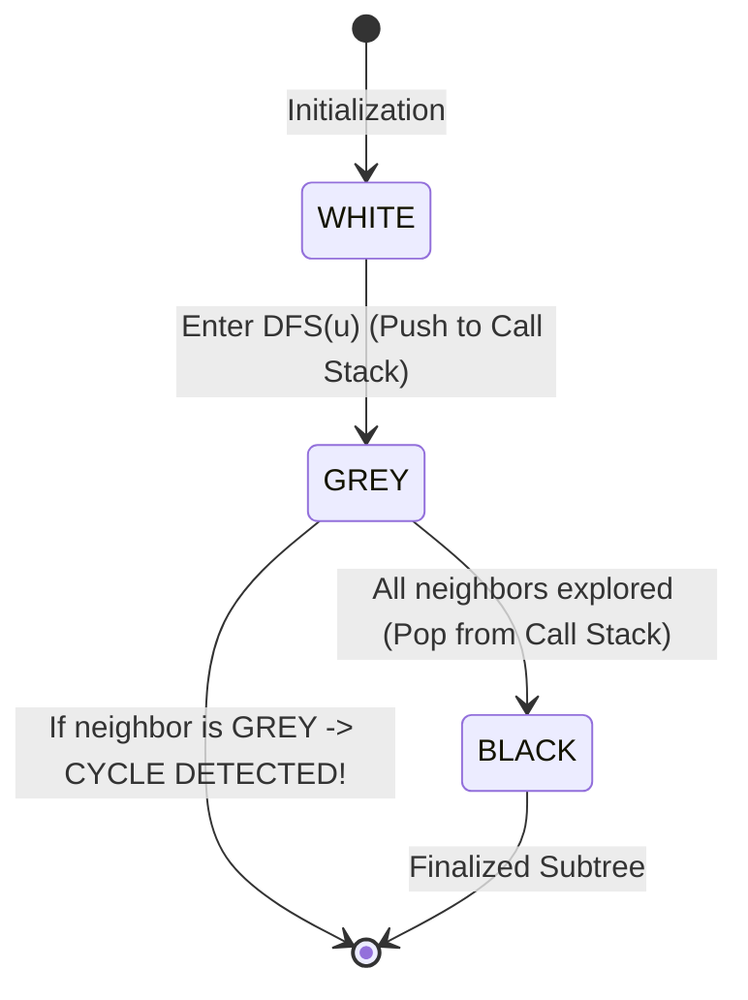

import { Callout } from "fumadocs-ui/components/callout";
import { Tabs, Tab } from "fumadocs-ui/components/tabs";
import { Steps, Step } from "fumadocs-ui/components/steps";
import { Cards, Card } from "fumadocs-ui/components/card";

A graph $G = (V, E)$ consists of a set of vertices $V$ and a set of edges $E \subseteq V \times V$. While conceptually simple, how a graph is represented in physical memory fundamentally dictates the performance, cache efficiency, and scalability of every algorithm executed upon it.

Traversals—visiting vertices and exploring their outgoing relationships—form the atomic building block of network routing, dependency evaluation, garbage collection, and state-space exploration.

---

## 1. Graph Representations in Physical Memory

Choosing how to store edges in memory is an engineering trade-off between **query latency**, **memory consumption**, and **CPU L1/L2/L3 cache locality**.

```mermaid
flowchart TD
    subgraph Reps["Graph Memory Representation Paradigms"]
        Matrix["1. Adjacency Matrix<br/>• Dense 2D Array<br/>• Memory: O(|V|²)<br/>• O(1) Edge Lookup<br/>• Cache-friendly for dense graphs"]
        AdjList["2. Adjacency List<br/>• Array of Vectors / Linked Lists<br/>• Memory: O(|V| + |E|)<br/>• Pointer-chasing cache misses<br/>• Dynamic insertion friendly"]
        CSR["3. Compressed Sparse Row (CSR)<br/>• Two contiguous arrays: row_offsets & col_indices<br/>• Memory: O(|V| + |E|)<br/>• Maximum CPU cache locality & zero heap overhead<br/>• Read-optimized for massive analytics"]
    end
    style Matrix fill:#1e293b,stroke:#38bdf8,stroke-width:1px
    style AdjList fill:#1e293b,stroke:#f59e0b,stroke-width:1px
    style CSR fill:#1e293b,stroke:#10b981,stroke-width:2px
```



### Representation Comparison

| Representation                  | Memory Complexity | Edge Lookup $(u, v)$ | Out-degree Iteration $(u)$ | CPU Cache Locality | Best Used For |
| :------------------------------ | :---------------- | :------------------- | :------------------------- | :----------------- | :------------ | ---------------------------------- | ---------------------------- | ------------------------------------- | ----------------------------------------------------------- | --- | ------- | --- | ------------------------ |
| **Adjacency Matrix**            | $\mathcal{O}(     | V                    | ^2)$                       | $\mathcal{O}(1)$   | $\mathcal{O}( | V                                  | )$                           | High (contiguous rows)                | Dense graphs ($                                             | E   | \approx | V   | ^2$), small $V \le 1000$ |
| **Adjacency List**              | $\mathcal{O}(     | V                    | +                          | E                  | )$            | $\mathcal{O}(\text{deg}(u))$       | $\mathcal{O}(\text{deg}(u))$ | Poor (heap pointer chasing)           | Sparse graphs, dynamic graph mutation                       |
| **Compressed Sparse Row (CSR)** | $\mathcal{O}(     | V                    | +                          | E                  | )$            | $\mathcal{O}(\log(\text{deg}(u)))$ | $\mathcal{O}(\text{deg}(u))$ | **Optimal** (fully contiguous arrays) | Static/batch graph analytics (PyTorch Geometric, GraphBLAS) |

### The Mechanics of Compressed Sparse Row (CSR)

In massive graph systems (hundreds of millions of nodes), standard adjacency lists (e.g., `vector<vector<int>>` in C++ or lists of lists in Python) allocate hundreds of thousands of independent heap buffers. This fragments memory and incurs severe CPU pointer chasing.

**CSR** flattens the graph into two contiguous arrays:

1. `row_ptr` (size $|V| + 1$): Stores the starting index of node $i$'s neighbors in `col_idx`.
2. `col_idx` (size $|E|$): Stores all neighbor vertex IDs in sequential order.

The neighbors of node $u$ reside in `col_idx[row_ptr[u] .. row_ptr[u+1]-1]`.

```mermaid
flowchart LR
    subgraph Graph["Directed Graph Example"]
        N0((0)) --> N1((1))
        N0 --> N2((2))
        N1 --> N2((2))
        N2 --> N0((0))
        N2 --> N3((3))
        N3 --> N3
    end

    subgraph CSRArrays["CSR Contiguous Memory Representation"]
        direction TB
        row_ptr["row_ptr = [0, 2, 3, 5, 6]  (length |V|+1)"]
        col_idx["col_idx = [1, 2,  2,  0, 3,  3]  (length |E|)"]
        map0["Node 0: col_idx[0..2) -> {1, 2}"]
        map1["Node 1: col_idx[2..3) -> {2}"]
        map2["Node 2: col_idx[3..5) -> {0, 3}"]
        map3["Node 3: col_idx[5..6) -> {3}"]
    end

    style Graph fill:#0f172a,stroke:#38bdf8,stroke-width:2px
    style CSRArrays fill:#1e293b,stroke:#10b981,stroke-width:2px
```



---

## 2. Breadth-First Search (BFS) & Multi-Source BFS

### Mental Model: The Wavefront Expansion

Breadth-First Search explores a graph in concentric ripples or wavefronts. Starting at a source $S$, it visits all nodes at distance $1$, then distance $2$, and so forth.

Because every edge in an unweighted graph has identical traversal cost ($1$), the first time BFS reaches any node $v$, it is guaranteed to have found the **shortest path in number of hops**.


### Multi-Source BFS

When searching for the shortest distance from _any_ node in a set of starting seeds $S = \{s_1, s_2, \dots, s_k\}$ to all other nodes (e.g., epidemic spread, nearest warehouse calculation, or flood fill), running independent BFS runs takes $\mathcal{O}(k \cdot (|V| + |E|))$.

Instead, **Multi-Source BFS** initializes the FIFO queue with _all_ seeds at distance $0$ simultaneously:

$$\text{Queue} \leftarrow [s_1, s_2, \dots, s_k], \quad \text{dist}[s_i] = 0$$

All sources expand their boundary concurrently in $\mathcal{O}(|V| + |E|)$ total time.

---

## 3. Depth-First Search (DFS) & 3-Color Cycle Detection

### The Call Stack & State Space Traversal

Depth-First Search plunges along a single branch until it hits a dead end or an already-visited vertex, then backtracks. It uses an explicit or implicit LIFO call stack.

### 3-Color Scheme for Directed Cycle Detection

A naive boolean `visited[u]` array cannot distinguish between a **back-edge** (which indicates a directed cycle) and a **cross-edge** (which is merely an alternate path to an already processed node).

We classify every vertex into one of three colors:

1. **WHITE (0)**: Unvisited.
2. **GREY (1)**: Currently exploring (on the active recursion call stack).
3. **BLACK (2)**: Fully explored (all descendants visited and backtracked).

<Callout type="warn" title="Directed Cycle Condition">
  A directed graph contains a cycle **if and only if** DFS encounters an edge
  $(u, v)$ where vertex $v$ is currently **GREY**. Encountering a **BLACK** node
  simply means encountering an already finalized subtree (a cross-edge or
  forward-edge), not a cycle!
</Callout>



---

## 4. 0-1 BFS with Double-Ended Queues (Deque)

When graph edge weights are constrained to strictly $\{0, 1\}$, running Dijkstra's algorithm incurs $\mathcal{O}(|E| \log |V|)$ overhead due to binary heap maintenance.

**0-1 BFS** computes single-source shortest paths in optimal $\mathcal{O}(|V| + |E|)$ time by using a **Deque (Double-Ended Queue)**:

- Traversing a weight-$0$ edge adds the neighbor to the **front** of the deque (`push_front`), because its distance equals the current node's distance.
- Traversing a weight-$1$ edge adds the neighbor to the **back** of the deque (`push_back`), preserving the monotonic order of distances inside the queue.

```mermaid
flowchart LR
    Current["Pop u from Front<br/>dist[u] = d"] --> Decision{"Edge Weight w"}
    Decision -- "w = 0" --> PushFront["push_front(v)<br/>dist[v] = d"]
    Decision -- "w = 1" --> PushBack["push_back(v)<br/>dist[v] = d + 1"]

    subgraph DequeState["Monotonic Deque Window: [d, d, ..., d+1, d+1]"]
        Front["Front: Distance d"] --- Back["Back: Distance d+1"]
    end

    PushFront -.-> Front
    PushBack -.-> Back

    style Current fill:#1e293b,stroke:#38bdf8,stroke-width:2px
    style DequeState fill:#0f172a,stroke:#10b981,stroke-width:2px
```



---

## Tri-Language Implementations

<Tabs items={['Python', 'TypeScript', 'C++']}>
  <Tab value="Python">
```python
from collections import deque
from typing import List, Tuple, Optional

class GraphTraversals:
"""Production-grade graph representations and traversal implementations."""

    @staticmethod
    def build_csr(num_vertices: int, edges: List[Tuple[int, int]]) -> Tuple[List[int], List[int]]:
        """
        Builds a Compressed Sparse Row (CSR) representation.
        Time: O(|V| + |E|), Space: O(|V| + |E|)
        """
        degree = [0] * num_vertices
        for u, _ in edges:
            degree[u] += 1

        # Prefix sums for row_offsets
        row_offsets = [0] * (num_vertices + 1)
        for i in range(num_vertices):
            row_offsets[i + 1] = row_offsets[i] + degree[i]

        col_indices = [0] * len(edges)
        # Copy start offsets so each vertex's insertion pointer advances independently without corrupting the original array
        cursor = list(row_offsets[:num_vertices])

        for u, v in edges:
            col_indices[cursor[u]] = v
            cursor[u] += 1

        return row_offsets, col_indices

    @staticmethod
    def multi_source_bfs(num_vertices: int, adj: List[List[int]], sources: List[int]) -> List[int]:
        """
        Multi-source BFS to find the shortest distance from any source.
        Returns distance array with -1 for unreachable vertices.
        """
        dist = [-1] * num_vertices
        queue = deque()

        for s in sources:
            dist[s] = 0
            queue.append(s)

        while queue:
            u = queue.popleft()
            for v in adj[u]:
                if dist[v] == -1:  # Unvisited
                    dist[v] = dist[u] + 1
                    queue.append(v)

        return dist

    @staticmethod
    def detect_cycle_directed_3color(num_vertices: int, adj: List[List[int]]) -> bool:
        """
        Detects directed cycles using 3-color DFS.
        0: WHITE (unvisited), 1: GREY (in stack), 2: BLACK (done)
        """
        WHITE, GREY, BLACK = 0, 1, 2
        colors = [WHITE] * num_vertices

        def dfs(u: int) -> bool:
            colors[u] = GREY
            for v in adj[u]:
                if colors[v] == GREY:
                    return True  # Back-edge detected: cycle exists
                if colors[v] == WHITE:
                    if dfs(v):
                        return True
            colors[u] = BLACK
            return False

        for i in range(num_vertices):
            if colors[i] == WHITE:
                if dfs(i):
                    return True
        return False

    @staticmethod
    def zero_one_bfs(num_vertices: int, adj: List[List[Tuple[int, int]]], source: int) -> List[int]:
        """
        0-1 BFS on graphs where edge weights are strictly 0 or 1.
        Time: O(|V| + |E|), Auxiliary Space: O(|V|)
        """
        INF = float('inf')
        dist = [INF] * num_vertices
        dist[source] = 0
        dq = deque([source])

        while dq:
            u = dq.popleft()
            for v, weight in adj[u]:
                if dist[u] + weight < dist[v]:
                    dist[v] = dist[u] + weight
                    if weight == 0:
                        dq.appendleft(v)
                    else:
                        dq.append(v)

        return dist

````
  </Tab>

  <Tab value="TypeScript">
```typescript
/**
 * Production-grade Graph Traversals in TypeScript.
 */

export interface Edge {
  to: number;
  weight: number; // 0 or 1 for 0-1 BFS
}

export class GraphAlgorithms {
  /**
   * Multi-source BFS computing shortest unweighted hop distances.
   */
  static multiSourceBFS(
    numVertices: number,
    adj: number[][],
    sources: number[]
  ): number[] {
    const dist: number[] = new Array(numVertices).fill(-1);
    const queue: number[] = [];
    let head = 0; // O(1) amortized shift emulation

    for (const s of sources) {
      dist[s] = 0;
      queue.push(s);
    }

    while (head < queue.length) {
      const u = queue[head++];
      for (const v of adj[u]) {
        if (dist[v] === -1) {
          dist[v] = dist[u] + 1;
          queue.push(v);
        }
      }
    }

    return dist;
  }

  /**
   * Directed cycle detection using 3-color DFS.
   */
  static hasCycleDirected(numVertices: number, adj: number[][]): boolean {
    const enum Color { WHITE = 0, GREY = 1, BLACK = 2 }
    const colors: Color[] = new Array(numVertices).fill(Color.WHITE);

    const dfs = (u: number): boolean => {
      colors[u] = Color.GREY;
      for (const v of adj[u]) {
        if (colors[v] === Color.GREY) return true; // Cycle detected
        if (colors[v] === Color.WHITE && dfs(v)) return true;
      }
      colors[u] = Color.BLACK;
      return false;
    };

    for (let i = 0; i < numVertices; i++) {
      if (colors[i] === Color.WHITE && dfs(i)) {
        return true;
      }
    }
    return false;
  }

  /**
   * 0-1 BFS using a fast double-ended list.
   */
  static zeroOneBFS(
    numVertices: number,
    adj: Edge[][],
    source: number
  ): number[] {
    const dist: number[] = new Array(numVertices).fill(Infinity);
    dist[source] = 0;

    // Fast array-based double-ended queue simulation
    // ⚠️ PRODUCTION NOTE: JavaScript Array.shift() and Array.unshift() are O(N)
    // operations because they re-index all elements. For true O(V+E) complexity,
    // use a doubly-linked list or a custom Deque implementation.
    // This simplified version uses arrays for clarity.
    const deque: number[] = [source];

    while (deque.length > 0) {
      const u = deque.shift()!;

      for (const edge of adj[u]) {
        const { to: v, weight: w } = edge;
        if (dist[u] + w < dist[v]) {
          dist[v] = dist[u] + w;
          if (w === 0) {
            deque.unshift(v);
          } else {
            deque.push(v);
          }
        }
      }
    }

    return dist;
  }
}
````

  </Tab>

  <Tab value="C++">
```cpp
#include <vector>
#include <deque>
#include <queue>
#include <numeric>
#include <limits>
#include <iostream>

class GraphAlgorithms {
public:
// Compressed Sparse Row (CSR) Representation
struct CSRGraph {
std::vector<int> row_ptr;
std::vector<int> col_idx;
int num_vertices;
};

    static CSRGraph buildCSR(int num_vertices, const std::vector<std::pair<int, int>>& edges) {
        CSRGraph csr;
        csr.num_vertices = num_vertices;
        csr.row_ptr.assign(num_vertices + 1, 0);

        for (const auto& [u, v] : edges) {
            csr.row_ptr[u + 1]++;
        }

        // Prefix sum
        for (int i = 0; i < num_vertices; ++i) {
            csr.row_ptr[i + 1] += csr.row_ptr[i];
        }

        csr.col_idx.resize(edges.size());
        std::vector<int> current_ptr = csr.row_ptr;

        for (const auto& [u, v] : edges) {
            csr.col_idx[current_ptr[u]++] = v;
        }

        return csr;
    }

    // 0-1 BFS using std::deque
    static std::vector<int> zeroOneBFS(
        int num_vertices,
        const std::vector<std::vector<std::pair<int, int>>>& adj,
        int source
    ) {
        const int INF = std::numeric_limits<int>::max();
        std::vector<int> dist(num_vertices, INF);
        std::deque<int> dq;

        dist[source] = 0;
        dq.push_back(source);

        while (!dq.empty()) {
            int u = dq.front();
            dq.pop_front();

            for (const auto& [v, w] : adj[u]) {
                if (dist[u] + w < dist[v]) {
                    dist[v] = dist[u] + w;
                    if (w == 0) {
                        dq.push_front(v);
                    } else {
                        dq.push_back(v);
                    }
                }
            }
        }
        return dist;
    }

    // 3-Color Cycle Detection in Directed Graph
    enum Color { WHITE = 0, GREY = 1, BLACK = 2 };

    static bool hasCycle(int num_vertices, const std::vector<std::vector<int>>& adj) {
        std::vector<Color> color(num_vertices, WHITE);

        auto dfs = [&](auto& self, int u) -> bool {
            color[u] = GREY;
            for (int v : adj[u]) {
                if (color[v] == GREY) return true; // Back-edge = Cycle
                if (color[v] == WHITE && self(self, v)) return true;
            }
            color[u] = BLACK;
            return false;
        };

        for (int i = 0; i < num_vertices; ++i) {
            if (color[i] == WHITE && dfs(dfs, i)) {
                return true;
            }
        }
        return false;
    }

};

```
  </Tab>
</Tabs>

---

## Production Systems Case Study: PyTorch Geometric & High-Throughput GraphBLAS

In graph neural network (GNN) frameworks such as **PyTorch Geometric (PyG)** and sparse BLAS libraries (**SuiteSparse GraphBLAS**), standard object-oriented adjacency lists are strictly avoided.

1. **Hardware Cache Misses**: When a GPU or multi-core CPU processes a graph with millions of vertices, jumping through linked pointer arrays causes constant cache misses and stalls memory buses.
2. **CSR Matrix-Vector Multiplications**: In CSR format, gathering neighbor features for message passing simplifies to:
   $$\mathbf{y}_u = \sum_{j = \text{row\_ptr}[u]}^{\text{row\_ptr}[u+1]-1} \mathbf{x}_{\text{col\_idx}[j]}$$
   Because `col_idx` is contiguous memory, the hardware prefetcher streams vertices directly into L1/L2 caches, unlocking vectorization (AVX-512) and GPU warp execution.

---

## Technical Interview Patterns & Pitfalls

<Callout type="warn" title="Pitfall 1: Forgetting Visited Set on Grid BFS">
When running BFS on a 2D grid ($M \times N$), **mark the cell as visited at the moment it is pushed into the queue**, NOT when it is popped. Failing to do so allows redundant duplicate entries to flood the queue, exploding memory from $\mathcal{O}(M \times N)$ to $\mathcal{O}(4^{M \times N})$.
</Callout>

<Callout type="info" title="Interview Pattern: 0-1 BFS vs Dijkstra">
Whenever a problem asks for shortest path on a grid or graph where edge costs are either $0$ or $1$ (e.g., minimum obstacle removals, minimum edge reversals to reach destination), **never use Dijkstra ($\mathcal{O}(E \log V)$)**. Use **0-1 BFS with a Deque** for clean $\mathcal{O}(V + E)$ linear time.
</Callout>

---

## Hands-On Verification Challenge

**Problem**: Given an $M \times N$ matrix where `0` represents an empty space, `1` represents a guard, and `2` represents a wall, write an algorithm that replaces each empty space with the distance to the **nearest guard**. If an empty space cannot reach any guard, set it to `-1`.

*Hint*: Solve this in $\mathcal{O}(M \times N)$ time using **Multi-Source BFS**, initializing the queue with the coordinates of all guards simultaneously.
```
