import { Callout } from "fumadocs-ui/components/callout";
import { Tabs, Tab } from "fumadocs-ui/components/tabs";
import { Steps, Step } from "fumadocs-ui/components/steps";
import { Cards, Card } from "fumadocs-ui/components/card";

Shortest path and Minimum Spanning Tree (MST) algorithms solve two of the most critical structural optimization problems in computer science:

1. **Shortest Path**: What is the minimum cost trajectory to navigate between two nodes in a weighted network?
2. **Minimum Spanning Tree**: What is the minimum cost set of edges required to connect every single node in an undirected network without creating cycles?

These algorithms power GPS navigation (Google Maps, Waze), Internet packet routing (OSPF, IS-IS, BGP), electrical grid connectivity, and distributed consensus gossip topologies.

---

## 1. Algorithm Decision Matrix

| Algorithm          | Problem Type         | Time Complexity               | Space Complexity   | Negative Edge Weights?                    | Cycle Detection?               |
| :----------------- | :------------------- | :---------------------------- | :----------------- | :---------------------------------------- | :----------------------------- |
| **Dijkstra**       | SSSP (Single-Source) | $\mathcal{O}((V + E) \log V)$ | $\mathcal{O}(V)$   | ❌ **No** (Infinite loop or wrong answer) | No                             |
| **Bellman-Ford**   | SSSP (Single-Source) | $\mathcal{O}(V \cdot E)$      | $\mathcal{O}(V)$   | ✅ **Yes**                                | ✅ **Detects negative cycles** |
| **Floyd-Warshall** | APSP (All-Pairs)     | $\mathcal{O}(V^3)$            | $\mathcal{O}(V^2)$ | ✅ **Yes** (No neg cycles)                | ✅ **Detects negative cycles** |
| **Kruskal (DSU)**  | MST (Undirected)     | $\mathcal{O}(E \log E)$       | $\mathcal{O}(V)$   | ✅ N/A (Edge weights arbitrary)           | Cycle prevention via DSU       |
| **Prim's (Heap)**  | MST (Undirected)     | $\mathcal{O}((V + E) \log V)$ | $\mathcal{O}(V)$   | ✅ N/A (Edge weights arbitrary)           | Cut property greedy pick       |

---

## 2. Dijkstra's Algorithm (Min-Heap Greedy SSSP)

### Mental Model: The Growing Crystal

Dijkstra's algorithm models an expanding boundary of crystallized nodes whose exact shortest distances from source $s$ have been proven optimal.
At every step, it extracts the unvisited vertex with the minimum tentative distance from a Priority Queue (min-heap), and **relaxes** its outgoing edges:

$$\text{Relax}(u, v, w): \quad \text{if } \text{dist}[u] + w < \text{dist}[v] \implies \text{dist}[v] = \text{dist}[u] + w$$

```mermaid
flowchart TD
    subgraph MinHeapPQ["Priority Queue (Min-Heap)"]
        Extract["Pop vertex u with minimum dist[u]"]
    end

    Extract --> CheckVisited{"Already Finalized?<br/>dist[u] < d"}
    CheckVisited -- Yes --> Skip["Drop Stale Entry (Skip)"]
    CheckVisited -- No --> RelaxNeighbors["For each neighbor v of u:"]

    RelaxNeighbors --> Cond{"dist[u] + w < dist[v]"}
    Cond -- True --> Update["dist[v] = dist[u] + w<br/>Push (dist[v], v) to PQ"]
    Cond -- False --> Ignore["Ignore edge"]

    style MinHeapPQ fill:#0f172a,stroke:#38bdf8,stroke-width:2px
    style Update fill:#1e293b,stroke:#10b981,stroke-width:2px
```



<Callout type="warn" title="Why Dijkstra Fails on Negative Weights">
  Dijkstra greedily assumes that once a vertex is extracted from the min-heap,
  its shortest distance is finalized and will never decrease. A negative weight
  edge later in the graph shatters this invariant, producing incorrect shortest
  paths.
</Callout>

---

## 3. Bellman-Ford Algorithm & Negative Cycle Arbitrage

### The Principle of Relaxation

A simple path in a graph with $|V|$ vertices can contain at most $|V| - 1$ edges. Bellman-Ford performs $|V| - 1$ relaxation passes over **every edge in the graph**. By the $(|V|-1)$-th pass, all shortest paths are guaranteed to have propagated.

If a **$|V|$-th pass** still succeeds in relaxing _any_ edge:
$$\text{dist}[u] + w < \text{dist}[v]$$
Then a **negative weight cycle** exists, because distances can be decreased indefinitely.

```mermaid
flowchart LR
    P1["Pass 1: Paths of length 1 finalized"] --> P2["Pass 2: Paths of length 2 finalized"]
    P2 --> PV["Pass V-1: All simple paths finalized"]
    PV --> PCheck{"Pass V: Can any edge relax further?"}
    PCheck -- Yes --> NegCycle["NEGATIVE CYCLE DETECTED!<br/>Arbitrage / Infinite cost reduction"]
    PCheck -- No --> Optimal["All Shortest Paths Validated"]

    style NegCycle fill:#7f1d1d,stroke:#ef4444,stroke-width:2px
    style Optimal fill:#064e3b,stroke:#10b981,stroke-width:2px
```



---

## 4. Floyd-Warshall: All-Pairs Shortest Paths (APSP)

Floyd-Warshall computes the shortest path between every pair of vertices $(i, j)$ using dynamic programming. It asks:

> _"Does the shortest path from $i$ to $j$ become shorter if we are allowed to route through intermediate vertex $k$?"_

### Recurrence Relation:

$$\text{dist}[i][j] = \min(\text{dist}[i][j], \; \text{dist}[i][k] + \text{dist}[k][j])$$

```mermaid
flowchart TD
    subgraph IntermediateK["Routing Through Intermediate Vertex k"]
        I((i)) -->|"dist[i][k]"| K((k))
        K -->|"dist[k][j]"| J((j))
        I -. Direct: dist[i][j] .-> J
    end
    style IntermediateK fill:#1e293b,stroke:#8b5cf6,stroke-width:2px
```



<Callout type="warn" title="Loop Nesting Order is Critical!">
  The intermediate node $k$ **must be the outermost loop**. If $k$ is inside the
  $i$ and $j$ loops, intermediate sub-paths will not have finished computing
  before being referenced, yielding incorrect distances!
</Callout>

---

## 5. Minimum Spanning Trees (MST) & Disjoint Set Union (DSU)

An MST spans all $|V|$ vertices using exactly $|V| - 1$ edges with the minimum possible total weight.

### Disjoint Set Union (DSU / Union-Find)

DSU maintains a partition of elements into disjoint sets with two nearly $\mathcal{O}(1)$ operations:

1. `find(x)`: Identifies the representative root of $x$ (accelerated with **Path Compression**).
2. `union(x, y)`: Merges the sets containing $x$ and $y$ (balanced with **Union by Rank** or size).

With both optimizations, any sequence of $M$ operations on $N$ elements executes in $\mathcal{O}(M \cdot \alpha(N))$ time, where $\alpha$ is the inverse Ackermann function ($\alpha(N) < 5$ for any realistic physical universe scale $N < 10^{80}$).

```mermaid
flowchart TD
    subgraph Before["Before Path Compression: find(4)"]
        R0((0)) --> N1((1))
        N1 --> N2((2))
        N2 --> N3((3))
        N3 --> N4((4))
    end

    subgraph After["After Path Compression: find(4)"]
        R0_A((0))
        R0_A --> N1_A((1))
        R0_A --> N2_A((2))
        R0_A --> N3_A((3))
        R0_A --> N4_A((4))
    end

    Before ==> After
    style Before fill:#1e293b,stroke:#f59e0b,stroke-width:1px
    style After fill:#1e293b,stroke:#10b981,stroke-width:2px
```



### Kruskal's Algorithm (Greedy Edge Addition)

1. Sort all edges in non-decreasing order of weight $w$.
2. Iterate through edges: if `find(u) != find(v)`, add $(u, v)$ to the MST and execute `union(u, v)`.
3. Stop when $|V| - 1$ edges are added.

---

## Tri-Language Implementations

<Tabs items={['Python', 'TypeScript', 'C++']}>
  <Tab value="Python">
```python
import heapq
from typing import List, Tuple, Optional

class DSU:
"""Disjoint Set Union with Path Compression and Union by Rank."""
def **init**(self, n: int):
self.parent = list(range(n))
self.rank = [0] \* n

    def find(self, i: int) -> int:
        if self.parent[i] == i:
            return i
        self.parent[i] = self.find(self.parent[i])  # Path compression
        return self.parent[i]

    def union(self, i: int, j: int) -> bool:
        root_i = self.find(i)
        root_j = self.find(j)
        if root_i == root_j:
            return False  # Already in same component (cycle)

        # Union by rank
        if self.rank[root_i] < self.rank[root_j]:
            self.parent[root_i] = root_j
        elif self.rank[root_i] > self.rank[root_j]:
            self.parent[root_j] = root_i
        else:
            self.parent[root_j] = root_i
            self.rank[root_i] += 1
        return True

class ShortestPathAndMST:
@staticmethod
def dijkstra(num_vertices: int, adj: List[List[Tuple[int, int]]], source: int) -> List[float]:
"""
Dijkstra's algorithm using a min-heap priority queue.
Time: O((V + E) log V), Space: O(V)
"""
dist = [float('inf')] \* num_vertices
dist[source] = 0.0 # Priority queue stores (distance, vertex)
pq = [(0.0, source)]

        while pq:
            d, u = heapq.heappop(pq)
            if d > dist[u]:
                continue  # Stale entry

            for v, weight in adj[u]:
                if dist[u] + weight < dist[v]:
                    dist[v] = dist[u] + weight
                    heapq.heappush(pq, (dist[v], v))

        return dist

    @staticmethod
    def bellman_ford(num_vertices: int, edges: List[Tuple[int, int, float]], source: int) -> Optional[List[float]]:
        """
        Bellman-Ford algorithm with negative cycle detection.
        Returns distance list or None if negative cycle is reachable.
        Time: O(V * E), Space: O(V)
        """
        dist = [float('inf')] * num_vertices
        dist[source] = 0.0

        for _ in range(num_vertices - 1):
            updated = False
            for u, v, w in edges:
                if dist[u] != float('inf') and dist[u] + w < dist[v]:
                    dist[v] = dist[u] + w
                    updated = True
            if not updated:
                break  # Early termination optimization

        # Detect negative cycles on V-th pass
        for u, v, w in edges:
            if dist[u] != float('inf') and dist[u] + w < dist[v]:
                return None  # Negative weight cycle exists!

        return dist

    @staticmethod
    def kruskal_mst(num_vertices: int, edges: List[Tuple[int, int, float]]) -> Tuple[float, List[Tuple[int, int, float]]]:
        """
        Kruskal's Minimum Spanning Tree algorithm.
        Time: O(E log E), Space: O(V)
        """
        # Sort edges by weight
        sorted_edges = sorted(edges, key=lambda x: x[2])
        dsu = DSU(num_vertices)
        mst = []
        total_weight = 0.0

        for u, v, w in sorted_edges:
            if dsu.union(u, v):
                mst.append((u, v, w))
                total_weight += w
                if len(mst) == num_vertices - 1:
                    break

        return total_weight, mst

````
  </Tab>

  <Tab value="TypeScript">
```typescript
/**
 * Production-ready DSU and Shortest Path Algorithms in TypeScript.
 */

export class DisjointSetUnion {
  private parent: number[];
  private rank: number[];

  constructor(n: number) {
    this.parent = Array.from({ length: n }, (_, i) => i);
    this.rank = new Array(n).fill(0);
  }

  find(i: number): number {
    if (this.parent[i] === i) return i;
    return (this.parent[i] = this.find(this.parent[i])); // Path compression
  }

  union(i: number, j: number): boolean {
    const rootI = this.find(i);
    const rootJ = this.find(j);
    if (rootI === rootJ) return false;

    if (this.rank[rootI] < this.rank[rootJ]) {
      this.parent[rootI] = rootJ;
    } else if (this.rank[rootI] > this.rank[rootJ]) {
      this.parent[rootJ] = rootI;
    } else {
      this.parent[rootJ] = rootI;
      this.rank[rootI]++;
    }
    return true;
  }
}

export interface WeightedEdge {
  from: number;
  to: number;
  weight: number;
}

export class ShortestPathEngine {
  /**
   * Floyd-Warshall All-Pairs Shortest Path (APSP).
   * Time: O(V^3), Space: O(V^2)
   */
  static floydWarshall(numVertices: number, edges: WeightedEdge[]): number[][] {
    const dist: number[][] = Array.from({ length: numVertices }, (_, i) =>
      Array.from({ length: numVertices }, (_, j) => (i === j ? 0 : Infinity))
    );

    // NOTE: This implementation assumes directed edges.
    // For undirected graphs, ensure both (u, v) and (v, u) are provided in the input.
    for (const { from, to, weight } of edges) {
      dist[from][to] = Math.min(dist[from][to], weight);
    }

    // k MUST be the outermost loop
    for (let k = 0; k < numVertices; k++) {
      for (let i = 0; i < numVertices; i++) {
        for (let j = 0; j < numVertices; j++) {
          if (dist[i][k] + dist[k][j] < dist[i][j]) {
            dist[i][j] = dist[i][k] + dist[k][j];
          }
        }
      }
    }

    return dist;
  }
}
````

  </Tab>

  <Tab value="C++">
```cpp
#include <vector>
#include <queue>
#include <algorithm>
#include <limits>
#include <iostream>

class DisjointSetUnion {
std::vector<int> parent;
std::vector<int> rank;
public:
DisjointSetUnion(int n) : parent(n), rank(n, 0) {
for (int i = 0; i < n; ++i) parent[i] = i;
}

    int find(int i) {
        if (parent[i] == i) return i;
        return parent[i] = find(parent[i]); // Path compression
    }

    bool unite(int i, int j) {
        int root_i = find(i);
        int root_j = find(j);
        if (root_i == root_j) return false;

        if (rank[root_i] < rank[root_j]) {
            parent[root_i] = root_j;
        } else if (rank[root_i] > rank[root_j]) {
            parent[root_j] = root_i;
        } else {
            parent[root_j] = root_i;
            rank[root_i]++;
        }
        return true;
    }

};

struct Edge {
int from, to;
double weight;
bool operator<(const Edge& other) const {
return weight < other.weight;
}
};

class ShortestPathAndMST {
public:
// Dijkstra using std::priority_queue
static std::vector<double> dijkstra(
int num_vertices,
const std::vector<std::vector<std::pair<int, double>>>& adj,
int source
) {
const double INF = std::numeric_limits<double>::infinity();
std::vector<double> dist(num_vertices, INF);
dist[source] = 0.0;

        // Min-heap storing pair<distance, vertex>
        using PDI = std::pair<double, int>;
        std::priority_queue<PDI, std::vector<PDI>, std::greater<PDI>> pq;
        pq.push({0.0, source});

        while (!pq.empty()) {
            auto [d, u] = pq.top();
            pq.pop();

            if (d > dist[u]) continue; // Stale node

            for (const auto& [v, w] : adj[u]) {
                if (dist[u] + w < dist[v]) {
                    dist[v] = dist[u] + w;
                    pq.push({dist[v], v});
                }
            }
        }
        return dist;
    }

    // Kruskal's MST
    static std::pair<double, std::vector<Edge>> kruskalMST(
        int num_vertices,
        std::vector<Edge>& edges
    ) {
        std::sort(edges.begin(), edges.end());
        DisjointSetUnion dsu(num_vertices);

        double total_weight = 0.0;
        std::vector<Edge> mst;

        for (const auto& edge : edges) {
            if (dsu.unite(edge.from, edge.to)) {
                mst.push_back(edge);
                total_weight += edge.weight;
                if (static_cast<int>(mst.size()) == num_vertices - 1) break;
            }
        }
        return {total_weight, mst};
    }

};

```
  </Tab>
</Tabs>

---

## Production Systems Case Study: OSPF & BGP Internet Routing

The global Internet functions through two dominant routing paradigms directly reflecting these algorithms:

1. **OSPF (Open Shortest Path First - Link-State Protocol)**:
   - Within an Autonomous System (datacenter or ISP), every router floods its local link states to construct an identical topological graph.
   - Each router runs **Dijkstra's algorithm** locally with itself as the source, constructing the forwarding table (FIB) to send packets along lowest-latency fiber backbones.

2. **BGP & RIP (Distance-Vector Routing Protocols)**:
   - When routers cannot maintain the full global topology, they share cost vectors with immediate peers.
   - Routers update routes using the distributed **Bellman-Ford equation**:
     $$\text{dist}(X, D) = \min_{N} \big(c(X, N) + \text{dist}(N, D)\big)$$
   - Bellman-Ford's vulnerability to count-to-infinity loops is mitigated using split horizon and poison reverse mechanics.

---

## Technical Interview Patterns & Pitfalls

<Callout type="warn" title="Pitfall: Using Dijkstra for Minimum Latency with Recharging">
If a problem allows negative weight edges or cycles with net negative sums (common in financial arbitrage problems), Dijkstra **will fail silently** with incorrect numbers or run into infinite loops. Always verify non-negativity before choosing Dijkstra.
</Callout>

<Callout type="info" title="Interview Pattern: Currency Arbitrage Detection">
Given currency exchange rates $R[i][j]$, detect if a series of conversions yields profit:
$$R[c_1][c_2] \times R[c_2][c_3] \times \dots \times R[c_k][c_1] > 1.0$$
Transform multiplication into addition using logarithms:
$$\log(R_1 \times R_2) = \log(R_1) + \log(R_2)$$
Negate the values: $w(u, v) = -\log(R[u][v])$. Now, finding arbitrage is identical to detecting a **negative weight cycle with Bellman-Ford**!
</Callout>

---

## Hands-On Verification Challenge

**Problem**: Network cables connect $N$ data centers. Each cable $(u, v)$ has an installation cost $w$. Several existing cables are already installed at zero extra cost. Write an algorithm that computes the minimum additional expenditure required to ensure every data center is connected.

*Hint*: Initialize the `DSU` with the existing cables (uniting their endpoints). Then sort the remaining candidate cables and run Kruskal's edge selection.
```
