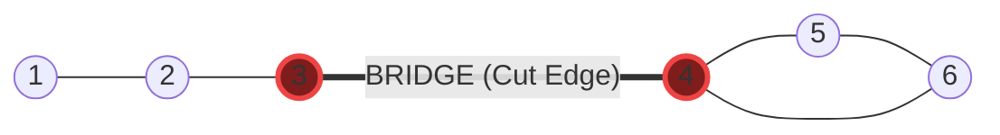

import { Callout } from "fumadocs-ui/components/callout";
import { Tabs, Tab } from "fumadocs-ui/components/tabs";
import { Steps, Step } from "fumadocs-ui/components/steps";
import { Cards, Card } from "fumadocs-ui/components/card";

In real-world distributed architectures, dependencies govern execution: a container cannot start until its database volume is attached, and a compiler cannot link binaries before compiling source modules.

A **Directed Acyclic Graph (DAG)** represents workflows without circular deadlocks. Determining valid execution orders requires **Topological Sorting**. Meanwhile, identifying cyclical modules and Single Points of Failure (SPOF) requires analyzing **Strongly Connected Components (SCC)** and **Bridges/Cut Vertices**.

---

## 1. Complexity & Algorithm Comparison

| Algorithm                   | Graph Type | Time Complexity      | Auxiliary Space      | Key Capability / Output                             |
| :-------------------------- | :--------- | :------------------- | :------------------- | :-------------------------------------------------- |
| **Kahn's Algorithm**        | Directed   | $\mathcal{O}(V + E)$ | $\mathcal{O}(V)$     | Linear ordering + instant cycle detection           |
| **DFS Reverse Post-Order**  | Directed   | $\mathcal{O}(V + E)$ | $\mathcal{O}(V)$     | Natural recursive topological ordering              |
| **Kosaraju's Algorithm**    | Directed   | $\mathcal{O}(V + E)$ | $\mathcal{O}(V + E)$ | 2-pass SCC identification using graph transpose     |
| **Tarjan's SCC**            | Directed   | $\mathcal{O}(V + E)$ | $\mathcal{O}(V)$     | **Single-pass** SCC using low-link values and stack |
| **Tarjan's Bridges & Cuts** | Undirected | $\mathcal{O}(V + E)$ | $\mathcal{O}(V)$     | Identifies Single Points of Failure (SPOFs)         |

---

## 2. Topological Sort: Kahn's Algorithm & In-Degrees

A topological sort of a directed graph is a linear ordering of its vertices such that for every directed edge $u \to v$, vertex $u$ comes before vertex $v$.

### Kahn's Algorithm (BFS-Style In-Degree Queue)

1. Calculate the **in-degree** (count of incoming edges) for every vertex.
2. Push all vertices with $\text{in-degree} = 0$ into a FIFO queue (these tasks have zero prerequisites).
3. While the queue is not empty:
   - Dequeue $u$, append it to the topological ordering.
   - For each neighbor $v$ of $u$, decrement $\text{in-degree}[v]$ by 1.
   - If $\text{in-degree}[v]$ becomes $0$, push $v$ into the queue.
4. **Cycle Invariant**: If the number of processed nodes is less than $|V|$, a **circular dependency cycle exists**, because cyclic nodes never reach in-degree zero.

```mermaid
flowchart TD
    subgraph Step1["Step 1: Calculate In-Degrees"]
        N0["A (in: 0)"] --> N1["B (in: 1)"]
        N0 --> N2["C (in: 1)"]
        N1 --> N3["D (in: 2)"]
        N2 --> N3
    end

    subgraph Step2["Step 2: Process Queue"]
        Q["Queue: [A]"] --> PopA["Process A -> in-degrees of B, C become 0"]
        PopA --> EnqBC["Queue: [B, C]"]
        EnqBC --> PopBC["Process B & C -> in-degree of D becomes 0"]
        PopBC --> EnqD["Queue: [D]"]
    end

    style Step1 fill:#0f172a,stroke:#38bdf8,stroke-width:2px
    style Step2 fill:#1e293b,stroke:#10b981,stroke-width:2px
```



---

## 3. Strongly Connected Components (Tarjan's Algorithm)

A **Strongly Connected Component (SCC)** of a directed graph is a maximal subgraph where every vertex is reachable from every other vertex within that subgraph. In dependency systems, each SCC represents an irreducible mutually recursive dependency cycle.

### Tarjan's Single-Pass DFS

Tarjan's algorithm uses DFS tree traversal and tracks two values per node:

- `tin[u]`: Timestamp when node $u$ was first visited.
- `low[u]`: Lowest `tin` reachable from $u$ via a sequence of tree edges followed by at most one back-edge to a node currently on the call stack.

```mermaid
flowchart TD
    DFS["DFS enters u: set tin[u] = low[u] = timer++, push u to Stack"]
    DFS --> LoopNeighbors["For each neighbor v:"]
    LoopNeighbors --> Unvisited{"v is unvisited?"}
    Unvisited -- Yes --> Recurse["DFS(v)<br/>low[u] = min(low[u], low[v])"]
    Unvisited -- No --> InStack{"v is in stack?"}
    InStack -- Yes --> BackEdge["low[u] = min(low[u], tin[v])"]
    InStack -- No --> CrossEdge["Ignore (Cross-edge to completed SCC)"]
    Recurse --> RootCheck{"low[u] == tin[u]?"}
    BackEdge --> RootCheck
    CrossEdge --> RootCheck
    RootCheck -- Yes --> PopSCC["Pop stack until u: Form new SCC!"]
    RootCheck -- No --> Continue["Return to parent"]

    style DFS fill:#0f172a,stroke:#38bdf8,stroke-width:2px
    style PopSCC fill:#7f1d1d,stroke:#ef4444,stroke-width:2px
```



<Callout type="warn" title="Critical Tarjan Pitfall: The `in_stack` Check">
  When updating `low[u]` from an already-visited neighbor $v$, you **must check
  if $v$ is currently in the stack** (`in_stack[v] == true`). If $v$ has already
  been popped, it belongs to an independent, already finalized SCC;
  incorporating its `tin` will corrupt cycle boundaries!
</Callout>

---

## 4. Bridges and Articulation Points (Network Failure Resilience)

In an undirected physical network (e.g. data center fiber connections, electrical grids, transport networks):

- **Bridge (Critical Connection)**: An edge whose deletion increases the number of connected components.
- **Articulation Point (Cut Vertex)**: A vertex whose removal disconnects the graph.



### DFS Tree Rules for Bridges & Articulation Points

During DFS from parent $u$ to child $v$:

1. **Bridge Condition**:
   $$\text{low}[v] > \text{tin}[u]$$
   _(Child $v$ has no alternative back-edge to reach $u$ or any ancestor of $u$. Deleting $(u, v)$ isolates $v$'s entire subtree)._

2. **Articulation Point Condition**:
   - **Root of DFS tree**: An articulation point **if and only if** it has $\ge 2$ children in the DFS tree.
   - **Non-root node $u$**: An articulation point **if and only if** it has a child $v$ such that:
     $$\text{low}[v] \ge \text{tin}[u]$$
     _(Child $v$ cannot reach any strict ancestor of $u$ without routing through $u$.)_

---

## Tri-Language Implementations

<Tabs items={['Python', 'TypeScript', 'C++']}>
  <Tab value="Python">
```python
from collections import deque
from typing import List, Tuple, Set

class GraphConnectivity:
@staticmethod
def kahn_topological_sort(num_vertices: int, adj: List[List[int]]) -> Tuple[List[int], bool]:
"""
Kahn's algorithm for Topological Sort and Cycle Detection.
Returns: (order, has_cycle)
Time: O(V + E), Space: O(V)
"""
in_degree = [0] \* num_vertices
for u in range(num_vertices):
for v in adj[u]:
in_degree[v] += 1

        queue = deque([u for u in range(num_vertices) if in_degree[u] == 0])
        order = []

        while queue:
            u = queue.popleft()
            order.append(u)
            for v in adj[u]:
                in_degree[v] -= 1
                if in_degree[v] == 0:
                    queue.append(v)

        has_cycle = len(order) < num_vertices
        return order if not has_cycle else [], has_cycle

    @staticmethod
    def tarjan_scc(num_vertices: int, adj: List[List[int]]) -> List[List[int]]:
        """
        Tarjan's algorithm for Strongly Connected Components (SCC).
        Time: O(V + E), Space: O(V)
        """
        timer = 0
        tin = [-1] * num_vertices
        low = [-1] * num_vertices
        stack = []
        in_stack = [False] * num_vertices
        sccs = []

        def dfs(u: int):
            nonlocal timer
            tin[u] = low[u] = timer
            timer += 1
            stack.append(u)
            in_stack[u] = True

            for v in adj[u]:
                if tin[v] == -1:
                    dfs(v)
                    low[u] = min(low[u], low[v])
                elif in_stack[v]:
                    low[u] = min(low[u], tin[v])

            if low[u] == tin[u]:
                component = []
                while True:
                    w = stack.pop()
                    in_stack[w] = False
                    component.append(w)
                    if w == u:
                        break
                sccs.append(component)

        for i in range(num_vertices):
            if tin[i] == -1:
                dfs(i)

        return sccs

    @staticmethod
    def find_bridges(num_vertices: int, adj: List[List[int]]) -> List[Tuple[int, int]]:
        """
        Finds all bridges (critical links) in an undirected graph.
        Time: O(V + E), Space: O(V)
        """
        timer = 0
        tin = [-1] * num_vertices
        low = [-1] * num_vertices
        bridges = []

        def dfs(u: int, parent: int):
            nonlocal timer
            tin[u] = low[u] = timer
            timer += 1

            for v in adj[u]:
                if v == parent:
                    continue
                if tin[v] != -1:
                    low[u] = min(low[u], tin[v])
                else:
                    dfs(v, u)
                    low[u] = min(low[u], low[v])
                    if low[v] > tin[u]:
                        bridges.append((u, v))

        for i in range(num_vertices):
            if tin[i] == -1:
                dfs(i, -1)

        return bridges

````
  </Tab>

  <Tab value="TypeScript">
```typescript
/**
 * Production-ready Topological Sort and Tarjan Connectivity in TypeScript.
 */

export class ConnectivityEngine {
  /**
   * Kahn's Topological Sort with cycle detection.
   */
  static kahnTopoSort(numVertices: number, adj: number[][]): { order: number[]; hasCycle: boolean } {
    const inDegree: number[] = new Array(numVertices).fill(0);
    for (let u = 0; u < numVertices; u++) {
      for (const v of adj[u]) {
        inDegree[v]++;
      }
    }

    const queue: number[] = [];
    for (let i = 0; i < numVertices; i++) {
      if (inDegree[i] === 0) queue.push(i);
    }

    const order: number[] = [];
    let head = 0;

    while (head < queue.length) {
      const u = queue[head++];
      order.push(u);

      for (const v of adj[u]) {
        inDegree[v]--;
        if (inDegree[v] === 0) {
          queue.push(v);
        }
      }
    }

    const hasCycle = order.length < numVertices;
    return { order: hasCycle ? [] : order, hasCycle };
  }

  /**
   * Identifies all bridges in an undirected graph.
   */
  static findBridges(numVertices: number, adj: number[][]): [number, number][] {
    let timer = 0;
    const tin: number[] = new Array(numVertices).fill(-1);
    const low: number[] = new Array(numVertices).fill(-1);
    const bridges: [number, number][] = [];

    const dfs = (u: number, parent: number): void => {
      tin[u] = low[u] = timer++;

      for (const v of adj[u]) {
        if (v === parent) continue;
        if (tin[v] !== -1) {
          low[u] = Math.min(low[u], tin[v]);
        } else {
          dfs(v, u);
          low[u] = Math.min(low[u], low[v]);
          if (low[v] > tin[u]) {
            bridges.push([u, v]);
          }
        }
      }
    };

    for (let i = 0; i < numVertices; i++) {
      if (tin[i] === -1) {
        dfs(i, -1);
      }
    }

    return bridges;
  }

  /**
   * Tarjan's Strongly Connected Components (Single-Pass DFS).
   */
  static tarjanSCC(numVertices: number, adj: number[][]): number[][] {
    let timer = 0;
    const tin = new Array(numVertices).fill(-1);
    const low = new Array(numVertices).fill(-1);
    const inStack = new Array(numVertices).fill(false);
    const stack: number[] = [];
    const sccs: number[][] = [];

    const dfs = (u: number): void => {
      tin[u] = low[u] = timer++;
      stack.push(u);
      inStack[u] = true;

      for (const v of adj[u]) {
        if (tin[v] === -1) {
          dfs(v);
          low[u] = Math.min(low[u], low[v]);
        } else if (inStack[v]) {
          low[u] = Math.min(low[u], tin[v]);
        }
      }

      if (low[u] === tin[u]) {
        const component: number[] = [];
        while (true) {
          const v = stack.pop()!;
          inStack[v] = false;
          component.push(v);
          if (u === v) break;
        }
        sccs.push(component);
      }
    };

    for (let i = 0; i < numVertices; i++) {
      if (tin[i] === -1) dfs(i);
    }
    return sccs;
  }

  /**
   * Identifies articulation points (cut vertices).
   */
  static findArticulationPoints(numVertices: number, adj: number[][]): number[] {
    let timer = 0;
    const tin = new Array(numVertices).fill(-1);
    const low = new Array(numVertices).fill(-1);
    const isCut = new Array(numVertices).fill(false);

    const dfs = (u: number, parent: number): void => {
      tin[u] = low[u] = timer++;
      let children = 0;

      for (const v of adj[u]) {
        if (v === parent) continue;
        if (tin[v] !== -1) {
          low[u] = Math.min(low[u], tin[v]);
        } else {
          dfs(v, u);
          low[u] = Math.min(low[u], low[v]);
          if (low[v] >= tin[u] && parent !== -1) {
            isCut[u] = true;
          }
          children++;
        }
      }

      if (parent === -1 && children > 1) {
        isCut[u] = true;
      }
    };

    for (let i = 0; i < numVertices; i++) {
      if (tin[i] === -1) dfs(i, -1);
    }

    const cuts: number[] = [];
    for (let i = 0; i < numVertices; i++) {
      if (isCut[i]) cuts.push(i);
    }
    return cuts;
  }
}
````

  </Tab>

  <Tab value="C++">
```cpp
#include <vector>
#include <queue>
#include <algorithm>
#include <iostream>

class ConnectivityEngine {
public:
// Tarjan's SCC Algorithm
static std::vector<std::vector<int>> tarjanSCC(
int num_vertices,
const std::vector<std::vector<int>>& adj
) {
int timer = 0;
std::vector<int> tin(num_vertices, -1);
std::vector<int> low(num_vertices, -1);
std::vector<bool> in_stack(num_vertices, false);
std::vector<int> stack;
std::vector<std::vector<int>> sccs;

        auto dfs = [&](auto& self, int u) -> void {
            tin[u] = low[u] = timer++;
            stack.push_back(u);
            in_stack[u] = true;

            for (int v : adj[u]) {
                if (tin[v] == -1) {
                    self(self, v);
                    low[u] = std::min(low[u], low[v]);
                } else if (in_stack[v]) {
                    low[u] = std::min(low[u], tin[v]);
                }
            }

            if (low[u] == tin[u]) {
                std::vector<int> component;
                while (true) {
                    int w = stack.back();
                    stack.pop_back();
                    in_stack[w] = false;
                    component.push_back(w);
                    if (w == u) break;
                }
                sccs.push_back(component);
            }
        };

        for (int i = 0; i < num_vertices; ++i) {
            if (tin[i] == -1) {
                dfs(dfs, i);
            }
        }
        return sccs;
    }

    // Articulation Points (Cut Vertices)
    static std::vector<int> findArticulationPoints(
        int num_vertices,
        const std::vector<std::vector<int>>& adj
    ) {
        int timer = 0;
        std::vector<int> tin(num_vertices, -1);
        std::vector<int> low(num_vertices, -1);
        std::vector<bool> is_cut(num_vertices, false);

        auto dfs = [&](auto& self, int u, int parent) -> void {
            tin[u] = low[u] = timer++;
            int children = 0;

            for (int v : adj[u]) {
                if (v == parent) continue;
                if (tin[v] != -1) {
                    low[u] = std::min(low[u], tin[v]);
                } else {
                    self(self, v, u);
                    low[u] = std::min(low[u], low[v]);
                    if (low[v] >= tin[u] && parent != -1) {
                        is_cut[u] = true;
                    }
                    children++;
                }
            }
            if (parent == -1 && children > 1) {
                is_cut[u] = true; // Root condition
            }
        };

        for (int i = 0; i < num_vertices; ++i) {
            if (tin[i] == -1) dfs(dfs, i, -1);
        }

        std::vector<int> cut_vertices;
        for (int i = 0; i < num_vertices; ++i) {
            if (is_cut[i]) cut_vertices.push_back(i);
        }
        return cut_vertices;
    }

};

```
  </Tab>
</Tabs>

---

## Production Systems Case Study: Bazel / Turbo & Telecom Optical Backbones

1. **Bazel / Turborepo Build Dependency Scheduling**:
   - Modern monorepo build tools build a DAG where vertices are build targets (`//frontend:bundle`, `//backend:service`) and edges represent import/compile dependencies.
   - Using **Kahn's algorithm**, the build scheduler identifies all tasks with in-degree 0 and executes them in parallel across distributed worker pools. As tasks complete, dependent tasks have their in-degrees decremented, scheduling downstream builds with zero lock contention.

2. **Optical Backbone Resilience & AWS Direct Connect**:
   - Telecom network topologies use **Tarjan's Bridge detection** to detect physical fiber routes whose failure would bifurcate the network. Redundant dark fiber links are provisioned to guarantee that no bridge edges exist in backbone routing.

---

## Technical Interview Patterns & Pitfalls

<Callout type="warn" title="Pitfall: Articulation Point Root Condition">
A common bug in bridge/cut vertex implementations is applying `low[v] >= tin[u]` to the root node of the DFS tree. The root **has no ancestors**, so `low[v] >= tin[root]` is *always true*. The root is an articulation point **only if it has 2 or more independent child branches** in the DFS tree!
</Callout>

<Callout type="info" title="Interview Pattern: Course Schedule II">
LeetCode "Course Schedule" asks to find a valid ordering or detect impossible requirements. This is a direct test of **Kahn's algorithm with cycle detection**:
- Prerequisite $(u, v)$ means $v \to u$.
- Count in-degrees; if the final topologically sorted list length $< \text{numCourses}$, return `[]`.
</Callout>

---

## Hands-On Verification Challenge

**Problem**: A microservice fleet has $N$ services. An incoming configuration change specifies that service $A$ must restart before service $B$. Write a function that returns:
1. `true` along with the safe restart sequence if the system can restart cleanly without deadlock.
2. `false` along with the list of mutually locked services (the SCC cycle) if a circular configuration deadlock exists.
```
