import { Callout } from "fumadocs-ui/components/callout";
import { Tabs, Tab } from "fumadocs-ui/components/tabs";
import { Steps, Step } from "fumadocs-ui/components/steps";
import { Cards, Card } from "fumadocs-ui/components/card";

Dynamic Programming (DP) is an algorithmic optimization paradigm designed to eliminate redundant computations. When an optimization or counting problem exhibits **Overlapping Subproblems** and **Optimal Substructure**, DP transforms naive $\mathcal{O}(2^N)$ exponential brute-force recursions into polynomial time $\mathcal{O}(N)$ or $\mathcal{O}(N \cdot M)$ solutions.

At its core, Dynamic Programming is simply **breadth/topological traversal of an implicitly evaluated state Directed Acyclic Graph (DAG)**.

---

## 1. The Core Principles of Dynamic Programming

```mermaid
flowchart LR
    subgraph Principles["Two Invariant Requirements for DP"]
        P1["1. Optimal Substructure<br/>The optimal solution to the global problem is composed of optimal solutions to its smaller subproblems."]
        P2["2. Overlapping Subproblems<br/>The recursive decomposition repeatedly evaluates identical subproblems hundreds or millions of times."]
    end
    style Principles fill:#0f172a,stroke:#38bdf8,stroke-width:2px
```



### Memoization (Top-Down) vs Tabulation (Bottom-Up)

```mermaid
flowchart TD
    subgraph TopDown["Top-Down (Memoization)"]
        TD_Root["Original Call: solve(N)"] --> TD_CacheCheck{"In Cache?"}
        TD_CacheCheck -- Yes --> TD_Return["Return cached result O(1)"]
        TD_CacheCheck -- No --> TD_Recurse["Recurse solve(N-1), solve(N-2)<br/>Save to Hash Table / Array"]
    end

    subgraph BottomUp["Bottom-Up (Tabulation)"]
        BU_Base["Base Cases: dp[0], dp[1]"] --> BU_Loop["Iterative for-loop from 2 to N"]
        BU_Loop --> BU_Compute["dp[i] = transition(dp[i-1], dp[i-2])"]
        BU_Compute --> BU_Result["Final Answer in dp[N]"]
    end

    style TopDown fill:#1e293b,stroke:#a855f7,stroke-width:2px
    style BottomUp fill:#1e293b,stroke:#10b981,stroke-width:2px
```



| Dimension                 | Top-Down (Memoization)                                | Bottom-Up (Tabulation)                                    |
| :------------------------ | :---------------------------------------------------- | :-------------------------------------------------------- |
| **Execution Style**       | Recursive with cache check                            | Iterative loop from base cases                            |
| **Subproblem Evaluation** | Only computes states strictly needed (Lazy)           | Evaluates all table states unconditionally                |
| **Call Stack Overhead**   | $\mathcal{O}(N)$ stack depth (risk of stack overflow) | $\mathcal{O}(1)$ stack overhead (zero recursion)          |
| **Memory Optimization**   | Difficult to reduce space complexity                  | Easily reduced via **rolling arrays** to $\mathcal{O}(1)$ |
| **Cache Locality**        | Random heap lookups (hash table misses)               | Contiguous array access (L1/L2 cache prefetch)            |

---

## 2. State-Space Reduction & The Rolling Variable Technique

When evaluating transitions that depend only on a fixed number of preceding states, allocating an entire array of size $\mathcal{O}(N)$ wastes physical memory.

In Fibonacci / Climbing Stairs:
$$dp[i] = dp[i-1] + dp[i-2]$$
We do not need history from $i-3, i-4, \dots, 0$. We only need two scalar registers: `prev1` and `prev2`. This drops space from $\mathcal{O}(N) \to \mathcal{O}(1)$.

Similarly, in 2D Grid DP:
$$dp[i][j] = \text{cost}[i][j] + \min(dp[i-1][j], dp[i][j-1])$$
Because row $i$ depends only on the current row and the row directly above it, we can compress an $M \times N$ matrix down to a single row array of size $\mathcal{O}(N)$.

```mermaid
flowchart LR
    subgraph FullMatrix["2D Matrix: O(M x N) Space"]
        R0["Row 0"] --- R1["Row 1"] --- R2["Row 2"] --- RN["Row M-1"]
    end

    subgraph RollingArray["1D Rolling Array: O(N) Space"]
        DP["dp[j] (holds above value dp[i-1][j])"]
        DP -. "Updated in-place" .-> DP_new["dp[j] = grid[i][j] + min(dp[j], dp[j-1])"]
    end

    FullMatrix ==> RollingArray
    style FullMatrix fill:#1e293b,stroke:#ef4444,stroke-width:1px
    style RollingArray fill:#1e293b,stroke:#10b981,stroke-width:2px
```



---

## 3. Classical DP Complexity Matrix

| Problem               | Recurrence Transition                                       | Time Complexity          | Naive Space              | Compressed Space |
| :-------------------- | :---------------------------------------------------------- | :----------------------- | :----------------------- | :--------------- |
| **Climbing Stairs**   | $dp[i] = dp[i-1] + dp[i-2]$                                 | $\mathcal{O}(N)$         | $\mathcal{O}(N)$         | $\mathcal{O}(1)$ |
| **House Robber**      | $dp[i] = \max(dp[i-1], dp[i-2] + \text{val}[i])$            | $\mathcal{O}(N)$         | $\mathcal{O}(N)$         | $\mathcal{O}(1)$ |
| **Coin Change**       | $dp[a] = 1 + \min_{c} dp[a - c]$                            | $\mathcal{O}(A \cdot C)$ | $\mathcal{O}(A)$         | $\mathcal{O}(A)$ |
| **Word Break**        | $dp[i] = \bigvee_{j} (dp[j] \land s[j..i] \in \text{Dict})$ | $\mathcal{O}(N^2)$       | $\mathcal{O}(N)$         | $\mathcal{O}(N)$ |
| **Unique Paths (2D)** | $dp[i][j] = dp[i-1][j] + dp[i][j-1]$                        | $\mathcal{O}(M \cdot N)$ | $\mathcal{O}(M \cdot N)$ | $\mathcal{O}(N)$ |
| **Min Path Sum (2D)** | $dp[i][j] = g[i][j] + \min(dp[i-1][j], dp[i][j-1])$         | $\mathcal{O}(M \cdot N)$ | $\mathcal{O}(M \cdot N)$ | $\mathcal{O}(N)$ |

---

## Tri-Language Implementations

<Tabs items={['Python', 'TypeScript', 'C++']}>
  <Tab value="Python">
```python
from typing import List, Set

class DynamicProgramming1D2D:
@staticmethod
def house_robber(nums: List[int]) -> int:
"""
House Robber with O(1) rolling space.
dp[i] = max(dp[i-1], dp[i-2] + nums[i])
Time: O(N), Space: O(1)
"""
rob_prev2 = 0 # dp[i-2]
rob_prev1 = 0 # dp[i-1]

        for val in nums:
            current = max(rob_prev1, rob_prev2 + val)
            rob_prev2 = rob_prev1
            rob_prev1 = current

        return rob_prev1

    @staticmethod
    def coin_change(coins: List[int], amount: int) -> int:
        """
        Fewest coins to make up amount. Returns -1 if impossible.
        Time: O(amount * len(coins)), Space: O(amount)
        """
        INF = amount + 1
        dp = [INF] * (amount + 1)
        dp[0] = 0

        for a in range(1, amount + 1):
            for c in coins:
                if a - c >= 0:
                    dp[a] = min(dp[a], dp[a - c] + 1)

        return dp[amount] if dp[amount] != INF else -1

    @staticmethod
    def word_break(s: str, word_dict: List[str]) -> bool:
        """
        Determines if s can be segmented into a space-separated sequence of dictionary words.
        Time: O(N^3) (due to O(N) overhead from string slicing s[j:i]), Space: O(N)
        """
        word_set: Set[str] = set(word_dict)
        n = len(s)
        dp = [False] * (n + 1)
        dp[0] = True  # Empty string is valid

        for i in range(1, n + 1):
            for j in range(i):
                if dp[j] and s[j:i] in word_set:
                    dp[i] = True
                    break

        return dp[n]

    @staticmethod
    def min_path_sum(grid: List[List[int]]) -> int:
        """
        Minimum Path Sum on 2D grid with O(N) space compression.
        Time: O(M * N), Space: O(N)
        """
        if not grid or not grid[0]:
            return 0
        rows, cols = len(grid), len(grid[0])
        dp = [float('inf')] * cols
        dp[0] = grid[0][0]

        # Initialize first row prefix sums
        for j in range(1, cols):
            dp[j] = dp[j - 1] + grid[0][j]

        for i in range(1, rows):
            dp[0] += grid[i][0]  # First column can only come from above
            for j in range(1, cols):
                dp[j] = grid[i][j] + min(dp[j], dp[j - 1])

        return int(dp[-1])

````
  </Tab>

  <Tab value="TypeScript">
```typescript
/**
 * 1D and 2D Dynamic Programming in TypeScript.
 */

export class DynamicProgrammingEngine {
  /**
   * House Robber with O(1) rolling space optimization.
   */
  static houseRobber(nums: number[]): number {
    let robPrev2 = 0;
    let robPrev1 = 0;

    for (const val of nums) {
      const current = Math.max(robPrev1, robPrev2 + val);
      robPrev2 = robPrev1;
      robPrev1 = current;
    }

    return robPrev1;
  }

  /**
   * Coin Change with 1D Tabulation.
   */
  static coinChange(coins: number[], amount: number): number {
    const dp: number[] = new Array(amount + 1).fill(Infinity);
    dp[0] = 0;

    for (let a = 1; a <= amount; a++) {
      for (const coin of coins) {
        if (a - coin >= 0 && dp[a - coin] !== Infinity) {
          dp[a] = Math.min(dp[a], dp[a - coin] + 1);
        }
      }
    }

    return dp[amount] === Infinity ? -1 : dp[amount];
  }

  /**
   * 2D Minimum Path Sum with O(N) rolling buffer.
   */
  static minPathSum(grid: number[][]): number {
    const rows = grid.length;
    const cols = grid[0].length;
    const dp: number[] = new Array(cols).fill(Infinity);

    dp[0] = grid[0][0];
    for (let j = 1; j < cols; j++) {
      dp[j] = dp[j - 1] + grid[0][j];
    }

    for (let i = 1; i < rows; i++) {
      dp[0] += grid[i][0];
      for (let j = 1; j < cols; j++) {
        dp[j] = grid[i][j] + Math.min(dp[j], dp[j - 1]);
      }
    }

    return dp[cols - 1];
  }
}
````

  </Tab>

  <Tab value="C++">
```cpp
#include <vector>
#include <string>
#include <unordered_set>
#include <algorithm>
#include <limits>
#include <iostream>

class DynamicProgrammingEngine {
public:
// House Robber with O(1) Space
static int houseRobber(const std::vector<int>& nums) {
int rob_prev2 = 0;
int rob_prev1 = 0;

        for (int val : nums) {
            int current = std::max(rob_prev1, rob_prev2 + val);
            rob_prev2 = rob_prev1;
            rob_prev1 = current;
        }
        return rob_prev1;
    }

    // Coin Change with Sentinel Boundary Checking
    static int coinChange(const std::vector<int>& coins, int amount) {
        const int INF = 1e9;
        std::vector<int> dp(amount + 1, INF);
        dp[0] = 0;

        for (int a = 1; a <= amount; ++a) {
            for (int c : coins) {
                if (a - c >= 0 && dp[a - c] != INF) {
                    dp[a] = std::min(dp[a], dp[a - c] + 1);
                }
            }
        }
        return dp[amount] >= INF ? -1 : dp[amount];
    }

    // 2D Minimum Path Sum with O(N) Space Compression
    static int minPathSum(const std::vector<std::vector<int>>& grid) {
        int rows = grid.size();
        int cols = grid[0].size();
        std::vector<int> dp(cols, 0);

        dp[0] = grid[0][0];
        for (int j = 1; j < cols; ++j) {
            dp[j] = dp[j - 1] + grid[0][j];
        }

        for (int i = 1; i < rows; ++i) {
            dp[0] += grid[i][0];
            for (int j = 1; j < cols; ++j) {
                dp[j] = grid[i][j] + std::min(dp[j], dp[j - 1]);
            }
        }
        return dp[cols - 1];
    }

};

```
  </Tab>
</Tabs>

---

## Production Systems Case Study: PostgreSQL System R Query Optimizer

Relational database cost-based optimizers (such as PostgreSQL's GEQO and the classic IBM System R optimizer) use Dynamic Programming to determine the lowest-cost order for multi-table joins:

- Joining tables $\{A, B, C, D\}$ naively has $(2N)! / N!$ orderings.
- The optimizer defines DP state: $dp[S] =$ minimum I/O cost to join the subset of tables $S \subseteq \{A, B, C, D\}$.
- Subsets of size 2 are calculated first, then combined to evaluate subsets of size 3, and finally the full join tree.
- By caching intermediate join plans, the optimizer reduces factorial search space to $\mathcal{O}(3^N)$, finding optimal indexes and hash joins in milliseconds.

---

## Technical Interview Patterns & Pitfalls

<Callout type="warn" title="Pitfall: C++ Integer Overflow with `INT_MAX`">
In optimization problems seeking a minimum, initializing unreachable states to `std::numeric_limits<int>::max()` causes an arithmetic integer overflow if you compute `dp[i - c] + 1`. In C++, this causes undefined behavior (negative wraps). Always use a safe sentinel like `1e9` or check `dp[i - c] != INF` before adding.
</Callout>

<Callout type="info" title="Interview Pattern: Word Break with Trie / Suffix Optimization">
When strings are long ($N > 10^4$), scanning all $j \in [0..i]$ incurs $\mathcal{O}(N^2)$ string slices. Storing the dictionary in a reverse Trie limits backward transitions strictly to the maximum word length $L_{\max}$, slashing execution time to $\mathcal{O}(N \cdot L_{\max})$.
</Callout>

---

## Hands-On Verification Challenge

**Problem**: You are an engineer building an auto-scaler for Kubernetes. During high traffic spikes, you must scale pods up across $M$ worker nodes. Node $i$ can host at most $C_i$ pods and consumes $P_i$ watts of power per pod. Formulate a 1D DP transition to determine the minimum total power required to provision exactly $K$ pods.
```
