import { Callout } from "fumadocs-ui/components/callout";
import { Tabs, Tab } from "fumadocs-ui/components/tabs";
import { Steps, Step } from "fumadocs-ui/components/steps";
import { Cards, Card } from "fumadocs-ui/components/card";

Subsequence and knapsack patterns represent the core workhorses of optimization: selecting, aligning, and balancing constrained resources. These algorithms power text editing differences (`git diff`), fuzzy search query engines (Elasticsearch Levenshtein automata), and container cluster bin packing.

---

## 1. Complexity & Recurrence Comparison

| Problem                             | Recurrence Core                                                      | Time Complexity          | Naive Space              | Compressed Space |
| :---------------------------------- | :------------------------------------------------------------------- | :----------------------- | :----------------------- | :--------------- | --- | --- | ------------- | --- | ----- | --- | --- | ------------------------------------- |
| **0/1 Knapsack**                    | $dp[w] = \max(dp[w], dp[w - \text{wt}] + \text{val})$ (Reverse loop) | $\mathcal{O}(N \cdot W)$ | $\mathcal{O}(N \cdot W)$ | $\mathcal{O}(W)$ |
| **Unbounded Knapsack**              | $dp[w] = \max(dp[w], dp[w - \text{wt}] + \text{val})$ (Forward loop) | $\mathcal{O}(N \cdot W)$ | $\mathcal{O}(N \cdot W)$ | $\mathcal{O}(W)$ |
| **Longest Common Subseq (LCS)**     | Match: $1 + dp[i-1][j-1]$; Mismatch: $\max(\text{up}, \text{left})$  | $\mathcal{O}(            | S_1                      | \cdot            | S_2 | )$  | $\mathcal{O}( | S_1 | \cdot | S_2 | )$  | $\mathcal{O}(\min(\|S_1\|, \|S_2\|))$ |
| **Edit Distance (Levenshtein)**     | $\min(\text{Replace}, \text{Delete}, \text{Insert}) + 1$             | $\mathcal{O}(            | S_1                      | \cdot            | S_2 | )$  | $\mathcal{O}( | S_1 | \cdot | S_2 | )$  | $\mathcal{O}(\min(\|S_1\|, \|S_2\|))$ |
| **Longest Increasing Subseq (LIS)** | Binary search on active tails array (Patience Sort)                  | $\mathcal{O}(N \log N)$  | $\mathcal{O}(N)$         | $\mathcal{O}(N)$ |

---

## 2. Knapsack: 0/1 vs Unbounded & Loop Direction

The difference between taking an item **at most once (0/1)** vs **infinitely many times (Unbounded)** comes down to a single detail: **the iteration direction of the capacity loop**.

```mermaid
flowchart TD
    subgraph KnapsackDuality["Knapsack Loop Direction Duality"]
        direction TB
        ZeroOne["0/1 Knapsack: REVERSE LOOP<br/>for w from W down to weight:<br/>Reads values from PREVIOUS item iteration.<br/>Prevents taking item twice."]
        Unbounded["Unbounded Knapsack: FORWARD LOOP<br/>for w from weight up to W:<br/>Reads values from CURRENT item iteration.<br/>Allows chaining multiple copies of same item."]
    end

    style ZeroOne fill:#1e293b,stroke:#38bdf8,stroke-width:2px
    style Unbounded fill:#1e293b,stroke:#10b981,stroke-width:2px
```

```mermaid
flowchart LR
    subgraph ReverseLoop["Reverse Loop in 0/1 Knapsack"]
        Old["dp[w - wt] (Unmodified from previous item)"]
        Target["dp[w] (Updated safely)"]
        Old -.-> Target
    end

    subgraph ForwardLoopBug["Forward Loop Accidentally Takes Item Again"]
        UpdatedAlready["dp[w - wt] (Already updated with current item)"]
        DoubleCount["dp[w] = dp[w - wt] + val (Takes item TWICE!)"]
        UpdatedAlready ==> DoubleCount
    end

    style ReverseLoop fill:#0f172a,stroke:#10b981,stroke-width:2px
    style ForwardLoopBug fill:#261214,stroke:#ef4444,stroke-width:2px
```





<Callout type="warn" title="Why 0/1 Knapsack Demands Reverse Iteration">
  If you iterate forwards `for w in range(weight, W + 1)` in 0/1 Knapsack, the
  entry at `dp[w - weight]` has *already been updated using the current item*.
  You inadvertently reuse the same item repeatedly, accidentally solving
  Unbounded Knapsack instead of 0/1!
</Callout>

---

## 3. String Alignment: LCS & Levenshtein Edit Distance

When aligning two strings $S_1$ and $S_2$:

- **LCS**: Finds the longest sequence of characters that appear in both strings in the same order (not necessarily contiguous).
- **Edit Distance**: Finds the minimum number of character operations (**Insert**, **Delete**, **Replace**) to transform $S_1$ into $S_2$.

```mermaid
flowchart TD
    subgraph EditDistanceCell["Edit Distance Grid Transition dp[i][j]"]
        TopLeft["dp[i-1][j-1]<br/>(Match: 0 cost / Replace: +1)"] --> Cell["dp[i][j]"]
        Top["dp[i-1][j]<br/>(Delete from S1: +1)"] --> Cell
        Left["dp[i][j-1]<br/>(Insert into S1: +1)"] --> Cell
    end
    style Cell fill:#1e293b,stroke:#38bdf8,stroke-width:2px
```



---

## 4. Longest Increasing Subsequence (LIS): $\mathcal{O}(N \log N)$ Patience Sorting

While classic DP solves LIS in $\mathcal{O}(N^2)$ via $dp[i] = 1 + \max_{j < i, \text{nums}[j] < \text{nums}[i]} dp[j]$, modern systems use **Patience Sorting**:

1. Maintain an array `tails` where `tails[i]` stores the smallest tail of all increasing subsequences of length $i + 1$ found so far.
2. For each number $x$:
   - Use **binary search** (`bisect_left` or `std::lower_bound`) to find the first element in `tails` $\ge x$.
   - If found, overwrite that element with $x$ (a smaller tail extends future sequences more easily).
   - If $x$ is larger than all elements in `tails`, append $x$ to `tails` (subsequence length increases by 1).
3. The length of `tails` at the end is the length of the LIS!

```mermaid
flowchart TD
    subgraph CardPiles["Patience Sorting Piles Visualization"]
        P1["Pile 0: [10 -> 2]"]
        P2["Pile 1: [9 -> 5]"]
        P3["Pile 2: [7]"]
        P4["Pile 3: [101 -> 18]"]
    end
    Note["Each new card is placed on leftmost pile whose top card is >= current card.<br/>Number of piles = Length of LIS!"]
    style CardPiles fill:#0f172a,stroke:#8b5cf6,stroke-width:2px
```



---

## Tri-Language Implementations

<Tabs items={['Python', 'TypeScript', 'C++']}>
  <Tab value="Python">
```python
import bisect
from typing import List, Tuple

class SubsequenceAndKnapsack:
@staticmethod
def knapsack*01(weights: List[int], values: List[int], capacity: int) -> int:
"""
0/1 Knapsack with 1D reverse-loop space compression.
Time: O(N * W), Space: O(W)
"""
dp = [0] \_ (capacity + 1)

        for wt, val in zip(weights, values):
            # Must iterate backwards to avoid item reuse
            for w in range(capacity, wt - 1, -1):
                dp[w] = max(dp[w], dp[w - wt] + val)

        return dp[capacity]

    @staticmethod
    def edit_distance(s1: str, s2: str) -> Tuple[int, List[str]]:
        """
        Levenshtein Edit Distance with operation path reconstruction.
        Time: O(M * N), Space: O(M * N)
        """
        m, n = len(s1), len(s2)
        dp = [[0] * (n + 1) for _ in range(m + 1)]

        for i in range(m + 1):
            dp[i][0] = i
        for j in range(n + 1):
            dp[0][j] = j

        for i in range(1, m + 1):
            for j in range(1, n + 1):
                if s1[i - 1] == s2[j - 1]:
                    dp[i][j] = dp[i - 1][j - 1]
                else:
                    dp[i][j] = 1 + min(
                        dp[i - 1][j - 1],  # Replace
                        dp[i - 1][j],      # Delete
                        dp[i][j - 1]       # Insert
                    )

        # Backtrack to reconstruct edit script
        i, j = m, n
        operations = []
        while i > 0 or j > 0:
            if i > 0 and j > 0 and s1[i - 1] == s2[j - 1]:
                operations.append(f"Keep '{s1[i - 1]}'")
                i -= 1
                j -= 1
            elif i > 0 and j > 0 and dp[i][j] == dp[i - 1][j - 1] + 1:
                operations.append(f"Replace '{s1[i - 1]}' with '{s2[j - 1]}'")
                i -= 1
                j -= 1
            elif i > 0 and dp[i][j] == dp[i - 1][j] + 1:
                operations.append(f"Delete '{s1[i - 1]}'")
                i -= 1
            else:
                operations.append(f"Insert '{s2[j - 1]}'")
                j -= 1

        operations.reverse()
        return dp[m][n], operations

    @staticmethod
    def length_of_lis(nums: List[int]) -> int:
        """
        Longest Increasing Subsequence via Patience Sorting & Binary Search.
        Time: O(N log N), Space: O(N)
        """
        tails = []
        for x in nums:
            idx = bisect.bisect_left(tails, x)
            if idx == len(tails):
                tails.append(x)
            else:
                tails[idx] = x
        return len(tails)

````
  </Tab>

  <Tab value="TypeScript">
```typescript
/**
 * Subsequences and Knapsack Algorithms in TypeScript.
 */

export class KnapsackAndSequences {
  /**
   * 0/1 Knapsack with 1D reverse array.
   */
  static knapsack01(weights: number[], values: number[], capacity: number): number {
    const dp: number[] = new Array(capacity + 1).fill(0);

    for (let i = 0; i < weights.length; i++) {
      const wt = weights[i];
      const val = values[i];
      for (let w = capacity; w >= wt; w--) {
        dp[w] = Math.max(dp[w], dp[w - wt] + val);
      }
    }

    return dp[capacity];
  }

  /**
   * Longest Common Subsequence (LCS).
   */
  static lcs(text1: string, text2: string): number {
    const m = text1.length;
    const n = text2.length;
    const dp: number[][] = Array.from({ length: m + 1 }, () => new Array(n + 1).fill(0));

    for (let i = 1; i <= m; i++) {
      for (let j = 1; j <= n; j++) {
        if (text1[i - 1] === text2[j - 1]) {
          dp[i][j] = 1 + dp[i - 1][j - 1];
        } else {
          dp[i][j] = Math.max(dp[i - 1][j], dp[i][j - 1]);
        }
      }
    }

    return dp[m][n];
  }

  /**
   * Longest Increasing Subsequence (LIS) in O(N log N).
   */
  static lengthOfLIS(nums: number[]): number {
    const tails: number[] = [];

    for (const x of nums) {
      let left = 0;
      let right = tails.length;

      // Binary search lower_bound
      while (left < right) {
        const mid = (left + right) >> 1;
        if (tails[mid] < x) {
          left = mid + 1;
        } else {
          right = mid;
        }
      }

      if (left === tails.length) {
        tails.push(x);
      } else {
        tails[left] = x;
      }
    }

    return tails.length;
  }

  /**
   * Unbounded Knapsack (Infinite supply of each item).
   * Time: O(N * W), Space: O(W)
   */
  static knapsackUnbounded(weights: number[], values: number[], capacity: number): number {
    const dp: number[] = new Array(capacity + 1).fill(0);
    for (let i = 0; i < weights.length; i++) {
      const wt = weights[i];
      const val = values[i];
      for (let w = wt; w <= capacity; w++) {
        dp[w] = Math.max(dp[w], dp[w - wt] + val);
      }
    }
    return dp[capacity];
  }
}
````

  </Tab>

  <Tab value="C++">
```cpp
#include <vector>
#include <string>
#include <algorithm>
#include <iostream>

class KnapsackAndSequences {
public:
// 0/1 Knapsack in O(W) Space
static int knapsack01(const std::vector<int>& weights, const std::vector<int>& values, int capacity) {
std::vector<int> dp(capacity + 1, 0);

        for (size_t i = 0; i < weights.size(); ++i) {
            int wt = weights[i];
            int val = values[i];
            for (int w = capacity; w >= wt; --w) {
                dp[w] = std::max(dp[w], dp[w - wt] + val);
            }
        }
        return dp[capacity];
    }

    // Levenshtein Edit Distance
    static int editDistance(const std::string& s1, const std::string& s2) {
        int m = s1.size();
        int n = s2.size();
        std::vector<std::vector<int>> dp(m + 1, std::vector<int>(n + 1, 0));

        for (int i = 0; i <= m; ++i) dp[i][0] = i;
        for (int j = 0; j <= n; ++j) dp[0][j] = j;

        for (int i = 1; i <= m; ++i) {
            for (int j = 1; j <= n; ++j) {
                if (s1[i - 1] == s2[j - 1]) {
                    dp[i][j] = dp[i - 1][j - 1];
                } else {
                    dp[i][j] = 1 + std::min({
                        dp[i - 1][j - 1], // Replace
                        dp[i - 1][j],     // Delete
                        dp[i][j - 1]      // Insert
                    });
                }
            }
        }
        return dp[m][n];
    }

    // LIS via Patience Sorting (std::lower_bound) O(N log N)
    static int lengthOfLIS(const std::vector<int>& nums) {
        std::vector<int> tails;
        for (int x : nums) {
            auto it = std::lower_bound(tails.begin(), tails.end(), x);
            if (it == tails.end()) {
                tails.push_back(x);
            } else {
                *it = x;
            }
        }
        return static_cast<int>(tails.size());
    }

};

```
  </Tab>
</Tabs>

---

## Production Systems Case Study: Myers Diff & Elasticsearch Fuzzy Automaton

1. **Git Diff (Myers Algorithm vs LCS)**:
   - When you execute `git diff`, Git views source code lines as characters in a string.
   - The diff problem is modeled as finding the shortest edit script from file version $A$ to file version $B$. Myers algorithm refines LCS by exploring the edit graph along diagonals $(k = x - y)$, calculating diffs in $\mathcal{O}(N \cdot D)$ time where $D$ is the number of differences.

2. **Elasticsearch / Lucene Fuzzy Query Automaton**:
   - When searching typos like `"reciept"` $\to$ `"receipt"`, full-table edit distance checks over millions of index entries would crash query latency.
   - Lucene compiles a query word into a **Levenshtein Finite State Transducer (FST)** with max edit distance $D \le 2$. The FST intersects directly with indexed terms in the dictionary block in sub-millisecond time.

---

## Technical Interview Patterns & Pitfalls

<Callout type="warn" title="Pitfall: 1-Based Table vs 0-Based String Indices">
When constructing the DP table for LCS or Edit Distance, the table has dimensions $(M+1) \times (N+1)$ where $0$ represents the empty string. Remember that character `s1[i-1]` corresponds to table row `i`! Accessing `s1[i]` causes out-of-bounds indexing.
</Callout>

<Callout type="info" title="Interview Pattern: Partition Equal Subset Sum">
Partitioning an array into two subsets with equal sum is simply **0/1 Knapsack**:
- Check if total sum $S$ is even.
- Target capacity $W = S / 2$.
- Find if any combination of items sums exactly to $W$.
</Callout>

---

## Hands-On Verification Challenge

**Problem**: A distributed task orchestrator has worker nodes with CPU capacity $C$. You are given a list of tasks with required CPU cores and RAM gigabytes. Write an algorithm to pack the maximum value of tasks into a single node without exceeding either CPU or RAM limits.

*Hint*: This is a **2D-Bounded 0/1 Knapsack**. The DP table is `dp[cpu][ram]`, and both capacity loops must iterate backwards!
```
