import { Callout } from "fumadocs-ui/components/callout";
import { Tabs, Tab } from "fumadocs-ui/components/tabs";
import { Steps, Step } from "fumadocs-ui/components/steps";
import { Cards, Card } from "fumadocs-ui/components/card";

When optimization problems exceed sequential linear sequences and two-dimensional grids, Dynamic Programming scales into higher-dimensional structural topologies:

1. **Interval DP**: Subarrays shrinking or expanding across ranges $[i, j]$.
2. **Tree DP**: Postorder bottom-up synthesis and two-pass re-rooting along tree hierarchies.
3. **Bitmask DP**: Compressing combinatorial subset states into 32- or 64-bit machine integers.
4. **Digit DP**: State exploration constrained by prefix bounds on numeric digits.

---

## 1. Complexity Comparison Matrix

| DP Paradigm              | State Representation                        | Typical Transition                                                        | Time Complexity                  | Auxiliary Space            | Canonical Problems                             |
| :----------------------- | :------------------------------------------ | :------------------------------------------------------------------------ | :------------------------------- | :------------------------- | :--------------------------------------------- |
| **Interval DP**          | $dp[i][j]$ (Subarray range $[i..j]$)        | $\min_{k} (dp[i][k] + dp[k+1][j] + \text{cost})$                          | $\mathcal{O}(N^3)$               | $\mathcal{O}(N^2)$         | Burst Balloons, Matrix Chain Multiplication    |
| **Tree DP (Postorder)**  | $dp[u] = (\text{state}_1, \text{state}_2)$  | Synthesize child tuples in postorder DFS                                  | $\mathcal{O}(N)$                 | $\mathcal{O}(N)$           | House Robber III, Binary Tree Maximum Path     |
| **Tree DP (Re-rooting)** | `in_dp[u]` and `out_dp[u]`                  | 2-Pass DFS: Bottom-up aggregate $\to$ top-down reroot                     | $\mathcal{O}(N)$                 | $\mathcal{O}(N)$           | Sum of Distances in Tree, Tree Centers         |
| **Bitmask DP**           | $dp[\text{mask}][u]$                        | $\min_{v \notin \text{mask}} (dp[\text{mask} \mid 2^v][v] + \text{cost})$ | $\mathcal{O}(N^2 \cdot 2^N)$     | $\mathcal{O}(N \cdot 2^N)$ | Traveling Salesperson (TSP), Hamiltonian Path  |
| **Digit DP**             | $dp[\text{idx}][\text{tight}][\text{mask}]$ | Transitions over valid digits $d \in [0..9]$                              | $\mathcal{O}(L \cdot D \cdot S)$ | $\mathcal{O}(L \cdot S)$   | Numbers with Unique Digits, Non-consecutive 1s |

---

## 2. Interval DP: Range Synthesis

In Interval DP, state $dp[i][j]$ answers the subproblem for subarray range $[i..j]$.
The core mechanism is choosing an optimal partition or pivot $k$ where $i \le k < j$:

$$dp[i][j] = \min_{i \le k < j} \big( dp[i][k] + dp[k+1][j] + \text{merge\_cost}(i, k, j) \big)$$

```mermaid
flowchart TD
    subgraph RangePartition["Interval [i .. j] Partitioned at k"]
        LeftRange["Sub-interval: [i .. k]"] --- SplitPoint["Pivot k"] --- RightRange["Sub-interval: [k+1 .. j]"]
    end
    MergeCost["Merge Cost: f(i, k, j)"]
    LeftRange -.-> MergeCost
    RightRange -.-> MergeCost

    style RangePartition fill:#0f172a,stroke:#38bdf8,stroke-width:2px
    style MergeCost fill:#1e293b,stroke:#10b981,stroke-width:2px
```



<Callout type="warn" title="Loop Order Invariant in Interval DP">
  You **cannot** iterate $i$ and $j$ sequentially from $0$ to $N$. Computing
  $dp[i][j]$ requires that all shorter sub-intervals $[i..k]$ and $[k+1..j]$ are
  already finalized! The **outermost loop must always be the interval length
  $L$** (from $1$ or $2$ up to $N$).
</Callout>

### Burst Balloons: The Inverse Mental Model

In the LeetCode classic **Burst Balloons**, popping balloon $k$ causes its neighbors $k-1$ and $k+1$ to become adjacent. This dynamically mutates remaining neighbors, breaking independence.

**The Inversion Trick**: Instead of choosing which balloon to burst _first_, choose which balloon $k$ in range $[i..j]$ is burst **last**!
Because balloon $k$ is burst last, its left and right boundaries are strictly $i-1$ and $j+1$ (the outside fixed walls). The subproblems $[i..k-1]$ and $[k+1..j]$ become completely decoupled!

$$dp[i][j] = \max_{i \le k \le j} \Big( dp[i][k-1] + dp[k+1][j] + \text{nums}[i-1] \times \text{nums}[k] \times \text{nums}[j+1] \Big)$$

---

## 3. Tree DP & Re-Rooting (In-and-Out DP)

### Postorder Tree DP (House Robber III)

On trees, subtrees are naturally disjoint and non-overlapping. A postorder traversal computes states from leaf nodes upward. Each node returns a state tuple:
$$\text{solve}(u) \to (\text{rob\_u}, \text{skip\_u})$$

```mermaid
flowchart TD
    U["Node u<br/>rob_u = val[u] + sum(skip_v)<br/>skip_u = sum(max(rob_v, skip_v))"]
    V1["Child v1<br/>(rob_v1, skip_v1)"]
    V2["Child v2<br/>(rob_v2, skip_v2)"]

    V1 --> U
    V2 --> U

    style U fill:#1e293b,stroke:#8b5cf6,stroke-width:2px
```



### Tree Re-Rooting (Two-Pass In-and-Out DP)

Suppose we want to find the sum of distances from _every_ node to all other nodes in a tree of $N$ vertices.

- Running $N$ independent BFS runs takes $\mathcal{O}(N^2)$.
- **Re-rooting DP** solves this in **$\mathcal{O}(N)$ linear time** using two DFS passes:
  1. **Pass 1 (Bottom-Up)**: Pick node $0$ as root. Calculate subtree sizes `count[u]` and downward distance sums `in_dist[u]`.
  2. **Pass 2 (Top-Down)**: When moving the root from parent $u$ to child $v$:
     - The $v$ subtree moves 1 step closer (distance decreases by `count[v]`).
     - All other $N - \text{count}[v]$ nodes move 1 step farther away!
       $$\text{ans}[v] = \text{ans}[u] - \text{count}[v] + (N - \text{count}[v])$$

```mermaid
flowchart LR
    RootU["Root is u<br/>ans[u]"] -- "Shift Root to Child v" --> RootV["Root is v<br/>ans[v] = ans[u] - count[v] + (N - count[v])"]
    style RootU fill:#0f172a,stroke:#38bdf8,stroke-width:2px
    style RootV fill:#1e293b,stroke:#10b981,stroke-width:2px
```



---

## 4. Bitmask DP: Traveling Salesperson Problem (TSP)

When states involve subsets of items and $N \le 20$, a bitmask represents visited sets:

- Number of subsets of $N$ items: $2^N$.
- Bit $i$ of integer `mask` is 1 if vertex $i$ is visited, 0 otherwise.

### State Definition:

$$dp[\text{mask}][u]$$
The minimum cost to visit all vertices present in `mask`, currently standing at vertex $u$.

### Transition:

$$dp[\text{mask} \mid (1 \ll v)][v] = \min \big( dp[\text{mask} \mid (1 \ll v)][v], \; dp[\text{mask}][u] + \text{cost}[u][v] \big)$$

```mermaid
flowchart TD
    MaskState["mask = 0b0011 (Visited: {0, 1})<br/>At Node 1"]
    MaskState -- "Visit Node 2 (cost: 5)" --> NewMaskState["new_mask = 0b0111 (Visited: {0, 1, 2})<br/>At Node 2"]

    style MaskState fill:#1e293b,stroke:#38bdf8,stroke-width:2px
    style NewMaskState fill:#1e293b,stroke:#10b981,stroke-width:2px
```



<Callout type="warn" title="Operator Precedence Trap in Bitmask DP">
In C++ and JavaScript, the bitwise AND operator `&` has **lower precedence** than equality `==`.
Writing `if (mask & (1 << v) == 0)` parses as `mask & ((1 << v) == 0)`!
Always wrap bitwise tests in explicit parentheses:
`if ((mask & (1 << v)) == 0)`
</Callout>

---

## Tri-Language Implementations

<Tabs items={['Python', 'TypeScript', 'C++']}>
  <Tab value="Python">
```python
from typing import List, Tuple

class AdvancedDP:
@staticmethod
def burst*balloons(nums: List[int]) -> int:
"""
Burst Balloons using Interval DP.
Time: O(N^3), Space: O(N^2)
""" # Add virtual boundary balloons with value 1
arr = [1] + [x for x in nums if x > 0] + [1]
n = len(arr)
dp = [[0] \* n for * in range(n)]

        # Outer loop: interval length L from 1 to original array size
        for length in range(1, n - 1):
            for i in range(1, n - length):
                j = i + length - 1
                # k is the LAST balloon burst in range [i..j]
                for k in range(i, j + 1):
                    coins = arr[i - 1] * arr[k] * arr[j + 1]
                    total = dp[i][k - 1] + dp[k + 1][j] + coins
                    if total > dp[i][j]:
                        dp[i][j] = total

        return dp[1][n - 2] if n > 2 else 0

    @staticmethod
    def tsp_bitmask(dist: List[List[int]]) -> int:
        """
        Traveling Salesperson Problem with Bitmask DP.
        Visits all vertices exactly once and returns to 0.
        Time: O(N^2 * 2^N), Space: O(N * 2^N)
        """
        n = len(dist)
        if n == 1:
            return 0
        INF = float('inf')
        # dp[mask][u]: min cost visited mask ending at u
        dp = [[INF] * n for _ in range(1 << n)]
        dp[1][0] = 0  # Starting at node 0 (mask: 0001)

        for mask in range(1, 1 << n):
            for u in range(n):
                if not (mask & (1 << u)) or dp[mask][u] == INF:
                    continue
                # Try extending path to unvisited vertex v
                for v in range(n):
                    if not (mask & (1 << v)):
                        next_mask = mask | (1 << v)
                        cost = dp[mask][u] + dist[u][v]
                        if cost < dp[next_mask][v]:
                            dp[next_mask][v] = cost

        # Return to origin 0 from all full tours
        full_mask = (1 << n) - 1
        ans = INF
        for u in range(1, n):
            ans = min(ans, dp[full_mask][u] + dist[u][0])

        return int(ans)

````
  </Tab>

  <Tab value="TypeScript">
```typescript
/**
 * Advanced Dynamic Programming in TypeScript.
 */

export class AdvancedDPEngine {
  /**
   * Interval DP: Burst Balloons.
   */
  static burstBalloons(nums: number[]): number {
    const arr = [1, ...nums, 1];
    const n = arr.length;
    const dp: number[][] = Array.from({ length: n }, () => new Array(n).fill(0));

    for (let len = 1; len <= n - 2; len++) {
      for (let i = 1; i <= n - 1 - len; i++) {
        const j = i + len - 1;
        for (let k = i; k <= j; k++) {
          const gain = arr[i - 1] * arr[k] * arr[j + 1];
          const total = dp[i][k - 1] + dp[k + 1][j] + gain;
          if (total > dp[i][j]) {
            dp[i][j] = total;
          }
        }
      }
    }

    return dp[1][n - 2];
  }

  /**
   * Bitmask DP: Traveling Salesperson Problem (TSP).
   */
  static tsp(dist: number[][]): number {
    const n = dist.length;
    const numStates = 1 << n;
    const dp: number[][] = Array.from({ length: numStates }, () =>
      new Array(n).fill(Infinity)
    );

    dp[1][0] = 0;

    for (let mask = 1; mask < numStates; mask++) {
      for (let u = 0; u < n; u++) {
        if ((mask & (1 << u)) === 0 || dp[mask][u] === Infinity) continue;

        for (let v = 0; v < n; v++) {
          if ((mask & (1 << v)) === 0) {
            const nextMask = mask | (1 << v);
            const cost = dp[mask][u] + dist[u][v];
            if (cost < dp[nextMask][v]) {
              dp[nextMask][v] = cost;
            }
          }
        }
      }
    }

    const fullMask = numStates - 1;
    let minCost = Infinity;
    for (let u = 1; u < n; u++) {
      minCost = Math.min(minCost, dp[fullMask][u] + dist[u][0]);
    }

    return minCost;
  }
}
````

  </Tab>

  <Tab value="C++">
```cpp
#include <vector>
#include <algorithm>
#include <limits>
#include <iostream>

class AdvancedDPEngine {
public:
// Burst Balloons in O(N^3)
static int burstBalloons(const std::vector<int>& nums) {
std::vector<int> arr;
arr.reserve(nums.size() + 2);
arr.push_back(1);
for (int x : nums) arr.push_back(x);
arr.push_back(1);

        int n = arr.size();
        std::vector<std::vector<int>> dp(n, std::vector<int>(n, 0));

        for (int len = 1; len <= n - 2; ++len) {
            for (int i = 1; i <= n - 1 - len; ++i) {
                int j = i + len - 1;
                for (int k = i; k <= j; ++k) {
                    int gain = arr[i - 1] * arr[k] * arr[j + 1];
                    dp[i][j] = std::max(dp[i][j], dp[i][k - 1] + dp[k + 1][j] + gain);
                }
            }
        }
        return dp[1][n - 2];
    }

    // Tree DP: House Robber III
    struct TreeNode {
        int val;
        TreeNode *left, *right;
        TreeNode(int x) : val(x), left(nullptr), right(nullptr) {}
    };

    static std::pair<int, int> robSubtree(TreeNode* root) {
        if (!root) return {0, 0}; // {rob_this, skip_this}

        auto left = robSubtree(root->left);
        auto right = robSubtree(root->right);

        int rob_this = root->val + left.second + right.second;
        int skip_this = std::max(left.first, left.second) + std::max(right.first, right.second);

        return {rob_this, skip_this};
    }

    static int rob(TreeNode* root) {
        auto [rob_root, skip_root] = robSubtree(root);
        return std::max(rob_root, skip_root);
    }

};

```
  </Tab>
</Tabs>

---

## Production Systems Case Study: PyTorch Tensor Contractions & Drone Logistics

1. **PyTorch / XLA Matrix Chain Multiplication (Interval DP)**:
   - When evaluating deep learning tensor products $(A \times B \times C \times D)$ with dimensions $10 \times 100 \times 5 \times 500$:
   - Associating $((A \times B) \times C) \times D$ vs $(A \times (B \times C)) \times D$ changes arithmetic operations from millions to billions of FLOPs.
   - Compilers use **Interval DP (Matrix Chain Multiplication)** during computation graph lowering to synthesize the minimal FLOP execution tree.

2. **Last-Mile Drone Dispatch & TSP (Bitmask DP)**:
   - Automated delivery fulfillment centers cluster destinations into batches of $N \le 16$ packages per drone delivery run.
   - A bitmask DP TSP solver computes the optimal battery-efficient delivery circuit in under 5 milliseconds before the drone takes off.

---

## Technical Interview Patterns & Pitfalls

<Callout type="warn" title="Bitmask State Scalability Ceiling">
Never attempt Bitmask DP if $N > 22$. The state table requires $2^N$ rows. At $N = 25$, $2^{25} \approx 33.5 \text{ million states}$, which consumes gigabytes of RAM and causes Memory Limit Exceeded (MLE).
</Callout>

<Callout type="info" title="Interview Pattern: Tree Re-rooting Signature">
When a problem asks for: *"Find the node that minimizes/maximizes the sum of something over the entire tree if that node were chosen as root"*, never call DFS from every node ($\mathcal{O}(N^2)$). Immediately recognize the **Two-Pass Tree Re-rooting DP pattern** ($\mathcal{O}(N)$).
</Callout>

---

## Hands-On Verification Challenge

**Problem**: Given an array of integers `p` representing matrix dimensions where matrix $A_i$ has dimension $p[i-1] \times p[i]$, implement Matrix Chain Multiplication using Interval DP to find the minimum number of scalar multiplications needed to compute the product.
```
