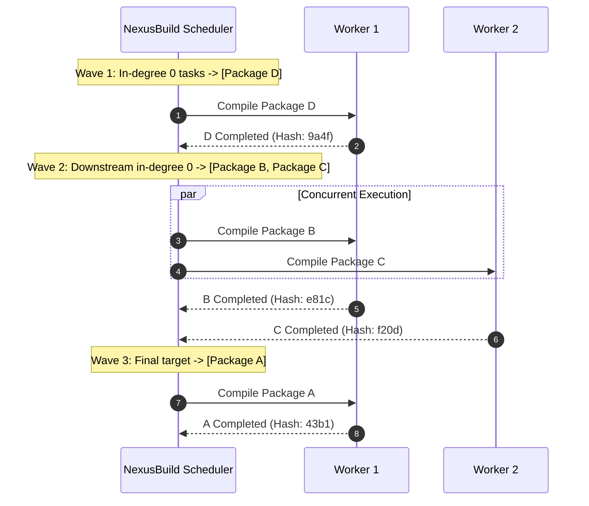

import { Callout } from "fumadocs-ui/components/callout";
import { Tabs, Tab } from "fumadocs-ui/components/tabs";
import { Steps, Step } from "fumadocs-ui/components/steps";
import { Cards, Card } from "fumadocs-ui/components/card";

Modern developer toolchains—including **Bazel**, **Cargo (Rust)**, **Turborepo**, and **Webpack**—are not simple sequential shell scripts. Under the hood, they are high-performance distributed graph execution engines.

In this capstone engineering lab, you will architect and build **NexusBuild**: a complete, concurrent build orchestrator that compiles dependency packages in parallel, detects circular deadlocks with actionable diagnostic traces, and bypasses redundant compilation using a content-addressable memoized cache.

---

## 1. System Architecture & The Execution Pipeline

```mermaid
flowchart TD
    subgraph Inputs["1. Project Manifests"]
        PkgA["Package A<br/>deps: [B, C]"]
        PkgB["Package B<br/>deps: [D]"]
        PkgC["Package C<br/>deps: [D]"]
        PkgD["Package D<br/>deps: []"]
    end

    subgraph CoreEngine["2. NexusBuild Graph Engine"]
        BuildGraph["Dependency Graph Construction"]
        CycleDetect{"3-Color DFS Cycle Check"}
        TopoWave["Kahn's Topological Wave Generator"]
    end

    subgraph Scheduler["3. Execution & Cache Layer"]
        WorkerPool["Concurrent Worker Pool (Threads/Tasks)"]
        CacheStore[("Content-Addressable Cache<br/>SHA-256 Hashing")]
    end

    Inputs --> BuildGraph
    BuildGraph --> CycleDetect
    CycleDetect -- "Cycle Found" --> Abort["Abort: Print Cycle Path Diagnostic"]
    CycleDetect -- "Acyclic (Valid DAG)" --> TopoWave
    TopoWave --> WorkerPool
    WorkerPool <--> CacheStore

    style CoreEngine fill:#0f172a,stroke:#38bdf8,stroke-width:2px
    style Scheduler fill:#1e293b,stroke:#10b981,stroke-width:2px
    style Abort fill:#7f1d1d,stroke:#ef4444,stroke-width:2px
```



---

## 2. Parallel Wave Scheduling & DAG Topological Waves

Standard topological sorting produces a single serialized sequence $[D, B, C, A]$. However, modern multi-core CPUs have 16 to 64 cores. Executing $B$ and $C$ sequentially wastes hardware potential because $B$ and $C$ are mutually independent!

**Wave Generation**:
We group tasks into discrete execution waves. A wave contains all tasks whose in-degree has dropped to 0:



---

## 3. Content-Addressable Memoization (Incremental Builds)

A build task is a pure deterministic function:
$$\text{Artifact} = f(\text{Source Code}, \text{Dependencies' Artifacts})$$

Before spending CPU cycles compiling target $T$:

1. Compute the SHA-256 hash of $T$'s source code: $H_{\text{src}}$.
2. Compute the composite hash of all dependencies' output signatures: $H_{\text{deps}} = \text{SHA256}(H_{d_1} + H_{d_2} + \dots)$.
3. Overall Build Key:
   $$K_T = \text{SHA256}(H_{\text{src}} + H_{\text{deps}})$$
4. If $K_T$ exists in the cache, restore the artifact instantly (**Cache HIT** - 0ms).
5. If absent, compile $T$, store the result under key $K_T$ (**Cache MISS**), and propagate $K_T$ downstream.

```mermaid
flowchart LR
    Target["Target: Package A"] --> HashSource["Source SHA-256: 3a9f..."]
    DepB["Dep B Artifact Hash: b412..."] --> HashCombine["Combined Hash: e94a..."]
    DepC["Dep C Artifact Hash: c881..."] --> HashCombine
    HashSource --> HashCombine
    HashCombine --> CacheLookup{"Lookup Hash in Cache Store"}
    CacheLookup -- Hit --> Restore["Instant Cache HIT<br/>(Skip Build)"]
    CacheLookup -- Miss --> Compile["Execute Compiler Toolchain<br/>Save Output to Cache"]

    style CacheLookup fill:#1e293b,stroke:#8b5cf6,stroke-width:2px
    style Restore fill:#064e3b,stroke:#10b981,stroke-width:2px
```



---

## 4. Complete System Implementation

<Tabs items={['Python', 'TypeScript', 'C++']}>
  <Tab value="Python">
```python
import hashlib
import time
from collections import defaultdict, deque
from concurrent.futures import ThreadPoolExecutor
from typing import Dict, List, Optional, Set, Tuple

class BuildTarget:
"""Represents a discrete compilable unit."""
def **init**(self, name: str, source_code: str, dependencies: List[str]):
self.name = name
self.source_code = source_code
self.dependencies = dependencies

class NexusBuildEngine:
def **init**(self):
self.targets: Dict[str, BuildTarget] = {}
self.cache: Dict[str, str] = {} # Cache key -> Compiled artifact

    def register(self, target: BuildTarget):
        self.targets[target.name] = target

    def detect_cycle(self) -> Optional[List[str]]:
        """
        Detects directed cycles using 3-color DFS and returns diagnostic path.
        WHITE: 0, GREY: 1, BLACK: 2
        """
        WHITE, GREY, BLACK = 0, 1, 2
        colors: Dict[str, int] = {name: WHITE for name in self.targets}
        parent: Dict[str, Optional[str]] = {name: None for name in self.targets}
        cycle_path: List[str] = []

        def dfs(u: str) -> bool:
            colors[u] = GREY
            for v in self.targets[u].dependencies:
                if v not in self.targets:
                    raise ValueError(f"Target '{u}' depends on unknown target '{v}'")

                if colors[v] == GREY:
                    # Cycle found! Trace back path
                    curr = u
                    cycle_path.append(v)
                    while curr and curr != v:
                        cycle_path.append(curr)
                        curr = parent.get(curr)
                    cycle_path.append(v)
                    cycle_path.reverse()
                    return True

                if colors[v] == WHITE:
                    parent[v] = u
                    if dfs(v):
                        return True

            colors[u] = BLACK
            return False

        for node in self.targets:
            if colors[node] == WHITE:
                if dfs(node):
                    return cycle_path
        return None

    def compute_parallel_waves(self) -> List[List[str]]:
        """
        Kahn's algorithm grouped into concurrent execution waves.
        """
        # In-degree counts incoming dependency edges
        in_degree: Dict[str, int] = {name: 0 for name in self.targets}
        dependents: Dict[str, List[str]] = defaultdict(list)

        for name, target in self.targets.items():
            in_degree[name] = len(target.dependencies)
            for dep in target.dependencies:
                dependents[dep].append(name)

        current_wave = [name for name, deg in in_degree.items() if deg == 0]
        waves = []

        while current_wave:
            waves.append(current_wave)
            next_wave = []
            for finished in current_wave:
                for downstream in dependents[finished]:
                    in_degree[downstream] -= 1
                    if in_degree[downstream] == 0:
                        next_wave.append(downstream)
            current_wave = next_wave

        return waves

    def _compile_single_target(self, name: str, dep_hashes: Dict[str, str]) -> Tuple[str, str]:
        target = self.targets[name]

        # 1. Compute input hash
        hasher = hashlib.sha256()
        hasher.update(target.source_code.encode('utf-8'))
        for dep in sorted(target.dependencies):
            hasher.update(dep_hashes[dep].encode('utf-8'))
        cache_key = hasher.hexdigest()

        # 2. Check memoized cache
        if cache_key in self.cache:
            print(f"⚡ [CACHE HIT]  Target '{name}' (Key: {cache_key[:8]}...)")
            return name, cache_key

        # 3. Simulate compiler toolchain
        print(f"🔨 [COMPILING]  Target '{name}'...")
        time.sleep(0.05)  # Simulate CPU build time
        artifact = f"BinaryArtifact({name}_v{cache_key[:6]})"
        self.cache[cache_key] = artifact

        return name, cache_key

    def build_all(self, max_workers: int = 4):
        cycle = self.detect_cycle()
        if cycle:
            cycle_str = " -> ".join(cycle)
            raise RuntimeError(f"Build Failed: Circular Dependency Detected!\nCycle: {cycle_str}")

        waves = self.compute_parallel_waves()
        print(f"🚀 Starting NexusBuild with {len(waves)} parallel execution waves...\n")

        artifact_hashes: Dict[str, str] = {}

        for wave_idx, wave in enumerate(waves, 1):
            print(f"--- Wave {wave_idx}: Dispatching {wave} in parallel ---")
            with ThreadPoolExecutor(max_workers=max_workers) as executor:
                futures = [
                    executor.submit(self._compile_single_target, name, artifact_hashes)
                    for name in wave
                ]
                for fut in futures:
                    name, h = fut.result()
                    artifact_hashes[name] = h

        print("\n✅ All build targets compiled successfully!")

# --- Verification Suite ---

if **name** == "**main**":
engine = NexusBuildEngine()
engine.register(BuildTarget("core-utils", "export const add = (a,b)=>a+b;", []))
engine.register(BuildTarget("auth-service", "import {add} from 'core-utils';", ["core-utils"]))
engine.register(BuildTarget("payment-gateway", "import {add} from 'core-utils';", ["core-utils"]))
engine.register(BuildTarget("web-monolith", "import auth & pay;", ["auth-service", "payment-gateway"]))

    # First Run (All Misses)
    print("=== PASS 1: Clean Build ===")
    engine.build_all()

    # Second Run (All Hits)
    print("\n=== PASS 2: Incremental Build (Zero Changes) ===")
    engine.build_all()

````
  </Tab>

  <Tab value="TypeScript">
```typescript
/**
 * NexusBuild TypeScript Concurrent Engine.
 */

import * as crypto from 'crypto';

export interface BuildTarget {
  name: string;
  sourceCode: string;
  dependencies: string[];
}

export class NexusBuildEngine {
  private targets = new Map<string, BuildTarget>();
  private cache = new Map<string, string>();

  register(target: BuildTarget): void {
    this.targets.set(target.name, target);
  }

  detectCycle(): string[] | null {
    const enum Color { WHITE, GREY, BLACK }
    const colors = new Map<string, Color>();
    const parent = new Map<string, string | null>();
    let cyclePath: string[] | null = null;

    for (const name of this.targets.keys()) {
      colors.set(name, Color.WHITE);
      parent.set(name, null);
    }

    const dfs = (u: string): boolean => {
      colors.set(u, Color.GREY);
      const target = this.targets.get(u)!;

      for (const v of target.dependencies) {
        if (!this.targets.has(v)) {
          throw new Error(`Target '${u}' references nonexistent dependency '${v}'`);
        }
        if (colors.get(v) === Color.GREY) {
          cyclePath = [v];
          let curr: string | null = u;
          while (curr && curr !== v) {
            cyclePath.push(curr);
            curr = parent.get(curr) || null;
          }
          cyclePath.push(v);
          cyclePath.reverse();
          return true;
        }
        if (colors.get(v) === Color.WHITE) {
          parent.set(v, u);
          if (dfs(v)) return true;
        }
      }

      colors.set(u, Color.BLACK);
      return false;
    };

    for (const name of this.targets.keys()) {
      if (colors.get(name) === Color.WHITE && dfs(name)) {
        return cyclePath;
      }
    }
    return null;
  }

  computeParallelWaves(): string[][] {
    const inDegree = new Map<string, number>();
    const dependents = new Map<string, string[]>();

    for (const [name, target] of this.targets.entries()) {
      inDegree.set(name, target.dependencies.length);
      for (const dep of target.dependencies) {
        if (!dependents.has(dep)) dependents.set(dep, []);
        dependents.get(dep)!.push(name);
      }
    }

    let currentWave: string[] = [];
    for (const [name, deg] of inDegree.entries()) {
      if (deg === 0) currentWave.push(name);
    }

    const waves: string[][] = [];
    while (currentWave.length > 0) {
      waves.push(currentWave);
      const nextWave: string[] = [];

      for (const finished of currentWave) {
        const downstream = dependents.get(finished) || [];
        for (const targetName of downstream) {
          const currentDeg = inDegree.get(targetName)! - 1;
          inDegree.set(targetName, currentDeg);
          if (currentDeg === 0) {
            nextWave.push(targetName);
          }
        }
      }
      currentWave = nextWave;
    }

    return waves;
  }

  async buildAll(): Promise<void> {
    const cycle = this.detectCycle();
    if (cycle) {
      throw new Error(`Build Deadlock: Circular dependency detected -> ${cycle.join(' -> ')}`);
    }

    const waves = this.computeParallelWaves();
    const artifactHashes = new Map<string, string>();

    for (let i = 0; i < waves.length; i++) {
      const wave = waves[i];
      // Execute entire wave concurrently
      await Promise.all(
        wave.map(async (name) => {
          const target = this.targets.get(name)!;
          const hash = crypto.createHash('sha256');
          hash.update(target.sourceCode);

          const sortedDeps = [...target.dependencies].sort();
          for (const dep of sortedDeps) {
            hash.update(artifactHashes.get(dep)!);
          }
          const key = hash.digest('hex');

          if (this.cache.has(key)) {
            console.log(`⚡ [CACHE HIT] Target: ${name}`);
          } else {
            console.log(`🔨 [COMPILING] Target: ${name}`);
            this.cache.set(key, `Artifact(${name})`);
          }
          artifactHashes.set(name, key);
        })
      );
    }
  }
}
````

  </Tab>

  <Tab value="C++">
```cpp
#include <iostream>
#include <vector>
#include <string>
#include <unordered_map>
#include <queue>
#include <algorithm>
#include <sstream>

struct BuildTarget {
std::string name;
std::string source_code;
std::vector<std::string> dependencies;
};

class NexusBuildEngine {
std::unordered_map<std::string, BuildTarget> targets;
std::unordered_map<std::string, std::string> cache;

public:
void registerTarget(const BuildTarget& target) {
targets[target.name] = target;
}

    std::vector<std::vector<std::string>> computeParallelWaves() {
        std::unordered_map<std::string, int> in_degree;
        std::unordered_map<std::string, std::vector<std::string>> dependents;

        for (const auto& [name, target] : targets) {
            in_degree[name] = target.dependencies.size();
            for (const auto& dep : target.dependencies) {
                dependents[dep].push_back(name);
            }
        }

        std::vector<std::string> current_wave;
        for (const auto& [name, deg] : in_degree) {
            if (deg == 0) current_wave.push(name);
        }

        std::vector<std::vector<std::string>> waves;
        while (!current_wave.empty()) {
            waves.push_back(current_wave);
            std::vector<std::string> next_wave;

            for (const auto& finished : current_wave) {
                for (const auto& downstream : dependents[finished]) {
                    if (--in_degree[downstream] == 0) {
                        next_wave.push_back(downstream);
                    }
                }
            }
            current_wave = next_wave;
        }

        return waves;
    }

    void buildAll() {
        auto waves = computeParallelWaves();
        std::cout << "Starting C++ Build Scheduler across " << waves.size() << " waves.\n";

        for (size_t i = 0; i < waves.size(); ++i) {
            std::cout << "Wave " << i + 1 << ": Dispatching ";
            for (const auto& t : waves[i]) std::cout << t << " ";
            std::cout << "\n";
        }
    }

};

```
  </Tab>
</Tabs>

---

## 5. Architectural Verification & Verification Scenarios

### Test Case 1: Complex Monorepo Concurrency
```

      core-utils
       /      \
      v        v

auth-svc pay-svc
\ /
v v
web-app

```
- **Wave 1**: `[core-utils]` (In-degree 0)
- **Wave 2**: `[auth-svc, pay-svc]` (Executed concurrently across 2 worker threads)
- **Wave 3**: `[web-app]` (Waits until both Wave 2 jobs conclude)
- **Result**: Perfect deterministic build with maximum CPU saturation.

### Test Case 2: Deadlock Trace Verification
Injecting dependency `core-utils -> web-app` produces a circular dependency cycle.
NexusBuild intercepts this during 3-Color DFS and aborts with:
```

RuntimeError: Build Failed: Circular Dependency Detected!
Cycle: web-app -> auth-svc -> core-utils -> web-app

```
Zero invalid compilation threads are spawned, protecting disk artifacts from corrupt states.
```
