import { Callout } from "fumadocs-ui/components/callout";
import { Tabs, Tab } from "fumadocs-ui/components/tabs";
import { Steps, Step } from "fumadocs-ui/components/steps";
import { Cards, Card } from "fumadocs-ui/components/card";

## The Architecture of Non-Linear Computation

In the early phases of computer science education, data is organized neatly into contiguous blocks and hierarchical trees: arrays, linked lists, queues, and balanced binary search trees. However, modern systems operate in a world where connections are arbitrary, cyclic, and high-dimensional.

From Internet packet routing protocols (BGP and OSPF) to dependency resolution engines (Cargo, npm, Webpack), database query execution planners, and social graph indexing (Neo4j, GraphQL), **Graphs** model the interconnected universe.

Parallel to this, **Dynamic Programming (DP)** is not a random collection of trick interview questions. At its mathematical core, Dynamic Programming is the technique of breaking down complex decision problems into recursive subproblems and navigating a **Directed Acyclic Graph (DAG) of states**. Every DP transition is simply an edge traversal across state vertices.

```mermaid
flowchart TD
    subgraph ProblemSpace["The Unified Paradigm: Graphs as State Spaces"]
        Problem["Complex Optimization Problem"] --> Decompose["Break into Overlapping Subproblems"]
        Decompose --> StateDAG["Formulate State Space as a DAG"]
        StateDAG --> MemoTab["Memoization (Top-Down DFS) / Tabulation (Bottom-Up Kahn's)"]
        MemoTab --> Solution["Optimal Substructure Solution"]
    end

    subgraph SystemsApplications["Production Systems Engineering"]
        StateDAG -.-> BuildEngine["Build Engines: Bazel / Turbo / Cargo"]
        StateDAG -.-> QueryPlanner["PostgreSQL System R Query Optimizer"]
        StateDAG -.-> NetworkRouting["IS-IS & OSPF Shortest Path Routing"]
        StateDAG -.-> DiffEngines["Myers Git Diff & Genome Sequencing"]
    end

    style ProblemSpace fill:#0f172a,stroke:#38bdf8,stroke-width:2px
    style SystemsApplications fill:#1e293b,stroke:#a855f7,stroke-width:2px
```

---

## The Core Duality: DP is Topological Sort on a DAG

To truly master Dynamic Programming, you must recognize its geometric identity with graphs:

> **Every Dynamic Programming problem is a Shortest (or Longest) Path problem on an implicitly defined Directed Acyclic Graph.**
>
> - **State:** A vertex $u \in V$.
> - **Transition / Choice:** A directed edge $(u, v) \in E$ with cost or reward $w(u, v)$.
> - **Base Case:** Source node(s) with known distances or zero cost.
> - **Tabulation:** Traversing vertices in **topological order** so that dependencies are resolved before computing downstream states.
> - **Memoization:** Depth-First Search with a cache to avoid re-visiting identical nodes in the state graph.

Understanding this duality transforms DP from an intimidating memorization exercise into a systematic graph traversal workflow.

---

## Track 3 Curriculum Roadmap

This track is divided into three comprehensive phases, concluding with a production-grade systems capstone project:

```mermaid
flowchart LR
    subgraph Phase1["Phase 1: Graph Traversal & Topology"]
        G1["01. Graph Representations<br/>Matrix, List, CSR<br/>BFS, DFS, 0-1 BFS"] --> G2["02. Shortest Paths & MST<br/>Dijkstra, Bellman-Ford<br/>Floyd-Warshall, Kruskal, Prim"]
        G2 --> G3["03. DAGs & Connectivity<br/>Kahn's Topo Sort<br/>Tarjan's SCC & Bridges"]
    end

    subgraph Phase2["Phase 2: Dynamic Programming Mastery"]
        DP1["04. 1D & 2D Dynamic Programming<br/>Optimal Substructure<br/>State Reduction & Rolling Arrays"] --> DP2["05. Subsequences & Knapsack<br/>0/1 & Unbounded Knapsack<br/>LCS, Edit Distance, LIS"]
        DP2 --> DP3["06. Advanced Dynamic Programming<br/>Interval DP, Tree DP<br/>Bitmask TSP, Digit DP"]
    end

    subgraph Phase3["Phase 3: Production Engineering & Capstone"]
        CAP["Capstone: Dependency Engine<br/>Concurrent Build Scheduler<br/>Cycle Detection & Memoized Cache"]
        REF["Quick Reference & Cheat Sheet<br/>Complexity Matrix<br/>DSU Production Template"]
    end

    G3 ==> DP1
    DP3 ==> CAP
    CAP ==> REF

    style Phase1 fill:#0f172a,stroke:#38bdf8,stroke-width:2px
    style Phase2 fill:#0f172a,stroke:#ec4899,stroke-width:2px
    style Phase3 fill:#0f172a,stroke:#10b981,stroke-width:2px
```

---

## Curriculum Modules

Explore the in-depth modules designed for this track:

<Cards>
  <Card
    title="01. Graph Fundamentals & Traversals"
    href="/docs/dsa/03-graphs-dynamic-programming-and-advanced-algorithms/01-graph-fundamentals-and-traversals"
    description="Adjacency Matrix, Adjacency List, Compressed Sparse Row (CSR) for CPU cache performance, Multi-Source BFS, 3-color DFS cycle detection, and 0-1 BFS with Deques."
  />
  <Card
    title="02. Shortest Paths & Minimum Spanning Trees"
    href="/docs/dsa/03-graphs-dynamic-programming-and-advanced-algorithms/02-shortest-paths-and-minimum-spanning-trees"
    description="Dijkstra's algorithm, Bellman-Ford negative cycle detection, Floyd-Warshall APSP, and Kruskal's MST powered by Disjoint Set Union (DSU) with Path Compression."
  />
  <Card
    title="03. Topological Sort & Graph Connectivity"
    href="/docs/dsa/03-graphs-dynamic-programming-and-advanced-algorithms/03-topological-sort-and-connectivity"
    description="Kahn's algorithm, DFS reverse post-order, Tarjan's Strongly Connected Components (SCC), and Tarjan's low-link algorithm for network bridges and articulation points."
  />
  <Card
    title="04. 1D and 2D Dynamic Programming"
    href="/docs/dsa/03-graphs-dynamic-programming-and-advanced-algorithms/04-dynamic-programming-1d-and-2d"
    description="Memoization vs Tabulation, state-space reduction, rolling variable arrays, Climbing Stairs, House Robber, Coin Change, and 2D grid path finding."
  />
  <Card
    title="05. Subsequences & Knapsack Problems"
    href="/docs/dsa/03-graphs-dynamic-programming-and-advanced-algorithms/05-dynamic-programming-subsequences-and-knapsack"
    description="0/1 and Unbounded Knapsack, reverse loop space compression, Longest Common Subsequence (LCS), Levenshtein Edit Distance, and O(N log N) Patience Sorting for LIS."
  />
  <Card
    title="06. Advanced DP: Interval, Tree & Bitmask"
    href="/docs/dsa/03-graphs-dynamic-programming-and-advanced-algorithms/06-advanced-dp-interval-tree-and-bitmask"
    description="Matrix Chain Multiplication, Burst Balloons, Tree DP (House Robber III, Re-rooting two-pass DFS), and Bitmask DP for the Traveling Salesperson Problem (TSP)."
  />
  <Card
    title="Capstone: Dependency Graph & Build System"
    href="/docs/dsa/03-graphs-dynamic-programming-and-advanced-algorithms/capstone-dependency-graph-and-build-system"
    description="Architect and implement a concurrent build orchestrator with DAG resolution, cycle tracing, wave-based parallel worker dispatch, and content-addressable caching."
  />
  <Card
    title="Quick Reference & Algorithm Selector"
    href="/docs/dsa/03-graphs-dynamic-programming-and-advanced-algorithms/quick-reference"
    description="Decision matrix for graph algorithms, Dynamic Programming recurrence cheat sheet, drop-in Disjoint Set Union (DSU) templates, and edge case checklist."
  />
</Cards>

---

## Pedagogical Standards in Track 3

Every lesson in this curriculum adheres to strict production engineering criteria:

1. **Memory & Cache Realities**: We analyze how adjacency lists cause CPU pointer chasing and branch mispredictions, and how Compressed Sparse Row (CSR) matrices optimize memory access in high-performance graph systems.
2. **Tri-Language Architecture**: Every algorithm is implemented cleanly and idiomatically in **Python**, **TypeScript**, and **C++**, complete with strict typing, memory ownership semantics, and thorough inline explanations.
3. **Real-World Systems Engineering**: We connect every theoretical concept to production systems: OSPF/BGP routing protocols, PostgreSQL cost-based query planners, Git Myers diff engine, and Linux kernel process namespaces.
