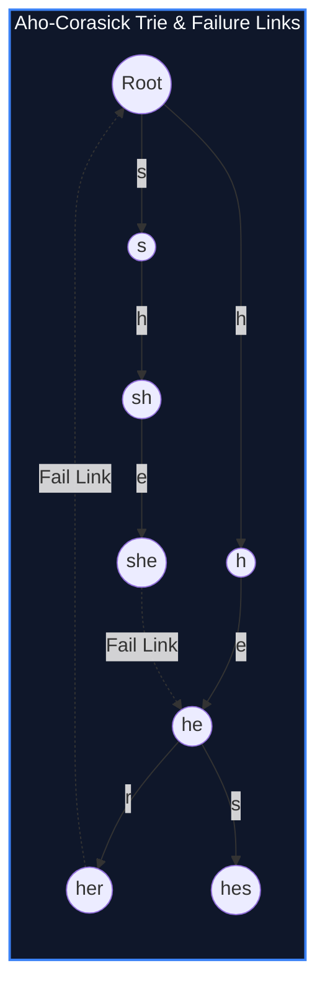

import { Callout } from "fumadocs-ui/components/callout";
import { Tabs, Tab } from "fumadocs-ui/components/tabs";
import { Steps, Step } from "fumadocs-ui/components/steps";
import { Cards, Card } from "fumadocs-ui/components/card";

## The Multi-Dictionary Search Problem

Standard string matching algorithms (such as KMP or Boyer-Moore) search for a **single pattern** $P$ within a text $T$ in $\mathcal{O}(|P| + |T|)$.

When querying a dictionary of $K$ patterns $\{P_1, P_2, \dots, P_K\}$ against text $T$ (e.g. anti-virus signature scanners, content filtering proxies, or genomic sequence analyzers):

- Running KMP independently for each pattern requires $\mathcal{O}(K \cdot |T| + \sum |P_i|)$.
- If $K = 10^5$ and $|T| = 10^6$, this takes over $10^{11}$ operations!

In 1975, Alfred V. Aho and Margaret J. Corasick created the **Aho-Corasick Automaton**, which searches all $K$ patterns simultaneously in:

$$\mathcal{O}\left(|T| + \sum |P_i| + \text{Matches}\right) \text{ time}$$



---

## Three Graph Structures in One Automaton

1. **Trie (Trie Edges):** Standard prefix tree storing the set of dictionary words.
2. **Failure Links (`fail[u]`):** Pointers to the longest proper suffix of the string represented by node $u$ that is also a prefix in the trie (analogous to KMP's $\pi$ table, computed via BFS).
3. **Dictionary Output Links (`exit[u]`):** Shortcuts directly linking node $u$ to the nearest ancestor with a valid terminal word match, preventing linear traversal of failure chains.

---

## Implementation

<Tabs items={["Python", "TypeScript", "C++"]}>
<Tab value="Python">
```python
from collections import deque
from typing import List, Dict

class AhoCorasickNode:
def **init**(self):
self.children: Dict[str, 'AhoCorasickNode'] = {}
self.fail: 'AhoCorasickNode' = None
self.output: List[int] = []

class AhoCorasick:
def **init**(self, patterns: List[str]):
self.root = AhoCorasickNode()
self.patterns = patterns

        # 1. Build trie
        for p_idx, pat in enumerate(patterns):
            curr = self.root
            for ch in pat:
                if ch not in curr.children:
                    curr.children[ch] = AhoCorasickNode()
                curr = curr.children[ch]
            curr.output.append(p_idx)

        # 2. Build failure links via BFS
        q = deque()
        for ch, child in self.root.children.items():
            child.fail = self.root
            q.append(child)

        while q:
            curr = q.popleft()
            for ch, child in curr.children.items():
                f = curr.fail
                while f and ch not in f.children:
                    f = f.fail
                child.fail = f.children[ch] if f else self.root
                child.output.extend(child.fail.output)
                q.append(child)

    def search(self, text: str) -> List[tuple]:
        """Returns list of (pattern_index, end_position_in_text)"""
        matches = []
        curr = self.root

        for i, ch in enumerate(text):
            while curr and ch not in curr.children:
                curr = curr.fail
            curr = curr.children[ch] if curr else self.root

            for p_idx in curr.output:
                matches.append((p_idx, i))

        return matches

````
</Tab>
<Tab value="TypeScript">
```typescript
class ACNode {
  children: Map<string, ACNode> = new Map();
  fail: ACNode | null = null;
  output: number[] = [];
}

export class AhoCorasick {
  private root: ACNode = new ACNode();

  constructor(patterns: string[]) {
    // 1. Build Trie
    for (let idx = 0; idx < patterns.length; idx++) {
      let curr = this.root;
      for (const ch of patterns[idx]) {
        if (!curr.children.has(ch)) {
          curr.children.set(ch, new ACNode());
        }
        curr = curr.children.get(ch)!;
      }
      curr.output.push(idx);
    }

    // 2. Build BFS Failure Links
    const q: ACNode[] = [];
    for (const [_, child] of this.root.children) {
      child.fail = this.root;
      q.push(child);
    }

    while (q.length > 0) {
      const curr = q.shift()!;
      for (const [ch, child] of curr.children) {
        let f = curr.fail;
        while (f && !f.children.has(ch)) f = f.fail;
        child.fail = f ? f.children.get(ch)! : this.root;
        child.output.push(...child.fail.output);
        q.push(child);
      }
    }
  }

  public search(text: string): [number, number][] {
    const matches: [number, number][] = [];
    let curr: ACNode | null = this.root;

    for (let i = 0; i < text.length; i++) {
      const ch = text[i];
      while (curr && !curr.children.has(ch)) curr = curr.fail;
      curr = curr ? curr.children.get(ch)! : this.root;

      for (const pIdx of curr.output) {
        matches.push([pIdx, i]);
      }
    }

    return matches;
  }
}
````

</Tab>
<Tab value="C++">
```cpp
#include <iostream>
#include <vector>
#include <string>
#include <queue>
#include <array>

class AhoCorasick {
struct Node {
std::array<int, 26> next;
int fail = 0;
std::vector<int> output;
Node() { next.fill(0); }
};

    std::vector<Node> trie;

public:
explicit AhoCorasick(const std::vector<std::string>& patterns) {
trie.emplace_back(); // root = 0

        for (int pIdx = 0; pIdx < static_cast<int>(patterns.size()); ++pIdx) {
            int curr = 0;
            for (char ch : patterns[pIdx]) {
                int c = ch - 'a';
                if (!trie[curr].next[c]) {
                    trie[curr].next[c] = static_cast<int>(trie.size());
                    trie.emplace_back();
                }
                curr = trie[curr].next[c];
            }
            trie[curr].output.push_back(pIdx);
        }

        std::queue<int> q;
        for (int c = 0; c < 26; ++c) {
            if (trie[0].next[c]) {
                q.push(trie[0].next[c]);
            }
        }

        while (!q.empty()) {
            int u = q.front();
            q.pop();

            for (int c = 0; c < 26; ++c) {
                int v = trie[u].next[c];
                if (v) {
                    trie[v].fail = trie[trie[u].fail].next[c];
                    const auto& failOutput = trie[trie[v].fail].output;
                    trie[v].output.insert(trie[v].output.end(), failOutput.begin(), failOutput.end());
                    q.push(v);
                } else {
                    trie[u].next[c] = trie[trie[u].fail].next[c];
                }
            }
        }
    }

    std::vector<std::pair<int, int>> search(const std::string& text) const {
        std::vector<std::pair<int, int>> matches;
        int curr = 0;

        for (int i = 0; i < static_cast<int>(text.size()); ++i) {
            curr = trie[curr].next[text[i] - 'a'];
            for (int pIdx : trie[curr].output) {
                matches.emplace_back(pIdx, i);
            }
        }

        return matches;
    }

};

```
</Tab>
</Tabs>

---

## Complexity Breakdown

| Phase | Time Complexity | Auxiliary Space |
| :--- | :--- | :--- |
| **Trie + Failure Construction** | $\mathcal{O}(\Sigma \cdot \sum |P_i|)$ | $\mathcal{O}(\Sigma \cdot \sum |P_i|)$ transitions |
| **Text Scanning** | $\mathcal{O}(|T| + \text{Matches})$ | Streaming without buffering text |
```
