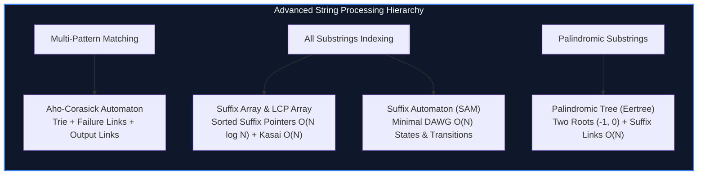

import { Callout } from "fumadocs-ui/components/callout";
import { Tabs, Tab } from "fumadocs-ui/components/tabs";
import { Steps, Step } from "fumadocs-ui/components/steps";
import { Cards, Card } from "fumadocs-ui/components/card";

## Linearizing All Substrings of a Text

A string of length $N$ contains $\Theta(N^2)$ distinct substrings. Standard pattern search algorithms (KMP, Rabin-Karp, Z-Algorithm) query single patterns against single texts. In text analytics, bioinformatics, and compiler symbol resolution, two higher-order challenges arise:

1. **Simultaneous Multi-Dictionary Search:** Querying hundreds of thousands of variable-length keywords simultaneously against a streaming text in $O(\sum |P_i| + |Text|)$ time.
2. **All-Substring Topology Representation:** Constructing a compressed linear structure ($O(N)$ vertices and edges) that encodes every single substring, its frequency, and its occurrence positions.

---

## Category Modules

<Cards>
  <Card
    title="Aho-Corasick Automaton"
    href="/docs/dsa/04-expert/advanced-string-suffix-structures/aho-corasick-automaton"
    description="Multi-pattern dictionary matching combining trie state transitions with KMP failure links and suffix dictionary shortcuts in linear time."
  />
  <Card
    title="Suffix Arrays and LCP Arrays"
    href="/docs/dsa/04-expert/advanced-string-suffix-structures/suffix-arrays-and-lcp"
    description="Lexicographically sorted suffix indices in O(N log N) paired with Kasai's algorithm for linear-time Longest Common Prefix derivation."
  />
  <Card
    title="Suffix Automata (SAM)"
    href="/docs/dsa/04-expert/advanced-string-suffix-structures/suffix-automata"
    description="Minimal directed acyclic word graph (DAWG) encoding all substrings of a string using O(N) states and transitions."
  />
  <Card
    title="Palindromic Trees (Eertree)"
    href="/docs/dsa/04-expert/advanced-string-suffix-structures/palindromic-trees-eertree"
    description="Two-rooted directed tree encoding all distinct palindromes of a string with suffix links in linear time and space."
  />
</Cards>
