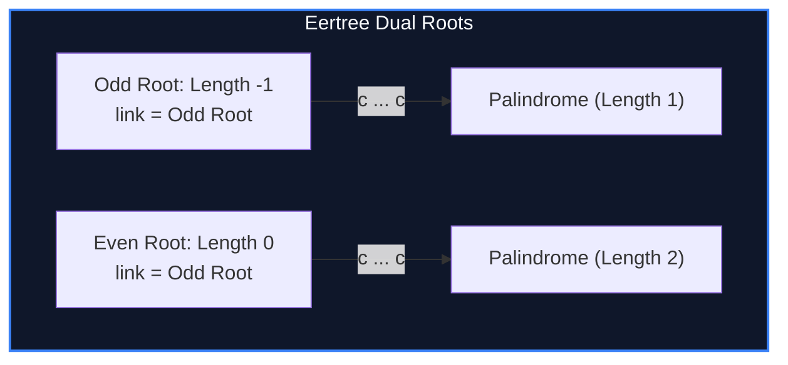

import { Callout } from "fumadocs-ui/components/callout";
import { Tabs, Tab } from "fumadocs-ui/components/tabs";
import { Steps, Step } from "fumadocs-ui/components/steps";
import { Cards, Card } from "fumadocs-ui/components/card";

## All Palindromes in Linear Time

A string of length $N$ can contain up to $\Theta(N^2)$ palindrome occurrences, but at most:

$$\le N \text{ distinct palindromic substrings}$$

In 2014, Mikhail Rubinchik and Arseny M. Shur invented the **Palindromic Tree (Eertree)**: an explicit tree representation of all distinct palindromes in a string.



---

## Structural Invariants

1. **Dual Imaginary Roots:**
   - Root 1 (Odd Root): Length $-1$, representing an empty seed that produces single-character palindromes ($(-1) + 2 = 1$).
   - Root 2 (Even Root): Length $0$, representing the empty string $\epsilon$.
2. **Transition:** Transition $u \xrightarrow{c} v$ represents surrounding palindrome $u$ with character $c$:
   $$v = c + u + c, \quad len(v) = len(u) + 2$$
3. **Suffix Link:** `link[u]` points to the node representing the longest proper palindromic suffix of $u$.

---

## Implementation

<Tabs items={["Python", "TypeScript", "C++"]}>
<Tab value="Python">
```python
class EertreeNode:
    __slots__ = ('len', 'link', 'next')
    def __init__(self, length: int = 0, link: int = 0):
        self.len = length
        self.link = link
        self.next = {}

class PalindromicTree:
def **init**(self): # 0 = Even root (len 0), 1 = Odd root (len -1)
self.tree = [EertreeNode(0, 1), EertreeNode(-1, 1)]
self.s = ""
self.last = 1

    def _get_link(self, u: int) -> int:
        while True:
            cur_len = self.tree[u].len
            pos = len(self.s) - cur_len - 1
            if pos >= 0 and self.s[pos] == self.s[-1]:
                return u
            u = self.tree[u].link

    def add_char(self, ch: str):
        self.s += ch
        cur = self._get_link(self.last)

        if ch not in self.tree[cur].next:
            new_node = len(self.tree)
            new_len = self.tree[cur].len + 2
            link = 0
            if new_len != 1:
                link = self.tree[self._get_link(self.tree[cur].link)].next[ch]

            self.tree.append(EertreeNode(new_len, link))
            self.tree[cur].next[ch] = new_node

        self.last = self.tree[cur].next[ch]

````
</Tab>
<Tab value="TypeScript">
```typescript
class ENode {
  len: number;
  link: number;
  next: Map<string, number> = new Map();

  constructor(len = 0, link = 0) {
    this.len = len;
    this.link = link;
  }
}

export class PalindromicTree {
  public tree: ENode[] = [new ENode(0, 1), new ENode(-1, 1)];
  private s: string = "";
  private last: number = 1;

  private getLink(u: number): number {
    while (true) {
      const curLen = this.tree[u].len;
      const pos = this.s.length - curLen - 1;
      if (pos >= 0 && this.s[pos] === this.s[this.s.length - 1]) return u;
      u = this.tree[u].link;
    }
  }

  public addChar(ch: string): void {
    this.s += ch;
    const cur = this.getLink(this.last);

    if (!this.tree[cur].next.has(ch)) {
      const newNode = this.tree.length;
      const newLen = this.tree[cur].len + 2;
      let link = 0;
      if (newLen !== 1) {
        link = this.tree[this.getLink(this.tree[cur].link)].next.get(ch)!;
      }
      this.tree.push(new ENode(newLen, link));
      this.tree[cur].next.set(ch, newNode);
    }

    this.last = this.tree[cur].next.get(ch)!;
  }
}
````

</Tab>
<Tab value="C++">
```cpp
#include <iostream>
#include <vector>
#include <string>
#include <map>

class PalindromicTree {
struct Node {
int len = 0, link = 0;
std::map<char, int> next;
};

    std::vector<Node> tree;
    std::string s;
    int last = 1;

    int getLink(int u) {
        while (true) {
            int curLen = tree[u].len;
            int pos = static_cast<int>(s.size()) - curLen - 1;
            if (pos >= 0 && s[pos] == s.back()) return u;
            u = tree[u].link;
        }
    }

public:
PalindromicTree() {
tree.emplace_back(0, 1); // Node 0: Even root
tree.emplace_back(-1, 1); // Node 1: Odd root
}

    void addChar(char ch) {
        s += ch;
        int cur = getLink(last);

        if (!tree[cur].next.count(ch)) {
            int newNode = static_cast<int>(tree.size());
            int newLen = tree[cur].len + 2;
            int link = 0;
            if (newLen != 1) {
                link = tree[getLink(tree[cur].link)].next[ch];
            }
            tree.push_back({newLen, link, {}});
            tree[cur].next[ch] = newNode;
        }

        last = tree[cur].next[ch];
    }

};

```
</Tab>
</Tabs>

---

## Complexity Breakdown

| Metric | Upper Bound |
| :--- | :--- |
| **Distinct Palindromes** | $\le N$ nodes |
| **Total Construction Time** | $\mathcal{O}(N)$ amortized |
| **Memory Consumption** | Linear $\mathcal{O}(N)$ |
```
