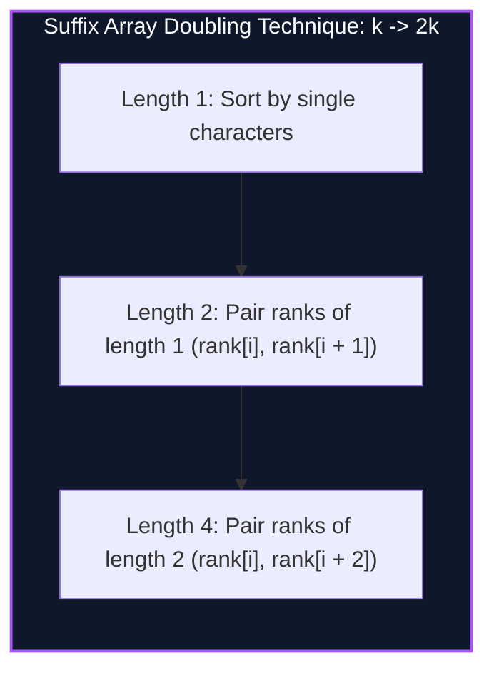

import { Callout } from "fumadocs-ui/components/callout";
import { Tabs, Tab } from "fumadocs-ui/components/tabs";
import { Steps, Step } from "fumadocs-ui/components/steps";
import { Cards, Card } from "fumadocs-ui/components/card";

## The Compact Alternative to Suffix Trees

A Suffix Tree represents all suffixes of a string of length $N$ in $\mathcal{O}(N)$ nodes. However, with massive alphabet pointers and heavy constant factors, building a suffix tree consumes 20–40 bytes per character.

A **Suffix Array (SA)** is an integer array of size $N$ storing the starting positions of all suffixes of string $S$ in **lexicographical order**:

$$S[SA[0] \dots N-1] < S[SA[1] \dots N-1] < \dots < S[SA[N-1] \dots N-1]$$

Consuming exactly **$4N$ bytes of memory**!

Paired with the **Longest Common Prefix (LCP) Array**, where:
$$LCP[i] = \text{length of longest common prefix between } S[SA[i] \dots] \text{ and } S[SA[i - 1] \dots]$$

Any substring query, longest repeated substring, or distinct substring count is solvable in $O(N)$ or $O(\log N)$.



---

## Kasai's Linear-Time LCP Algorithm

Naively computing LCP between consecutive suffixes in the suffix array takes $\mathcal{O}(N^2)$ worst-case time.

In 2001, Toru Kasai et al. proved that when evaluating suffixes in **original string order** ($i = 0, 1, \dots, N-1$):

> **Kasai's Invariant:**
> $$LCP[\text{rank}[i]] \ge LCP[\text{rank}[i - 1]] - 1$$

Because the LCP decrement is at most 1 per character, the internal character comparison pointer advances monotonically, computing the complete LCP array in:

$$\mathcal{O}(N) \text{ deterministic linear time!}$$

---

## Implementation

<Tabs items={["Python", "TypeScript", "C++"]}>
<Tab value="Python">
```python
from typing import List, Tuple

def build_suffix_array(s: str) -> List[int]:
"""Prefix doubling suffix array construction in O(N log^2 N)"""
n = len(s)
sa = list(range(n))
rank = [ord(c) for c in s]
k = 1

    while k < n:
        # Sort based on pair of ranks: (rank[i], rank[i + k])
        sa.sort(key=lambda i: (rank[i], rank[i + k] if i + k < n else -1))

        temp_rank = [0] * n
        temp_rank[sa[0]] = 0
        for i in range(1, n):
            prev_pair = (rank[sa[i - 1]], rank[sa[i - 1] + k] if sa[i - 1] + k < n else -1)
            curr_pair = (rank[sa[i]], rank[sa[i] + k] if sa[i] + k < n else -1)
            temp_rank[sa[i]] = temp_rank[sa[i - 1]] + (1 if curr_pair > prev_pair else 0)

        rank = temp_rank
        if rank[sa[-1]] == n - 1:
            break
        k <<= 1

    return sa

def build_lcp_kasai(s: str, sa: List[int]) -> List[int]:
"""Kasai's algorithm computing LCP array in O(N) time"""
n = len(s)
rank = [0] \* n
for i, p in enumerate(sa):
rank[p] = i

    lcp = [0] * n
    h = 0
    for i in range(n):
        if rank[i] > 0:
            j = sa[rank[i] - 1]
            while i + h < n and j + h < n and s[i + h] == s[j + h]:
                h += 1
            lcp[rank[i]] = h
            if h > 0:
                h -= 1
    return lcp

````
</Tab>
<Tab value="TypeScript">
```typescript
export function buildSuffixArray(s: string): number[] {
  const n = s.length;
  let sa = Array.from({ length: n }, (_, i) => i);
  let rank = Array.from({ length: n }, (_, i) => s.charCodeAt(i));
  let k = 1;

  while (k < n) {
    sa.sort((a, b) => {
      if (rank[a] !== rank[b]) return rank[a] - rank[b];
      const ra = a + k < n ? rank[a + k] : -1;
      const rb = b + k < n ? rank[b + k] : -1;
      return ra - rb;
    });

    const tempRank = new Array(n).fill(0);
    for (let i = 1; i < n; i++) {
      const prevA = sa[i - 1], currA = sa[i];
      const prevPair = [rank[prevA], prevA + k < n ? rank[prevA + k] : -1];
      const currPair = [rank[currA], currA + k < n ? rank[currA + k] : -1];
      const diff = currPair[0] !== prevPair[0] || currPair[1] !== prevPair[1];
      tempRank[currA] = tempRank[prevA] + (diff ? 1 : 0);
    }

    rank = tempRank;
    if (rank[sa[n - 1]] === n - 1) break;
    k <<= 1;
  }

  return sa;
}

export function buildLcpKasai(s: string, sa: number[]): number[] {
  const n = s.length;
  const rank = new Array(n).fill(0);
  for (let i = 0; i < n; i++) rank[sa[i]] = i;

  const lcp = new Array(n).fill(0);
  let h = 0;

  for (let i = 0; i < n; i++) {
    if (rank[i] > 0) {
      const j = sa[rank[i] - 1];
      while (i + h < n && j + h < n && s[i + h] === s[j + h]) h++;
      lcp[rank[i]] = h;
      if (h > 0) h--;
    }
  }

  return lcp;
}
````

</Tab>
<Tab value="C++">
```cpp
#include <iostream>
#include <vector>
#include <string>
#include <algorithm>

std::vector<int> buildSuffixArray(const std::string& s) {
int n = static_cast<int>(s.size());
std::vector<int> sa(n), rank(n);
for (int i = 0; i < n; ++i) {
sa[i] = i;
rank[i] = static_cast<unsigned char>(s[i]);
}

    for (int k = 1; k < n; k <<= 1) {
        auto cmp = [&](int a, int b) {
            if (rank[a] != rank[b]) return rank[a] < rank[b];
            int ra = (a + k < n) ? rank[a + k] : -1;
            int rb = (b + k < n) ? rank[b + k] : -1;
            return ra < rb;
        };
        std::sort(sa.begin(), sa.end(), cmp);

        std::vector<int> tempRank(n, 0);
        for (int i = 1; i < n; ++i) {
            tempRank[sa[i]] = tempRank[sa[i - 1]] + (cmp(sa[i - 1], sa[i]) ? 1 : 0);
        }
        rank = std::move(tempRank);
        if (rank[sa.back()] == n - 1) break;
    }
    return sa;

}

std::vector<int> buildLcpKasai(const std::string& s, const std::vector<int>& sa) {
int n = static_cast<int>(s.size());
std::vector<int> rank(n, 0), lcp(n, 0);
for (int i = 0; i < n; ++i) rank[sa[i]] = i;

    int h = 0;
    for (int i = 0; i < n; ++i) {
        if (rank[i] > 0) {
            int j = sa[rank[i] - 1];
            while (i + h < n && j + h < n && s[i + h] == s[j + h]) ++h;
            lcp[rank[i]] = h;
            if (h > 0) --h;
        }
    }
    return lcp;

}

```
</Tab>
</Tabs>

---

## Complexity Breakdown

| Phase | Time Complexity | Auxiliary Space |
| :--- | :--- | :--- |
| **Prefix Doubling SA** | $\mathcal{O}(N \log N)$ with radix sort | $\mathcal{O}(N)$ integer arrays |
| **Kasai's LCP Construction** | $\mathcal{O}(N)$ deterministic linear time | $\mathcal{O}(N)$ LCP array |
```
