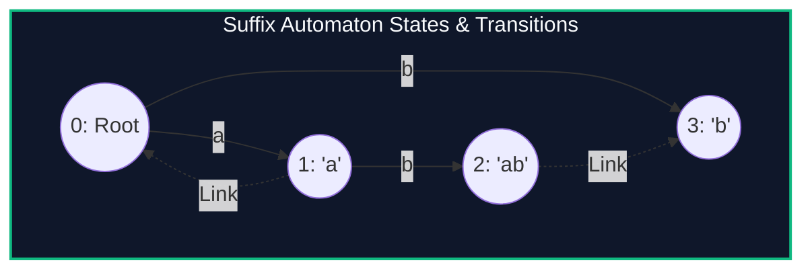

import { Callout } from "fumadocs-ui/components/callout";
import { Tabs, Tab } from "fumadocs-ui/components/tabs";
import { Steps, Step } from "fumadocs-ui/components/steps";
import { Cards, Card } from "fumadocs-ui/components/card";

## The Apex of String Data Structures

A string of length $N$ contains $\Theta(N^2)$ substrings. Explicitly storing them requires quadratic space.

A **Suffix Automaton (SAM)** (or Directed Acyclic Word Graph - DAWG) is the **minimal deterministic finite automaton (DFA)** that accepts all suffixes of string $S$. Because every substring is a prefix of some suffix, the SAM recognizes **every single substring of $S$**!

> **Linear Structural Theorem:** For any string of length $N \ge 1$:
>
> - The number of states (vertices) in SAM is at most:
>   $$|V| \le 2N - 1$$
> - The number of transitions (edges) is at most:
>   $$|E| \le 3N - 4$$

Constructible online in **strict linear time $\mathcal{O}(N)$**!



---

## Equivalence Classes & Suffix Links

Two substrings $u$ and $v$ belong to the same state if and only if they share the exact same set of end-positions in $S$:

$$\text{endpos}(u) = \text{endpos}(v)$$

- Each state represents a continuous range of lengths: $[len(link[u]) + 1, len[u]]$.
- Suffix links form a directed tree (the **Link Tree**) directed toward the root state, corresponding to the Suffix Tree of the reversed string!

---

## Implementation

<Tabs items={["Python", "TypeScript", "C++"]}>
<Tab value="Python">
```python
class SAMState:
    __slots__ = ('len', 'link', 'next')
    def __init__(self, length: int = 0, link: int = -1):
        self.len = length
        self.link = link
        self.next = {}

class SuffixAutomaton:
def **init**(self):
self.states = [SAMState(0, -1)]
self.last = 0

    def extend(self, ch: str):
        cur = len(self.states)
        self.states.append(SAMState(self.states[self.last].len + 1))

        p = self.last
        while p != -1 and ch not in self.states[p].next:
            self.states[p].next[ch] = cur
            p = self.states[p].link

        if p == -1:
            self.states[cur].link = 0
        else:
            q = self.states[p].next[ch]
            if self.states[p].len + 1 == self.states[q].len:
                self.states[cur].link = q
            else:
                clone = len(self.states)
                self.states.append(SAMState(self.states[p].len + 1, self.states[q].link))
                self.states[clone].next = dict(self.states[q].next)

                while p != -1 and self.states[p].next.get(ch) == q:
                    self.states[p].next[ch] = clone
                    p = self.states[p].link

                self.states[q].link = clone
                self.states[cur].link = clone

        self.last = cur

    def contains(self, sub: str) -> bool:
        curr = 0
        for ch in sub:
            if ch not in self.states[curr].next:
                return False
            curr = self.states[curr].next[ch]
        return True

````
</Tab>
<Tab value="TypeScript">
```typescript
class SAMState {
  len: number;
  link: number;
  next: Map<string, number> = new Map();

  constructor(len = 0, link = -1) {
    this.len = len;
    this.link = link;
  }
}

export class SuffixAutomaton {
  public states: SAMState[] = [new SAMState(0, -1)];
  private last: number = 0;

  public extend(ch: string): void {
    const cur = this.states.length;
    this.states.push(new SAMState(this.states[this.last].len + 1));

    let p = this.last;
    while (p !== -1 && !this.states[p].next.has(ch)) {
      this.states[p].next.set(ch, cur);
      p = this.states[p].link;
    }

    if (p === -1) {
      this.states[cur].link = 0;
    } else {
      const q = this.states[p].next.get(ch)!;
      if (this.states[p].len + 1 === this.states[q].len) {
        this.states[cur].link = q;
      } else {
        const clone = this.states.length;
        const cloneState = new SAMState(this.states[p].len + 1, this.states[q].link);
        cloneState.next = new Map(this.states[q].next);
        this.states.push(cloneState);

        while (p !== -1 && this.states[p].next.get(ch) === q) {
          this.states[p].next.set(ch, clone);
          p = this.states[p].link;
        }

        this.states[q].link = clone;
        this.states[cur].link = clone;
      }
    }
    this.last = cur;
  }

  public contains(sub: string): boolean {
    let curr = 0;
    for (const ch of sub) {
      if (!this.states[curr].next.has(ch)) return false;
      curr = this.states[curr].next.get(ch)!;
    }
    return true;
  }
}
````

</Tab>
<Tab value="C++">
```cpp
#include <iostream>
#include <vector>
#include <string>
#include <map>

class SuffixAutomaton {
struct State {
int len = 0, link = -1;
std::map<char, int> next;
};

    std::vector<State> states;
    int last = 0;

public:
SuffixAutomaton() {
states.emplace_back();
}

    void extend(char ch) {
        int cur = static_cast<int>(states.size());
        states.emplace_back();
        states[cur].len = states[last].len + 1;

        int p = last;
        while (p != -1 && !states[p].next.count(ch)) {
            states[p].next[ch] = cur;
            p = states[p].link;
        }

        if (p == -1) {
            states[cur].link = 0;
        } else {
            int q = states[p].next[ch];
            if (states[p].len + 1 == states[q].len) {
                states[cur].link = q;
            } else {
                int clone = static_cast<int>(states.size());
                states.push_back(states[q]);
                states[clone].len = states[p].len + 1;

                while (p != -1 && states[p].next[ch] == q) {
                    states[p].next[ch] = clone;
                    p = states[p].link;
                }

                states[q].link = clone;
                states[cur].link = clone;
            }
        }
        last = cur;
    }

    bool contains(const std::string& sub) const {
        int curr = 0;
        for (char ch : sub) {
            auto it = states[curr].next.find(ch);
            if (it == states[curr].next.end()) return false;
            curr = it->second;
        }
        return true;
    }

};

```
</Tab>
</Tabs>

---

## Complexity Breakdown

| Metric | Guaranteed Upper Bound |
| :--- | :--- |
| **Number of States** | $\le 2N - 1$ |
| **Number of Transitions** | $\le 3N - 4$ |
| **Construction Time** | $\mathcal{O}(N)$ amortized |
```
