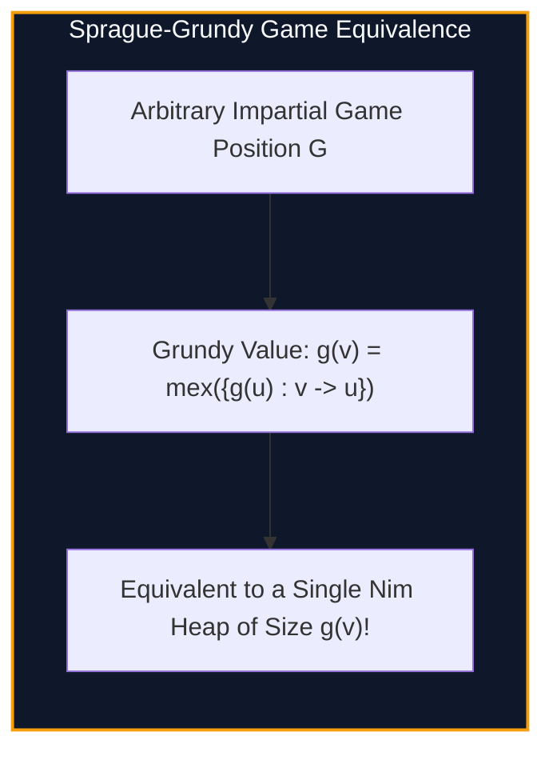

import { Callout } from "fumadocs-ui/components/callout";
import { Tabs, Tab } from "fumadocs-ui/components/tabs";
import { Steps, Step } from "fumadocs-ui/components/steps";
import { Cards, Card } from "fumadocs-ui/components/card";

## Impartial Games and Normal Play Convention

An **Impartial Game** satisfies three fundamental axioms:

1. Two players alternate turns.
2. From any given state $v$, the set of permissible moves is **identical for both players**.
3. **Normal Play Convention:** The player who makes the last valid move wins (a player facing zero legal moves loses).

The classical game of **Nim** consists of heaps of stones; a player takes any positive number of stones from a single heap. Charles Bouton proved in 1901 that a Nim position with heap sizes $(x_1, x_2, \dots, x_k)$ is a **winning position for the first player** if and only if their **Nim-Sum** is non-zero:

$$x_1 \oplus x_2 \oplus \dots \oplus x_k \neq 0$$



---

## The Sprague-Grundy Theorem

Roland Sprague (1935) and Patrick Grundy (1939) independently proved that **every impartial game under normal play is isomorphic to a single heap of Nim**:

1. **Minimum Excluded Function ($mex$):**
   $$mex(S) = \min \{ k \in \mathbb{N}_0 : k \notin S \}$$
2. **Grundy Value (Nim-Value) of a State:**
   $$G(v) = mex(\{ G(u) : v \to u \text{ is a valid transition} \})$$
3. **Composite Independent Games:**
   If a game consists of independent subgames $G_1, G_2, \dots, G_m$, the total game value is the **XOR sum of their Grundy values**:
   $$G_{\text{total}} = G(G_1) \oplus G(G_2) \oplus \dots \oplus G(G_m)$$

---

## Implementation

<Tabs items={["Python", "TypeScript", "C++"]}>
<Tab value="Python">
```python
from typing import Dict, List

def calculate_mex(values: set) -> int:
m = 0
while m in values:
m += 1
return m

def solve_sprague_grundy(transitions: Dict[int, List[int]], terminal_states: List[int]) -> Dict[int, int]:
"""
Computes Grundy values G(v) for a DAG of game states using topological ordering.
"""
memo: Dict[int, int] = {}

    def get_grundy(u: int) -> int:
        if u in memo:
            return memo[u]
        reachable_values = set()
        for v in transitions.get(u, []):
            reachable_values.add(get_grundy(v))
        memo[u] = calculate_mex(reachable_values)
        return memo[u]

    for state in terminal_states:
        memo[state] = 0

    return memo

````
</Tab>
<Tab value="TypeScript">
```typescript
export function calculateMex(values: Set<number>): number {
  let m = 0;
  while (values.has(m)) m++;
  return m;
}

export function solveSpragueGrundy(
  transitions: Map<number, number[]>
): Map<number, number> {
  const memo = new Map<number, number>();

  function getGrundy(u: number): number {
    if (memo.has(u)) return memo.get(u)!;
    const reachable = new Set<number>();
    const nxt = transitions.get(u) ?? [];

    for (const v of nxt) {
      reachable.add(getGrundy(v));
    }

    const g = calculateMex(reachable);
    memo.set(u, g);
    return g;
  }

  for (const [u] of transitions) {
    getGrundy(u);
  }

  return memo;
}
````

</Tab>
<Tab value="C++">
```cpp
#include <iostream>
#include <vector>
#include <unordered_set>
#include <algorithm>

int calculateMex(const std::unordered_set<int>& vals) {
int m = 0;
while (vals.count(m)) ++m;
return m;
}

std::vector<int> computeGrundyValues(int n, const std::vector<std::vector<int>>& dag) {
std::vector<int> g(n + 1, -1);

    auto dfs = [&](auto& self, int u) -> int {
        if (g[u] != -1) return g[u];
        std::unordered_set<int> reachable;
        for (int v : dag[u]) {
            reachable.insert(self(self, v));
        }
        return g[u] = calculateMex(reachable);
    };

    for (int i = 1; i <= n; ++i) {
        if (g[i] == -1) dfs(dfs, i);
    }
    return g;

}

```
</Tab>
</Tabs>

---

## Complexity Breakdown

| Step | Time Complexity | Auxiliary Space |
| :--- | :--- | :--- |
| **Grundy DFS over DAG** | $\mathcal{O}(V + E)$ | $\mathcal{O}(V)$ memoization |
| **Nim-Sum Evaluation** | $\mathcal{O}(\text{Games})$ | $\mathcal{O}(1)$ |
```
