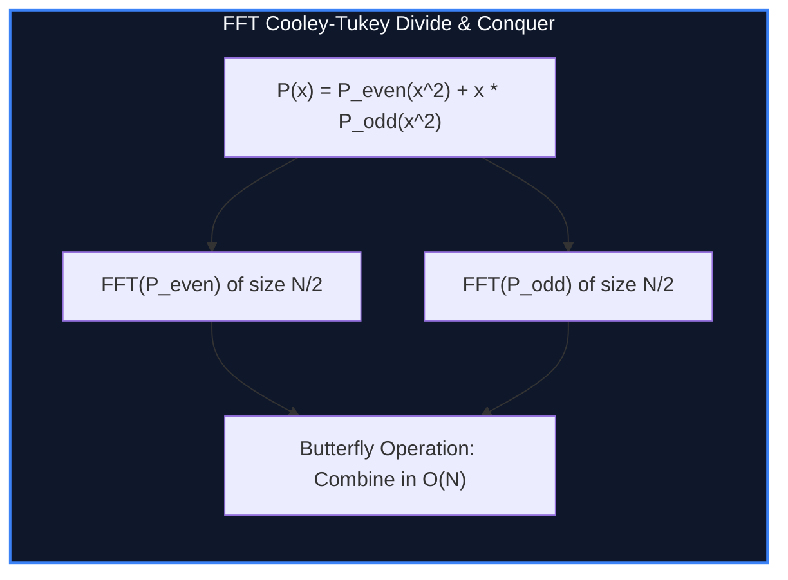

import { Callout } from "fumadocs-ui/components/callout";
import { Tabs, Tab } from "fumadocs-ui/components/tabs";
import { Steps, Step } from "fumadocs-ui/components/steps";
import { Cards, Card } from "fumadocs-ui/components/card";

## The Polynomial Convolution Barrier

Multiplying two polynomials $A(x) = \sum_{i = 0}^{N - 1} a_i x^i$ and $B(x) = \sum_{j = 0}^{M - 1} b_j x^j$ requires evaluating their Cauchy convolution:

$$C_k = \sum_{i = 0}^k a_i b_{k - i}$$

A naive double loop executes in $\mathcal{O}(N \cdot M) = \mathcal{O}(N^2)$ operations.

By the **Evaluation-Interpolation Duality**:

1. A polynomial of degree $N$ is uniquely determined by its values at $N$ distinct points.
2. In the point-value representation, polynomial multiplication is strictly **pointwise**:
   $$C(x_k) = A(x_k) \cdot B(x_k) \quad \text{in } \mathcal{O}(1) \text{ per point}$$

The **Fast Fourier Transform (FFT)** evaluates polynomials at the $N$-th **complex roots of unity** $\omega_N^k = e^{2\pi i k / N}$ in:

$$\mathcal{O}(N \log N) \text{ time}$$



---

## Number Theoretic Transform (NTT)

When working with modular arithmetic (e.g. modulo $998244353 = 119 \cdot 2^{23} + 1$), floating-point complex numbers introduce fatal precision errors.

The **Number Theoretic Transform (NTT)** replaces complex roots of unity with **modular primitive roots** $g = 3$:

$$\omega_N = g^{(P - 1) / N} \pmod P$$

Guaranteed exact integer arithmetic without precision loss!

---

## Implementation

<Tabs items={["Python", "TypeScript", "C++"]}>
<Tab value="Python">
```python
MOD = 998244353
G = 3

def ntt(a: list, invert: bool = False):
n = len(a)
j = 0
for i in range(1, n):
bit = n >> 1
while j & bit:
j ^= bit
bit >>= 1
j ^= bit
if i < j:
a[i], a[j] = a[j], a[i]

    length = 2
    while length <= n:
        wlen = pow(G, (MOD - 1) // length, MOD)
        if invert:
            wlen = pow(wlen, MOD - 2, MOD)
        for i in range(0, n, length):
            w = 1
            for k in range(length // 2):
                u = a[i + k]
                v = (a[i + k + length // 2] * w) % MOD
                a[i + k] = (u + v) % MOD
                a[i + k + length // 2] = (u - v + MOD) % MOD
                w = (w * wlen) % MOD
        length <<= 1

    if invert:
        n_inv = pow(n, MOD - 2, MOD)
        for i in range(n):
            a[i] = (a[i] * n_inv) % MOD

def multiply_polynomials(poly_a: list, poly_b: list) -> list:
n = 1
total_len = len(poly_a) + len(poly_b) - 1
while n < total_len:
n <<= 1

    fa = poly_a + [0] * (n - len(poly_a))
    fb = poly_b + [0] * (n - len(poly_b))

    ntt(fa, False)
    ntt(fb, False)

    for i in range(n):
        fa[i] = (fa[i] * fb[i]) % MOD

    ntt(fa, True)
    return fa[:total_len]

````
</Tab>
<Tab value="TypeScript">
```typescript
const MOD = 998244353n;
const G = 3n;

function power(base: bigint, exp: bigint): bigint {
  let res = 1n;
  base %= MOD;
  while (exp > 0n) {
    if ((exp & 1n) === 1n) res = (res * base) % MOD;
    base = (base * base) % MOD;
    exp >>= 1n;
  }
  return res;
}

function modInverse(n: bigint): bigint {
  return power(n, MOD - 2n);
}

export function ntt(a: bigint[], invert: boolean = false): void {
  const n = a.length;
  let j = 0;
  for (let i = 1; i < n; i++) {
    let bit = n >> 1;
    while ((j & bit) !== 0) {
      j ^= bit;
      bit >>= 1;
    }
    j ^= bit;
    if (i < j) {
      const temp = a[i]; a[i] = a[j]; a[j] = temp;
    }
  }

  for (let len = 2; len <= n; len <<= 1) {
    let wlen = power(G, (MOD - 1n) / BigInt(len));
    if (invert) wlen = modInverse(wlen);

    for (let i = 0; i < n; i += len) {
      let w = 1n;
      for (let k = 0; k < len / 2; k++) {
        const u = a[i + k];
        const v = (a[i + k + len / 2] * w) % MOD;
        a[i + k] = (u + v) % MOD;
        a[i + k + len / 2] = (u - v + MOD) % MOD;
        w = (w * wlen) % MOD;
      }
    }
  }

  if (invert) {
    const nInv = modInverse(BigInt(n));
    for (let i = 0; i < n; i++) {
      a[i] = (a[i] * nInv) % MOD;
    }
  }
}
````

</Tab>
<Tab value="C++">
```cpp
#include <iostream>
#include <vector>
#include <cstdint>

const int MOD = 998244353;
const int G = 3;

int64*t power(int64_t base, int64_t exp) {
int64_t res = 1;
base %= MOD;
while (exp > 0) {
if (exp & 1) res = (res * base) % MOD;
base = (base \_ base) % MOD;
exp >>= 1;
}
return res;
}

int64_t modInverse(int64_t n) {
return power(n, MOD - 2);
}

void ntt(std::vector<int64_t>& a, bool invert) {
int n = static_cast<int>(a.size());
for (int i = 1, j = 0; i < n; ++i) {
int bit = n >> 1;
for (; j & bit; bit >>= 1) j ^= bit;
j ^= bit;
if (i < j) std::swap(a[i], a[j]);
}

    for (int len = 2; len <= n; len <<= 1) {
        int64_t wlen = power(G, (MOD - 1) / len);
        if (invert) wlen = modInverse(wlen);

        for (int i = 0; i < n; i += len) {
            int64_t w = 1;
            for (int k = 0; k < len / 2; ++k) {
                int64_t u = a[i + k];
                int64_t v = (a[i + k + len / 2] * w) % MOD;
                a[i + k] = (u + v) % MOD;
                a[i + k + len / 2] = (u - v + MOD) % MOD;
                w = (w * wlen) % MOD;
            }
        }
    }

    if (invert) {
        int64_t nInv = modInverse(n);
        for (int i = 0; i < n; ++i) a[i] = (a[i] * nInv) % MOD;
    }

}

```
</Tab>
</Tabs>

---

## Complexity Breakdown

| Phase | Time Complexity | Auxiliary Space |
| :--- | :--- | :--- |
| **Bit-Reversal Permutation** | $\mathcal{O}(N)$ in-place | $\mathcal{O}(1)$ |
| **Butterfly Merging (NTT)** | $\mathcal{O}(N \log N)$ | $\mathcal{O}(N)$ padded vectors |
```
