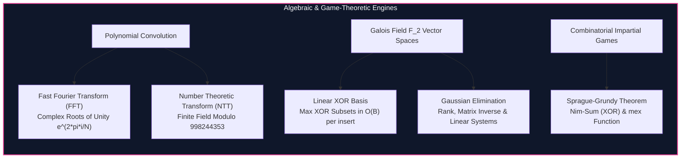

import { Callout } from "fumadocs-ui/components/callout";
import { Tabs, Tab } from "fumadocs-ui/components/tabs";
import { Steps, Step } from "fumadocs-ui/components/steps";
import { Cards, Card } from "fumadocs-ui/components/card";

## Polynomials, Vector Spaces, and Impartial Games

When algorithmic challenges transcend discrete graph traversal and combinatorial iteration, abstract algebraic structures provide exact mathematical solutions:

1. **Polynomial Convolution via Discrete Transforms:** Multiplying two polynomials of degree $N$ naively takes $\Theta(N^2)$ operations. The **Fast Fourier Transform (FFT)** evaluates polynomials at complex roots of unity, performs pointwise multiplication, and applies inverse FFT in $O(N \log N)$. The **Number Theoretic Transform (NTT)** replaces complex floating-point numbers with primitive roots of finite fields $\mathbb{Z}_p$, guaranteeing exact integer arithmetic without precision loss.
2. **Vector Spaces over Galois Fields:** Gaussian elimination over the two-element field $\mathbb{F}_2$ maintains a **Linear XOR Basis** of at most $64$ numbers, solving maximum XOR subset sums and system reachability in $O(N \log(\max A))$.
3. **Impartial Game Theory:** Under normal play convention, finite impartial games are isomorphic to the game of Nim. The **Sprague-Grundy Theorem** calculates Grundy values via the Minimum Excluded ($mex$) function, decomposing independent concurrent games into bitwise XOR operations.

---

## Category Modules

<Cards>
  <Card
    title="FFT and NTT"
    href="/docs/dsa/04-expert/algebraic-and-game-theoretic-algorithms/fft-and-ntt"
    description="Fast Fourier Transform using complex roots of unity and Number Theoretic Transform over prime modulus fields for O(N log N) polynomial multiplication."
  />
  <Card
    title="Linear XOR Basis & Gaussian Elimination"
    href="/docs/dsa/04-expert/algebraic-and-game-theoretic-algorithms/linear-xor-basis-and-gaussian-elimination"
    description="Construct vector space bases over F_2 to evaluate maximum XOR subset sums and solve modular linear equation systems."
  />
  <Card
    title="Combinatorial Game Theory & Sprague-Grundy"
    href="/docs/dsa/04-expert/algebraic-and-game-theoretic-algorithms/combinatorial-game-theory-sprague-grundy"
    description="Analyze normal-play impartial games using the mex function, nim-values, and the Sprague-Grundy XOR equivalence theorem."
  />
</Cards>
