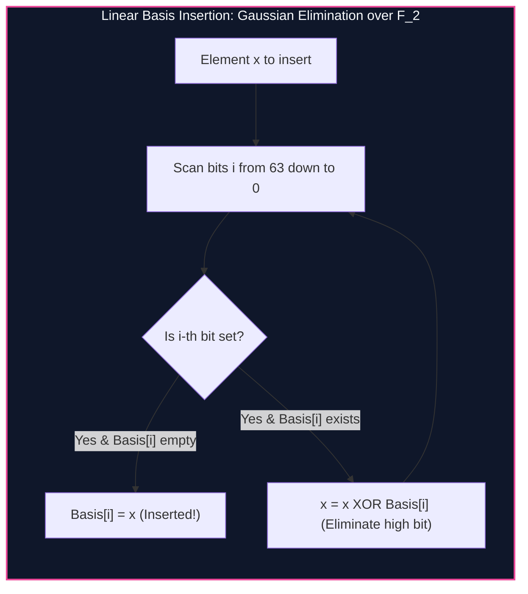

import { Callout } from "fumadocs-ui/components/callout";
import { Tabs, Tab } from "fumadocs-ui/components/tabs";
import { Steps, Step } from "fumadocs-ui/components/steps";
import { Cards, Card } from "fumadocs-ui/components/card";

## Vector Spaces over Galois Field F_2

In the Galois Field of two elements $\mathbb{F}_2$:

- Addition is bitwise **XOR** ($\oplus$).
- Multiplication is bitwise **AND** ($\land$).

Any 64-bit integer can be viewed as a 64-dimensional column vector in the vector space $\mathbb{V} = \mathbb{F}_2^{64}$.

A **Linear XOR Basis** of a set of integers $S$ is a minimal linearly independent subset $B \subseteq S$ that spans the exact same XOR subspace:

$$\text{span}(B) = \text{span}(S)$$

> **Dimension Bound:** For 64-bit integers, the size of any basis is strictly bounded by:
> $$|B| \le 64 \text{ elements}$$



---

## Maximum XOR Subset Sum

To find the maximum possible XOR sum from any subset of $S$:

1. Insert all elements into the Linear Basis.
2. Initialize `max_xor = 0`.
3. Iterate $i$ from 63 down to 0:
   - If `(max_xor ^ basis[i]) > max_xor`, update `max_xor = max_xor ^ basis[i]`.
     Runs in **$\mathcal{O}(64)$ deterministic operations**!

---

## Implementation

<Tabs items={["Python", "TypeScript", "C++"]}>
<Tab value="Python">
```python
from typing import List

class LinearXorBasis:
def **init**(self, bits: int = 64):
self.bits = bits
self.basis = [0] \* bits

    def insert(self, x: int) -> bool:
        for i in range(self.bits - 1, -1, -1):
            if (x >> i) & 1:
                if not self.basis[i]:
                    self.basis[i] = x
                    return True
                x ^= self.basis[i]
        return False

    def max_xor(self) -> int:
        ans = 0
        for i in range(self.bits - 1, -1, -1):
            if (ans ^ self.basis[i]) > ans:
                ans ^= self.basis[i]
        return ans

    def can_form(self, x: int) -> bool:
        for i in range(self.bits - 1, -1, -1):
            if (x >> i) & 1:
                if not self.basis[i]:
                    return False
                x ^= self.basis[i]
        return x == 0

````
</Tab>
<Tab value="TypeScript">
```typescript
export class LinearXorBasis {
  private basis: bigint[];

  constructor(private bits: number = 64) {
    this.basis = new Array(bits).fill(0n);
  }

  public insert(x: bigint): boolean {
    for (let i = this.bits - 1; i >= 0; i--) {
      if (((x >> BigInt(i)) & 1n) === 1n) {
        if (this.basis[i] === 0n) {
          this.basis[i] = x;
          return true;
        }
        x ^= this.basis[i];
      }
    }
    return false;
  }

  public maxXor(): bigint {
    let ans = 0n;
    for (let i = this.bits - 1; i >= 0; i--) {
      if ((ans ^ this.basis[i]) > ans) {
        ans ^= this.basis[i];
      }
    }
    return ans;
  }

  public canForm(x: bigint): boolean {
    for (let i = this.bits - 1; i >= 0; i--) {
      if (((x >> BigInt(i)) & 1n) === 1n) {
        if (this.basis[i] === 0n) return false;
        x ^= this.basis[i];
      }
    }
    return x === 0n;
  }
}
````

</Tab>
<Tab value="C++">
```cpp
#include <iostream>
#include <vector>
#include <cstdint>

class LinearXorBasis {
int bits;
std::vector<uint64_t> basis;

public:
explicit LinearXorBasis(int bitLength = 64) : bits(bitLength), basis(bitLength, 0) {}

    bool insert(uint64_t x) {
        for (int i = bits - 1; i >= 0; --i) {
            if ((x >> i) & 1) {
                if (!basis[i]) {
                    basis[i] = x;
                    return true;
                }
                x ^= basis[i];
            }
        }
        return false;
    }

    uint64_t maxXor() const {
        uint64_t ans = 0;
        for (int i = bits - 1; i >= 0; --i) {
            if ((ans ^ basis[i]) > ans) {
                ans ^= basis[i];
            }
        }
        return ans;
    }

    bool canForm(uint64_t x) const {
        for (int i = bits - 1; i >= 0; --i) {
            if ((x >> i) & 1) {
                if (!basis[i]) return false;
                x ^= basis[i];
            }
        }
        return x == 0;
    }

};

```
</Tab>
</Tabs>

---

## Complexity Breakdown

| Operation | Time Complexity | Auxiliary Space |
| :--- | :--- | :--- |
| **Insert Value** | $\mathcal{O}(B)$ where $B = 64$ | Exactly 64 integer words |
| **Max XOR Subset Sum** | $\mathcal{O}(B)$ | $\mathcal{O}(1)$ |
```
