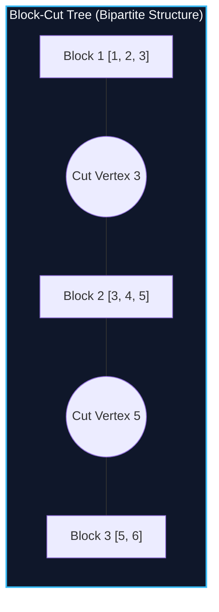

import { Callout } from "fumadocs-ui/components/callout";
import { Tabs, Tab } from "fumadocs-ui/components/tabs";
import { Steps, Step } from "fumadocs-ui/components/steps";
import { Cards, Card } from "fumadocs-ui/components/card";

## The Topology of Biconnectivity

While bridges decompose an undirected graph into edge-biconnected components, **articulation points (cut vertices)** decompose a graph into maximal **vertex-biconnected components (Blocks)**.

A single cut vertex belongs to multiple blocks simultaneously! To represent this cleanly without structural ambiguity, we construct a bipartite tree called the **Block-Cut Tree (BCT)**:

1. **Square Nodes (Blocks):** One node for every 2-vertex-connected component.
2. **Round Nodes (Cuts):** One node for every cut vertex in the original graph.
3. **Edges in BCT:** Connect each cut vertex node to all block nodes that contain it!



---

## Path Queries on Block-Cut Trees

Once the Block-Cut Tree is built, answering vertex-disjoint path and reachability queries reduces to simple tree traversals:

- "Does every path from $u$ to $v$ pass through vertex $w$?"
  $\iff$ Round node $w$ lies on the simple tree path between the block of $u$ and the block of $v$ in the BCT!

---

## Implementation

<Tabs items={["Python", "TypeScript", "C++"]}>
<Tab value="Python">
```python
from typing import List

class BlockCutTree:
def **init**(self, n: int, adj: List[List[int]]):
self.n = n
self.adj = adj
self.tin = [0] _ (n + 1)
self.low = [0] _ (n + 1)
self.timer = 0
self.stack = []
self.is_cut = [False] \* (n + 1)
self.blocks = []

        for i in range(1, n + 1):
            if not self.tin[i]:
                self._dfs(i, 0)

        # Build BCT adjacency
        self.bct_nodes = len(self.blocks)
        self.bct_adj = [[] for _ in range(self.n + self.bct_nodes + 1)]

        for b_id, block in enumerate(self.blocks, 1):
            for u in block:
                if self.is_cut[u]:
                    # Edge between cut vertex u and block node b_id
                    self.bct_adj[u].append(self.n + b_id)
                    self.bct_adj[self.n + b_id].append(u)

    def _dfs(self, u: int, p: int):
        self.timer += 1
        self.tin[u] = self.low[u] = self.timer
        self.stack.append(u)
        children = 0

        for v in self.adj[u]:
            if v == p: continue
            if self.tin[v]:
                self.low[u] = min(self.low[u], self.tin[v])
            else:
                children += 1
                self._dfs(v, u)
                self.low[u] = min(self.low[u], self.low[v])

                if self.low[v] >= self.tin[u]:
                    if p != 0 or children > 1:
                        self.is_cut[u] = True
                    block = [u]
                    while True:
                        node = self.stack.pop()
                        block.append(node)
                        if node == v: break
                    self.blocks.append(block)

````
</Tab>
<Tab value="TypeScript">
```typescript
export class BlockCutTree {
  private tin: number[];
  private low: number[];
  private timer: number = 0;
  private stack: number[] = [];
  public isCut: boolean[];
  public blocks: number[][] = [];
  public bctAdj: number[][];

  constructor(private n: number, private adj: number[][]) {
    this.tin = new Array(n + 1).fill(0);
    this.low = new Array(n + 1).fill(0);
    this.isCut = new Array(n + 1).fill(false);

    for (let i = 1; i <= n; i++) {
      if (this.tin[i] === 0) this.dfs(i, 0);
    }

    const bCount = this.blocks.length;
    this.bctAdj = Array.from({ length: n + bCount + 1 }, () => []);

    for (let b = 0; b < bCount; b++) {
      const blockId = n + b + 1;
      for (const u of this.blocks[b]) {
        if (this.isCut[u]) {
          this.bctAdj[u].push(blockId);
          this.bctAdj[blockId].push(u);
        }
      }
    }
  }

  private dfs(u: number, p: number): void {
    this.tin[u] = this.low[u] = ++this.timer;
    this.stack.push(u);
    let children = 0;

    for (const v of this.adj[u]) {
      if (v === p) continue;
      if (this.tin[v] !== 0) {
        this.low[u] = Math.min(this.low[u], this.tin[v]);
      } else {
        children++;
        this.dfs(v, u);
        this.low[u] = Math.min(this.low[u], this.low[v]);

        if (this.low[v] >= this.tin[u]) {
          if (p !== 0 || children > 1) this.isCut[u] = true;
          const block = [u];
          while (true) {
            const node = this.stack.pop()!;
            block.push(node);
            if (node === v) break;
          }
          this.blocks.push(block);
        }
      }
    }
  }
}
````

</Tab>
<Tab value="C++">
```cpp
#include <iostream>
#include <vector>
#include <algorithm>

class BlockCutTree {
int n, timer = 0;
const std::vector<std::vector<int>>& adj;
std::vector<int> tin, low, stack;

    void dfs(int u, int p) {
        tin[u] = low[u] = ++timer;
        stack.push_back(u);
        int children = 0;

        for (int v : adj[u]) {
            if (v == p) continue;
            if (tin[v]) {
                low[u] = std::min(low[u], tin[v]);
            } else {
                children++;
                dfs(v, u);
                low[u] = std::min(low[u], low[v]);

                if (low[v] >= tin[u]) {
                    if (p != 0 || children > 1) isCut[u] = true;
                    std::vector<int> block = {u};
                    while (true) {
                        int node = stack.back();
                        stack.pop_back();
                        block.push_back(node);
                        if (node == v) break;
                    }
                    blocks.push_back(block);
                }
            }
        }
    }

public:
std::vector<bool> isCut;
std::vector<std::vector<int>> blocks;
std::vector<std::vector<int>> bctAdj;

    BlockCutTree(int numNodes, const std::vector<std::vector<int>>& graph)
        : n(numNodes), adj(graph), tin(n + 1, 0), low(n + 1, 0), isCut(n + 1, false) {
        for (int i = 1; i <= n; ++i) {
            if (!tin[i]) dfs(i, 0);
        }

        int bCount = static_cast<int>(blocks.size());
        bctAdj.resize(n + bCount + 1);

        for (int b = 0; b < bCount; ++b) {
            int blockId = n + b + 1;
            for (int u : blocks[b]) {
                if (isCut[u]) {
                    bctAdj[u].push_back(blockId);
                    bctAdj[blockId].push_back(u);
                }
            }
        }
    }

};

```
</Tab>
</Tabs>

---

## Complexity Breakdown

| Phase | Time Complexity | Total BCT Vertices |
| :--- | :--- | :--- |
| **Tarjan Stack Extraction** | $\mathcal{O}(V + E)$ | $\le 2V$ total nodes |
| **BCT Adjacency Building** | $\mathcal{O}(V + E)$ | Strictly a forest/tree structure |
```
