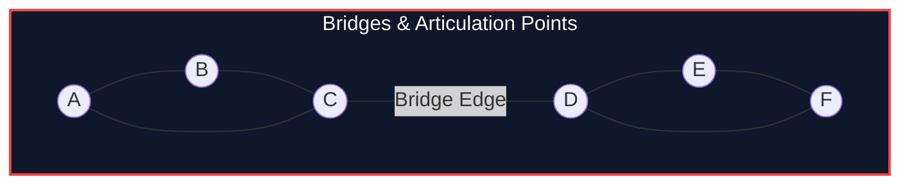

import { Callout } from "fumadocs-ui/components/callout";
import { Tabs, Tab } from "fumadocs-ui/components/tabs";
import { Steps, Step } from "fumadocs-ui/components/steps";
import { Cards, Card } from "fumadocs-ui/components/card";

## Critical Structural Vulnerabilities in Networks

In physical communications networks, server backbones, and civil infrastructure, certain nodes or transmission lines represent **single points of catastrophic failure**:

1. **Bridge (Cut Edge):** An edge $e$ whose removal increases the number of connected components in the graph.
2. **Articulation Point (Cut Vertex):** A vertex $u$ whose removal increases the number of connected components.
3. **2-Edge-Connected Component (Bridge-Block):** A maximal subgraph containing no bridges. Any two vertices are connected by at least two edge-disjoint paths.
4. **2-Vertex-Connected Component (Biconnected Component):** A maximal subgraph containing no articulation points.



---

## Tarjan's Bridge & Cut Vertex Conditions

Using DFS discovery time `tin[u]` and the low-link value `low[u]`:

### Bridge Condition

An edge $(u, v)$ in the DFS tree is a **Bridge** if and only if:
$$\text{low}[v] > \text{tin}[u]$$
_(No back edge from $v$ or any of its descendants reaches $u$ or any ancestor of $u$.)_

### Articulation Point Condition

A vertex $u$ is an **Articulation Point** if and only if:

1. $u$ is the **DFS root** and has **$\ge 2$ children** in the DFS tree.
2. $u$ is **not the root**, and there exists at least one child $v$ such that:
   $$\text{low}[v] \ge \text{tin}[u]$$

---

## Implementation

<Tabs items={["Python", "TypeScript", "C++"]}>
<Tab value="Python">
```python
from typing import List, Tuple

class BridgeCutFinder:
def **init**(self, n: int, adj: List[List[int]]):
self.n = n
self.adj = adj
self.tin = [0] _ (n + 1)
self.low = [0] _ (n + 1)
self.timer = 0
self.bridges: List[Tuple[int, int]] = []
self.is_cut_vertex = [False] \* (n + 1)

        for i in range(1, n + 1):
            if not self.tin[i]:
                self._dfs(i, 0)

    def _dfs(self, u: int, p: int):
        self.timer += 1
        self.tin[u] = self.low[u] = self.timer
        children = 0

        for v in self.adj[u]:
            if v == p:
                continue
            if self.tin[v]:
                self.low[u] = min(self.low[u], self.tin[v])
            else:
                children += 1
                self._dfs(v, u)
                self.low[u] = min(self.low[u], self.low[v])

                # Bridge condition
                if self.low[v] > self.tin[u]:
                    self.bridges.append((u, v))

                # Articulation condition for non-root
                if p != 0 and self.low[v] >= self.tin[u]:
                    self.is_cut_vertex[u] = True

        if p == 0 and children > 1:
            self.is_cut_vertex[u] = True

````
</Tab>
<Tab value="TypeScript">
```typescript
export class BridgeCutFinder {
  private tin: number[];
  private low: number[];
  private timer: number = 0;
  public bridges: [number, number][] = [];
  public isCutVertex: boolean[];

  constructor(private n: number, private adj: number[][]) {
    this.tin = new Array(n + 1).fill(0);
    this.low = new Array(n + 1).fill(0);
    this.isCutVertex = new Array(n + 1).fill(false);

    for (let i = 1; i <= n; i++) {
      if (this.tin[i] === 0) {
        this.dfs(i, 0);
      }
    }
  }

  private dfs(u: number, p: number): void {
    this.tin[u] = this.low[u] = ++this.timer;
    let children = 0;

    for (const v of this.adj[u]) {
      if (v === p) continue;
      if (this.tin[v] !== 0) {
        this.low[u] = Math.min(this.low[u], this.tin[v]);
      } else {
        children++;
        this.dfs(v, u);
        this.low[u] = Math.min(this.low[u], this.low[v]);

        if (this.low[v] > this.tin[u]) {
          this.bridges.push([u, v]);
        }

        if (p !== 0 && this.low[v] >= this.tin[u]) {
          this.isCutVertex[u] = true;
        }
      }
    }

    if (p === 0 && children > 1) {
      this.isCutVertex[u] = true;
    }
  }
}
````

</Tab>
<Tab value="C++">
```cpp
#include <iostream>
#include <vector>
#include <algorithm>

class BridgeCutFinder {
int n, timer = 0;
const std::vector<std::vector<int>>& adj;
std::vector<int> tin, low;

    void dfs(int u, int p) {
        tin[u] = low[u] = ++timer;
        int children = 0;

        for (int v : adj[u]) {
            if (v == p) continue;
            if (tin[v]) {
                low[u] = std::min(low[u], tin[v]);
            } else {
                children++;
                dfs(v, u);
                low[u] = std::min(low[u], low[v]);

                if (low[v] > tin[u]) {
                    bridges.emplace_back(u, v);
                }

                if (p != 0 && low[v] >= tin[u]) {
                    isCutVertex[u] = true;
                }
            }
        }

        if (p == 0 && children > 1) {
            isCutVertex[u] = true;
        }
    }

public:
std::vector<std::pair<int, int>> bridges;
std::vector<bool> isCutVertex;

    BridgeCutFinder(int numNodes, const std::vector<std::vector<int>>& graph)
        : n(numNodes), adj(graph), tin(n + 1, 0), low(n + 1, 0), isCutVertex(n + 1, false) {
        for (int i = 1; i <= n; ++i) {
            if (!tin[i]) dfs(i, 0);
        }
    }

};

```
</Tab>
</Tabs>

---

## Complexity Breakdown

| Metric | Complexity |
| :--- | :--- |
| **Execution Time** | $\mathcal{O}(V + E)$ single linear DFS pass |
| **Auxiliary Memory** | $\mathcal{O}(V)$ for low-link array and recursion depth |
```
