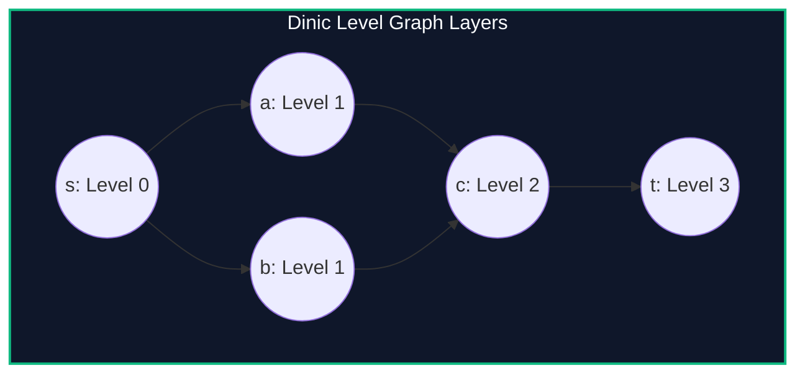

import { Callout } from "fumadocs-ui/components/callout";
import { Tabs, Tab } from "fumadocs-ui/components/tabs";
import { Steps, Step } from "fumadocs-ui/components/steps";
import { Cards, Card } from "fumadocs-ui/components/card";

## The Breakthrough of Blocking Flows

In Edmonds-Karp, each BFS discovers a single augmenting path and discards the level information. In 1970, Yefim Dinic revolutionized network flow theory by introducing **Level Graphs** and **Blocking Flows**:

1. **Level Graph Construction (BFS):** Partition vertices into discrete layers where `level[v] = level[u] + 1`. An edge $(u, v)$ is admissible if and only if $\text{level}[v] = \text{level}[u] + 1$ and residual capacity $r(u, v) > 0$.
2. **Blocking Flow Augmentation (DFS):** Repeatedly push flow along admissible edges until no more path from $s$ to $t$ exists in the current level graph.
3. **Dead-End Elimination (Current-Arc Optimization):** Maintain a pointer `ptr[u]` that skips saturated or exhausted outgoing edges during DFS, preventing re-exploration.



---

## Complexity Guarantees

- **General Networks:** Since the distance from $s$ to $t$ strictly increases in each phase, there are at most $V - 1$ phases. Each phase pushes a blocking flow in $O(V E)$, yielding:
  $$\mathcal{O}(V^2 E)$$
- **Unit Networks (Capacity $\in \{0, 1\}$):**
  $$\mathcal{O}(E \min(V^{2/3}, \sqrt{E}))$$
- **Bipartite Matching Networks:**
  $$\mathcal{O}(E \sqrt{V})$$

---

## Implementation

<Tabs items={["Python", "TypeScript", "C++"]}>
<Tab value="Python">
```python
from collections import deque
from typing import List

class Dinic:
class Edge:
def **init**(self, to: int, rev: int, cap: int):
self.to = to
self.rev = rev
self.cap = cap
self.flow = 0

    def __init__(self, n: int):
        self.n = n
        self.adj = [[] for _ in range(n + 1)]
        self.level = [-1] * (n + 1)
        self.ptr = [0] * (n + 1)

    def add_edge(self, u: int, v: int, cap: int):
        forward = self.Edge(v, len(self.adj[v]), cap)
        backward = self.Edge(u, len(self.adj[u]), 0)
        self.adj[u].append(forward)
        self.adj[v].append(backward)

    def _bfs(self, s: int, t: int) -> bool:
        self.level = [-1] * (self.n + 1)
        self.level[s] = 0
        q = deque([s])

        while q:
            u = q.popleft()
            for edge in self.adj[u]:
                if edge.cap - edge.flow > 0 and self.level[edge.to] == -1:
                    self.level[edge.to] = self.level[u] + 1
                    q.append(edge.to)
        return self.level[t] != -1

    def _dfs(self, u: int, t: int, pushed: int) -> int:
        if pushed == 0 or u == t:
            return pushed

        for cid in range(self.ptr[u], len(self.adj[u])):
            self.ptr[u] = cid
            edge = self.adj[u][cid]
            tr = edge.to
            if self.level[u] + 1 != self.level[tr] or edge.cap - edge.flow == 0:
                continue
            tr_pushed = self._dfs(tr, t, min(pushed, edge.cap - edge.flow))
            if tr_pushed == 0:
                continue
            edge.flow += tr_pushed
            self.adj[tr][edge.rev].flow -= tr_pushed
            return tr_pushed
        return 0

    def max_flow(self, s: int, t: int) -> int:
        flow = 0
        while self._bfs(s, t):
            self.ptr = [0] * (self.n + 1)
            while True:
                pushed = self._dfs(s, t, float('inf'))
                if pushed == 0:
                    break
                flow += pushed
        return flow

````
</Tab>
<Tab value="TypeScript">
```typescript
interface FlowEdge {
  to: number;
  rev: number;
  cap: number;
  flow: number;
}

export class Dinic {
  private adj: FlowEdge[][];
  private level: number[];
  private ptr: number[];

  constructor(private n: number) {
    this.adj = Array.from({ length: n + 1 }, () => []);
    this.level = new Array(n + 1).fill(-1);
    this.ptr = new Array(n + 1).fill(0);
  }

  public addEdge(u: number, v: number, cap: number): void {
    const forward: FlowEdge = { to: v, rev: this.adj[v].length, cap, flow: 0 };
    const backward: FlowEdge = { to: u, rev: this.adj[u].length, cap: 0, flow: 0 };
    this.adj[u].push(forward);
    this.adj[v].push(backward);
  }

  private bfs(s: number, t: number): boolean {
    this.level.fill(-1);
    this.level[s] = 0;
    const q: number[] = [s];

    while (q.length > 0) {
      const u = q.shift()!;
      for (const edge of this.adj[u]) {
        if (edge.cap - edge.flow > 0 && this.level[edge.to] === -1) {
          this.level[edge.to] = this.level[u] + 1;
          q.push(edge.to);
        }
      }
    }
    return this.level[t] !== -1;
  }

  private dfs(u: number, t: number, pushed: number): number {
    if (pushed === 0 || u === t) return pushed;

    for (let cid = this.ptr[u]; cid < this.adj[u].length; cid++) {
      this.ptr[u] = cid;
      const edge = this.adj[u][cid];
      const tr = edge.to;
      if (this.level[u] + 1 !== this.level[tr] || edge.cap - edge.flow === 0) continue;

      const trPushed = this.dfs(tr, t, Math.min(pushed, edge.cap - edge.flow));
      if (trPushed === 0) continue;

      edge.flow += trPushed;
      this.adj[tr][edge.rev].flow -= trPushed;
      return trPushed;
    }
    return 0;
  }

  public maxFlow(s: number, t: number): number {
    let flow = 0;
    while (this.bfs(s, t)) {
      this.ptr.fill(0);
      while (true) {
        const pushed = this.dfs(s, t, Infinity);
        if (pushed === 0) break;
        flow += pushed;
      }
    }
    return flow;
  }
}
````

</Tab>
<Tab value="C++">
```cpp
#include <iostream>
#include <vector>
#include <queue>
#include <algorithm>

class Dinic {
struct Edge {
int to, rev;
int64_t cap, flow;
};

    int n;
    std::vector<std::vector<Edge>> adj;
    std::vector<int> level, ptr;

    bool bfs(int s, int t) {
        std::fill(level.begin(), level.end(), -1);
        level[s] = 0;
        std::queue<int> q;
        q.push(s);

        while (!q.empty()) {
            int u = q.front();
            q.pop();

            for (const auto& edge : adj[u]) {
                if (edge.cap - edge.flow > 0 && level[edge.to] == -1) {
                    level[edge.to] = level[u] + 1;
                    q.push(edge.to);
                }
            }
        }
        return level[t] != -1;
    }

    int64_t dfs(int u, int t, int64_t pushed) {
        if (pushed == 0 || u == t) return pushed;

        for (int& cid = ptr[u]; cid < static_cast<int>(adj[u].size()); ++cid) {
            auto& edge = adj[u][cid];
            int tr = edge.to;
            if (level[u] + 1 != level[tr] || edge.cap - edge.flow == 0) continue;

            int64_t trPushed = dfs(tr, t, std::min(pushed, edge.cap - edge.flow));
            if (trPushed == 0) continue;

            edge.flow += trPushed;
            adj[tr][edge.rev].flow -= trPushed;
            return trPushed;
        }
        return 0;
    }

public:
explicit Dinic(int numNodes) : n(numNodes), adj(n + 1), level(n + 1), ptr(n + 1) {}

    void addEdge(int u, int v, int64_t cap) {
        adj[u].push_back({v, static_cast<int>(adj[v].size()), cap, 0});
        adj[v].push_back({u, static_cast<int>(adj[u].size()) - 1, 0, 0});
    }

    int64_t maxFlow(int s, int t) {
        int64_t flow = 0;
        while (bfs(s, t)) {
            std::fill(ptr.begin(), ptr.end(), 0);
            while (int64_t pushed = dfs(s, t, 1e18)) {
                flow += pushed;
            }
        }
        return flow;
    }

};

```
</Tab>
</Tabs>

---

## Complexity Breakdown

| Network Structure | Time Complexity | Real-world Runtime |
| :--- | :--- | :--- |
| **General Integer Capacities** | $\mathcal{O}(V^2 E)$ | Executes in $< 0.1$s for $V \le 5000, E \le 30000$ |
| **Unit Networks** | $\mathcal{O}(E \sqrt{V})$ | Comparable to Hopcroft-Karp |
```
