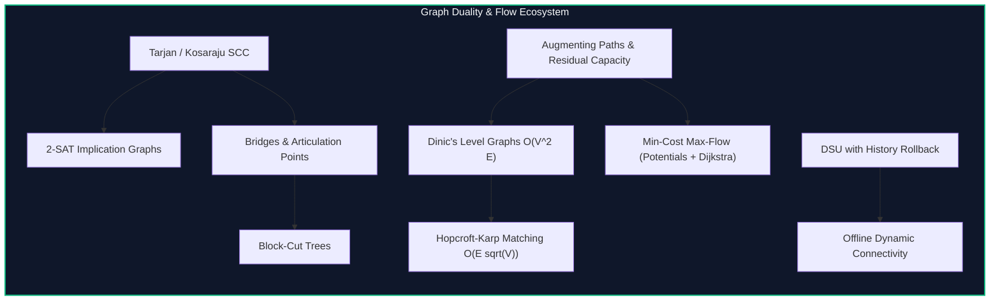

import { Callout } from "fumadocs-ui/components/callout";
import { Tabs, Tab } from "fumadocs-ui/components/tabs";
import { Steps, Step } from "fumadocs-ui/components/steps";
import { Cards, Card } from "fumadocs-ui/components/card";

## Advanced Graph Dualities & Structural Invariants

Elementary graph algorithms focus on traversal (DFS/BFS) and shortest paths (Dijkstra). Expert graph theory bridges topology, discrete optimization, and algebraic dualities:

1. **Strong Connectivity & Implication Logic:** Kosaraju and Tarjan partition directed graphs into maximal strongly connected components (SCCs), condensing cycles into directed acyclic graphs (DAGs). This provides a direct linear-time decision procedure for **Two-Satisfiability (2-SAT)** via implication graphs.
2. **Biconnectivity & Critical Vulnerability:** Tarjan's low-link values identify bridge edges and articulation points, whose contraction produces **Block-Cut Trees**—revealing single points of failure across physical networks.
3. **Flow Networks & Min-Cut Equivalence:** Ford-Fulkerson, Edmonds-Karp, and **Dinic's algorithm** solve the bottleneck throughput problem. The Max-Flow Min-Cut theorem transforms combinatorial partitioning into polynomial-time flow augmentation.
4. **Bipartite Matching & Cost Optimization:** Konig's theorem and Hopcroft-Karp find maximum matchings in $O(E \sqrt{V})$. Successive shortest path algorithms with Johnson potentials compute **Minimum Cost Maximum Flow (MCMF)**.
5. **Dynamic Temporal Topology:** When graph edges appear and disappear over time, DSU with rollback paired with segment-tree time divide-and-conquer resolves connectivity without dynamic link-cut overhead.

---

## Category Modules

<Cards>
  <Card
    title="Strongly Connected Components"
    href="/docs/dsa/04-expert/connectivity-flows-and-matchings/strongly-connected-components"
    description="Kosaraju's two-pass and Tarjan's single-pass low-link DFS algorithms for decomposing directed graphs into acyclic condensation DAGs."
  />
  <Card
    title="Two-Satisfiability (2-SAT)"
    href="/docs/dsa/04-expert/connectivity-flows-and-matchings/two-satisfiability-2-sat"
    description="Solve boolean satisfiability of 2-variable CNF clauses in linear time using topological orderings over SCC implication graphs."
  />
  <Card
    title="Bridges & Articulation Points"
    href="/docs/dsa/04-expert/connectivity-flows-and-matchings/bridges-and-articulation-points"
    description="Identify critical failure edges and cut vertices in undirected networks using DFS discovery and low-link numbers."
  />
  <Card
    title="Block-Cut Trees"
    href="/docs/dsa/04-expert/connectivity-flows-and-matchings/block-cut-trees"
    description="Construct bipartite tree representations of 2-vertex-connected blocks and cut vertices to solve vertex-disjoint path queries."
  />
  <Card
    title="Maximum Flow and Minimum Cut"
    href="/docs/dsa/04-expert/connectivity-flows-and-matchings/max-flow-min-cut"
    description="The foundational Max-Flow Min-Cut theorem, residual graphs, Ford-Fulkerson method, and Edmonds-Karp algorithm."
  />
  <Card
    title="Dinic's Algorithm"
    href="/docs/dsa/04-expert/connectivity-flows-and-matchings/dinics-algorithm"
    description="Level graphs constructed via BFS and blocking flows pushed via DFS in O(V^2 E) general and O(E sqrt(V)) unit networks."
  />
  <Card
    title="Maximum Bipartite Matching"
    href="/docs/dsa/04-expert/connectivity-flows-and-matchings/maximum-bipartite-matching"
    description="Hopcroft-Karp algorithm for maximum cardinality bipartite matching running in optimal O(E sqrt(V)) time."
  />
  <Card
    title="Minimum Cost Maximum Flow (MCMF)"
    href="/docs/dsa/04-expert/connectivity-flows-and-matchings/min-cost-max-flow"
    description="Pushing flows with minimum monetary or latency cost using SPFA, Bellman-Ford, and reduced cost potentials with Dijkstra."
  />
  <Card
    title="Offline Dynamic Connectivity"
    href="/docs/dsa/04-expert/connectivity-flows-and-matchings/offline-dynamic-connectivity"
    description="Segment tree divide-and-conquer over query time intervals paired with undoable DSU to handle dynamic graph edge insertions and deletions."
  />
</Cards>
