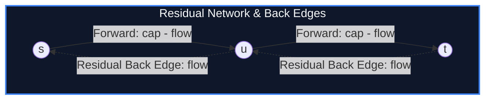

import { Callout } from "fumadocs-ui/components/callout";
import { Tabs, Tab } from "fumadocs-ui/components/tabs";
import { Steps, Step } from "fumadocs-ui/components/steps";
import { Cards, Card } from "fumadocs-ui/components/card";

## The Fundamental Duality of Network Flow

In a directed flow network $G = (V, E)$ with source $s$, sink $t$, and non-negative edge capacities $c(u, v)$:

- **Capacity Constraint:** $0 \le f(u, v) \le c(u, v)$ for all edges.
- **Flow Conservation:** For every vertex $u \notin \{s, t\}$, incoming flow equals outgoing flow:
  $$\sum_{v} f(v, u) = \sum_{w} f(u, w)$$

An **$(s, t)$-Cut** $(S, T)$ is a partition of $V$ such that $s \in S$ and $t \in T$. The **capacity of the cut** is the sum of capacities of edges pointing from $S$ to $T$:

$$C(S, T) = \sum_{u \in S, v \in T} c(u, v)$$

> **Max-Flow Min-Cut Theorem (Ford & Fulkerson, 1956):** The maximum value of an $(s, t)$-flow equals the minimum capacity of an $(s, t)$-cut!
> $$\max |f| = \min_{(S, T)} C(S, T)$$



---

## Edmonds-Karp Algorithm

Edmonds and Karp proved that finding augmenting paths via **Breadth-First Search (BFS)** (shortest path in terms of number of edges) guarantees polynomial termination in:

$$\mathcal{O}(V E^2) \text{ time}$$

---

## Implementation

<Tabs items={["Python", "TypeScript", "C++"]}>
<Tab value="Python">
```python
from collections import deque
from typing import List

class EdmondsKarp:
def **init**(self, n: int):
self.n = n
self.cap = [[0] \* (n + 1) for _ in range(n + 1)]
self.adj = [[] for _ in range(n + 1)]

    def add_edge(self, u: int, v: int, c: int):
        self.adj[u].append(v)
        self.adj[v].append(u)
        self.cap[u][v] += c

    def max_flow(self, s: int, t: int) -> int:
        flow = 0
        parent = [-1] * (self.n + 1)

        def bfs() -> int:
            parent.fill = -1
            for i in range(self.n + 1): parent[i] = -1
            parent[s] = -2
            q = deque([(s, float('inf'))])

            while q:
                cur, pushed = q.popleft()
                for nxt in self.adj[cur]:
                    if parent[nxt] == -1 and self.cap[cur][nxt] > 0:
                        parent[nxt] = cur
                        new_pushed = min(pushed, self.cap[cur][nxt])
                        if nxt == t:
                            return new_pushed
                        q.append((nxt, new_pushed))
            return 0

        while True:
            pushed = bfs()
            if pushed == 0:
                break
            flow += pushed
            curr = t
            while curr != s:
                prev = parent[curr]
                self.cap[prev][curr] -= pushed
                self.cap[curr][prev] += pushed
                curr = prev

        return flow

````
</Tab>
<Tab value="TypeScript">
```typescript
export class EdmondsKarp {
  private cap: number[][];
  private adj: number[][];

  constructor(private n: number) {
    this.cap = Array.from({ length: n + 1 }, () => new Array(n + 1).fill(0));
    this.adj = Array.from({ length: n + 1 }, () => []);
  }

  public addEdge(u: number, v: number, c: number): void {
    this.adj[u].push(v);
    this.adj[v].push(u);
    this.cap[u][v] += c;
  }

  public maxFlow(s: number, t: number): number {
    let flow = 0;
    const parent = new Array(this.n + 1).fill(-1);

    const bfs = (): number => {
      parent.fill(-1);
      parent[s] = -2;
      const q: [number, number][] = [[s, Infinity]];

      while (q.length > 0) {
        const [cur, pushed] = q.shift()!;
        for (const nxt of this.adj[cur]) {
          if (parent[nxt] === -1 && this.cap[cur][nxt] > 0) {
            parent[nxt] = cur;
            const newPushed = Math.min(pushed, this.cap[cur][nxt]);
            if (nxt === t) return newPushed;
            q.push([nxt, newPushed]);
          }
        }
      }
      return 0;
    };

    while (true) {
      const pushed = bfs();
      if (pushed === 0) break;
      flow += pushed;
      let curr = t;
      while (curr !== s) {
        const prev = parent[curr];
        this.cap[prev][curr] -= pushed;
        this.cap[curr][prev] += pushed;
        curr = prev;
      }
    }

    return flow;
  }
}
````

</Tab>
<Tab value="C++">
```cpp
#include <iostream>
#include <vector>
#include <queue>
#include <algorithm>

class EdmondsKarp {
int n;
std::vector<std::vector<int>> cap;
std::vector<std::vector<int>> adj;

public:
explicit EdmondsKarp(int numNodes)
: n(numNodes), cap(numNodes + 1, std::vector<int>(numNodes + 1, 0)), adj(numNodes + 1) {}

    void addEdge(int u, int v, int c) {
        adj[u].push_back(v);
        adj[v].push_back(u);
        cap[u][v] += c;
    }

    int maxFlow(int s, int t) {
        int flow = 0;
        std::vector<int> parent(n + 1);

        auto bfs = [&]() -> int {
            std::fill(parent.begin(), parent.end(), -1);
            parent[s] = -2;
            std::queue<std::pair<int, int>> q;
            q.push({s, 1e9});

            while (!q.empty()) {
                auto [cur, pushed] = q.front();
                q.pop();

                for (int nxt : adj[cur]) {
                    if (parent[nxt] == -1 && cap[cur][nxt] > 0) {
                        parent[nxt] = cur;
                        int newPushed = std::min(pushed, cap[cur][nxt]);
                        if (nxt == t) return newPushed;
                        q.push({nxt, newPushed});
                    }
                }
            }
            return 0;
        };

        while (int pushed = bfs()) {
            flow += pushed;
            int curr = t;
            while (curr != s) {
                int prev = parent[curr];
                cap[prev][curr] -= pushed;
                cap[curr][prev] += pushed;
                curr = prev;
            }
        }

        return flow;
    }

};

```
</Tab>
</Tabs>

---

## Complexity Breakdown

| Algorithm | Augmenting Path Search | Time Complexity | Space Complexity |
| :--- | :--- | :--- | :--- |
| **Ford-Fulkerson** | Arbitrary DFS | $\mathcal{O}(E \cdot |f|)$ | $\mathcal{O}(V + E)$ |
| **Edmonds-Karp** | Shortest path via BFS | $\mathcal{O}(V E^2)$ | $\mathcal{O}(V^2)$ or $\mathcal{O}(V + E)$ |
```
