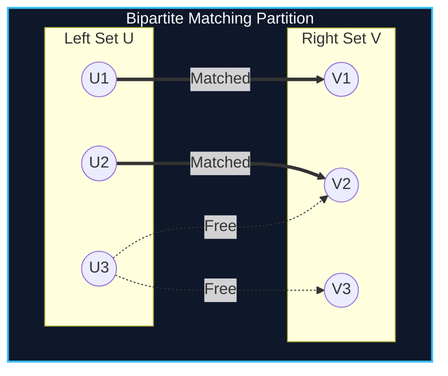

import { Callout } from "fumadocs-ui/components/callout";
import { Tabs, Tab } from "fumadocs-ui/components/tabs";
import { Steps, Step } from "fumadocs-ui/components/steps";
import { Cards, Card } from "fumadocs-ui/components/card";

## Matching in Bipartite Partitions

Let $G = (U \cup V, E)$ be a bipartite graph where edges exist strictly between disjoint sets $U$ and $V$. A **matching** $M \subseteq E$ is a set of edges with no shared endpoints.

While the Hungarian algorithm takes $O(V^3)$ and basic augmenting DFS runs in $O(V \cdot E)$, the **Hopcroft-Karp Algorithm** (1973) simultaneously discovers a maximal set of **shortest vertex-disjoint augmenting paths** in each phase, achieving:

$$\mathcal{O}(E \sqrt{V}) \text{ optimal time}$$



---

## Hopcroft-Karp Phase Mechanics

1. **Multi-Source BFS:** Start BFS simultaneously from all currently **free (unmatched) vertices in $U$**. Alternate between unmatched and matched edges, stopping when reaching a free vertex in $V$ to determine the shortest augmenting path length $L$.
2. **Depth-First Search (DFS):** From each free vertex in $U$, search along paths of exact length $L$ to augment the matching.
3. Because the shortest path length strictly increases by at least 2 after each phase, there are at most $\mathcal{O}(\sqrt{V})$ phases!

---

## Implementation

<Tabs items={["Python", "TypeScript", "C++"]}>
<Tab value="Python">
```python
from collections import deque
from typing import List

class HopcroftKarp:
def **init**(self, size*u: int, size_v: int):
self.n_u = size_u
self.n_v = size_v
self.adj = [[] for * in range(size*u + 1)]
self.pair_u = [0] * (size*u + 1)
self.pair_v = [0] * (size_v + 1)
self.dist = [0] \* (size_u + 1)

    def add_edge(self, u: int, v: int):
        self.adj[u].append(v)

    def _bfs(self) -> bool:
        q = deque()
        for u in range(1, self.n_u + 1):
            if self.pair_u[u] == 0:
                self.dist[u] = 0
                q.append(u)
            else:
                self.dist[u] = float('inf')

        self.dist[0] = float('inf')
        while q:
            u = q.popleft()
            if self.dist[u] < self.dist[0]:
                for v in self.adj[u]:
                    if self.dist[self.pair_v[v]] == float('inf'):
                        self.dist[self.pair_v[v]] = self.dist[u] + 1
                        q.append(self.pair_v[v])
        return self.dist[0] != float('inf')

    def _dfs(self, u: int) -> bool:
        if u != 0:
            for v in self.adj[u]:
                if self.dist[self.pair_v[v]] == self.dist[u] + 1:
                    if self._dfs(self.pair_v[v]):
                        self.pair_v[v] = u
                        self.pair_u[u] = v
                        return True
            self.dist[u] = float('inf')
            return False
        return True

    def max_matching(self) -> int:
        matching = 0
        while self._bfs():
            for u in range(1, self.n_u + 1):
                if self.pair_u[u] == 0 and self._dfs(u):
                    matching += 1
        return matching

````
</Tab>
<Tab value="TypeScript">
```typescript
export class HopcroftKarp {
  private adj: number[][];
  public pairU: number[];
  public pairV: number[];
  private dist: number[];

  constructor(private nU: number, private nV: number) {
    this.adj = Array.from({ length: nU + 1 }, () => []);
    this.pairU = new Array(nU + 1).fill(0);
    this.pairV = new Array(nV + 1).fill(0);
    this.dist = new Array(nU + 1).fill(0);
  }

  public addEdge(u: number, v: number): void {
    this.adj[u].push(v);
  }

  private bfs(): boolean {
    const q: number[] = [];
    for (let u = 1; u <= this.nU; u++) {
      if (this.pairU[u] === 0) {
        this.dist[u] = 0;
        q.push(u);
      } else {
        this.dist[u] = Infinity;
      }
    }

    this.dist[0] = Infinity;
    while (q.length > 0) {
      const u = q.shift()!;
      if (this.dist[u] < this.dist[0]) {
        for (const v of this.adj[u]) {
          if (this.dist[this.pairV[v]] === Infinity) {
            this.dist[this.pairV[v]] = this.dist[u] + 1;
            q.push(this.pairV[v]);
          }
        }
      }
    }
    return this.dist[0] !== Infinity;
  }

  private dfs(u: number): boolean {
    if (u !== 0) {
      for (const v of this.adj[u]) {
        if (this.dist[this.pairV[v]] === this.dist[u] + 1) {
          if (this.dfs(this.pairV[v])) {
            this.pairV[v] = u;
            this.pairU[u] = v;
            return true;
          }
        }
      }
      this.dist[u] = Infinity;
      return false;
    }
    return true;
  }

  public maxMatching(): number {
    let matching = 0;
    while (this.bfs()) {
      for (let u = 1; u <= this.nU; u++) {
        if (this.pairU[u] === 0 && this.dfs(u)) {
          matching++;
        }
      }
    }
    return matching;
  }
}
````

</Tab>
<Tab value="C++">
```cpp
#include <iostream>
#include <vector>
#include <queue>
#include <algorithm>

class HopcroftKarp {
const int INF = 1e9;
int nU, nV;
std::vector<std::vector<int>> adj;
std::vector<int> pairU, pairV, dist;

    bool bfs() {
        std::queue<int> q;
        for (int u = 1; u <= nU; ++u) {
            if (pairU[u] == 0) {
                dist[u] = 0;
                q.push(u);
            } else {
                dist[u] = INF;
            }
        }

        dist[0] = INF;
        while (!q.empty()) {
            int u = q.front();
            q.pop();

            if (dist[u] < dist[0]) {
                for (int v : adj[u]) {
                    if (dist[pairV[v]] == INF) {
                        dist[pairV[v]] = dist[u] + 1;
                        q.push(pairV[v]);
                    }
                }
            }
        }
        return dist[0] != INF;
    }

    bool dfs(int u) {
        if (u != 0) {
            for (int v : adj[u]) {
                if (dist[pairV[v]] == dist[u] + 1) {
                    if (dfs(pairV[v])) {
                        pairV[v] = u;
                        pairU[u] = v;
                        return true;
                    }
                }
            }
            dist[u] = INF;
            return false;
        }
        return true;
    }

public:
HopcroftKarp(int sizeU, int sizeV)
: nU(sizeU), nV(sizeV), adj(nU + 1), pairU(nU + 1, 0), pairV(nV + 1, 0), dist(nU + 1) {}

    void addEdge(int u, int v) {
        adj[u].push_back(v);
    }

    int maxMatching() {
        int matching = 0;
        while (bfs()) {
            for (int u = 1; u <= nU; ++u) {
                if (pairU[u] == 0 && dfs(u)) matching++;
            }
        }
        return matching;
    }

};

```
</Tab>
</Tabs>

---

## Complexity Breakdown

| Phase | Bound | Total Guarantee |
| :--- | :--- | :--- |
| **Number of Augmenting Phases** | $\le 2\sqrt{V}$ phases | Each phase costs $\mathcal{O}(E)$ |
| **Total Running Time** | $\mathcal{O}(E \sqrt{V})$ | Fastest known general bipartite algorithm |
```
