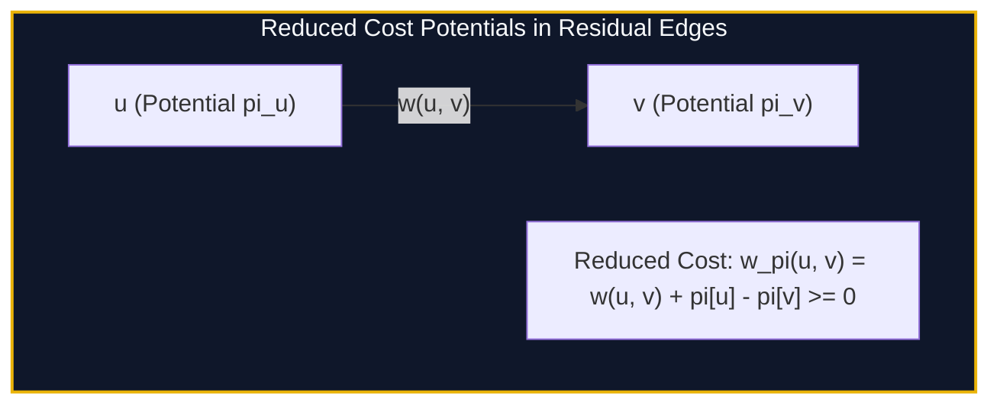

import { Callout } from "fumadocs-ui/components/callout";
import { Tabs, Tab } from "fumadocs-ui/components/tabs";
import { Steps, Step } from "fumadocs-ui/components/steps";
import { Cards, Card } from "fumadocs-ui/components/card";

## Cost Optimization over Flow Networks

In standard Max-Flow, any augmenting path is acceptable. In the **Minimum Cost Maximum Flow (MCMF)** problem, each directed edge has an integer capacity $c(u, v)$ and a unit cost $w(u, v)$.

The total cost of a flow $f$ is:
$$\text{Cost}(f) = \sum_{(u, v) \in E} f(u, v) \cdot w(u, v)$$

The goal is to find a flow configuration that maximizes total flow $|f|$ while minimizing total cost $\text{Cost}(f)$.



---

## Primal-Dual Potentials (Dijkstra Acceleration)

Because residual back edges have negative costs ($-w(u, v)$), standard Dijkstra fails. While SPFA works, its worst-case is $\mathcal{O}(V \cdot E)$ per augmentation.

By introducing **Johnson potentials** $\pi[u]$:
$$w^\pi(u, v) = w(u, v) + \pi[u] - \pi[v] \ge 0$$

All edge weights in the residual network become strictly non-negative! We can then run fast heap-based Dijkstra in $\mathcal{O}(E \log V)$ per augmentation phase.

---

## Implementation

<Tabs items={["Python", "TypeScript", "C++"]}>
<Tab value="Python">
```python
import heapq
from typing import List, Tuple

class MCMF:
class Edge:
def **init**(self, to: int, rev: int, cap: int, cost: int):
self.to = to
self.rev = rev
self.cap = cap
self.flow = 0
self.cost = cost

    def __init__(self, n: int):
        self.n = n
        self.adj = [[] for _ in range(n + 1)]
        self.pot = [0] * (n + 1)
        self.dist = [0] * (n + 1)
        self.parent_edge = [0] * (n + 1)
        self.parent_node = [0] * (n + 1)

    def add_edge(self, u: int, v: int, cap: int, cost: int):
        self.adj[u].append(self.Edge(v, len(self.adj[v]), cap, cost))
        self.adj[v].append(self.Edge(u, len(self.adj[u]) - 1, 0, -cost))

    def solve(self, s: int, t: int) -> Tuple[int, int]:
        total_flow = 0
        total_cost = 0

        while True:
            self.dist = [float('inf')] * (self.n + 1)
            self.dist[s] = 0
            pq = [(0, s)]

            while pq:
                d, u = heapq.heappop(pq)
                if d > self.dist[u]: continue
                for i, edge in enumerate(self.adj[u]):
                    if edge.cap - edge.flow > 0:
                        reduced_cost = edge.cost + self.pot[u] - self.pot[edge.to]
                        if self.dist[edge.to] > self.dist[u] + reduced_cost:
                            self.dist[edge.to] = self.dist[u] + reduced_cost
                            self.parent_node[edge.to] = u
                            self.parent_edge[edge.to] = i
                            heapq.heappush(pq, (self.dist[edge.to], edge.to))

            if self.dist[t] == float('inf'):
                break

            for i in range(1, self.n + 1):
                if self.dist[i] < float('inf'):
                    self.pot[i] += self.dist[i]

            push = float('inf')
            curr = t
            while curr != s:
                p_node = self.parent_node[curr]
                p_edge = self.parent_edge[curr]
                edge = self.adj[p_node][p_edge]
                push = min(push, edge.cap - edge.flow)
                curr = p_node

            total_flow += push
            total_cost += push * self.pot[t]
            curr = t
            while curr != s:
                p_node = self.parent_node[curr]
                p_edge = self.parent_edge[curr]
                edge = self.adj[p_node][p_edge]
                edge.flow += push
                self.adj[curr][edge.rev].flow -= push
                curr = p_node

        return total_flow, total_cost

````
</Tab>
<Tab value="TypeScript">
```typescript
interface MCMFEdge {
  to: number;
  rev: number;
  cap: number;
  flow: number;
  cost: number;
}

export class MCMF {
  private adj: MCMFEdge[][];
  private pot: number[];
  private dist: number[];
  private pNode: number[];
  private pEdge: number[];

  constructor(private n: number) {
    this.adj = Array.from({ length: n + 1 }, () => []);
    this.pot = new Array(n + 1).fill(0);
    this.dist = new Array(n + 1).fill(0);
    this.pNode = new Array(n + 1).fill(0);
    this.pEdge = new Array(n + 1).fill(0);
  }

  public addEdge(u: number, v: number, cap: number, cost: number): void {
    this.adj[u].push({ to: v, rev: this.adj[v].length, cap, flow: 0, cost });
    this.adj[v].push({ to: u, rev: this.adj[u].length - 1, cap: 0, flow: 0, cost: -cost });
  }

  public solve(s: number, t: number): [number, number] {
    let totalFlow = 0, totalCost = 0;

    while (true) {
      this.dist.fill(Infinity);
      this.dist[s] = 0;
      const visited = new Array(this.n + 1).fill(false);

      for (let step = 0; step < this.n; step++) {
        let u = -1;
        for (let i = 1; i <= this.n; i++) {
          if (!visited[i] && (u === -1 || this.dist[i] < this.dist[u])) u = i;
        }
        if (u === -1 || this.dist[u] === Infinity) break;
        visited[u] = true;

        for (let i = 0; i < this.adj[u].length; i++) {
          const edge = this.adj[u][i];
          if (edge.cap - edge.flow > 0) {
            const redCost = edge.cost + this.pot[u] - this.pot[edge.to];
            if (this.dist[edge.to] > this.dist[u] + redCost) {
              this.dist[edge.to] = this.dist[u] + redCost;
              this.pNode[edge.to] = u;
              this.pEdge[edge.to] = i;
            }
          }
        }
      }

      if (this.dist[t] === Infinity) break;

      for (let i = 1; i <= this.n; i++) {
        if (this.dist[i] < Infinity) this.pot[i] += this.dist[i];
      }

      let push = Infinity;
      for (let curr = t; curr !== s; curr = this.pNode[curr]) {
        const edge = this.adj[this.pNode[curr]][this.pEdge[curr]];
        push = Math.min(push, edge.cap - edge.flow);
      }

      totalFlow += push;
      totalCost += push * this.pot[t];
      for (let curr = t; curr !== s; curr = this.pNode[curr]) {
        const edge = this.adj[this.pNode[curr]][this.pEdge[curr]];
        edge.flow += push;
        this.adj[curr][edge.rev].flow -= push;
      }
    }

    return [totalFlow, totalCost];
  }
}
````

</Tab>
<Tab value="C++">
```cpp
#include <iostream>
#include <vector>
#include <queue>
#include <algorithm>

class MCMF {
struct Edge {
int to, rev;
int64_t cap, flow, cost;
};

    int n;
    std::vector<std::vector<Edge>> adj;
    std::vector<int64_t> pot, dist;
    std::vector<int> pNode, pEdge;

public:
explicit MCMF(int numNodes)
: n(numNodes), adj(n + 1), pot(n + 1, 0), dist(n + 1), pNode(n + 1), pEdge(n + 1) {}

    void addEdge(int u, int v, int64_t cap, int64_t cost) {
        adj[u].push_back({v, static_cast<int>(adj[v].size()), cap, 0, cost});
        adj[v].push_back({u, static_cast<int>(adj[u].size()) - 1, 0, 0, -cost});
    }

    std::pair<int64_t, int64_t> solve(int s, int t) {
        int64_t totalFlow = 0, totalCost = 0;

        while (true) {
            std::fill(dist.begin(), dist.end(), 1e18);
            dist[s] = 0;
            std::priority_queue<std::pair<int64_t, int>,
                                std::vector<std::pair<int64_t, int>>,
                                std::greater<>> pq;
            pq.push({0, s});

            while (!pq.empty()) {
                auto [d, u] = pq.top();
                pq.pop();
                if (d > dist[u]) continue;

                for (size_t i = 0; i < adj[u].size(); ++i) {
                    const auto& edge = adj[u][i];
                    if (edge.cap - edge.flow > 0) {
                        int64_t redCost = edge.cost + pot[u] - pot[edge.to];
                        if (dist[edge.to] > dist[u] + redCost) {
                            dist[edge.to] = dist[u] + redCost;
                            pNode[edge.to] = u;
                            pEdge[edge.to] = static_cast<int>(i);
                            pq.push({dist[edge.to], edge.to});
                        }
                    }
                }
            }

            if (dist[t] == 1e18) break;

            for (int i = 1; i <= n; ++i) {
                if (dist[i] < 1e18) pot[i] += dist[i];
            }

            int64_t push = 1e18;
            for (int curr = t; curr != s; curr = pNode[curr]) {
                const auto& edge = adj[pNode[curr]][pEdge[curr]];
                push = std::min(push, edge.cap - edge.flow);
            }

            totalFlow += push;
            totalCost += push * pot[t];
            for (int curr = t; curr != s; curr = pNode[curr]) {
                auto& edge = adj[pNode[curr]][pEdge[curr]];
                edge.flow += push;
                adj[curr][edge.rev].flow -= push;
            }
        }

        return {totalFlow, totalCost};
    }

};

```
</Tab>
</Tabs>

---

## Complexity Breakdown

| Method | Phase Search | Time Complexity |
| :--- | :--- | :--- |
| **SPFA Augmentation** | Shortest path with negatives | $\mathcal{O}(F \cdot V E)$ worst-case |
| **Primal-Dual Potentials** | Reduced Dijkstra with Heap | $\mathcal{O}(F \cdot E \log V)$ |
```
