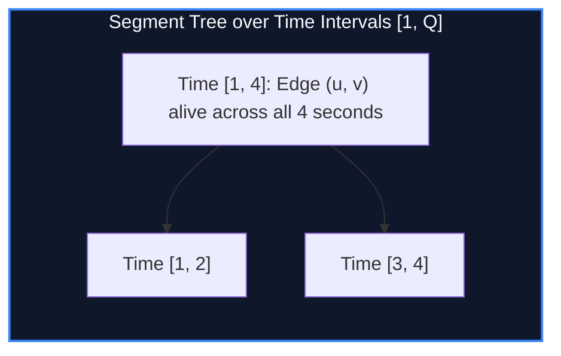

import { Callout } from "fumadocs-ui/components/callout";
import { Tabs, Tab } from "fumadocs-ui/components/tabs";
import { Steps, Step } from "fumadocs-ui/components/steps";
import { Cards, Card } from "fumadocs-ui/components/card";

## The Difficulty of Dynamic Edge Deletion

Disjoint Set Union (DSU) maintains connected components in near $O(1)$ amortized time under continuous **edge additions**. However, DSU fundamentally **cannot support arbitrary edge deletions** online while maintaining path compression.

When all $Q$ operations (Add Edge, Delete Edge, Query Connected) are known offline:
Instead of deleting edges, map each edge $e$ to the **time interval $[t_{\text{insert}}, t_{\text{delete}}]$ during which it was alive**.

We store edge lifespans in a **Segment Tree over Time $[1, Q]$**, and traverse the tree with a **DSU supporting Undo/Rollback**!



---

## DSU with Rollback

To support rollback:

1. **Disable Path Compression:** Modifying parent pointers destroys structural history.
2. **Use Union by Rank / Size:** Guarantees tree height is bounded strictly by $\mathcal{O}(\log V)$.
3. **Record Mutations in a Stack:** Every union modifies at most one parent pointer and one size value. Undoing a union takes $\mathcal{O}(1)$ time!

---

## Implementation

<Tabs items={["Python", "TypeScript", "C++"]}>
<Tab value="Python">
```python
from typing import List, Tuple

class RollbackDSU:
def **init**(self, n: int):
self.parent = list(range(n + 1))
self.sz = [1] \* (n + 1)
self.history = []

    def find(self, i: int) -> int:
        while i != self.parent[i]:
            i = self.parent[i]
        return i

    def union(self, u: int, v: int) -> bool:
        ru, rv = self.find(u), self.find(v)
        if ru == rv:
            return False
        if self.sz[ru] < self.sz[rv]:
            ru, rv = rv, ru
        self.history.append((rv, ru, self.sz[ru]))
        self.parent[rv] = ru
        self.sz[ru] += self.sz[rv]
        return True

    def rollback(self):
        rv, ru, prev_sz = self.history.pop()
        self.parent[rv] = rv
        self.sz[ru] = prev_sz

class OfflineDynamicConnectivity:
def **init**(self, n: int, q: int):
self.n = n
self.q = q
self.tree = [[] for \_ in range(4 \* (q + 1))]
self.dsu = RollbackDSU(n)

    def add_edge_interval(self, u: int, l: int, r: int, ql: int, qr: int, edge: Tuple[int, int]):
        if ql <= l and r <= qr:
            self.tree[u].append(edge)
            return
        mid = l + (r - l) // 2
        if ql <= mid:
            self.add_edge_interval(2 * u, l, mid, ql, qr, edge)
        if qr > mid:
            self.add_edge_interval(2 * u + 1, mid + 1, r, ql, qr, edge)

    def solve(self, u: int, l: int, r: int, queries, ans):
        unions = 0
        for edge in self.tree[u]:
            if self.dsu.union(edge[0], edge[1]):
                unions += 1

        if l == r:
            if queries[l]:
                u_q, v_q = queries[l]
                ans[l] = (self.dsu.find(u_q) == self.dsu.find(v_q))
        else:
            mid = l + (r - l) // 2
            self.solve(2 * u, l, mid, queries, ans)
            self.solve(2 * u + 1, mid + 1, r, queries, ans)

        for _ in range(unions):
            self.dsu.rollback()

````
</Tab>
<Tab value="TypeScript">
```typescript
class RollbackDSU {
  private parent: number[];
  private sz: number[];
  private history: [number, number, number][] = [];

  constructor(n: number) {
    this.parent = Array.from({ length: n + 1 }, (_, i) => i);
    this.sz = new Array(n + 1).fill(1);
  }

  public find(i: number): number {
    let curr = i;
    while (curr !== this.parent[curr]) curr = this.parent[curr];
    return curr;
  }

  public union(u: number, v: number): boolean {
    let ru = this.find(u), rv = this.find(v);
    if (ru === rv) return false;
    if (this.sz[ru] < this.sz[rv]) {
      const temp = ru; ru = rv; rv = temp;
    }
    this.history.push([rv, ru, this.sz[ru]]);
    this.parent[rv] = ru;
    this.sz[ru] += this.sz[rv];
    return true;
  }

  public rollback(): void {
    const [rv, ru, prevSz] = this.history.pop()!;
    this.parent[rv] = rv;
    this.sz[ru] = prevSz;
  }
}

export class OfflineDynamicConnectivity {
  private tree: [number, number][][];
  private dsu: RollbackDSU;

  constructor(private n: number, private q: number) {
    this.tree = Array.from({ length: 4 * (q + 1) }, () => []);
    this.dsu = new RollbackDSU(n);
  }

  public addEdgeInterval(u: number, l: number, r: number, ql: number, qr: number, edge: [number, number]): void {
    if (ql <= l && r <= qr) {
      this.tree[u].push(edge);
      return;
    }
    const mid = l + ((r - l) >> 1);
    if (ql <= mid) this.addEdgeInterval(2 * u, l, mid, ql, qr, edge);
    if (qr > mid) this.addEdgeInterval(2 * u + 1, mid + 1, r, ql, qr, edge);
  }

  public solve(u: number, l: number, r: number, queries: ([number, number] | null)[], ans: boolean[]): void {
    let unions = 0;
    for (const [eu, ev] of this.tree[u]) {
      if (this.dsu.union(eu, ev)) unions++;
    }

    if (l === r) {
      if (queries[l] !== null) {
        const [uq, vq] = queries[l]!;
        ans[l] = this.dsu.find(uq) === this.dsu.find(vq);
      }
    } else {
      const mid = l + ((r - l) >> 1);
      this.solve(2 * u, l, mid, queries, ans);
      this.solve(2 * u + 1, mid + 1, r, queries, ans);
    }

    for (let i = 0; i < unions; i++) this.dsu.rollback();
  }
}
````

</Tab>
<Tab value="C++">
```cpp
#include <iostream>
#include <vector>

class RollbackDSU {
std::vector<int> parent, sz;
struct History { int rv, ru, prevSz; };
std::vector<History> history;

public:
explicit RollbackDSU(int n) : parent(n + 1), sz(n + 1, 1) {
for (int i = 0; i <= n; ++i) parent[i] = i;
}

    int find(int i) {
        while (i != parent[i]) i = parent[i];
        return i;
    }

    bool unite(int u, int v) {
        int ru = find(u), rv = find(v);
        if (ru == rv) return false;
        if (sz[ru] < sz[rv]) std::swap(ru, rv);
        history.push_back({rv, ru, sz[ru]});
        parent[rv] = ru;
        sz[ru] += sz[rv];
        return true;
    }

    void rollback() {
        auto [rv, ru, prevSz] = history.back();
        history.pop_back();
        parent[rv] = rv;
        sz[ru] = prevSz;
    }

};

class OfflineDynamicConnectivity {
int n, q;
std::vector<std::vector<std::pair<int, int>>> tree;
RollbackDSU dsu;

public:
OfflineDynamicConnectivity(int numNodes, int numQueries)
: n(numNodes), q(numQueries), tree(4 \* (numQueries + 1)), dsu(numNodes) {}

    void addEdgeInterval(int u, int l, int r, int ql, int qr, std::pair<int, int> edge) {
        if (ql <= l && r <= qr) {
            tree[u].push_back(edge);
            return;
        }
        int mid = l + (r - l) / 2;
        if (ql <= mid) addEdgeInterval(2 * u, l, mid, ql, qr, edge);
        if (qr > mid) addEdgeInterval(2 * u + 1, mid + 1, r, ql, qr, edge);
    }

    void solve(int u, int l, int r,
               const std::vector<std::pair<int, int>>& queries,
               const std::vector<bool>& isQuery,
               std::vector<bool>& ans) {
        int unions = 0;
        for (const auto& edge : tree[u]) {
            if (dsu.unite(edge.first, edge.second)) unions++;
        }

        if (l == r) {
            if (isQuery[l]) {
                ans[l] = (dsu.find(queries[l].first) == dsu.find(queries[l].second));
            }
        } else {
            int mid = l + (r - l) / 2;
            solve(2 * u, l, mid, queries, isQuery, ans);
            solve(2 * u + 1, mid + 1, r, queries, isQuery, ans);
        }

        while (unions--) dsu.rollback();
    }

};

```
</Tab>
</Tabs>

---

## Complexity Breakdown

| Phase | Bound | Total Guarantee |
| :--- | :--- | :--- |
| **Segment Tree Time Dispersal** | $\mathcal{O}(Q \log Q)$ node inserts | Edge lives across $O(\log Q)$ canonical segments |
| **DSU Union with Rollback** | $\mathcal{O}(\log V)$ per operation | Without path compression |
| **Total Offline Runtime** | $\mathcal{O}(Q \log Q \log V)$ | Avoids Link-Cut Tree complexity |
```
