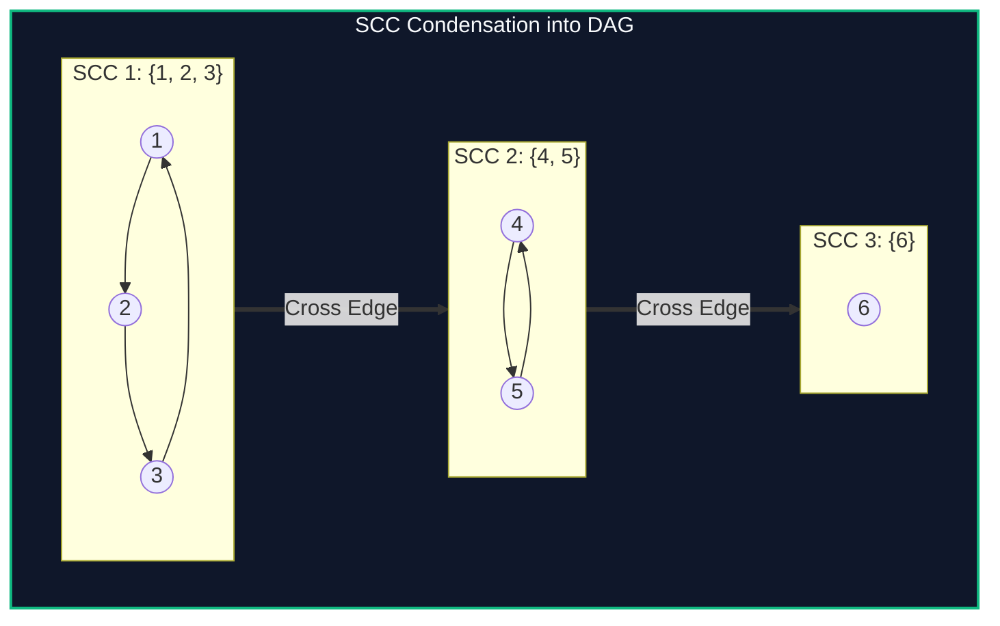

import { Callout } from "fumadocs-ui/components/callout";
import { Tabs, Tab } from "fumadocs-ui/components/tabs";
import { Steps, Step } from "fumadocs-ui/components/steps";
import { Cards, Card } from "fumadocs-ui/components/card";

## The Asymmetry of Directed Reachability

In undirected graphs, connectivity is an equivalence relation: if $u$ connects to $v$, then $v$ connects to $u$. In directed graphs, mutual reachability is asymmetric:

> **Strongly Connected Component (SCC):** A maximal subset of vertices $C \subseteq V$ such that for every pair $u, v \in C$, there exists a directed path from $u$ to $v$ and a directed path from $v$ to $u$.

Condensing every SCC into a single super-vertex transforms any directed graph with cycles into a **Directed Acyclic Graph (DAG)** (the **Condensation Graph**), enabling topological sorting and dynamic programming over cyclic dependencies.



---

## Tarjan's Low-Link Algorithm

Robert Tarjan's algorithm computes SCCs in a single DFS pass using two integer labels per vertex:

- `tin[u]`: Discovery timestamp of $u$ in DFS traversal.
- `low[u]`: The smallest `tin` reachable from $u$ through a sequence of tree edges followed by at most one back edge pointing to a node currently on the active recursion stack.

> **Root of an SCC:** Vertex $u$ is the entry point (root) of its strongly connected component if and only if:
> $$\text{low}[u] = \text{tin}[u]$$

When $\text{low}[u] = \text{tin}[u]$, pop all vertices from the stack down to $u$; they form a complete, maximal SCC!

---

## Implementation

<Tabs items={["Python", "TypeScript", "C++"]}>
<Tab value="Python">
```python
from typing import List

class TarjanSCC:
def **init**(self, n: int, adj: List[List[int]]):
self.n = n
self.adj = adj
self.tin = [0] _ (n + 1)
self.low = [0] _ (n + 1)
self.on*stack = [False] * (n + 1)
self.stack = []
self.timer = 0
self.scc*id = [0] * (n + 1)
self.scc_count = 0
self.scc_groups = []

        for i in range(1, n + 1):
            if not self.tin[i]:
                self._dfs(i)

    def _dfs(self, u: int):
        self.timer += 1
        self.tin[u] = self.low[u] = self.timer
        self.stack.append(u)
        self.on_stack[u] = True

        for v in self.adj[u]:
            if not self.tin[v]:
                self._dfs(v)
                self.low[u] = min(self.low[u], self.low[v])
            elif self.on_stack[v]:
                self.low[u] = min(self.low[u], self.tin[v])

        if self.low[u] == self.tin[u]:
            self.scc_count += 1
            group = []
            while True:
                v = self.stack.pop()
                self.on_stack[v] = False
                self.scc_id[v] = self.scc_count
                group.append(v)
                if v == u:
                    break
            self.scc_groups.append(group)

````
</Tab>
<Tab value="TypeScript">
```typescript
export class TarjanSCC {
  private tin: number[];
  private low: number[];
  private onStack: boolean[];
  private stack: number[] = [];
  private timer: number = 0;
  public sccId: number[];
  public sccCount: number = 0;
  public sccGroups: number[][] = [];

  constructor(private n: number, private adj: number[][]) {
    this.tin = new Array(n + 1).fill(0);
    this.low = new Array(n + 1).fill(0);
    this.onStack = new Array(n + 1).fill(false);
    this.sccId = new Array(n + 1).fill(0);

    for (let i = 1; i <= n; i++) {
      if (this.tin[i] === 0) {
        this.dfs(i);
      }
    }
  }

  private dfs(u: number): void {
    this.tin[u] = this.low[u] = ++this.timer;
    this.stack.push(u);
    this.onStack[u] = true;

    for (const v of this.adj[u]) {
      if (this.tin[v] === 0) {
        this.dfs(v);
        this.low[u] = Math.min(this.low[u], this.low[v]);
      } else if (this.onStack[v]) {
        this.low[u] = Math.min(this.low[u], this.tin[v]);
      }
    }

    if (this.low[u] === this.tin[u]) {
      this.sccCount++;
      const group: number[] = [];
      while (true) {
        const v = this.stack.pop()!;
        this.onStack[v] = false;
        this.sccId[v] = this.sccCount;
        group.push(v);
        if (v === u) break;
      }
      this.sccGroups.push(group);
    }
  }
}
````

</Tab>
<Tab value="C++">
```cpp
#include <iostream>
#include <vector>
#include <algorithm>

class TarjanSCC {
int n, timer = 0;
const std::vector<std::vector<int>>& adj;
std::vector<int> tin, low, stack;
std::vector<bool> onStack;

    void dfs(int u) {
        tin[u] = low[u] = ++timer;
        stack.push_back(u);
        onStack[u] = true;

        for (int v : adj[u]) {
            if (!tin[v]) {
                dfs(v);
                low[u] = std::min(low[u], low[v]);
            } else if (onStack[v]) {
                low[u] = std::min(low[u], tin[v]);
            }
        }

        if (low[u] == tin[u]) {
            sccCount++;
            std::vector<int> group;
            while (true) {
                int v = stack.back();
                stack.pop_back();
                onStack[v] = false;
                sccId[v] = sccCount;
                group.push_back(v);
                if (v == u) break;
            }
            sccGroups.push_back(group);
        }
    }

public:
int sccCount = 0;
std::vector<int> sccId;
std::vector<std::vector<int>> sccGroups;

    TarjanSCC(int numNodes, const std::vector<std::vector<int>>& graph)
        : n(numNodes), adj(graph), tin(n + 1, 0), low(n + 1, 0), onStack(n + 1, false), sccId(n + 1, 0) {
        for (int i = 1; i <= n; ++i) {
            if (!tin[i]) dfs(i);
        }
    }

};

```
</Tab>
</Tabs>

---

## Complexity Breakdown

| Algorithm | Passes | Time Complexity | Auxiliary Space |
| :--- | :--- | :--- | :--- |
| **Tarjan's Algorithm** | 1 DFS pass | $\mathcal{O}(V + E)$ | $\mathcal{O}(V)$ stack & low array |
| **Kosaraju's Algorithm** | 2 DFS passes | $\mathcal{O}(V + E)$ | $\mathcal{O}(V + E)$ transposed graph |
```
