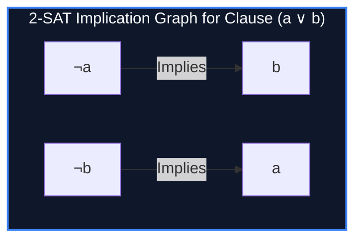

import { Callout } from "fumadocs-ui/components/callout";
import { Tabs, Tab } from "fumadocs-ui/components/tabs";
import { Steps, Step } from "fumadocs-ui/components/steps";
import { Cards, Card } from "fumadocs-ui/components/card";

## The Linear Boundary of Boolean Satisfiability

While 3-SAT is famously NP-complete, **Two-Satisfiability (2-SAT)** restricts each boolean clause to at most two literals:

$$\Phi = (x_1 \lor \neg x_2) \land (\neg x_1 \lor x_3) \land (x_2 \lor \neg x_3)$$

Through classical propositional logic, a disjunction $(a \lor b)$ is mathematically equivalent to two conditional implications:

$$a \lor b \iff (\neg a \implies b) \land (\neg b \implies a)$$

By constructing a directed **Implication Graph** where each boolean variable $x$ has two vertices ($x$ and $\neg x$) and implications form directed edges, 2-SAT is solvable in:

$$\mathcal{O}(V + E) \text{ deterministic linear time}$$



---

## The Satisfiability Theorem & Truth Assignment

> **Fundamental Theorem of 2-SAT:** A 2-CNF formula is satisfiable if and only if **no variable $x$ and its negation $\neg x$ belong to the same Strongly Connected Component (SCC)**!
> $$\forall i: \quad \text{SCC}(x_i) \neq \text{SCC}(\neg x_i)$$

### Deriving Valid Variable Assignments

Because Tarjan's algorithm produces SCC IDs in **reverse topological order**:

- If $\text{SCC}(x) < \text{SCC}(\neg x)$, then $\neg x$ appears earlier topologically than $x$.
- Assign $x = \text{True}$ if $\text{SCC}(x) < \text{SCC}(\neg x)$, and $x = \text{False}$ otherwise!

---

## Implementation

<Tabs items={["Python", "TypeScript", "C++"]}>
<Tab value="Python">
```python
from typing import List, Optional

class TwoSat:
def **init**(self, n: int):
self.n = n # Vertices: 2*x for x, 2*x + 1 for ~x (0-based)
self.adj = [[] for \_ in range(2 \* n)]

    def add_clause(self, u: int, val_u: bool, v: int, val_v: bool):
        # (u == val_u) or (v == val_v)
        node_u = 2 * u + (0 if val_u else 1)
        node_not_u = 2 * u + (1 if val_u else 0)
        node_v = 2 * v + (0 if val_v else 1)
        node_not_v = 2 * v + (1 if val_v else 0)

        # ~u => v and ~v => u
        self.adj[node_not_u].append(node_v)
        self.adj[node_not_v].append(node_u)

    def solve(self) -> Optional[List[bool]]:
        total_nodes = 2 * self.n
        tin = [0] * total_nodes
        low = [0] * total_nodes
        on_stack = [False] * total_nodes
        stack = []
        timer = 0
        scc_id = [0] * total_nodes
        scc_count = 0

        def dfs(u):
            nonlocal timer, scc_count
            timer += 1
            tin[u] = low[u] = timer
            stack.append(u)
            on_stack[u] = True

            for v in self.adj[u]:
                if not tin[v]:
                    dfs(v)
                    low[u] = min(low[u], low[v])
                elif on_stack[v]:
                    low[u] = min(low[u], tin[v])

            if low[u] == tin[u]:
                scc_count += 1
                while True:
                    node = stack.pop()
                    on_stack[node] = False
                    scc_id[node] = scc_count
                    if node == u:
                        break

        for i in range(total_nodes):
            if not tin[i]:
                dfs(i)

        assignment = [False] * self.n
        for i in range(self.n):
            if scc_id[2 * i] == scc_id[2 * i + 1]:
                return None  # Unsatisfiable contradiction
            # If scc_id[x] < scc_id[~x], x appears later in topological sort -> True
            assignment[i] = scc_id[2 * i] < scc_id[2 * i + 1]

        return assignment

````
</Tab>
<Tab value="TypeScript">
```typescript
export class TwoSat {
  private adj: number[][];

  constructor(private n: number) {
    this.adj = Array.from({ length: 2 * n }, () => []);
  }

  public addClause(u: number, valU: boolean, v: number, valV: boolean): void {
    const nodeU = 2 * u + (valU ? 0 : 1);
    const notU = 2 * u + (valU ? 1 : 0);
    const nodeV = 2 * v + (valV ? 0 : 1);
    const notV = 2 * v + (valV ? 1 : 0);

    this.adj[notU].push(nodeV);
    this.adj[notV].push(nodeU);
  }

  public solve(): boolean[] | null {
    const total = 2 * this.n;
    const tin = new Array(total).fill(0);
    const low = new Array(total).fill(0);
    const onStack = new Array(total).fill(false);
    const stack: number[] = [];
    const sccId = new Array(total).fill(0);
    let timer = 0, sccCount = 0;

    const dfs = (u: number) => {
      tin[u] = low[u] = ++timer;
      stack.push(u);
      onStack[u] = true;

      for (const v of this.adj[u]) {
        if (tin[v] === 0) {
          dfs(v);
          low[u] = Math.min(low[u], low[v]);
        } else if (onStack[v]) {
          low[u] = Math.min(low[u], tin[v]);
        }
      }

      if (low[u] === tin[u]) {
        sccCount++;
        while (true) {
          const node = stack.pop()!;
          onStack[node] = false;
          sccId[node] = sccCount;
          if (node === u) break;
        }
      }
    };

    for (let i = 0; i < total; i++) {
      if (tin[i] === 0) dfs(i);
    }

    const assignment = new Array(this.n).fill(false);
    for (let i = 0; i < this.n; i++) {
      if (sccId[2 * i] === sccId[2 * i + 1]) return null;
      assignment[i] = sccId[2 * i] < sccId[2 * i + 1];
    }

    return assignment;
  }
}
````

</Tab>
<Tab value="C++">
```cpp
#include <iostream>
#include <vector>
#include <algorithm>

class TwoSat {
int n;
std::vector<std::vector<int>> adj;

public:
explicit TwoSat(int numVariables) : n(numVariables), adj(2 \* numVariables) {}

    void addClause(int u, bool valU, int v, bool valV) {
        int nodeU = 2 * u + (valU ? 0 : 1);
        int notU = 2 * u + (valU ? 1 : 0);
        int nodeV = 2 * v + (valV ? 0 : 1);
        int notV = 2 * v + (valV ? 1 : 0);

        adj[notU].push_back(nodeV);
        adj[notV].push_back(nodeU);
    }

    bool solve(std::vector<bool>& assignment) {
        int total = 2 * n;
        std::vector<int> tin(total, 0), low(total, 0), sccId(total, 0), stk;
        std::vector<bool> onStack(total, false);
        int timer = 0, sccCount = 0;

        auto dfs = [&](auto& self, int u) -> void {
            tin[u] = low[u] = ++timer;
            stk.push_back(u);
            onStack[u] = true;

            for (int v : adj[u]) {
                if (!tin[v]) {
                    self(self, v);
                    low[u] = std::min(low[u], low[v]);
                } else if (onStack[v]) {
                    low[u] = std::min(low[u], tin[v]);
                }
            }

            if (low[u] == tin[u]) {
                sccCount++;
                while (true) {
                    int node = stk.back();
                    stk.pop_back();
                    onStack[node] = false;
                    sccId[node] = sccCount;
                    if (node == u) break;
                }
            }
        };

        for (int i = 0; i < total; ++i) {
            if (!tin[i]) dfs(dfs, i);
        }

        assignment.assign(n, false);
        for (int i = 0; i < n; ++i) {
            if (sccId[2 * i] == sccId[2 * i + 1]) return false;
            assignment[i] = sccId[2 * i] < sccId[2 * i + 1];
        }
        return true;
    }

};

```
</Tab>
</Tabs>

---

## Complexity Breakdown

| Step | Time Complexity | Space Complexity |
| :--- | :--- | :--- |
| **Implication Graph Construction** | $\mathcal{O}(V + C)$ where $C$ is clauses | $\mathcal{O}(V + C)$ directed edges |
| **Tarjan SCC & Assignment** | $\mathcal{O}(V + C)$ linear DFS | $\mathcal{O}(V)$ recursion stack |
```
