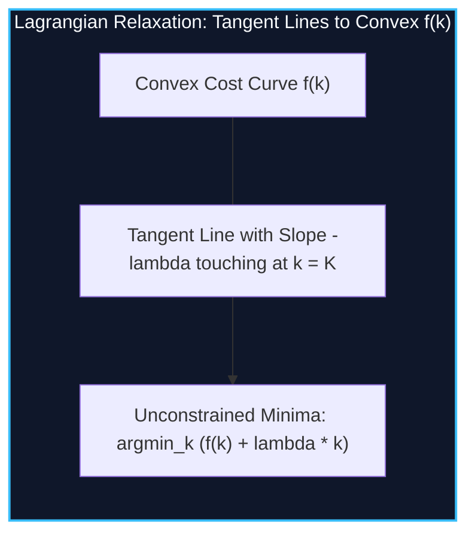

import { Callout } from "fumadocs-ui/components/callout";
import { Tabs, Tab } from "fumadocs-ui/components/tabs";
import { Steps, Step } from "fumadocs-ui/components/steps";
import { Cards, Card } from "fumadocs-ui/components/card";

## Eliminating the Cardinality Dimension

In problems such as _IOI 2016 Aliens_, you are asked to optimize an objective function subject to a strict cardinality constraint:

> "Select **exactly $K$** items / intervals to minimize (or maximize) total cost."

Including $K$ as an explicit state dimension ($dp[i][k]$) yields an $\mathcal{O}(N \cdot K)$ state space. When $N, K \le 10^5$, this requires $\mathcal{O}(N^2)$ time and memory, which will timeout.

**Lagrangian Relaxation (Aliens Trick)** removes the cardinality constraint entirely:

1. Attach a cost penalty (Lagrange multiplier $\lambda$) to every chosen item.
2. Solve the **unconstrained problem** in $\mathcal{O}(N)$ time:
   $$g(\lambda) = \min_{k} \{ f(k) + \lambda \cdot k \}$$
3. **Binary search for $\lambda$:** If optimal cost function $f(k)$ is strictly convex/concave, adjusting $\lambda$ controls the number of items chosen. When the unconstrained DP selects exactly $K$ items, the optimal value for the original problem is recovered as:
   $$\text{Answer} = g(\lambda) - \lambda \cdot K$$



---

## Preconditions for the Aliens Trick

The Aliens Trick applies if and only if the optimal cost $f(k)$ as a function of the number of chosen elements $k$ is **convex** (discrete second derivative non-negative):

$$f(k + 1) - f(k) \ge f(k) - f(k - 1)$$

---

## Implementation

<Tabs items={["Python", "TypeScript", "C++"]}>
<Tab value="Python">
```python
from typing import List, Tuple

def aliens_trick(n: int, target_k: int, unconstrained_solver) -> int:
"""
unconstrained_solver(penalty) -> (min_cost, count_items_used)
Binary searches penalty lambda to achieve exactly target_k items.
"""
low = 0
high = 10\*\*14 # Sized by maximum possible cost range
best_ans = 0

    while low <= high:
        mid_penalty = (low + high) // 2
        cost, count = unconstrained_solver(mid_penalty)

        if count >= target_k:
            # Penalty too low (too many items chosen) -> increase penalty
            best_ans = cost - mid_penalty * target_k
            low = mid_penalty + 1
        else:
            high = mid_penalty - 1

    return best_ans

````
</Tab>
<Tab value="TypeScript">
```typescript
export function aliensTrick(
  n: number,
  targetK: number,
  unconstrainedSolver: (penalty: bigint) => [bigint, number]
): bigint {
  let low = 0n;
  let high = 100000000000000n;
  let bestAns = 0n;

  while (low <= high) {
    const midPenalty = (low + high) / 2n;
    const [cost, count] = unconstrainedSolver(midPenalty);

    if (count >= targetK) {
      bestAns = cost - midPenalty * BigInt(targetK);
      low = midPenalty + 1n;
    } else {
      high = midPenalty - 1n;
    }
  }

  return bestAns;
}
````

</Tab>
<Tab value="C++">
```cpp
#include <iostream>
#include <cstdint>

template<typename SolverFunc>
int64_t aliensTrick(int n, int targetK, SolverFunc solver) {
int64_t low = 0, high = 1e14;
int64_t bestAns = 0;

    while (low <= high) {
        int64_t midPenalty = low + (high - low) / 2;
        auto [cost, count] = solver(midPenalty);

        if (count >= targetK) {
            bestAns = cost - midPenalty * targetK;
            low = midPenalty + 1;
        } else {
            high = midPenalty - 1;
        }
    }

    return bestAns;

}

```
</Tab>
</Tabs>

---

## Complexity Breakdown

| Dimension | Standard DP | With Aliens Trick |
| :--- | :--- | :--- |
| **State Space** | $\mathcal{O}(N \cdot K)$ | $\mathcal{O}(N)$ without cardinality |
| **Total Running Time** | $\mathcal{O}(N \cdot K)$ | $\mathcal{O}(N \log(\text{Max Penalty}))$ |
```
