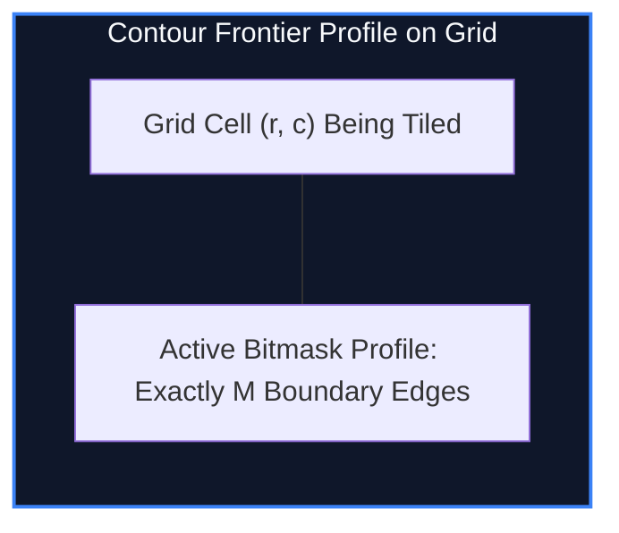

import { Callout } from "fumadocs-ui/components/callout";
import { Tabs, Tab } from "fumadocs-ui/components/tabs";
import { Steps, Step } from "fumadocs-ui/components/steps";
import { Cards, Card } from "fumadocs-ui/components/card";

## Transitioning Over Jagged Grid Boundaries

In standard grid bitmask DP, transitions advance an entire row at a time, requiring $O(M \cdot 2^{2M})$ states. When $M \ge 12$, iterating over row-to-row transitions is computationally infeasible.

**Broken Profile DP** (also known as Contour DP) transitions **cell by cell** ($r, c$) in row-major order:

- At any point in the computation, the grid is partitioned by a **jagged frontier boundary** separating processed cells from unprocessed cells.
- The boundary profile consists of exactly $M$ edges.



---

## Dominos Tiling Example

To count the number of ways to tile an $N \times M$ grid with $2 \times 1$ dominoes:

1. If the current cell $(r, c)$ is already covered (its bit in the profile mask is `1`), the only valid choice is to leave it empty and advance to the next cell.
2. If the current cell is empty (bit is `0`):
   - Place a vertical domino covering $(r, c)$ and $(r + 1, c)$.
   - Place a horizontal domino covering $(r, c)$ and $(r, c + 1)$ (if $c + 1 < M$).

Each cell transition takes $\mathcal{O}(1)$ time per mask, yielding:

$$\mathcal{O}(N \cdot M \cdot 2^M) \text{ total runtime}$$

---

## Implementation

<Tabs items={["Python", "TypeScript", "C++"]}>
<Tab value="Python">
```python
def domino_tiling_broken_profile(n: int, m: int) -> int:
    """
    Counts tilings of an N x M grid with 2x1 dominoes in O(N * M * 2^M) time.
    """
    if (n * m) % 2 != 0:
        return 0
    if n < m:
        n, m = m, n

    total_masks = 1 << m
    dp = [0] * total_masks
    dp[0] = 1

    for r in range(n):
        for c in range(m):
            nxt_dp = [0] * total_masks
            for mask in range(total_masks):
                if dp[mask] == 0:
                    continue

                if mask & (1 << c):
                    # Current cell is already occupied; move forward
                    nxt_dp[mask ^ (1 << c)] += dp[mask]
                else:
                    # Place vertical domino (covers cell below in next row)
                    if r + 1 < n:
                        nxt_dp[mask | (1 << c)] += dp[mask]
                    # Place horizontal domino (covers current cell and right neighbor)
                    if c + 1 < m and not (mask & (1 << (c + 1))):
                        nxt_dp[mask | (1 << (c + 1))] += dp[mask]

            dp = nxt_dp

    return dp[0]

````
</Tab>
<Tab value="TypeScript">
```typescript
export function dominoTilingBrokenProfile(n: number, m: number): number {
  if ((n * m) % 2 !== 0) return 0;
  if (n < m) {
    const temp = n; n = m; m = temp;
  }

  const totalMasks = 1 << m;
  let dp = new Array(totalMasks).fill(0);
  dp[0] = 1;

  for (let r = 0; r < n; r++) {
    for (let c = 0; c < m; c++) {
      const nxtDp = new Array(totalMasks).fill(0);
      for (let mask = 0; mask < totalMasks; mask++) {
        if (dp[mask] === 0) continue;

        if ((mask & (1 << c)) !== 0) {
          nxtDp[mask ^ (1 << c)] += dp[mask];
        } else {
          // Vertical domino
          if (r + 1 < n) {
            nxtDp[mask | (1 << c)] += dp[mask];
          }
          // Horizontal domino
          if (c + 1 < m && (mask & (1 << (c + 1))) === 0) {
            nxtDp[mask | (1 << (c + 1))] += dp[mask];
          }
        }
      }
      dp = nxtDp;
    }
  }

  return dp[0];
}
````

</Tab>
<Tab value="C++">
```cpp
#include <iostream>
#include <vector>
#include <cstdint>

int64_t dominoTilingBrokenProfile(int n, int m) {
if ((n \* m) % 2 != 0) return 0;
if (n < m) std::swap(n, m);

    int totalMasks = 1 << m;
    std::vector<int64_t> dp(totalMasks, 0);
    dp[0] = 1;

    for (int r = 0; r < n; ++r) {
        for (int c = 0; c < m; ++c) {
            std::vector<int64_t> nxtDp(totalMasks, 0);
            for (int mask = 0; mask < totalMasks; ++mask) {
                if (dp[mask] == 0) continue;

                if (mask & (1 << c)) {
                    nxtDp[mask ^ (1 << c)] += dp[mask];
                } else {
                    // Vertical
                    if (r + 1 < n) {
                        nxtDp[mask | (1 << c)] += dp[mask];
                    }
                    // Horizontal
                    if (c + 1 < m && !(mask & (1 << (c + 1)))) {
                        nxtDp[mask | (1 << (c + 1))] += dp[mask];
                    }
                }
            }
            dp = std::move(nxtDp);
        }
    }

    return dp[0];

}

```
</Tab>
</Tabs>

---

## Complexity Breakdown

| Method | Complexity | Memory |
| :--- | :--- | :--- |
| **Row-by-Row DP** | $\mathcal{O}(N \cdot 2^{2M})$ | $\mathcal{O}(2^M)$ |
| **Broken Profile DP** | $\mathcal{O}(N \cdot M \cdot 2^M)$ | $\mathcal{O}(2^M)$ single rolling profile |
```
