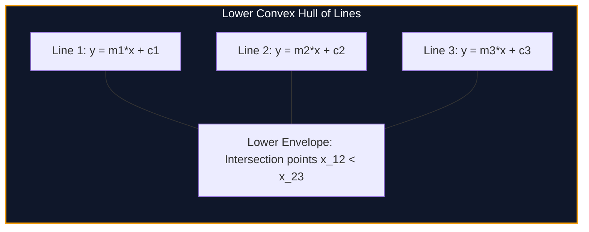

import { Callout } from "fumadocs-ui/components/callout";
import { Tabs, Tab } from "fumadocs-ui/components/tabs";
import { Steps, Step } from "fumadocs-ui/components/steps";
import { Cards, Card } from "fumadocs-ui/components/card";

## The Linear DP Form

Consider dynamic programming recurrences of the mathematical form:

$$dp[i] = \min_{j < i} \{ dp[j] + m_j \cdot x_i + c_j \}$$

where $x_i$ is a query point, $m_j$ is a slope determined by state $j$, and $c_j = dp[j]$ is an intercept constant.

Evaluating this recurrence naively requires scanning all $j < i$ for each $i$, demanding $\mathcal{O}(N^2)$ operations.

Notice that $y = m_j \cdot x + c_j$ is the **equation of a straight line**. For a fixed query coordinate $x_i$, minimizing over all candidate states $j$ is equivalent to finding the **minimum $y$-value among a set of lines at coordinate $x = x_i$**—the **Lower Convex Hull (Lower Envelope)** of lines!



---

## Intersection Invariant & Monotonic Deque

The $x$-coordinate of the intersection point between line $L_1(m_1, c_1)$ and line $L_2(m_2, c_2)$ is:

$$x_{\text{intersect}}(L_1, L_2) = \frac{c_2 - c_1}{m_1 - m_2}$$

When inserting line $L_3$ after $L_1$ and $L_2$ (where slopes are monotonically decreasing $m_1 > m_2 > m_3$):

- If $x_{\text{intersect}}(L_2, L_3) \le x_{\text{intersect}}(L_1, L_2)$, line $L_2$ is **redundant** and never contributes to the lower envelope! Pop $L_2$ off the deque.
- If query coordinates $x_i$ are also monotonically non-decreasing, optimal lines can be retrieved from the front of the deque in amortized $\mathcal{O}(1)$ time, reducing overall DP runtime to:
  $$\mathcal{O}(N) \text{ total time}$$

---

## Implementation

<Tabs items={["Python", "TypeScript", "C++"]}>
<Tab value="Python">
```python
from collections import deque
from typing import List

class Line:
**slots** = ('m', 'c')
def **init**(self, m: int, c: int):
self.m = m
self.c = c

    def eval(self, x: int) -> int:
        return self.m * x + self.c

class ConvexHullTrick: # Lower envelope: assumes slopes m are inserted in decreasing order (m1 > m2 > ...) # and queries x are non-decreasing (x1 <= x2 <= ...)
def **init**(self):
self.hull = deque()

    def _intersect_x(self, l1: Line, l2: Line) -> float:
        return (l2.c - l1.c) / (l1.m - l2.m)

    def add_line(self, m: int, c: int):
        new_line = Line(m, c)
        while len(self.hull) >= 2:
            if self._intersect_x(self.hull[-1], new_line) <= self._intersect_x(self.hull[-2], self.hull[-1]):
                self.hull.pop()
            else:
                break
        self.hull.append(new_line)

    def query_min(self, x: int) -> int:
        while len(self.hull) >= 2 and self.hull[0].eval(x) >= self.hull[1].eval(x):
            self.hull.popleft()
        return self.hull[0].eval(x)

````
</Tab>
<Tab value="TypeScript">
```typescript
interface Line {
  m: number;
  c: number;
}

export class ConvexHullTrick {
  private hull: Line[] = [];
  private head: number = 0;

  private intersectX(l1: Line, l2: Line): number {
    return (l2.c - l1.c) / (l1.m - l2.m);
  }

  public addLine(m: number, c: number): void {
    const newLine: Line = { m, c };
    while (this.hull.length - this.head >= 2) {
      const l2 = this.hull[this.hull.length - 1];
      const l1 = this.hull[this.hull.length - 2];
      if (this.intersectX(l2, newLine) <= this.intersectX(l1, l2)) {
        this.hull.pop();
      } else {
        break;
      }
    }
    this.hull.push(newLine);
  }

  public queryMin(x: number): number {
    while (
      this.hull.length - this.head >= 2 &&
      this.hull[this.head].m * x + this.hull[this.head].c >=
        this.hull[this.head + 1].m * x + this.hull[this.head + 1].c
    ) {
      this.head++;
    }
    const best = this.hull[this.head];
    return best.m * x + best.c;
  }
}
````

</Tab>
<Tab value="C++">
```cpp
#include <iostream>
#include <vector>
#include <cstdint>

struct Line {
int64_t m, c;
int64_t eval(int64_t x) const { return m \* x + c; }
};

class ConvexHullTrick {
std::vector<Line> hull;
size_t head = 0;

    double intersectX(const Line& l1, const Line& l2) const {
        return static_cast<double>(l2.c - l1.c) / (l1.m - l2.m);
    }

public:
void addLine(int64_t m, int64_t c) {
Line newLine{m, c};
while (hull.size() - head >= 2) {
const auto& l2 = hull.back();
const auto& l1 = hull[hull.size() - 2];
if (intersectX(l2, newLine) <= intersectX(l1, l2)) {
hull.pop_back();
} else {
break;
}
}
hull.push_back(newLine);
}

    int64_t queryMin(int64_t x) {
        while (hull.size() - head >= 2 && hull[head].eval(x) >= hull[head + 1].eval(x)) {
            head++;
        }
        return hull[head].eval(x);
    }

};

```
</Tab>
</Tabs>

---

## Complexity Breakdown

| Scenario | Slopes $m$ | Queries $x$ | Time Complexity | Data Structure |
| :--- | :--- | :--- | :--- | :--- |
| **Monotonic Deque** | Monotonic | Monotonic | $\mathcal{O}(N)$ | Double-ended queue (`std::deque`) |
| **Binary Search CHT** | Monotonic | Arbitrary | $\mathcal{O}(N \log N)$ | Vector + `std::lower_bound` |
| **Dynamic CHT** | Arbitrary | Arbitrary | $\mathcal{O}(N \log N)$ | `std::set` / Li Chao Tree |
```
