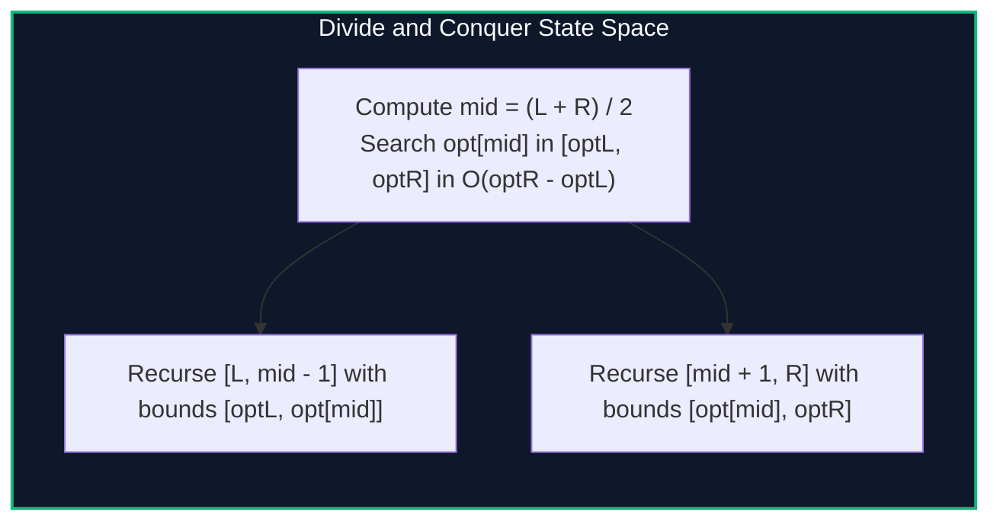

import { Callout } from "fumadocs-ui/components/callout";
import { Tabs, Tab } from "fumadocs-ui/components/tabs";
import { Steps, Step } from "fumadocs-ui/components/steps";
import { Cards, Card } from "fumadocs-ui/components/card";

## The Multi-Partition DP Recurrence

Consider partitioning an array of $N$ items into $K$ contiguous subarrays to minimize cost:

$$dp[i][j] = \min_{k < j} \{ dp[i - 1][k] + C(k, j) \}$$

Naively, filling an $K \times N$ matrix where each entry scans up to $N$ choices takes $\mathcal{O}(K \cdot N^2)$ time.

Let $opt[i][j]$ denote the optimal split index $k$ that minimizes the transition for state $(i, j)$.

> **Quadrangle Monotonicity Condition:** If $opt[i][j]$ satisfies:
> $$opt[i][j] \le opt[i][j + 1]$$
> (the optimal split index moves monotonically rightward as $j$ increases), the **Divide and Conquer DP Optimization** accelerates evaluation to:
> $$\mathcal{O}(K \cdot N \log N)$$



---

## When Does Monotonicity Hold?

Monotonicity of $opt[i][j]$ is guaranteed whenever the cost function $C(i, j)$ satisfies the **Quadrangle Inequality**:

$$C(a, c) + C(b, d) \le C(a, d) + C(b, c) \quad \forall a \le b \le c \le d$$

---

## Implementation

<Tabs items={["Python", "TypeScript", "C++"]}>
<Tab value="Python">
```python
from typing import List, Callable

def dc_dp_optimize(k_layers: int, n: int, cost_fn: Callable[[int, int], int]) -> List[int]:
dp_prev = [cost_fn(0, j) for j in range(n + 1)]
dp_curr = [float('inf')] \* (n + 1)

    def compute(l: int, r: int, opt_l: int, opt_r: int):
        if l > r:
            return
        mid = (l + r) // 2
        best_val = float('inf')
        best_k = opt_l

        for k in range(opt_l, min(mid, opt_r) + 1):
            val = dp_prev[k] + cost_fn(k, mid)
            if val < best_val:
                best_val = val
                best_k = k

        dp_curr[mid] = best_val

        # Recurse subproblems
        compute(l, mid - 1, opt_l, best_k)
        compute(mid + 1, r, best_k, opt_r)

    for _ in range(2, k_layers + 1):
        compute(1, n, 0, n)
        dp_prev, dp_curr = dp_curr, [float('inf')] * (n + 1)

    return dp_prev

````
</Tab>
<Tab value="TypeScript">
```typescript
export function dcDpOptimize(
  kLayers: number,
  n: number,
  costFn: (i: number, j: number) => number
): number[] {
  let dpPrev: number[] = Array.from({ length: n + 1 }, (_, j) => costFn(0, j));
  let dpCurr: number[] = new Array(n + 1).fill(Infinity);

  const compute = (l: number, r: number, optL: number, optR: number) => {
    if (l > r) return;
    const mid = (l + r) >> 1;
    let bestVal = Infinity;
    let bestK = optL;

    const limit = Math.min(mid, optR);
    for (let k = optL; k <= limit; k++) {
      const val = dpPrev[k] + costFn(k, mid);
      if (val < bestVal) {
        bestVal = val;
        bestK = k;
      }
    }

    dpCurr[mid] = bestVal;

    compute(l, mid - 1, optL, bestK);
    compute(mid + 1, r, bestK, optR);
  };

  for (let layer = 2; layer <= kLayers; layer++) {
    compute(1, n, 0, n);
    dpPrev = [...dpCurr];
    dpCurr.fill(Infinity);
  }

  return dpPrev;
}
````

</Tab>
<Tab value="C++">
```cpp
#include <iostream>
#include <vector>
#include <algorithm>
#include <cstdint>

template<typename CostFunc>
std::vector<int64_t> dcDpOptimize(int kLayers, int n, CostFunc cost) {
std::vector<int64_t> dpPrev(n + 1);
for (int j = 0; j <= n; ++j) dpPrev[j] = cost(0, j);
std::vector<int64_t> dpCurr(n + 1, 1e18);

    auto compute = [&](auto& self, int l, int r, int optL, int optR) -> void {
        if (l > r) return;
        int mid = l + (r - l) / 2;
        int64_t bestVal = 1e18;
        int bestK = optL;

        int limit = std::min(mid, optR);
        for (int k = optL; k <= limit; ++k) {
            int64_t val = dpPrev[k] + cost(k, mid);
            if (val < bestVal) {
                bestVal = val;
                bestK = k;
            }
        }
        dpCurr[mid] = bestVal;

        self(self, l, mid - 1, optL, bestK);
        self(self, mid + 1, r, bestK, optR);
    };

    for (int layer = 2; layer <= kLayers; ++layer) {
        compute(compute, 1, n, 0, n);
        dpPrev = dpCurr;
        std::fill(dpCurr.begin(), dpCurr.end(), 1e18);
    }

    return dpPrev;

}

```
</Tab>
</Tabs>

---

## Complexity Breakdown

| Layer Level | Total Work per Level | Total Complexity ($K$ layers) |
| :--- | :--- | :--- |
| Level $d$ in recursive tree | $\sum (optR - optL) = \mathcal{O}(N)$ | $\mathcal{O}(K \cdot N \log N)$ total time |
```
